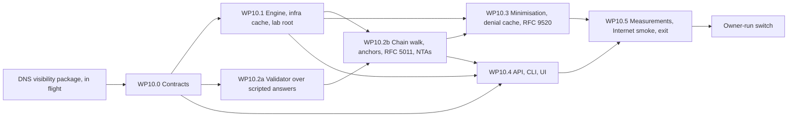

# Recursion plan: Tenko's own recursive resolver

- Status: Draft for the owner's review on 2026-10-22. Every decision of section 7 (REC-Q1 to REC-Q15) is a recommendation until the owner answers; the plan binds once the owner accepts it and then changes only through rule 2.8 of the execution plan. The owner's standing direction, single node first and cluster-aware (section 2.10 of [phase-2-plan.md](phase-2-plan.md)), binds this work; section 2.13 says how
- Date: 2026-10-22
- Scope: the "Recursive resolver" bullet of Phase 5 in [ROADMAP.md](../ROADMAP.md) (DNS-03, DNS-13, DNS-34), planned now at the owner's request of 2026-10-22 ("plan recursion in DNS, root servers and everything") so that it can be decided and built sooner than the ROADMAP says; where it sits in the order is REC-Q1. Written against `main` at `86518fd`, with Phase 2 closed ([phase-2-exit.md](phase-2-exit.md)) and Phase 3 in its first slice ([phase-3-status.md](phase-3-status.md)). Requirement IDs refer to [REQUIREMENTS.md](../REQUIREMENTS.md), toggles (TGL) and never-off items (NEVER) to [SECURITY-PROFILES.md](../SECURITY-PROFILES.md), RFC targets to [CONFORMANCE.md](../CONFORMANCE.md). Exit criteria, measurements and risks continue the series of Phase 3 (E33 onward, M36 onward, R72 onward) so that one trace covers the project.

This plan does for the recursive resolver what [phase-3-plan.md](phase-3-plan.md) does for DHCP: the goal, the exit criteria as checks, one slice, the contracts the packages share, the work packages with owners and acceptance, the order of merging, the measurements, the risks and the decisions only the owner can take. "(proposed)" marks a choice the documents leave open. Sizes: S up to one builder-week, M one to three, L three to six.

Contents:

1. [Scope and exit](#1-scope-and-exit)
2. [Design decisions the packages share](#2-design-decisions-the-packages-share)
3. [Contracts and shared files (WP10.0)](#3-contracts-and-shared-files-wp100)
4. [Work packages](#4-work-packages)
5. [Order, parallelism and merging](#5-order-parallelism-and-merging)
6. [Measurements and exit checks](#6-measurements-and-exit-checks)
7. [Owner decisions](#7-owner-decisions)
8. [Risks](#8-risks)
9. [Owner actions](#9-owner-actions)
10. [Documents this slice writes](#10-documents-this-slice-writes)

## 1. Scope and exit

### 1.1 Goal

Tenko resolves names itself: a node with the `dns` role answers a name outside its zones by asking the root servers, then the servers of each delegation down to the authority of the name, with no upstream resolver in between (DNS-03); it validates what it gets with DNSSEC from the root trust anchors it ships and keeps current (DNS-13); it asks each server for as little as the step needs (QNAME minimisation) and answers names it can prove absent from its cache without asking anyone (RFC 8198; DNS-34). The forwarder of Phase 2 stays: a rule that names an upstream still forwards, a stub zone still asks its servers, and a view decides whether its clients recurse, forward or are refused. The reference home-lab environment (three LANs and a DMZ behind a UniFi gateway, AD-integrated Windows DNS and DHCP today) ends the slice with Tenko as the only resolver of its networks, forwarding only the Active Directory zone to the domain controllers, as the owner-run step.

The ROADMAP puts this in Phase 5 and ADR 0007 says why it came after the forwarder: a large, security-sensitive component with little benefit over forwarding for the first deployments. The first deployment now exists and the owner's backlog of the test drive (2026-10-18) asks for recursion so that no second resolver is needed beside Tenko. ADR 0021 ([0021-recursive-resolution-and-validation.md](../adr/0021-recursive-resolution-and-validation.md), Proposed) supersedes the "later" part of ADR 0007 and records the design.

The slice builds and measures a **single node**: one process with the `controller` and `dns` roles. Nothing in a recursive resolver needs a second Tenko node; what Phase 5 adds is a `dns` node without a controller that validates with the trust anchors it receives through node sync (section 2.13).

### 1.2 Exit criteria

E33 to E42 are what DNS-03, DNS-13 and DNS-34 make testable, plus the owner-run step. Every check runs against the lab's own root (section 2.12): no benchmark and no acceptance test touches the real root servers.

| # | Check | Requirements | Package |
|---|---|---|---|
| E33 | Validation from the lab root: a name in a zone signed by Tenko and one in a zone signed by BIND answer with AD through a DS chain from the lab root's trust anchor (NSEC and NSEC3, a wildcard, an opt-out delegation, NODATA and NXDOMAIN proofs); a bogus zone (a DS that matches no key, a wrong signature, an expired signature) answers SERVFAIL with the extended error of RFC 8914 that names the fault, and the same name with CD set answers its data with AD clear; an unsigned zone under a signed parent answers with AD clear and no error; a negative trust anchor for the bogus zone lets it through, with its audit record, and stops letting it through when it expires | DNS-13, OPS-09 | WP10.2 |
| E34 | An RFC 5011 roll of the lab root's KSK (a new key published, the hold-down time passed, the old key revoked) is followed by the node without an operator: the new anchor is Valid in the trust anchor table before the old one is revoked, the state changes are audited, and validation never fails during the roll; a node started from a backup taken before the roll follows it on start | DNS-13 | WP10.2 |
| E35 | On the wire: the lab TLD's query log shows only the labels QNAME minimisation sends for a name three labels below it, never the full name; after one NXDOMAIN whose NSEC (and, in the NSEC3 zone, whose NSEC3) covers a range, a second name in that range is answered NXDOMAIN with no query to the authority (the authority's log shows none), the same for NODATA and for a wildcard; names below a cached NXDOMAIN are NXDOMAIN (RFC 8020) | DNS-34 | WP10.3 |
| E36 | Priming at start from the shipped hints and from a hints file, and again before the root NS set expires; the resolver survives, within its work budget and with SERVFAIL and the extended error that names the cause: a lame delegation, a delegation whose name servers point at each other without glue, a CNAME loop, a TLD whose servers do not answer, a server that breaks 0x20, one that answers FORMERR to EDNS, one that truncates everything, and a referral with out-of-bailiwick glue; the failure of each is cached per RFC 9520 and the counts of queries sent are documented | DNS-03, DNS-08 | WP10.1 |
| E37 | resperf and dnsperf against the lab root from the load VM, on the musl binary, cold cache and warm, with and without validation: resolutions per second at a fixed latency budget documented (M36, M37, M38) | DNS-03, DNS-27 | WP10.5 |
| E38 | Idle RSS below 100 MB with every role, the home zones, a full answer cache and the infrastructure cache after a run of 100,000 distinct names, on the musl binary, one node; the infrastructure cache stays within its bound | OPS-15 | WP10.5 |
| E39 | The Internet smoke, observational: the owner's networks resolve through Tenko alone with no upstream for a day (a DoT root rule kept ready as the one-command fallback), the AD zone forwarded to the domain controllers, validation on; the dashboard's SERVFAIL share, p50 and p99, cache hit ratio and sub-query counts are recorded; then the owner-run switch of section 9 | DNS-03, DNS-13, DNS-02, TGL-22 | WP10.5 (owner-run) |
| E40 | Fuzz targets for every new parser of network data (referrals and glue, DNSKEY, DS, RRSIG, NSEC and NSEC3 in the validator, the trust anchor file) run in the weekly fuzz smoke; the counting-allocator test still binds steps 1 to 7 of the query path, now with a validated cache hit, a hit for a client without DO, a hit on a bogus entry and a synthesised NXDOMAIN | API-14, API-15 | WP10.1, WP10.2, WP10.3 |
| E41 | The RPZ triggers NSDNAME and NSIP, which a forwarding resolver cannot match ([dns-resolver.md](../dns-resolver.md) section 5.2), match in the lab for a name whose delegation the resolver followed | DNS-21 | WP10.1 |
| E42 | The conformance rows this plan adds to CONFORMANCE.md are Implemented or Partial with test references, and the exit document records every criterion's state | API-17 | WP10.5 |

### 1.3 The slice

One slice, numbered after Phase 3's: **Slice 10, the recursive resolver**. Phase 4's slices start at 11. Where the slice runs in the calendar is REC-Q1.

| Slice | Content | Closes |
|---|---|---|
| 10. The recursive resolver | The contracts (trust anchors, negative trust anchors, the resolution mode of views and rules, the cache entry with its validation state); the iterative engine with the infrastructure cache and the lab root; validation with RFC 5011 and negative trust anchors; QNAME minimisation, aggressive NSEC, RFC 8020 and RFC 9520; the API, CLI and UI; the measurements, the Internet smoke and the exit document; the owner-run switch | E33 to E42 |

### 1.4 Requirements

| Requirement | What this slice delivers | Phase today |
|---|---|---|
| DNS-03 Own full recursive resolver | The iterative engine, the infrastructure cache, priming, the work budget, the special-use names, cookies and TCP to authorities (WP10.1); the API, CLI and UI (WP10.4); the measurements (WP10.5) | 5, Should (REC-Q1 proposes the change) |
| DNS-13 DNSSEC validation with RFC 5011 and negative trust anchors | The validator, the chain walk, the security states, the trust anchor service, RFC 5011, negative trust anchors (WP10.2); TGL-12 gains its values | 5, Must |
| DNS-34 QNAME minimisation and aggressive use of the validated cache | WP10.3 | 5, Should |
| DNS-02 Forwarder and cache | Unchanged in what it does; gains the `recurse` mode of a rule and the resolution mode of a view (section 2.7) | 2, delivered |
| DNS-08 Source port and 0x20 randomisation | Applied to queries to authorities as to upstreams, with the stricter port policy of section 2.1 | 2, delivered |
| DNS-21 RPZ | NSDNAME and NSIP triggers become matchable (E41) | 2, delivered |
| DNS-23 Cache | The entry gains its validation state and the record kinds; the key loses DO and CD (section 2.2); serve-stale and prefetch unchanged | 2, delivered |
| TGL-22 Recursion and forwarding ACL | Unchanged: the same list decides who may recurse, whatever the route | 2, delivered |
| OPS-15, OPS-21 | The infrastructure cache under the memory target; metrics without allocation on the query path | 1, delivered |

### 1.5 Carried items

| Item | Where |
|---|---|
| Owner backlog of the test drive (phase-2-status.md, 2026-10-18): "Full recursion in Tenko itself" | This plan |
| Phase 2 exit deviation 88 (no recursion of its own) | Closed by E39 |
| Phase 2 exit deviation 89 (upstream round-trip time and health not shown) | The DNS visibility package now in flight adds per-upstream RTT, EWMA and p50/p99 to the pool and a blocking view; this plan reuses that bookkeeping for authorities (section 2.1) and does not redo it |
| `AnswerBuf::authenticated` and `Request::ad`, present since WP4.0 and set by nothing | WP10.2 sets AD from the validation state |
| The note "AD clear (no validation in Phase 2)" in `cache.rs` and the keying of the cache on DO and CD | WP10.0 changes the key and the entry (section 2.2) |
| NSDNAME and NSIP triggers of RPZ, documented as unmatchable by a forwarding resolver | E41 |
| TGL-12 "DNSSEC validation", listed for Phase 5 with the note that validation is the upstream resolver's job | WP10.2; the SECURITY-PROFILES.md note is removed by the lead (section 7) |

### 1.6 Left out, with reasons

| Item | Reason | Goes to |
|---|---|---|
| RFC 7871 client subnet | REC-Q11 recommends never: it leaks client prefixes to authorities, OPS-06 counts it as personal data, and views already select by the query's source | Not built unless the owner decides otherwise |
| RFC 6147 DNS64, RFC 9539 opportunistic encryption to authorities | REC-Q14: later, with the hooks named in section 2.9 | Phase 5 |
| RFC 8806 local root | REC-Q7: an option after the engine, not the default; needs a zone kind flag the engine does not have | A later package (section 2.5) |
| DoQ to authorities (DNS-16) | Phase 5 by the requirement; no authority speaks it yet | Phase 5 |
| A `dns` node without a controller that validates with synced anchors; the cluster labs | Single node first (section 2.13); the subset is declared | Phase 5 |
| Query-log and dnstap records of the queries the resolver sends (`RESOLVER_QUERY`, `RESOLVER_RESPONSE`) | The query log is the clients' log (OPS-06); the resolver's own traffic is in the metrics and the infrastructure cache view; dnstap resolver messages can follow when a collector asks for them | Later, if needed |
| A second resolver beside the node for the household | The cluster data plane of Phase 5; the fallback at home is the DoT root rule, one command (section 9) | Phase 5 |

### 1.7 Starting point in the code

Facts the packages build on, read on `86518fd` (the paths are `crates/tenko-dns/src/` unless said otherwise):

- **The hand-off.** A query outside the zones with RD set becomes `Resolution::Forward{view, rule}` in `authoritative.rs`; `Responder::respond` asks the `ForwardSink` (`respond.rs`: `intake`, then `submit`) on the worker, where the recursion access list of the view, the "no route" refusal and the cache hit are decided without allocating; a miss copies the query (`message.to_vec()`) and hands it to the forwarder, which runs on the tokio runtime: a queue of 4,096, 1,024 in flight behind a semaphore, one task per query (`forward.rs`). The answer goes back through the transport's reply path (the worker's UDP socket, or the TCP writer task). The counting-allocator test (`tests/alloc.rs`) binds parse, build, the index lookup, the full authoritative path, the cache hit with a recursion list, the policy and the limiter, and TSIG; it does not measure the miss path, by design.
- **Outbound.** `outbound.rs`: a query built per attempt with a random id, RD and CD copied from the client, an OPT of 1,232 octets with the client's DO bit and no options; 0x20 over the first 256 letters, checked on the answer (`check_answer`, exact case); sockets bound to a random port above 1023 (eight tries, then port 0), kept per local address (64 idle), each reused for at most 64 exchanges and one minute; a socket per exchange, answers from another address discarded. No outstanding-query table: the exchange owns its socket. IPv4 and IPv6 by the upstream's family. `upstream.rs`: TCP on TC with a new connection, DoT with four idle streams, DoH over one HTTP/2 connection.
- **The pool.** `pool.rs`: per member `srtt` (an eighth-weight moving average, doubled on failure), failures, back-off (three failures, 1 s doubling to 60 s), 0x20 strikes (two, then lower case); the choice by lowest SRTT with one probe in 16; a set holds at most 32 members (a bitmask of the tried ones); SERVFAIL and REFUSED move on with the answer kept as the fallback. The DNS visibility package in flight adds the EWMA and the p50 and p99 per upstream and the status views; WP10.1 waits for its merge (section 5).
- **Stub zones** (`forward.rs`, `Shared::learn`) already do a small part of recursion: the NS set asked without RD, the glue read (`parse_ns`, `addresses_in`), missing addresses looked up through the forwarder's own routes, a TTL clamped to 30 s to a day. The referral and glue readers are the building blocks of the engine.
- **The cache** (`cache.rs`): the key is a stack buffer of the view, type, class, a flags byte with DO and CD, and the lowercase name; the entry is the upstream's message with the OPT stripped and the TTL offsets kept; up to 64 shards with a least-recently-used list each, bounded by entries and octets; a hit copies the message into the worker's buffer with the TTLs lowered, AD always clear; serve-stale and prefetch; the flush and the listing (`cache/list.rs`) decode entries for the API. No RRset-level cache, no infrastructure cache, no validation state.
- **Cookies** (`cookie.rs`): the server cookie handed to clients follows RFC 9018 (SipHash-2-4, version 1, a daily secret with the previous one still valid); nothing is sent to upstreams.
- **DNSSEC** (`dnssec/`): `crypto.rs` signs and verifies algorithms 13 and 15 through `aws-lc-rs` (`verify(algorithm, public key, message, signature)` exists and returns false for every other algorithm), computes key tags and SHA-256 DS records; `canonical.rs` builds the signed data of RFC 4034 section 3.1.8.1 over Tenko's stored lowercase wire form (class IN hard-coded, no canonicalisation of names inside record data, which the stored rows do not need and answers from authorities do); `chain.rs` hashes NSEC3 owners in fixed buffers (SHA-1 through the legacy interface, tested against the RFC 5155 vectors) and encodes base32hex. No chain walk, no trust anchor store, no DS comparison, no NSEC proof logic, no RSA, no P-384, no Ed448, no SHA-1 or SHA-384 digests. `aws-lc-rs` 1.18 provides RSA PKCS#1 v1.5 with SHA-1 (legacy interface), SHA-256 and SHA-512, ECDSA P-384 and the SHA-1 and SHA-384 digests; it does not provide Ed448.
- **Crates.** `domain` is pinned at exactly 0.12.3 with the `std` feature only (ADR 0017 point 9); the validator module `domain` carries behind an `unstable-validator` feature in its 0.12 line is not compiled (REC-Q4 decides whether it is used). `hickory-proto` 0.26.3 is a dev-dependency for the differential tests.
- **Metrics and the log.** The forwarder's families are `tenko_dns_cache_*`, `tenko_dns_upstream_queries_total{rule,upstream,transport,outcome}` and `tenko_dns_upstream_rtt_seconds{upstream}`; the query log entry has `cached` and `blocked` and nothing about how the answer was found.
- **The lab** (`deploy/compose/lab-dns`): BIND 9.20 as the authority of `example.test` (unsigned, 5 s TTLs), one Tenko node, a client container; rounds `plain`, `dot`, `doh`, `xfr`, `update` and the serve-stale steps. Nothing signs, nothing delegates, nothing talks to a root.
- **The bench** (`bench/phase2-dns`): the load generator, `zonegen`, the M17 remote driver over the two lab VMs (the node VM with 4 vCPU, the load VM with 8, 0.4 ms apart), the musl rule, dnsperf and flamethrower installed by hand on the load VM; resperf comes with dnsperf's package and is not installed yet.
- **The role** (`crates/tenko/src/serve/dns.rs`): the forwarder is started in the `dns` start step with its settings, the policy sink around it and the recursion policy watcher; the DHCP builders own `crates/tenko/src/serve/**` for Phase 3 except one marked block in `dns.rs` (section 4).
- **Trace.** `scripts/requirement-trace.mjs` traces Phases 1 to 3 from their plan files; the exit criteria of this plan are not read by it (section 10).

## 2. Design decisions the packages share

These are the choices the packages assume. Section 7 records the recommendations; ADR 0021 records the design.

### 2.1 The resolution algorithm

The engine is the algorithm of RFC 1034 section 5.3.3 as resolvers run it today, with the defences every resolver has needed since the Kaminsky attacks of 2008:

- **Priming (RFC 8109).** At start the resolver asks `./NS` without RD, with EDNS and DO, of a root server from the hints (the shipped file, or `[dns.recursion] hints`), and keeps the NS set and the addresses of the answer as the root's delegation in the infrastructure cache; it primes again before the NS set's TTL runs out and after a hints change, and when priming fails it keeps the hints as the servers to ask and tries again with back-off. A node whose hints name no reachable server answers SERVFAIL with extended error 22 ("No Reachable Authority") for every recursed name and shows `dns.recursion.priming_failed` in its health.
- **Referral following.** For a name, the resolver takes the closest delegation it holds (the longest suffix with a known NS set, the root at worst), asks one of its servers, and reads the answer as RFC 2181 section 5.4 ranks it: an authoritative answer section first, then an authoritative authority section, then glue. A referral (no answer, NS records in the authority section at or below the zone it asked, not above) moves the resolver down; its NS set is cached under the child's name and its glue under the bailiwick rule: addresses are taken from the additional section only for name servers whose names are at or below the delegated zone (in-domain glue of RFC 9471); addresses of sibling glue (a name server in a sibling zone of the same parent) are used for this step and marked unconfirmed until an answer for them comes from their own authority; every other address in the additional section is ignored. An answer whose records are above the zone the server was asked for is ignored for the cache (the server may still be used for the step).
- **Name-server addresses.** A name server without usable glue gets its A and AAAA looked up as sub-queries through the same engine, at most three such lookups at a depth, then two, then one, then none (Unbound's fetch policy) and at most six levels deep; a delegation whose every server needs a lookup that itself needs this delegation is a loop, answered SERVFAIL with extended error 22.
- **CNAME and DNAME.** A CNAME in the answer restarts the resolution for the target, at most eight restarts per client query (`MAX_CHAIN` of the index applies to the zones, the same limit here); a DNAME synthesises the CNAME as RFC 6672 says; a loop is answered as the index answers one inside its zones: the chain so far with SERVFAIL. The answer to the client carries the whole chain with every CNAME's own TTL and validation state.
- **The work budget per client query** (REC-Q12): at most 32 queries sent to authorities (sub-queries included), 8 restarts, 6 levels of name-server lookups, 3 attempts per server, 10 s of wall clock from the hand-off; when any bound is hit the answer is SERVFAIL with extended error 22 or 23 ("Network Error") and the failure is cached (RFC 9520, section 2.2); the counters say which bound. The in-flight limit of the forwarder (1,024) and its queue (4,096) stay the outer bounds; identical client queries in flight (same name, type, class and view) are joined to one resolution, so a burst of one name costs one resolution, and the join table is what defeats the birthday attack on outstanding queries.
- **Server selection.** A delegation's servers form a pool as a rule's upstreams do: the pool's SRTT, failures, back-off and 0x20 strikes, with the visibility package's EWMA and percentiles, keyed by the server address rather than the rule; a server unknown to the pool counts as fastest and is measured first; the timeout of an attempt is derived from the SRTT (four times it, at least 300 ms, at most `[dns.recursion] timeout_ms`, 2,000 by default), so a lame or slow server costs little. A server that answers REFUSED or SERVFAIL for a zone, or a non-authoritative answer where an authoritative one was due, is lame for that zone for the infrastructure cache's TTL and skipped while another server exists.
- **EDNS and the fallback ladder.** Every query carries EDNS with 1,232 octets and DO (validators always ask for signatures, RFC 3225); a server that answers FORMERR or NOTIMP to EDNS is asked once without it and marked EDNS-less for the infrastructure TTL (RFC 6891 section 6.2.2); a timeout is never a reason to drop EDNS (DNS flag day 2019, RFC 8906); a truncated answer is asked again over TCP (RFC 7766, RFC 9210) and a server that truncates every answer is marked TCP-only. There is no step to 4,096 or 512: 1,232 is the one size.
- **Cookies to authorities (RFC 7873, RFC 9018).** Every query carries a client cookie (8 octets from the node's secret over the server address); a server cookie that comes back is kept per server in the infrastructure cache and sent from then on; BADCOOKIE is answered by asking again with the new cookie, once; a server that never returns a cookie costs nothing. Cookies are what make a plain UDP exchange hard to spoof without TCP; together with 0x20 (kept, exact case checked) and port randomisation they are the three defences of DNS-08.
- **Source ports.** The outbound layer reuses a socket for 64 exchanges; for authorities the resolver asks for a fresh port per exchange from the same layer (`SOCKET_USES` becomes a parameter of the socket set: 1 for authorities, 64 for upstreams), so that an attacker who saw one exchange learns nothing about the next; the cost is a bind per query, measured by M36, with the 64-use policy as the fallback if the bind costs more than 5 percent.
- **Unwanted answers.** An answer that matches nothing outstanding (wrong id, wrong question, wrong case) is counted per server; above 1,000 in an hour the server is asked over TCP for that hour and the count is in the health view; above 100,000 across the node in an hour the answer cache is flushed, as Unbound's `unwanted-reply-threshold` does, and the event is audited (`dns.recursion.unwanted_flush`).
- **IPv4 and IPv6 outbound** (REC-Q9): both families by default; a server is asked on its fastest address; on a node without a global IPv6 address every IPv6 address fails at once and is marked unreachable for the infrastructure TTL, re-probed every six hours, so a v4-only node pays one failure per server per six hours; `[dns.recursion] outbound` forces `v4`, `v6` or `both`. A v6-only node resolves only zones with an IPv6 name server, which is what such a node can reach.
- **Special-use and locally served names** (RFC 6761, RFC 6303, RFC 8375, RFC 7686): `localhost`, `invalid`, `test`, `example`, `onion`, `home.arpa`, `local`, and the reverse zones of the RFC 1918, link-local, loopback, documentation and ULA ranges never reach an authority: a zone or a rule of the node answers them, else the resolver answers NXDOMAIN (or an empty NOERROR for the reverse zones, as RFC 6303 says) with AD clear, counted as `local`. `test` and `example` are the lab's names: the lab configuration lists `test` as an exception (`[dns.recursion] local_zones_except`), which Lab allows.

### 2.2 The caches

Three caches, two of them new, all per node and bounded per profile:

- **The answer cache** (exists). The key loses the DO and CD bits: there is one entry per view, name, type and class, holding the authority's answer with its signatures (every query to an authority carries DO) and its **validation state** (`secure`, `insecure`, `bogus`, `indeterminate`, or `unvalidated` when validation is off). The entry gains the offsets of its RRSIG records, so a hit for a client without DO copies the message skipping them (and lowers the counts), and a bogus entry answers a client with CD clear as SERVFAIL with the stored extended error and a client with CD set with the data; a secure entry sets AD for a client that asked with AD or DO. A positive entry's lifetime is the smallest TTL capped by the earliest signature expiry (RFC 4035 section 4.5); a bogus entry lives for the failure time of RFC 9520 (below). All of this happens on the worker in the fixed buffer, and the counting-allocator test proves it (E40). The listing of `cache/list.rs` shows the state per entry; `dnssec_ok` and `checking_disabled` leave the listing, since they are no longer part of the key. Serve-stale and prefetch are unchanged; a stale entry keeps its state. The forwarder's entries (from a rule's upstream) are `unvalidated` unless the upstream's answer is validated by WP10.2 as well (REC-Q3: validation applies to forwarded answers too, as Unbound and BIND validate what a forwarder returns, so a Home node that keeps a DoT rule still validates).
- **The infrastructure cache** (new, `tenko_dns::infra`). Per zone cut: the NS set with its TTL and the DS state once validated (secure with the validated key set, insecure with the proof's expiry, bogus); per name server name: the addresses with their TTLs and whether they came from glue, sibling glue or an authoritative answer; per server address: the SRTT and the pool bookkeeping, the EDNS and TCP capabilities, the server cookie, the lameness per zone, the unwanted count, the time of the last failure. Bounds: 1,000 zone cuts and 2,000 server addresses under Home, 10,000 and 20,000 under the others, least recently used out; the infrastructure TTL (`[dns.recursion] infra_ttl_secs`, 900 as Unbound's) bounds how long a learnt capability or lameness holds. It is read on the runtime only, never on the worker, so it may allocate and lock freely. The node status shows its size and the API lists it (`GET /nodes/{id}/dns/infra`, a page per zone cut, audited as a cache read is not: it holds no client data).
- **The failure cache** (RFC 9520, in the answer cache as a kind of entry). A resolution that ends in SERVFAIL for a cause of the server's (no reachable authority, budget exhausted, bogus) is cached for 5 s, doubling on each repeat up to 5 minutes, and answered SERVFAIL with the same extended error until then; a cause of the client's (FORMERR of the question) is not cached. The entry is flushed with the cache, and `dns.cache.flush` with a suffix removes it.
- **The denial cache** (RFC 8198, WP10.3, `tenko_dns::cache::denial`). Validated NSEC and NSEC3 records with their SOA, per zone, in canonical order (NSEC by owner, NSEC3 by hashed owner within the zone's parameters), each with its TTL and the signatures the synthesised answer must carry for a DO client; bounded by entries (2,000 under Home, 20,000 under the others). The lookup on the worker: for a name whose answer cache has nothing, the closest enclosing zone with a denial cache is found, the covering record for the name and, for NXDOMAIN, for the wildcard at the closest encloser are looked up under the shard's lock without allocating (NSEC3 hashing in the fixed buffers of `chain.rs`, at most the iteration cap of RFC 9276), and NXDOMAIN, NODATA or the wildcard answer is synthesised in the worker's buffer with the SOA and the proofs. RFC 8020 is the same lookup for a cached NXDOMAIN of an ancestor in an unsigned zone (the NXDOMAIN entry itself, applied to the names below it). A miss falls through to the runtime as today.

### 2.3 Validation

The validator (`tenko_dns::validate`, WP10.2) sits on the runtime between the authority's answer and the cache insert; the worker never validates and never verifies a signature. It is Tenko's own code over the signer's canonical form, crypto and NSEC3 hashing (REC-Q4):

- **The chain walk.** For the owner of an RRset the validator finds the nearest trust anchor at or above it (the root by default; an operator anchor for a private zone is allowed), then walks down: at each cut it asks the parent for DS (a sub-query, counted in the budget), validates the DS set with the parent's keys, fetches the child's DNSKEY set and validates it against the DS (key tag, algorithm, digest: SHA-256 and SHA-384, SHA-1 accepted for validation as RFC 8624 requires, never used by the signer), then validates the RRset with the child's keys. Validated key sets are kept in the infrastructure cache per zone until the smaller of their TTL and signature expiry, so a second name in a zone costs no DS or DNSKEY query. A cut whose DS is proven absent (an NSEC or NSEC3 proof from the parent, opt-out included) makes the child and everything below it `insecure`; a zone whose DS names only algorithms or digests the validator does not support is `insecure`, never bogus (RFC 4035 section 5.2, RFC 6840 section 5.2).
- **Algorithms (RFC 8624).** Validation of RSASHA1 (5), RSASHA1-NSEC3-SHA1 (7), RSASHA256 (8), RSASHA512 (10), ECDSAP256SHA256 (13), ECDSAP384SHA384 (14) and ED25519 (15); DS digests SHA-1 (1), SHA-256 (2) and SHA-384 (4). ED448 (16) and the GOST algorithms (12, 23) are unsupported, so zones signed with them alone are insecure; RSAMD5 (1) and DSA (3, 6) are unsupported as RFC 8624 says they must be. The signer keeps signing with 13 and 15 only (ADR 0018). `crypto.rs` gains the RSA and P-384 verification and the two digests through `aws-lc-rs`; nothing else is added to the dependency tree.
- **Proofs.** NSEC: the covering record for a name, the closest encloser, the wildcard proof, the NODATA proof with the type bitmap (RFC 4035 section 5.4, RFC 6840 section 4); NSEC3: the same with hashed owners, opt-out (a delegation under an opt-out span is insecure), the iteration cap (RFC 9276: above 100 iterations the zone is treated as insecure, above 500 the answer is SERVFAIL with extended error 27). The proof logic is table-driven and tested against the examples of RFC 4035 appendix and RFC 5155 appendix B and the lab's zones.
- **States and the wire.** `secure`: AD set when the client asked with AD or DO. `insecure`: AD clear. `bogus`: SERVFAIL with the extended error that names the fault (6 "DNSSEC Bogus", 7 "Signature Expired", 8 "Signature Not Yet Valid", 9 "DNSKEY Missing", 10 "RRSIGs Missing", 11 "No Zone Key Bit Set", 12 "NSEC Missing", 1 and 2 for unsupported algorithms and digests where they make a chain bogus rather than insecure, 27 for the NSEC3 iterations) unless the client set CD, which gets the data with AD clear. `indeterminate` (no anchor covers the name): AD clear, no error, extended error 5 "DNSSEC Indeterminate" in the OPT. With validation off (Lab) every entry is `unvalidated`, AD clear, signatures passed to DO clients as today.
- **CD.** A query with CD set still runs the validator (so the cache state is right for the next client) and never waits for a DS or DNSKEY sub-query that the resolution did not need; its answer is the data whatever the state.
- **Cost caps (the KeyTrap class, CVE-2023-50387).** At most 8 signature verifications per RRset, at most 16 DNSKEY candidates per key tag, at most 4 NSEC3 hash computations per proof step, at most 32 verifications per client query; beyond a cap the answer is bogus with extended error 6 and the zone is counted in `tenko_dns_validation_total{state="bogus",reason="cap"}`. Colliding key tags cost at most the cap.
- **Negative trust anchors (RFC 7646).** A row `dns.ntas` names a zone, an expiry (at most 7 days; required under Hardened, TGL-12), a reason and the principal; names at or below it are `insecure` instead of bogus while it lives; creating one needs `dns.keys` and an interactive session, is audited (`dns.nta.create`) and shown in the warnings of `GET /system/status` until it expires; expiry is audited by the leader service (`dns.nta.expire`). The UI's form asks for the reason.
- **The clock (OPS-09).** A signature's validity window is checked against the node's clock; when validation of the root's DNSKEY set fails with "not yet valid" or "expired" at start or after a priming, the health finding `dns.validation.clock` says that the clock is probably wrong (the only other explanation is a bad anchor), and the node keeps validating (failing) rather than switching validation off: a wrong clock is loud, never silent.
- **Forwarded answers.** A rule's upstream answer goes through the same validator (the chain walk asks the upstream for DS and DNSKEY, as a validating forwarder does); an upstream that strips signatures makes everything bogus, which the health view shows per rule (`dns.forwarder.strips_dnssec`), and the operator may mark a rule `validate = false` (default true under every profile but Lab).

### 2.4 Trust anchors and RFC 5011

- **Shipped anchors.** The binary embeds the root trust anchors from the IANA XML of RFC 7958 (`crates/tenko-dns/anchors/root-anchors.xml`, converted at build time by a script into a constant table and checked by a test that parses the XML again): today the 2017 KSK (key tag 20326) and the 2024 KSK (key tag 38696), each with its validity window. By ICANN's published plan the 2024 key takes over signing in late 2026 and the 2017 key is revoked early in 2027, so the slice runs during a roll (R74): shipping both and following RFC 5011 is what makes a node built before the roll validate after it. A release that ships new anchors replaces the shipped set on upgrade where the stored set still equals the previous shipped set; anchors the operator or RFC 5011 changed are kept.
- **The table.** `dns.trust_anchors`, one row per zone (the root by default; an operator may add an anchor for a private zone, as a DS or a DNSKEY), with the keys and their RFC 5011 state (Start, AddPend with its timer, Valid, Missing, Revoked, Removed), the source of each (shipped, operator, 5011) and the times of the last query and the next. Rows are replicated like every DNS setting (ADR 0017) and are in the `dns` subset of node sync, so a Phase 5 node validates with the same anchors.
- **The service.** The leader-only service `dns.trust_anchors` runs RFC 5011: it asks the zone's DNSKEY set through the node's own resolver (on the single node, in process; a controller without the `dns` role asks a node of the installation in Phase 5) at the active refresh interval of section 2.3 of the RFC (half the signature validity, at least an hour, at most 15 days), validates it with the current anchors, adds a new key with the SEP bit as AddPend and makes it Valid after the add hold-down (30 days) if it is still there, marks a revoked key Revoked and removes it after the remove hold-down, and writes every state change as a row change with its audit record (`dns.trust_anchor.state`). A node that was off for longer than the hold-down and comes back with only revoked anchors cannot validate the root: it reports `dns.trust_anchor.stale` and the operator adds the current anchor (from a new release, or by hand); the shipped set of the next release is the second path (REC-Q6).
- **The lab.** The lab root has its own KSK; `smoke.sh` adds it with `tenko dns trust-anchor add . --ds <digest> --replace-root` (allowed under Lab, refused under the other profiles with `dns.trust_anchor.root_protected`) and runs the roll of E34 with `[dns.recursion] rfc5011_hold_down_secs` set to seconds, a test knob the configuration check refuses outside the Lab profile.
- **Signalling** (REC-Q10): RFC 8509's sentinel names (`root-key-sentinel-is-ta-<tag>` and `root-key-sentinel-not-ta-<tag>`) are answered as the RFC says, which costs a label check on the answer path; RFC 8145's `_ta-<tags>` query to the root is sent once a day when on (default on, off under Hardened).

### 2.5 Root hints

The hints (`crates/tenko-dns/anchors/named.root`, the IANA file with its date) are embedded and used for priming only; `[dns.recursion] hints` names a file instead (the lab's root). The hints are refreshed by priming, never by a download. RFC 8806 (a local copy of the root zone, transferred from the root servers that offer AXFR, answered without asking the root) is an option for later (REC-Q7): it needs a zone kind flag `upstream_only` (a secondary zone the resolver uses as if it were the authority and the engine never answers to clients), which the index does not have; the hook is the `Route` of section 2.7, where such a zone is one more route.

### 2.6 QNAME minimisation

RFC 9156 as its section 3 describes it, in the relaxed mode BIND and Unbound ship (REC-Q8): the resolver asks each server only for the labels that server needs, with the original type (A for a type the server may refuse, as the RFC allows), adding one label at a time for the first four steps and more after, at most ten minimising steps; on NXDOMAIN or an error from a server that is not RFC 8020 clean (a NODATA where the next label exists) it falls back to the full name for that zone and remembers the fallback in the infrastructure cache for the TTL. `strict` never falls back and is what Hardened may choose; `off` sends the full name. The cache is unchanged: the minimised queries fill the infrastructure cache (NS sets, DS states) and only the final answer fills the answer cache, so a cache hit never depends on the mode.

### 2.7 The resolver beside the forwarder

One lookup order, extended by one route and one default:

| Step | What |
|---|---|
| 1 to 5 | As today: header, limiter, view; zones; the policy; RD; the recursion access list of the view (TGL-22, unchanged) |
| 6. A route | The longest suffix among the forwarding rules and the stub zones decides, as today; a rule now has a `mode`: `forward` (its upstreams, as today) or `recurse` (no upstreams: the names under its suffix are resolved iteratively, so a root rule that forwards can have a `recurse` exception for one suffix, and the other way round). No rule: the view's `resolution` (`recurse`, `forward` with the configuration's default forwarder, `refuse`), else the profile's default (REC-Q2) |
| 7. The caches | The answer cache, the denial cache (section 2.2) |
| 8. The runtime | The forwarder for a `forward` route, the engine for a `recurse` route; both fill the same cache and answer through the same reply path |

The forwarder keeps everything it has: the rules that name an upstream, the stub zones, the default forwarder of the configuration file (now a value of the view's resolution, never a silent default: a node with recursion on and `[dns] forwarders` set uses the latter only where a view says `forward`). The `recurse` route lives in `forward.rs` as a fourth `Route` variant and a `PoolKey` per delegation; the engine is a module beside it (`tenko_dns::recurse`), started by the forwarder when recursion is on.

### 2.8 Privacy

Forwarding sends every query to one upstream, which sees everything; recursion sends each query to the authorities of its name, each of which sees only the names under its zone and, with QNAME minimisation, only the labels it needs. Neither is encrypted on the Internet today: DoT and DoH to an upstream protect the path to the upstream, and nothing protects the path from any resolver to the authorities until RFC 9539 is deployed (REC-Q14). The plan's stance (REC-Q5): recursion with minimisation is the default; a household that would rather trust one operator keeps the DoT root rule of Phase 2, which the forwarders page offers as a preset. The query log and dnstap are unchanged (OPS-06); the infrastructure cache holds no client data; the resolver's own queries carry no client subnet (REC-Q11) and no cookie of the client.

### 2.9 RPZ, DNS64 and the hooks for later

- **RPZ** (DNS-21): with recursion the resolver knows the NS set and the addresses of the delegation it followed, so the NSDNAME and NSIP triggers are matched against them before the answer is used (E41); for a forwarded answer they match what the answer carries, as today. The policy's `answer` hook gains the delegation as an argument.
- **DNS64** (RFC 6147, REC-Q14): the hook is a synthesis step after the answer and before the cache, per view (the view's `dns64_prefix`), which turns an A answer into AAAA when the AAAA answer is empty; not built.
- **RFC 9539**: the hook is a transport kind `opportunistic_tls` of the server entry in the infrastructure cache with its probing state (a DoT attempt with a short timeout, the result remembered for the infrastructure TTL); not built.

### 2.10 The allocation rule

Steps 1 to 7 on the worker stay allocation-free (ADR 0009): the recursion access list, the route choice, the answer cache hit with the new rendering by flags and state, the denial cache lookup and the synthesised answer, the special-use names. The engine runs on the forwarder's task pool like a forwarded query: it allocates what it needs (the sub-query state, the validator's buffers), and `tests/alloc.rs` keeps measuring the worker only, with the new sections of E40. The engine's own buffers are per task, not per worker; the validator's signed-data buffer is reused per task.

### 2.11 Metrics, the query log and the status

- **Metrics** (`tenko_dns::metrics`, registered by the role when recursion is on): `tenko_dns_recursion_total{outcome}` (`answered`, `servfail`, `budget`, `timeout`, `local`), `tenko_dns_recursion_duration_seconds` (the forwarder's buckets), `tenko_dns_recursion_subqueries` (a histogram of queries sent per client query, buckets 1 to 32), `tenko_dns_authority_queries_total{transport,outcome}` (`udp`, `tcp`; `ok`, `referral`, `lame`, `timeout`, `unreachable`, `malformed`, `tc`, `badcookie`), `tenko_dns_authority_rtt_seconds` (one histogram; the per-server figures are in the infrastructure cache view, not a label per server: the root alone has 13 names and hundreds of addresses), `tenko_dns_validation_total{state,reason}` (`secure`, `insecure`, `bogus`, `indeterminate`; `reason` for bogus: `signature`, `expired`, `not_yet_valid`, `missing_key`, `missing_rrsig`, `nsec`, `cap`, `algorithm`), `tenko_dns_validation_verifications_total`, `tenko_dns_infra_entries{kind}` (`zone`, `server`), `tenko_dns_denial_total{kind}` (`nxdomain`, `nodata`, `wildcard`, `nxdomain_cut`: answers synthesised from the denial cache), `tenko_dns_failure_cache_hits_total`, `tenko_dns_priming_total{outcome}`, `tenko_dns_trust_anchor_keys{zone,state}` (a gauge, registered by the controller). Every counter is a per-shard relaxed atomic (OPS-21); M36 measures the cost.
- **The query log** gains `resolution` (`zone`, `cache`, `denial`, `stale`, `forward`, `recurse`, `local`, `policy`, `refused`), `validation` (`secure`, `insecure`, `bogus`, `indeterminate`, `none`), `subqueries` and `ede` (the extended error code, 0 for none); the JSON lines and the dnstap output (the query and the answer header only, as today) carry them; the log page shows them as columns. The entry stays fixed-size.
- **The status** (`GET /nodes/{id}/dns`) gains `recursion`: on or off, the hints source, the last priming and its outcome, the root servers with their SRTT, the infrastructure cache's sizes, the counters above since the role started, and `problems` gains `priming_failed`, `clock`, `trust_anchor_stale`; the dashboard's DNS tiles gain the validation outcomes (secure, insecure, bogus per second) and the sub-queries per second beside the upstream tile.

### 2.12 The lab root

The compose lab (`deploy/compose/lab-dns`) gains an authoritative sandbox (REC-Q15) so that every recursion check and measurement runs against a root of its own:

| Service | What |
|---|---|
| `authority` | A second Tenko node from the lab image (`--roles controller,dns`, the Lab profile, its own data volume), serving the root zone `.` (NS `a.root.test`, glue `203.0.113.10`, signed online with the lab's KSK and ZSK, NSEC) and the TLD `test` (DS in the root, signed, NSEC), and under it `example.test` (signed, NSEC), `nsec3.example.test` (signed, NSEC3 with zero iterations), `wild.example.test` (wildcards), `dname.example.test`, `cname.example.test` (a chain of 10 and a loop), `big.example.test` (answers above 1,232 octets), `insecure.example.test` (unsigned, no DS), `bogus.example.test` (a DS in the parent that matches no key), `lame.example.test` (NS pointing at BIND, which does not serve it), `loop.example.test` and `loop2.example.test` (each the other's name server, no glue), the TLD `unreachable` (delegated to `203.0.113.250`, where nothing answers), and the reverse zones the lab needs. The authoritative engine serving `.` is what R75 is about |
| `bind` | As today, plus: `bind.example.test` signed by BIND with its own keys (DS in `example.test`: the independent signer of E33), `optout.example.test` and `expired.example.test` produced per run with `dnssec-keygen` and `dnssec-signzone` in the BIND image (opt-out; an expiration in the past) and served by BIND, with their DS in the parent |
| `quirk` | The engine's example server (`crates/tenko-dns/examples/authoritative.rs`, built for musl like the binary) with flags: no EDNS (FORMERR on OPT), 0x20 broken (answers in lower case), TC on everything, answers delayed, answers from the wrong source address; authoritative for `quirk.example.test`, delegated with glue |
| `tenko` | The node under test: `[dns.recursion] hints = "/lab/root.hints"` (the lab root), the lab root's DS as the trust anchor, `local_zones_except = ["test"]`, recursion on, validation on; its forwarding rules removed for the round `recursion` |
| `client` | `dig` and `delv` from the BIND image (`delv` validates independently with the lab anchor: the second validator of E33) |

The round `recursion` of `smoke.sh` prints a PASS or FAIL line per row of E33, E35, E36 and E41, with the authority's query log as the witness for E35; the round `rfc5011` runs E34 with the hold-down knob. The measurements of section 6 run the sandbox on the load VM (its three containers on the lab network) and the node under test on the node VM, so that the authority's CPU is not the node's.

### 2.13 Single node first, cluster-aware

Section 2.10 of the Phase 2 plan applied to the resolver: built now because it would be rework later, and nothing more.

Built now:

- The trust anchors, the negative trust anchors and the resolution mode of views and rules as rows in the store, in the `dns` subset of node sync (declared, consumed by nobody).
- The trust anchor service as a leader-only service that asks a resolver through one `AnchorResolver` trait: in process now; a node of the installation in Phase 5.
- The recursion status and the infrastructure cache listing as node commands (`dns.recursion.status`, `dns.recursion.prime`, `dns.infra.list`, `dns.infra.flush`), local on the one node as `dns.stats` is.
- The denial, infrastructure and failure caches per node, never shared: a node's caches are its own in every design.

Deferred to Phase 5: a `dns` node without a controller validating with synced anchors, the per-node views of the cluster page, the cluster labs, and every measurement that needs more than one node. RFC 8806 and RFC 9539 are later packages (section 1.6).

Measurement rule: every figure of this slice is a single-node figure, on the musl binary on Linux, against the lab root.

## 3. Contracts and shared files (WP10.0)

The lead writes these with one Opus builder before any other package of the slice starts, as WP4.0 and WP7.0 did.

### 3.1 Model (`tenko-core::dns`)

- `TrustAnchor { zone: DnsName, keys: [AnchorKey { key_tag, algorithm, digest_type: Option<u8>, data: Ds | Dnskey (wire form), state: AnchorState, source: Shipped { release } | Operator | Rfc5011, added_at, state_since, last_seen }], last_query: Option<Time>, next_query: Option<Time> }` with `AnchorState = Start | AddPend | Valid | Missing | Revoked | Removed`; validation: one row per zone, at least one key, a DS or DNSKEY that parses, the root row never empty outside the Lab profile.
- `NegativeTrustAnchor { id, zone: DnsName, expires_at: Time, reason: String (1 to 500 characters), created_by: PrincipalId, created_at }`; validation: at most 7 days ahead, an expiry required under Hardened (TGL-12), not the root.
- `ResolutionMode = Recurse | Forward | Refuse` on `View.resolution: Option<ResolutionMode>` (absent: the profile's default) and `ViewCreate`, `ViewPatch` (with `default_resolution: true` to clear it); `ForwardRule.mode: RuleMode = Forward | Recurse`, `Forward` the default; `ForwardRule::validate` allows no upstream exactly when the mode is `recurse`, and refuses `transport`, `tls_name` and `validate = false` on a recurse rule; `ForwardRule.validate: bool` (true) for `forward` rules.
- `SecurityState = Secure | Insecure | Bogus | Indeterminate | Unvalidated` with its wire rendering rules, shared by the cache, the listing and the log; `ExtendedError` gains the DNSSEC codes as named constants.
- The migration IR is untouched: trust anchors and negative trust anchors are not migrated from other servers in Phase 4 (BIND's `trust-anchors` statement is read as a note in the loss report).

### 3.2 Store

- Tables `dns.trust_anchors` (key: zone name) and `dns.ntas` (key: id, with an index by zone), in the `dns` namespace; both in `Subset::role_tables` of the `dns` role; no format bump (the tables are additive, as the Phase 2 ones were after format 3).
- `dns.views` and `dns.forwarders` rows gain their fields with defaults, read by the existing decoders as absent.

### 3.3 Engine contracts (`tenko-dns`)

- `Route::Recurse` beside `Default`, `Rule` and `Stub`; `PoolKey::Delegation(zone)`.
- `Authority` (one exchange with one authority server: UDP with cookies and 0x20, TCP on TC, the EDNS ladder), `InfraCache` (zone cuts, servers, capabilities, lameness, cookies, the DS state and the validated key set), `Validator` (an answer plus the chain context in, a `SecurityState` and the extended error out), `TrustAnchors` (the current anchors of a zone, fed from the rows through the catalog), `DenialCache`, `FailureCache`, `AnchorResolver` (for the leader service), with in-memory reference implementations as the test oracles (`MemInfra`, `MemAnchors`, a `MemAuthority` scripted from zone data so that the engine is tested without sockets).
- The cache key and entry changes of section 2.2 (`CacheKey` without DO and CD, `Entry` with `state`, `rrsig_offsets`, `ede`, `signature_expiry`), with `cache/list.rs`, the status, the UI's cache browse and `tests/alloc.rs` adjusted in the same package, and M24 run again (M37).
- The no-allocation rule as section 2.10 states it; the counting-allocator test gains its sections.
- Metrics: the families of section 2.11 declared with their labels.
- The embedded anchors and hints (`crates/tenko-dns/anchors/`), the conversion script (`scripts/root-anchors.mjs`) and the test that parses the XML again; `tenko --version` prints the anchors' key tags and the hints' date.
- The evaluation of REC-Q4 (the `domain` validator): feature, API surface, what it would still need from Tenko, written into the package's notes and ADR 0021.

### 3.4 API, CLI, UI and node sync

- Routes under `/api/v1/dns/`: `trust-anchors` (list; `POST` adds an anchor for a zone, scope `dns.keys`, interactive session; `DELETE /trust-anchors/{zone}` and `POST /trust-anchors/{zone}/refresh` to run RFC 5011 now), `ntas` (list, `POST`, `DELETE /ntas/{id}`; scope `dns.keys`, interactive session, audited); `forwarders` and `views` gain their fields. Under `/nodes/{id}/dns`: `recursion` (status), `recursion/prime` (`POST`), `infra` (a page per zone cut; `suffix`, `limit`, `cursor`), `infra/flush` (`POST`, optional `suffix`).
- Error codes: `dns.trust_anchor.not_found`, `dns.trust_anchor.invalid` (`field`, `reason`), `dns.trust_anchor.root_protected` (removing or replacing the root anchor outside Lab), `dns.nta.not_found`, `dns.nta.invalid` (`field`, `reason`: no expiry under Hardened, over 7 days, the root), `dns.recursion.disabled` (409 for a node command while recursion is off); `dns.forwarder.invalid` gains the reasons of 3.1.
- Audit actions: `dns.trust_anchor.add`, `dns.trust_anchor.remove`, `dns.trust_anchor.state` (by the service, component `dns`), `dns.trust_anchor.refresh`, `dns.nta.create`, `dns.nta.delete`, `dns.nta.expire`, `dns.recursion.prime`, `dns.infra.flush`, `dns.recursion.unwanted_flush`.
- Health findings in `GET /system/status`: `dns.recursion.priming_failed`, `dns.validation.clock`, `dns.trust_anchor.stale`, `dns.trust_anchor.pending` (an AddPend key, informational), `dns.nta.active` (one per negative trust anchor), `dns.forwarder.strips_dnssec`.
- SSE topic `dns`: trust anchor state changes and negative trust anchor changes, for the resolver page.
- CLI: `tenko dns trust-anchor list|add <zone> --ds <digest>|--dnskey <record> [--replace-root]|remove <zone>|refresh <zone>`, `tenko dns nta list|add <zone> --expires <duration> --reason <text>|remove <id>`, `tenko dns recursion status <node>|prime <node>|infra <node> [--suffix]|flush-infra <node>`, `tenko dns forwarder create <suffix> --recurse`, `tenko dns view update <name> --resolution recurse|forward|refuse|default`.
- Configuration `[dns.recursion]`: `enabled` (the profile's default), `hints` (a file; absent: the shipped hints), `outbound` (`auto`, `v4`, `v6`, `both`), `timeout_ms` (2,000), `budget_queries` (32), `budget_restarts` (8), `budget_depth` (6), `budget_ms` (10,000), `infra_entries` (the profile's), `infra_ttl_secs` (900), `qname_minimisation` (`relaxed`, `strict`, `off`), `aggressive_nsec` (true), `denial_entries` (the profile's), `failure_cache_max_secs` (300), `trust_anchor_signalling` (RFC 8145, the profile's), `key_sentinel` (true), `fresh_port_per_query` (true), `local_zones_except` (none), `rfc5011_hold_down_secs` (Lab only); documented in `deploy/tenko.example.toml`. Validation on or off and the default resolution are toggles of the profile (TGL-12 and the proposed rows of section 7), stored, read by the role as the recursion policy is.
- The UI: the resolver page (`/dns/forwarders` today, which the visibility package extends) gains the rule editor's **Recurse** mode, the **Default resolution** block per view (recurse, forward to the default forwarder, refuse; the profile's value shown), the preset **Forward everything to a DoT resolver** (a root rule); a new **Recursion** section with the trust anchors and their state (and the refresh button), the hints source and the last priming, the validation counters, the negative trust anchors with the form (zone, expiry, reason) and their expiry; `/settings/dns` gains the infrastructure cache browse beside the cache browse; the first-run wizard's DNS step asks "resolve names yourself or forward to a resolver of your choice" with the privacy sentence of section 2.8; i18n units in en and sv per area, loaded with the DNS chunk.

### 3.5 Shared files the lead owns

`Cargo.toml` (no new dependency expected; `aws-lc-rs` features if RSA needs one), `deny.toml`, `crates/tenko-core/src/names.rs`, `crates/tenko-cluster/src/node_sync/tables.rs`, `docs/api/openapi.json` (regenerated by the gate), `ui/src/App.tsx` routes, `fuzz/Cargo.toml`, `.github/workflows/ci.yml` (the lab's recursion rounds in the weekly job), `crates/tenko/src/serve/dns.rs` (one marked block `// recursion:` for the engine's start and the anchor feed) and `crates/tenko/src/serve/leader.rs` (the registration of `dns.trust_anchors` and the negative trust anchor expiry), `scripts/requirement-trace.mjs` (section 10).

## 4. Work packages

The DHCP builders of Phase 3 own `crates/tenko-dhcp/**`, the `dhcp` routes, `ui/src/dhcp/**`, `deploy/compose/lab-dhcp`, `bench/phase3-dhcp` and `crates/tenko/src/serve/**` beyond the marked block above; no package below touches those. Every package below touches `crates/tenko-dns/**`, `crates/tenko-core/src/dns.rs`, `crates/tenko-api/src/routes/dns/**`, `ui/src/dns/**`, `deploy/compose/lab-dns`, `bench/phase2-dns` and the DNS documents, which no Phase 3 package touches; the two sets of builders can therefore run side by side (REC-Q1) within the quota (R79).

### Slice 10: the recursive resolver

#### WP10.0 Contracts and shared files (M)

- **Requirements:** DNS-03, DNS-13, DNS-34 (the model and the contracts they share), DNS-23 (the cache entry and key).
- **Owns:** section 3 in code: the model, the tables and the subset, the engine traits with the in-memory reference implementations, the cache key and entry change with M24 run again, the route stubs at 501, codes, audit actions, metric families, the SSE events, the embedded anchors and hints with their script and test, the configuration keys, the UI route stubs, the lab's compose services as empty shells, ADR 0021 refined with the REC-Q4 evaluation, `docs/dns-contracts.md` gaining the tables, routes and codes.
- **Depends on:** the owner's acceptance of this plan; the merge of the DNS visibility package (it changes `pool.rs` and the forwarders page).
- **Content:** 1. the model with validation and property tests; 2. the tables and the subset; 3. the traits and `MemAuthority`, `MemInfra`, `MemAnchors`; 4. the cache change: the key without DO and CD, the entry's state and offsets, the rendering by flags, the listing, the alloc test's new sections, M24 again; 5. the anchors and hints embedded; 6. routes, scopes, codes, audit actions, metric names, i18n units; 7. the REC-Q4 evaluation.
- **Acceptance:** workspace builds; model tests pass; `cargo deny` passes; the counting-allocator test fails on a deliberate allocation in the new hit rendering; M24 within 5 percent of its Phase 2 figure (M37); the trace question of section 10 answered by the lead.
- **Size and risk:** M; R76, R86.

#### WP10.1 The iterative engine, the infrastructure cache and the lab root (L)

- **Requirements:** DNS-03, DNS-08 (0x20, fresh ports and cookies towards authorities), DNS-21 (the NSDNAME and NSIP triggers).
- **Owns:** `tenko_dns::recurse` (priming, the referral walk, bailiwick and ranking, glue, name-server sub-queries, CNAME and DNAME, the work budget, the join table, the EDNS ladder, TCP on TC, cookies to authorities, the fresh-port policy, the unwanted counter, the IPv4 and IPv6 policy, the special-use and locally served names), `tenko_dns::infra`, the `Route::Recurse` plumbing in `forward.rs` and the view's resolution default, the RPZ NSDNAME and NSIP matching, the metrics and log fields of 2.11, the fuzz targets `dns_referral` and `dns_cookie_client`, the lab's `authority` and `quirk` services with the `recursion` round of `smoke.sh` (the rows of E36 and E41; E35's rows come with WP10.3), `docs/dns-resolver.md` section 10 (recursion).
- **Depends on:** WP10.0.
- **Content:** 1. the engine as a state machine over `Authority` and `InfraCache`, tested against `MemAuthority` scripted from the lab's zone data for every case of E36 before a socket is involved; 2. the real `Authority` over `outbound.rs` and `upstream.rs` with the pool's bookkeeping per server; 3. the lab root served by Tenko (R75), the quirk server, the round; 4. the budget counters and the status; 5. the RPZ triggers.
- **Acceptance:** E36 and E41 in the lab; the engine's table-driven tests for every case; the query counts per case documented (M40); unvalidated resolution of the lab's names from a cold cache; no change to the forwarder's tests (`src/forward/tests.rs`, `tests/upstreams.rs`) beyond the new route.
- **Size and risk:** L; R72, R75, R78, R83, R84.

#### WP10.2 Validation, trust anchors, RFC 5011 and negative trust anchors (L)

- **Requirements:** DNS-13, OPS-09 (the clock), TGL-12.
- **Owns:** `tenko_dns::validate` (the chain walk, the DS and DNSKEY logic, the RRSIG verification over `dnssec/canonical.rs` with the canonicalisation of names inside record data that answers from authorities need, the NSEC and NSEC3 proofs, the states and the extended errors, the cost caps, CD, the clock finding), the algorithm additions in `dnssec/crypto.rs` (RSA, P-384, the SHA-1 and SHA-384 digests), the validated key sets in the infrastructure cache, `tenko_dns::anchors` (the catalog's view of the rows), the leader service `dns.trust_anchors` with the RFC 5011 state machine, the negative trust anchor service and its expiry, RFC 8509 and RFC 8145 per REC-Q10, the validation of forwarded answers and `dns.forwarder.strips_dnssec`, the fuzz targets `dns_dnskey_ds`, `dns_rrsig`, `dns_nsec3_proof`, `dns_trust_anchor_xml`, the lab's signed zones and BIND's (`optout`, `expired`, `bind.example.test`) with the rows of E33 and the round `rfc5011` (E34), `docs/dnssec.md` section 12 (validation).
- **Depends on:** WP10.0; WP10.1 for the sub-queries (its first half, the validator over `MemAuthority`, runs before WP10.1 merges).
- **Content:** 1. the validator over scripted answers, tested against the vectors of RFC 4035, 5155, 5702, 6605, 8080 and the published test zones; 2. the chain walk with the key cache; 3. the states on the wire and the cache; 4. the caps; 5. the trust anchor rows, the service, the hold-downs, the audit; 6. negative trust anchors; 7. the signalling; 8. the lab rows.
- **Acceptance:** E33 and E34 in the lab with `delv` agreeing on every state; the vectors; a KeyTrap-style zone (many colliding key tags) answered within the caps in under 50 ms; the forwarded answers validated against the lab's BIND as upstream.
- **Size and risk:** L; R72, R73, R74, R77, R80.

#### WP10.3 QNAME minimisation, aggressive NSEC, RFC 8020 and RFC 9520 (M)

- **Requirements:** DNS-34, DNS-03 (the failure cache).
- **Owns:** the minimising step of the engine with its fallback memory, `tenko_dns::cache::denial` with the worker-side lookup and synthesis (NSEC first, then NSEC3), the RFC 8020 rule, the failure cache, the alloc test's synthesis section, the rows of E35 in the lab, the metrics `tenko_dns_denial_total` and `tenko_dns_failure_cache_hits_total`, `docs/dns-resolver.md` section 11.
- **Depends on:** WP10.1, WP10.2.
- **Acceptance:** E35; the synthesised answers validate in `delv`; M42 (authority queries per 1,000 random names under a covered range, with and without the denial cache); zero allocations on the synthesis path.
- **Size and risk:** M; R77.

#### WP10.4 API, CLI and UI (M)

- **Requirements:** DNS-03 and DNS-13 (their operator surface), DNS-02 (the rule mode and the view default).
- **Owns:** the routes of 3.4 (trust anchors, negative trust anchors, recursion status and commands, the infrastructure listing), the CLI, `ui/src/dns/forwarders/**` (the Recurse mode, the default resolution, the preset) and the new Recursion section, the settings page's infrastructure browse, the wizard's step, the log page's columns, the dashboard tile additions, XLIFF units in en and sv, Playwright scenarios.
- **Depends on:** WP10.0 for the stubs and mocks; WP10.1 and WP10.2 for the live data.
- **Acceptance:** route tests for every operation; UI tests; Playwright scenarios for a recurse rule, the default resolution, an anchor's state, a negative trust anchor's creation and expiry, the infrastructure browse; first-load growth under 1 KB gzip.
- **Size and risk:** M; R45 of Phase 2.

#### WP10.5 Measurements, the Internet smoke and the exit document (M)

- **Requirements:** DNS-03, DNS-13, DNS-34 (the exit), DNS-27 (the figures), OPS-15 and OPS-21 (memory and metrics cost), API-17 (the conformance rows).
- **Owns:** `bench/phase2-dns/scripts/run-m36-resperf.sh` and `run-m38-validation.sh` (resperf and dnsperf from the load VM against the node VM, the sandbox on the load VM), M36 to M43 and their results, the E38 run with the M23 procedure, the E39 record and the owner-run switch's runbook (`docs/dns-resolver.md` section 9 gains the recursion variant), `docs/plans/dns-recursion-exit.md`, the conformance rows to Implemented or Partial with their test references (E42), the acceptance tests `crates/tenko/tests/acceptance_dns_recursion.rs` completed.
- **Depends on:** everything above.
- **Acceptance:** E37, E38, E42; the exit document with every criterion's state and the owner-run step recorded.
- **Size and risk:** M; R73, R80.

## 5. Order, parallelism and merging

| Merge | Contents | Gate |
|---|---|---|
| M10.0 | WP10.0 (after the visibility package) | Workspace builds, model tests, deny, the allocator test with the new hit sections, M24 again within 5 percent, the trace question answered |
| M10.1 | WP10.1, WP10.2a (two builders at once after M10.0) | The engine's table-driven tests; the lab round `recursion` green (E36, E41); the validator's vectors |
| M10.2 | WP10.2b, WP10.3 (WP10.3 starts when WP10.2b's chain walk serves the denial cache's proofs) | E33, E34, E35 in the lab; the fuzz targets listed; the allocator test with the synthesis section |
| M10.3 | WP10.4 | Route tests, UI tests, Playwright |
| M10.4 | WP10.5 | E37, E38, E42; the exit document; then the Internet smoke (E39) and the owner-run switch on a day the owner chooses |

The gate is the Phase 2 gate (workspace clippy and tests, lab acceptance, UI tests, Playwright, the traces, the changelog, deny, the fuzz crate's `cargo check --locked`, the embedded build) plus the lab's `recursion` and `rfc5011` rounds and a resperf smoke against the sandbox on the workstation. Builders run as in Phase 2 and 3: local Opus agents in their own worktrees with their own `CARGO_TARGET_DIR` under `F:\`, Sonnet for the leaf tasks (the conformance rows, the vectors as fixtures, the XLIFF units, the lab's zone files); the lead gates and squashes. Beside Phase 3's Slice 8 and 9 the plan assumes one recursion builder at a time next to two DHCP builders (R79); WP10.1 and WP10.2a may run at once when the quota allows.

## 6. Measurements and exit checks

Results go to `bench/phase2-dns/results/` with scripts, machine and versions, as the Phase 2 DNS figures do. Linux figures come from the static musl binary, the one that ships. Every figure is a single-node figure: one Tenko process on the node VM, the authoritative sandbox and the load generator on the load VM. Thresholds are proposals.

| # | Measurement | Threshold | Method | Package |
|---|---|---|---|---|
| M36 | Cold-cache resolutions per second and p99 against the lab root (resperf) | Documented; proposed: at least 20,000 per second with validation on the 4-vCPU node VM at a p99 under 50 ms, with 1 M distinct names three labels below the TLD; the fresh-port policy's cost below 5 percent (else the 64-use fallback, section 2.1) | resperf's ramp from the load VM, the sandbox's three authorities on the load VM, cache flushed before each run; validation on and off; `fresh_port_per_query` on and off | WP10.5 |
| M37 | Warm cache: M24 again | Hit ratio and p99 within 5 percent of the Phase 2 figure (0.837 at the 100,000-entry bound, p99 1.2 ms paced at 20,000 per second on Windows; the Linux run is new); RSS documented | `run-m24-cache.sh` with the new entry layout, Windows and the musl binary on the node VM | WP10.0 (first), WP10.5 (final) |
| M38 | Validation cost | CPU per query of a secure answer against an unvalidated one documented; signature verifications per second per core documented; the KeyTrap zone under 50 ms per query | dnsperf at a fixed rate with validation on and off, `tenko_dns_validation_verifications_total` and the server's CPU seconds | WP10.5 |
| M39 | Memory of the infrastructure and denial caches (OPS-15) | Below 8 MiB for 1,000 zone cuts and 2,000 servers (Home's bound); E38's idle RSS below 100 MB with everything | RSS after a run of 100,000 names over 1,000 zones of the sandbox, against an empty node; the M23 procedure | WP10.5 |
| M40 | The work budget | Each E36 case ends in SERVFAIL within 10 s and at most 32 queries sent; the counts per case documented; the second ask within the failure time sends nothing | The lab round with the counters read before and after each case | WP10.1 |
| M41 | Priming and the RFC 5011 roll | Priming under 100 ms in the lab; a roll followed within the shortened hold-down plus one refresh interval | The lab rounds `recursion` and `rfc5011` | WP10.1, WP10.2 |
| M42 | The denial cache's effect | Authority queries per 1,000 random names under a covered NSEC range below 50 (one per range) with the denial cache, 1,000 without; NSEC3 the same at zero iterations | The lab, the authority's query counter | WP10.3 |
| M43 | The Internet smoke (observational) | No threshold: p50, p99, cache hit ratio, SERVFAIL share, sub-queries per query and validation outcomes over a day at home recorded | The dashboard and the node status, read at the end of the day | WP10.5 |
| M44 | Metrics cost on the recursion path (OPS-21) | Below 2 percent, p99 unchanged | M36 with the engine's example server with metrics on and off, as M22 | WP10.5 |

Comparison points, with their caveats. The published resolver figures measure something else: the Knot Resolver benchmark (DNS Shotgun over 10 GbE, replayed real traffic, six workers on an underclocked EPYC) reports the clients each resolver sustains, with Unbound 1.24 above 300,000 UDP clients, BIND 9.20 at 225,000 and Knot Resolver 5.7 at 200,000, and roughly half over DoT; a 2026 four-vCPU VM test with mostly cache hits gives PowerDNS Recursor about 68,000 queries per second with dnsperf. Neither is a cold-cache figure against a lab root with microsecond round trips, which is what M36 measures: the lab removes the Internet's latency and so measures the engine's CPU cost per resolution, not what a client sees. WP10.5 records the current published figures beside Tenko's with these words, and E39's observational figures are the only ones from the Internet.

## 7. Owner decisions

Each question lists its options, the trade-offs and the plan's recommendation; the owner answers in the style "REC-Q1: a". Document changes the recommendations imply (the lead's files, proposed here): DNS-03, DNS-13 and DNS-34 moved from Phase 5 to the phase REC-Q1 names in REQUIREMENTS.md; the ROADMAP's Phase 5 "Recursive resolver" bullet moved to that phase and its Phase 5 "Until then" sentence removed; the "Recursion" row of the baseline decisions table pointing at ADR 0021; TGL-12's phase and note in SECURITY-PROFILES.md and the toggle rows of 2.11 below; CONFORMANCE.md rows from Planned as the packages land; ADR 0007 point 2 marked as superseded by ADR 0021 for the "later" part (the ADR itself is not edited beyond its status line, as the ADR rules say).

Proposed toggle rows (SECURITY-PROFILES.md, the lead's file):

| Toggle | Home | Standard | Hardened | Lab | Where |
|---|---|---|---|---|---|
| TGL-12 DNSSEC validation (the row exists; the phase becomes this slice's) | On | On | On; negative trust anchors must have an expiry | Off allowed (on by default) | WP10.2 |
| Default resolution outside the zones and rules (proposed new row, REC-Q2) | Recurse | Recurse | Recurse | Recurse | WP10.1 |
| QNAME minimisation (proposed new row, REC-Q8) | Relaxed | Relaxed | Relaxed (strict allowed) | Relaxed | WP10.3 |
| Trust anchor signalling, RFC 8145 (proposed new row, REC-Q10) | On | On | Off | On | WP10.2 |
| Negative trust anchor lifetime (proposed new row) | At most 7 days | At most 7 days | Expiry required, at most 7 days | At most 7 days | WP10.2 |

**REC-Q1. Where does the slice sit?**
- Options: (a) now, beside Phase 3's Slice 8 and 9, as Slice 10 with its own exit criteria and status file, one recursion builder at a time next to the DHCP builders; (b) after Phase 3 closes, before Phase 4; (c) Phase 5, as the ROADMAP says.
- Trade-offs: (a) gives the home the single resolver soonest and uses the DNS lab and bench while they are fresh; the packages touch no DHCP file (section 4), so the only shared resource is the quota (R79) and the lead's gating time; the ROADMAP, REQUIREMENTS.md and ADR 0007 change as listed above. (b) keeps the quota for DHCP and starts recursion with the whole Phase 3 lab in place; the home runs a second resolver for the length of Phase 3. (c) is the ROADMAP's order and the owner's wish disagrees with it.
- **Recommendation: (a). Decided by the owner on 2026-10-22: (a).**, with DNS-03, DNS-13 and DNS-34 moved to Phase 3 as "3 (Slice 10)" so that one trace covers them (section 10 says what the trace script needs), and with the rule that a DHCP package that is ready to merge goes before a recursion package in the lead's queue.

**REC-Q2. The default resolution per profile: recursion or forwarding?**
- Options: (a) recursion in every profile for a new installation; an installation that has a root forwarding rule keeps it (a rule wins over the default), so nothing changes at an upgrade; (b) recursion under Home and Lab, forwarding under Standard and Hardened (an enterprise usually has an upstream of its own); (c) forwarding everywhere, recursion by a rule or a view.
- Trade-offs: (a) is the owner's goal and what Unbound, BIND and Knot Resolver do out of the box; under Hardened it means plaintext UDP to the authorities, which TGL-14 forbids towards upstreams: the plan's reading is that TGL-14 governs rules that name an upstream and that DNSSEC validation is the integrity story for authorities, with RFC 9539 as the later privacy step; an operator who wants DoT everywhere adds a root rule. (b) matches enterprise habit but makes the Standard default a forwarder with no upstream configured until the operator adds one, which is today's REFUSED behaviour. (c) is today's behaviour with recursion opt-in.
- **Recommendation: (a). Decided by the owner on 2026-10-22: (a).**, with the first-run wizard's sentence of section 2.8 and the DoT preset on the forwarders page. The Hardened reading of TGL-14 is recorded in the toggle's note.

**REC-Q3. Validation on by default, and for forwarded answers too?**
- Options: (a) on under Home, Standard and Hardened, off allowed under Lab (TGL-12 as written), applied to recursed and to forwarded answers alike; (b) on for recursed answers only, with forwarded answers trusted as today; (c) off by default under Home ("permissive" like some consumer routers), on elsewhere.
- Trade-offs: (a) is one behaviour and what the Home user expects from a resolver that replaces a public one; a forwarding upstream that strips signatures shows up as bogus, which the health view names, and the rule's `validate = false` is the escape. (b) leaves a hole where a rule forwards. (c) gives up the one defence against a poisoned answer at home, where it is cheapest.
- **Recommendation: (a). Decided by the owner on 2026-10-22: (a).**

**REC-Q4. Whose validator?**
- Options: (a) Tenko's own, over the signer's `canonical.rs`, `crypto.rs` and `chain.rs`, extended with RSA, P-384 and the SHA-1 and SHA-384 digests through `aws-lc-rs`; (b) the `domain` crate's validator module (behind an `unstable-validator` feature in its 0.12 line; WP10.0 confirms what 0.12.3 holds); (c) another crate.
- Trade-offs: (a) keeps the rule of ADR 0017 (no `unstable-*` features of `domain`), reuses tested code, gives the project one DNSSEC implementation to fuzz, test against the vectors and own; its cost is writing the chain walk and the proof logic, the security-sensitive part, which WP10.2 sizes as L. (b) saves part of that writing, but the module's API moves between minor versions, it would need Tenko's caches, trust anchors and extended errors around it anyway, and its licence (BSD-3-Clause) and maintenance are fine while its stability is not. (c) brings a second DNS wire implementation into the tree.
- **Recommendation: (a). Decided by the owner on 2026-10-22: (a), with the published vectors and `delv` as the independent check (E33).**, with the published vectors and `delv` as the independent check (E33).

**REC-Q5. The Home profile's privacy stance?**
- Options: (a) recursion with QNAME minimisation by default, the DoT preset one click away, the wizard saying what each means; (b) forwarding over DoT to a resolver the operator names as the Home default, recursion one click away; (c) recursion but with a built-in list of public DoT resolvers to choose from in the wizard.
- Trade-offs: (a) sends each query to the authorities of its name and nothing to a third party; it is the Pi-hole-with-Unbound setup many home users build by hand, and it is what the owner asked for. (b) trusts one operator with everything and depends on it being up. (c) was declined for Phase 2 (P2-Q5: no upstream built in) and the reason holds.
- **Recommendation: (a). Decided by the owner on 2026-10-22: (a).**

**REC-Q6. Trust anchor shipping and maintenance?**
- Options: (a) the anchors shipped in the binary from the IANA XML with their validity, maintained by RFC 5011, replaced at an upgrade where the stored set still equals the previous shipped set; (b) shipped only, maintained by releases; (c) (a) plus the updates channel (OPS-24's release source) serving an anchors file the controller fetches.
- Trade-offs: (a) is what BIND and Unbound do (`managed-keys`, `auto-trust-anchor-file`); a node that is off for longer than the hold-down of a roll needs a release or the operator (section 2.4), which the health view says. (b) fails any installation that does not upgrade during a roll. (c) adds a fetch of security material from the project's release source, which the Hardened profile's "version string only" update check (TGL-23) would have to allow; it is a later addition if (a)'s gap turns out to matter.
- **Recommendation: (a). Decided by the owner on 2026-10-22: (a), with (c), the updates channel as a second path, kept as a later item.**, with (c) noted as the second path for later.

**REC-Q7. Root hints: shipped and primed, or a local root?**
- Options: (a) the IANA hints shipped and primed per RFC 8109, `[dns.recursion] hints` for a file (the lab); (b) RFC 8806 (a local copy of the root zone kept by AXFR from the root servers that allow it) as the default; (c) (a) now and (b) as an option in a later package.
- Trade-offs: (a) is every resolver's default and costs one priming per root NS TTL. (b) answers every root query locally and hides the node's queries for TLDs from the root operators, but needs a transfer every refresh, a zone kind flag the engine lacks (section 2.5) and a fallback when the transfer fails. (c) keeps the option without the work now.
- **Recommendation: (c). Decided by the owner on 2026-10-22: (c).**

**REC-Q8. QNAME minimisation and aggressive NSEC defaults?**
- Options: (a) minimisation relaxed in every profile (strict allowed under Hardened), aggressive NSEC on in every profile; (b) minimisation strict everywhere; (c) both off under Lab.
- Trade-offs: (a) is the default of BIND and Unbound and is safe against the broken servers that answer NXDOMAIN to a minimised query; aggressive NSEC costs memory bounded by the denial cache and saves queries under random-subdomain floods. (b) breaks names under non-compliant servers for a privacy gain that the relaxed fallback mostly keeps. (c) makes Lab measurements differ from production for no reason.
- **Recommendation: (a). Decided by the owner on 2026-10-22: (a).**

**REC-Q9. Outbound IPv6 policy?**
- Options: (a) `auto`: both families, the fastest address, unreachable addresses marked for the infrastructure TTL and re-probed every six hours; (b) IPv4 only unless the operator enables IPv6; (c) both, no marking (every v6 failure costs a timeout).
- Trade-offs: (a) works on v4-only, v6-only and dual-stack nodes with one failure per server per six hours on a v4-only node. (b) ignores the IPv6-only authorities that exist. (c) makes a v4-only node slow.
- **Recommendation: (a). Decided by the owner on 2026-10-22: (a), with an explicit setting that disables IPv6 outbound (`outbound = ipv4`) for an installation whose ISP carries IPv4 only; the auto mode stays the default.**

**REC-Q10. Trust anchor signalling (RFC 8145) and the root key sentinel (RFC 8509)?**
- Options: (a) both built: the sentinel always (it is an answer rule), the signalling on by default and off under Hardened; (b) the sentinel only; (c) neither.
- Trade-offs: (a) lets the root operators see which anchors resolvers hold (the signal that measured the 2018 roll) at the cost of one query a day that names the node's anchors; the sentinel costs a label check. (b) keeps the node silent. (c) saves a day of work.
- **Recommended; the owner decides: (a).**

**REC-Q11. Client subnet (RFC 7871)?**
- Options: (a) never: the resolver sends no client subnet and strips the option from clients' queries; (b) send a truncated prefix (/24, /56) to the authorities that ask for it; (c) send it only where a rule says so.
- Trade-offs: (a) keeps client prefixes inside the installation (OPS-06) and keeps the cache simple (one entry per name, not per client prefix); a content network answers for the resolver's own location, which at home is the home. (b) gives geographically closer answers to large installations at the cost of a cache keyed by prefix and of telling authorities where clients are. (c) is (b) with a switch.
- **Recommendation: (a). Decided by the owner on 2026-10-22: (a).**, as the conformance row has said since Phase 0's note.

**REC-Q12. The work budget defaults?**
- Options: (a) 32 queries, 8 restarts, 6 levels, 3 attempts per server, 10 s, the fetch policy 3, 2, 1, 0 and the failure cache 5 s doubling to 5 minutes; (b) BIND's shape (`max-recursion-queries` 50 and depth 7); (c) Unbound's (`max-sent-count` 32, `max-query-restarts` 11, `target-fetch-policy` "3 2 1 0 0").
- Trade-offs: the three are close; (a) takes Unbound's send count and fetch policy, which bound the NXNSAttack class best, and the index's chain limit of 8 so that one number means one thing in Tenko. All are configuration keys; Lab may raise them.
- **Recommendation: (a). Decided by the owner on 2026-10-22: (a).**

**REC-Q13. What does the home cut-over do first?**
- Options: (a) after E37 and E38, the node's root rule is deleted and the AD zone's rule kept, one client for a day, then the networks follow as they already point at the node (nothing changes for them); the DoT root rule is recreated by one command to roll back; (b) a `recurse` rule for one suffix first (a name the household uses), the root rule kept, widened suffix by suffix; (c) a second node for recursion, the first kept forwarding.
- Trade-offs: (a) is one setting and the rollback is one command; the household notices only through the dashboard. (b) proves recursion on real names first with no risk to the rest, at the cost of several steps. (c) needs the cluster data plane.
- **Recommendation: (a). Decided by the owner on 2026-10-22: (a).**, with (b) as the first hour's warm-up if the owner prefers; section 9 lists both.

**REC-Q14. DNS64 and RFC 9539?**
- Options: (a) later (Phase 5), with the hooks named in section 2.9; (b) DNS64 now as part of WP10.1 (the home has no NAT64 today); (c) RFC 9539 now as a transport of WP10.1.
- Trade-offs: (a) keeps the slice to what the home and the requirements need. (b) is a day of work for a function nobody here uses yet. (c) is an experimental RFC with few authorities deployed; the probing state costs memory and timeouts.
- **Recommendation: (a). Decided by the owner on 2026-10-22: (a).**

**REC-Q15. What does the lab root look like?**
- Options: (a) Tenko's own authoritative engine serving the root, the TLD and the signed test zones from the lab image, with BIND beside it for an independently signed zone, the opt-out and expired zones, and `delv` as the second validator, and the quirk responder from the engine's example server (section 2.12); (b) BIND or Knot containers serving the whole sandbox; (c) Tenko only.
- Trade-offs: (a) exercises Tenko's signer and authoritative engine as a root (which finds R75 early) and keeps an independent signer and validator in the loop; (b) is independent of Tenko's own bugs but measures a Tenko resolver against servers whose behaviour the project does not control, and needs every zone written as BIND files; (c) has no independent check.
- **Recommended; the owner decides: (a).**

## 8. Risks

Phase 3 uses R55 to R71; this slice continues at R72.

| # | Risk | Proposed resolution |
|---|---|---|
| R72 | The validator is the security-critical piece: a wrong proof accepts a forged answer, a wrong cap denies service (the KeyTrap class, CVE-2023-50387) | Tenko's own code over tested primitives; table-driven proof logic against the RFC examples and the lab zones; `delv` as the second validator in every lab row; the caps of 2.3 with a lab zone that hits them; fuzz targets before merge (E40); no `unsafe` |
| R73 | A lab root with microsecond round trips is not the Internet: timeouts, lameness, large answers and ISP behaviour are seen only at E39 | The quirk server and the E36 cases cover the known failure modes; the Internet smoke runs a day before the switch; the DoT root rule is the one-command fallback (section 9) |
| R74 | The root KSK roll (the 2024 key signing from late 2026, the 2017 key revoked in 2027) happens while the slice is built and after it ships | Both anchors shipped with their validity; RFC 5011 first in WP10.2's order; the lab roll (E34); the `dns.trust_anchor.stale` finding |
| R75 | Tenko's authoritative engine has never served the root zone or a TLD: the root's NS set at the apex `.`, DS at a child apex when the parent is served, glue in referrals (RFC 9471), the name `.` in the API and the CLI | WP10.1 builds the lab root first and files what breaks against the zone service; the root zone is a zone like any other in the model (`DnsName` has the root), and the DS-at-apex rule exists (ADR 0018 point 10) |
| R76 | The cache key and entry change breaks what Phase 2 measured and tested: M24, the cache browse, the serve-stale rows of the lab, the alloc test | WP10.0 changes them in one package with M24 run again (M37) and the lab's cache rounds green before anything else merges |
| R77 | NSEC3 hashing on the worker for aggressive NSEC costs CPU per miss and could be made expensive by a zone with many iterations | The iteration cap of RFC 9276 (zones above 100 iterations are insecure and get no denial cache); the hash in the fixed buffer that the signer already uses; M42 measures; `aggressive_nsec = false` turns it off |
| R78 | Source ports: the outbound layer reuses a port for 64 exchanges, which gives an attacker who saw one exchange the port for the next 63 | The fresh-port policy per query for authorities (2.1), measured by M36 with the 64-use fallback; cookies and 0x20 on top; the unwanted counter switches a flooded server to TCP |
| R79 | Quota: a recursion builder beside two DHCP builders within the weekly pools | One recursion builder at a time; DHCP packages first in the merge queue (REC-Q1); Sonnet for the leaf tasks; the lab and measurement runs while builders are idle |
| R80 | The household depends on recursion to the real Internet: an ISP that blocks or intercepts port 53, broken IPv6, CGNAT, a slow link make Tenko slower than the public resolver it replaces | E39's day with the figures; the DoT preset as the fallback; serve-stale keeps answering through short outages; the dashboard's SERVFAIL share is the signal |
| R81 | RPZ NSDNAME and NSIP matching makes every policy answer look at the delegation, which costs on the runtime | The match runs only when an enabled RPZ zone has such triggers (the compiler knows); the delegation is already in hand from the walk |
| R82 | The AD zone must keep going to the domain controllers after the switch, including `_msdcs` and the reverse zones the controllers hold | The rules of the Phase 2 cut-over stay; the runbook's check rows (section 9); a `recurse` rule never covers a suffix a `forward` rule covers more closely |
| R83 | Cache poisoning through the infrastructure cache: glue, sibling glue, NS sets above the asked zone | The bailiwick rule of 2.1 (in-domain glue only, sibling glue unconfirmed until its authority answers, nothing above the zone asked), RFC 2181 ranking, validated DS states; the engine's tests include the classic poisoning answers |
| R84 | Amplification through the resolver: random-subdomain floods, delegations that fan out (the NXNSAttack class), CNAME chains | The work budget and the fetch policy (REC-Q12), the join table, the failure cache, the denial cache against floods under signed zones, the per-client limits of Phase 2 on the way in |
| R85 | The new parsers (referrals, DNSKEY, DS, RRSIG, NSEC3) carry the bugs resolvers are known for | Bounds-checked readers over the existing `wire` helpers; the differential corpus against `hickory-proto` for the record types; the fuzz targets of E40 |
| R86 | The DNS visibility package and WP10.0 both change `pool.rs` and the forwarders page | WP10.0 starts after that package merges (section 5) and reuses its fields; the lead orders the queue |

## 9. Owner actions

| When | Action |
|---|---|
| Before WP10.0 | Read the plan; answer REC-Q1 to REC-Q15 |
| Before WP10.5's measurements | On the load VM: resperf (it comes with the dnsperf package already installed there), Docker with the compose plugin for the sandbox (or a third VM for it if the load VM should stay a load generator only; the lead says which after M10.1); the lead gives the commands |
| Before E39 | Choose the day; make sure the node has a route to the Internet on UDP and TCP port 53 (outbound) over IPv4 and, where the home has it, IPv6, and that the gateway does not intercept port 53; time synchronisation on the node (OPS-09) |
| E39, the Internet smoke | On the node: `tenko dns forwarder delete .` (the DoT root rule of Phase 2 goes; the AD zone's rule stays: `tenko dns forwarder list` shows it, and its reverse zones), validation on (the profile's default); from one client, the check rows below; a day of use; the figures of M43 read from the dashboard. The rollback is `tenko dns forwarder create . --transport dot --tls-name dns.example.net --upstream 198.51.100.53 --upstream 198.51.100.54` (the placeholders of the Phase 2 runbook) |
| The switch (owner-run) | Nothing changes for the networks: they already point at the node (E14). The step is that the node now resolves alone; the AD zone's forwarding rule to the domain controllers (`ad.example.test` and the reverse zones they hold) is the only forwarding left. If REC-Q13 (b) is chosen: `tenko dns forwarder create <suffix> --recurse` for one suffix first, the root rule kept, then the root rule deleted |
| During the slice | Nothing else: the slice needs no external account or service |

The check rows from one client after the root rule is gone (every name a placeholder):

| Ask | Command | Expected |
|---|---|---|
| An outside name | `dig @192.0.2.53 www.example.com A` | NOERROR with `ra` and, for a signed zone, `ad`; the Upstream queries tile shows no exchange with an upstream, the sub-queries tile shows the resolution |
| A signed name, validation | `dig @192.0.2.53 +dnssec www.example.com A` | `ad` set, the RRSIGs in the answer; `dig +cd` the same without `ad` |
| A bogus name (a public test zone that is deliberately broken) | `dig @192.0.2.53 <bogus test name> A` | SERVFAIL with `EDE: 6 (DNSSEC Bogus)` or the fault's code; with `+cd` the data |
| The AD zone | `dig @192.0.2.53 dc1.ad.example.test A`; `dig @192.0.2.53 _ldap._tcp.dc._msdcs.ad.example.test SRV` | The domain controllers' answers through the rule, as in Phase 2 |
| A locally served name | `dig @192.0.2.53 -x 192.0.2.20` | The PTR from the node's reverse zone, never a query to the Internet (the sub-queries tile) |
| The root servers | `tenko dns recursion status <node>` | Priming done, the root servers with their round-trip times, the trust anchors Valid |

## 10. Documents this slice writes

| Document | Package |
|---|---|
| ADR 0021: recursive resolution and validation (the engine, the caches, the validator, the trust anchors, the lookup order, the privacy stance, single node first); supersedes the "later" part of ADR 0007 | Written as Proposed with this plan; refined by WP10.0; Accepted with the exit document |
| `docs/dns-resolver.md` sections 10 (recursion: the algorithm, the infrastructure cache, the budget, the status, the settings) and 11 (QNAME minimisation and the denial cache); section 9's runbook gains the recursion variant | WP10.1, WP10.3, WP10.5 |
| `docs/dnssec.md` section 12 (validation: the chain, the states, the extended errors, the trust anchors and RFC 5011, negative trust anchors, the clock) | WP10.2 |
| `docs/dns-contracts.md` (the tables, routes, codes, audit actions, metrics, node commands) | WP10.0 |
| `docs/observability.md` (the families of 2.11 and the tiles), `docs/SECURITY-PROFILES.md` (TGL-12's values and the proposed rows; the lead's file) | WP10.4; the lead |
| `deploy/README.md` (outbound port 53, IPv6, the hints file), `deploy/tenko.example.toml` (`[dns.recursion]`), `deploy/compose/lab-dns` (the sandbox and the rounds) | WP10.1, WP10.2 |
| `bench/phase2-dns/README.md` (resperf, M36 to M44) and results | WP10.5 |
| `docs/plans/dns-recursion-status.md` (the hand-over file), `docs/plans/dns-recursion-exit.md` | the lead; WP10.5 |
| CONFORMANCE.md rows from Planned to Implemented or Partial as each RFC lands (the rows this plan adds: 2181, 3225, 4509, 5702, 6303, 6605, 6761, 6840, 7646, 7686, 7958, 8020, 8080, 8109, 8145, 8375, 8509, 8624, 8806, 8906, 9018, 9210, 9276, 9471, 9520, and 4033, 4035, 5011, 7871, 8198, 9156 that existed; 6147, 9539 stay Planned; 9558 is skipped); CHANGELOG entries per package | every package |

**The trace.** `scripts/requirement-trace.mjs` reads a phase's exit criteria from one plan file (E22 to E32 from the Phase 3 plan). E33 to E42 live here, so they are not traced today. If REC-Q1 moves DNS-03, DNS-13 and DNS-34 to Phase 3, the script needs this plan listed as a second source of Phase 3's criteria (or the slice as a phase entry of its own with its trace file `docs/plans/dns-recursion-trace.md`); that is a change to the script's `PHASES` table, which the lead makes with WP10.0. Until then the Phase 2 and Phase 3 traces count this document among the documents that name their requirements, which is correct.

The lead links this plan from `ROADMAP.md`'s Phase 5 section (or the section REC-Q1 chooses), records the owner's answers to section 7 here, makes the document changes listed at the head of section 7, and keeps the package states in the status document as in Phase 2 and 3.
