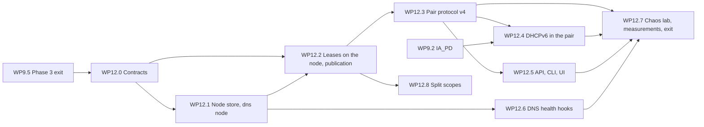

# High availability plan: DHCP failover and a data plane that outlives a node

- Status: Accepted on 2026-10-25: the owner decided every question of section 7 (HA-Q1 to HA-Q15) as recommended. The plan binds and changes only through rule 2.8 of the execution plan. The owner's standing direction, single node first and cluster-aware (section 2.10 of [phase-2-plan.md](phase-2-plan.md), section 2.12 of [phase-3-plan.md](phase-3-plan.md)), is what this plan builds on: Phase 3 built one node and the fields and traits a pair needs; this plan says what the pair is
- Date: 2026-10-25
- Scope: DHCP-12 (failover), DHCP-18 (its chaos test), the DHCP half of OPS-02 and OPS-26, the "Multi-node data plane" bullet of Phase 5 in [ROADMAP.md](../ROADMAP.md) as far as DNS and DHCP need it to survive the loss of one node, and the health hooks of OPS-17. Written against `main` at `3bee0354`, with DHCPv4 complete, DHCPv6 IA_NA merged as WP9.1 and IA_PD open as WP9.2 ([phase-3-status.md](phase-3-status.md)). Requirement IDs refer to [REQUIREMENTS.md](../REQUIREMENTS.md), toggles (TGL) and never-off items (NEVER) to [SECURITY-PROFILES.md](../SECURITY-PROFILES.md), RFC targets to [CONFORMANCE.md](../CONFORMANCE.md). The decision is recorded as [ADR 0025](../adr/0025-dhcp-failover-and-data-plane-ha.md) (Accepted)

The owner compared Tenko with Infoblox, BlueCat and EfficientIP and named two gaps that keep Tenko out of production: high availability of the data plane, above all DHCP failover, and identity. Both are to be done right from the start. This plan covers the first; identity has a plan of its own, written at the same time. The plan has the form of [dns-recursion-plan.md](dns-recursion-plan.md): the goal, the exit criteria as checks, the designs compared and the one recommended, the decisions the packages share, the work packages with their acceptance, the order, the measurements, the owner's decisions, the requirement rows touched, the risks, the owner's actions and the sources. "(proposed)" marks a choice the documents leave open. Sizes are in builder-days.

**Numbering.** Exit criteria, measurements and risks continue the project's series but start at E60, M60 and R100, so that the identity plan written beside this one can take the next free numbers (E43, M45 and R87 onward) without a clash; the lead closes the gap when both plans are accepted. The slice is called Slice 12 and its packages WP12.x, provisionally: Phase 4's slices were to start at 11 (recursion plan, section 1.3), and the identity plan may take 11. Where the slice sits in the calendar was HA-Q1, decided on 2026-10-25, and the lead renumbers accordingly.

Contents:

1. [Scope and exit](#1-scope-and-exit)
2. [The designs compared](#2-the-designs-compared)
3. [The design the packages share](#3-the-design-the-packages-share)
4. [Work packages](#4-work-packages)
5. [Order, parallelism and merging](#5-order-parallelism-and-merging)
6. [Measurements](#6-measurements)
7. [Owner decisions](#7-owner-decisions)
8. [Requirement rows and documents touched](#8-requirement-rows-and-documents-touched)
9. [Risks](#9-risks)
10. [Owner actions](#10-owner-actions)
11. [Documents this slice writes](#11-documents-this-slice-writes)
12. [Sources](#12-sources)

## 1. Scope and exit

### 1.1 Goal

A network served by Tenko keeps getting addresses and names when one Tenko node dies, with no address given to two clients and no acknowledged lease lost, and an operator can set it up without knowing the failover draft. Concretely:

- **DHCP.** Two nodes with the `dhcp` role form a pair for a set of scopes, in load balance or hot standby (DHCP-12). Either one alone keeps every client of those scopes served: renewals at once, new clients within seconds, from its own share of each pool, with lease times bounded by the maximum client lead time (MCLT). Neither needs the controllers, the other partner or a quorum to grant a new lease. When the dead partner is shown to be gone the survivor takes over its share; when it comes back the two resynchronise and return to normal without an operator. The chaos test of DHCP-18 kills, partitions and wipes partners under load and finds no duplicate and no lost acknowledged lease.
- **DNS.** A node with the `dns` role and no controller in its process serves the zones and runs the resolver from its own copy, so a second `dns` node is one enrolment away and the loss of the controllers does not stop name service. Clients reach a surviving `dns` node through the two addresses of option 6 (CON-04), or through a floating address or anycast that the operator's own VRRP or routing daemon moves, driven by a health check Tenko provides (OPS-17).
- **Two boxes are enough.** A home with two machines gets all of this: one runs every role as today, the other runs `dns` and `dhcp`. An enterprise with three to five controllers runs a pair per site, or one central standby for many branches, and any number of `dns` nodes.

### 1.2 The gap

The comparison (`docs/comparison.md`, untracked, rows "Failover and HA" and "HA of the DNS and DHCP data plane") rates Tenko 0.0.5 as planned for DHCP failover and partial for data-plane HA, against documented DHCPv4 failover pairs in Infoblox and BlueCat and one-to-one, one-to-many and Microsoft failover in EfficientIP. None of the three documents DHCPv6 failover with lease synchronisation; BlueCat offers a static DHCPv6 split without sync. Tenko's DNS already keeps answering while every controller is down on a node that runs a controller (OPS-02), but a `dns` node without a controller does not exist yet: `tenko serve --roles dns` without `controller` is refused ([dns.md](../dns.md), section 8), and so is `dhcp` alone.

### 1.3 Exit criteria

Every check runs on the shipped binary (the musl build on Linux) in the lab of WP12.7; the chaos runs use two node VMs and the load VM (section 10).

| # | Check | Requirements | Package |
|---|---|---|---|
| E60 | Kill under load: perfdhcp and the engine's own client run through two relays against a pair in load balance and again in hot standby; one partner is killed (SIGKILL, and a power-off of its VM) at a random moment, 50 times per mode, and restarted. After each round, from the clients' ACK logs and both nodes' stores: no address was acknowledged to a second client before the first client's acknowledged end (no duplicate); every acknowledged binding whose end lies in the future is in a live node's store (no lost acknowledged lease); the survivor served new clients of the dead partner's share within the take-over bound of M60; after the restart the pair is normal again within the bound of M61 | DHCP-12, DHCP-18, DHCP-07 | WP12.7 |
| E61 | Partition: the pair link is cut for random durations from 5 seconds to 2 hours while both partners keep reaching the clients, at the default partner-down setting: neither partner enters partner-down while its partner serves, no duplicate, and after the heal both stores hold the same bindings. With partner-down forced on both sides by hand (the unsafe operator error), every conflicting binding is found at the heal, counted, shown and resolved by the rule of section 3.5 | DHCP-12, DHCP-18, OPS-26 | WP12.7 |
| E62 | Disk loss: one partner's data directory is destroyed under load and the node returns empty. It recovers every binding from its partner, holds new allocations for the MCLT, and no duplicate results; the acknowledged bindings that existed only on the lost disk are counted, each had an acknowledged end within the MCLT of its grant, and none of their addresses went to another client before that end | DHCP-12, DHCP-18, OPS-07 | WP12.7 |
| E63 | Controller outage: every controller is stopped for an hour under load. Both partners keep granting new leases and renewals in the normal state, and their publications queue. After the controllers return, the published lease table equals the union of the partners' stores, the IPAM observations and the DDNS records of the leases granted during the outage arrive, and nothing is missing from the history. The same with one unpaired `dhcp` node: it grants new leases throughout | OPS-02, OPS-26, DHCP-13, DHCP-16 | WP12.7 |
| E64 | Two boxes: one node with every role and one with `dns` and `dhcp`, set up from the UI with the steps of section 3.17. Each node is killed in turn: DHCP goes on as in E60; a client with both addresses in option 6 keeps resolving names of a Tenko zone and Internet names; with keepalived's floating address driven by `tenko node health`, a client with one address resolves again within the bound of M67 | DHCP-12, OPS-02, OPS-17, CON-04 | WP12.7 |
| E65 | DHCPv6: E60 and E62 for IA_NA, and for IA_PD once WP9.2 has merged, with the allocation rules of section 3.11 | DHCP-09, DHCP-12, DHCP-18 | WP12.4, WP12.7 |
| E66 | A `dns` node without a controller: enrolled with one token and fed through node sync into its node store, it serves every zone of its subset at the controllers' revision, signed zones included, forwards updates while a controller is reachable and answers them SERVFAIL while none is, runs the resolver with the synced trust anchors, and keeps serving through a controller outage of an hour; a zone of 1 M record sets reaches it through paged snapshots | OPS-02, OPS-28, DNS-01, DNS-13 | WP12.1 |
| E67 | Clock skew: a partner's clock is moved by 4 s, 30 s and 90 s. At 4 s nothing changes; at 30 s the warning `dhcp.pair.clock_skew` is raised; at 90 s the pair leaves the normal state and stays in communications-interrupted until the clocks agree, and no lease time exceeds the bound of section 3.6 measured on the client's clock | DHCP-12, OPS-09 | WP12.3 |
| E68 | The pair simulator: two engines, two node stores, a network that drops, delays, duplicates and cuts, and two clocks, driven by 10,000 random schedules per CI run (kills, restarts, wipes, partitions, an operator's partner-down) against the invariants of section 2.1, with a fixed seed corpus of every failure found so far | DHCP-12, DHCP-18 | WP12.3 |
| E69 | Rolling upgrade: a pair runs an older and a newer binary in turn (`TENKO_OLD_BIN`, as in `cluster_mixed_versions.rs`); each partner is restarted with the planned-pause message, the other serves at once, and the versions negotiate the protocol | OPS-08, DHCP-12 | WP12.3 |
| E70 | Fuzz targets for every new parser of network data (the pair messages, the publication call, the paged snapshot frames) run in the weekly fuzz smoke; the counting-allocator test still binds the DORA path with ownership, the client hash and `grant_time` with a partner limit | API-14, API-15, OPS-21 | WP12.0, WP12.3 |
| E71 | Split scope beside another server: a Tenko scope that excludes the other server's range, non-authoritative, with the offer delay of section 3.12, serves beside a second DHCP server on one network (Kea in the lab as the stand-in for Windows DHCP; the Windows lab of Phase 4 repeats it with Windows): no client is refused by the server that does not hold its lease, and no address is offered by both | CON-05, MIG-08, DHCP-06 | WP12.8 |

### 1.4 The slice

| Slice | Content | Closes |
|---|---|---|
| 12. Data-plane high availability | The node store on data-plane nodes and the `dns` node without a controller; leases held by the serving node and published to the controllers; the pair protocol for DHCPv4 and DHCPv6; the API, CLI and UI of pairs; the DNS health hooks; split scopes for coexistence; the chaos lab, the measurements and the exit document | E60 to E71 |

### 1.5 Requirements

| Requirement | What this slice delivers | Phase today |
|---|---|---|
| DHCP-12 Failover between Tenko nodes | The pair, its modes, MCLT, partner-down, lease sync, the hash split, DHCPv6 (WP12.3, WP12.4); the wording changes of section 8 | 3, Must (P3-Q2 moved it to Phase 5; the row still says 3) |
| DHCP-18 Failover chaos test | E60 to E62, E65, E68 | 3, Must (as above) |
| DHCP-07 Durable lease store | The lease store becomes the serving node's (section 3.1), which is what the row said before P3-Q1; the published copy keeps the backup and the history | 3, delivered |
| OPS-02 The data plane never depends on the control plane | A `dhcp` node grants new leases with every controller down (E63); a `dns` node without a controller (E66) | 1, delivered for nodes that run a controller |
| OPS-26 Partition behaviour | "Lease state merges through the DHCP failover protocol (MCLT)" becomes true; the store's refusal path of P3-Q14 is left for a failing disk | 1 (Slice 3), delivered for controllers |
| OPS-28 Sites over slow links | The `dns` and `dhcp` subsets consumed, paged snapshots, the node store | 1 (Slice 3), delivered for probes |
| OPS-17 Health hooks for anycast | `tenko node health` and the readiness route the operator's VRRP or routing daemon reads; examples for keepalived and BIRD | 5, Should |
| OPS-08 Rolling upgrades with version negotiation | The pair protocol's versioning and the planned pause (E69) | 1, Should, delivered for the cluster protocol |
| IAM-16 Vault handling | The failover secret is not needed (section 3.14); the row's list changes | 1, delivered |
| CON-05, MIG-08 | Split scopes (E71); a Windows failover relationship maps to a Tenko pair without its secret | constraint; 4 |
| DHCP-02, CON-04 | Option 6 with two `dns` nodes as the default client failover, with a finding when only one is named | 3, delivered |

### 1.6 Left out, with reasons

| Item | Reason | Goes to |
|---|---|---|
| Wire compatibility with ISC dhcpd, Windows or RFC 8156 peers | No peer exists to talk to: ISC DHCP reached end of life in October 2022, Windows failover is proprietary and DHCPv4 only, and neither Kea nor ISC dhcpd implements RFC 8156 (section 12). CON-05 already rules out a shared relationship with Windows | Never, unless a peer appears |
| Groups of more than two servers for one scope | The failover model is a pair; a node may be in several pairs (one central standby for many branches), which covers EfficientIP's one-to-many case. More than two servers per scope needs a different protocol (section 2.3) | Not planned |
| Pool rebalancing between partners (the draft's POOLREQ) | Shares are a fixed split of each pool (section 3.4); the row's `share` field stays reserved for rebalancing. Load balance splits clients and addresses alike, so the shares drain at the same rate | A later package if M63 or the field asks for it |
| The draft's RESOLUTION-INTERRUPTED as a state of its own | Contact lost during a conflict resolution returns to communications-interrupted, which is safe; the resolution resumes at the next contact | Not planned |
| A shared secret between partners | The pair channel is the mutual TLS of the cluster port between enrolled nodes (section 3.14, HA-Q8) | Not planned |
| VRRP or a BGP speaker inside Tenko | Both need privileges a data-plane process should not hold (`CAP_NET_ADMIN` for addresses and raw sockets for VRRP; ADR 0023 grants a role only what it needs) and are the operator's layer; Tenko provides the health signal (section 3.13, HA-Q12) | Not planned |
| DDNS while no controller is reachable | Zones change only through the store, which needs a quorum; names of clients that arrive during an outage appear after it (section 3.10, HA-Q13) | Phase 5 multi-site ownership (OPS-27) for sites that must keep writing |
| Leasequery (RFC 4388) and bulk leasequery | No requirement asks for them; CONFORMANCE.md lists leasequery as Phase 5 | Phase 5, or never |
| The controller cluster on three VMs (E9, M2, M4, M7 of Phase 1) | The cluster's own lab is a separate item of Phase 5; this slice needs two node VMs and the load VM | Phase 5 |

### 1.7 Starting point in the code

Facts the packages build on, read on `3bee0354` (paths under `crates/` unless said otherwise):

- **The lease row** (`tenko-core/src/dhcp/lease.rs`): `Lease` carries the failover draft's fields: `BindingState` (`free`, `active`, `expired`, `released`, `abandoned`, `reset`, `backup`), `cltt`, `ends`, `tstp`, `tsfp`, `atsfp`, the writing `node` and `share: Option<PoolShare>` (`primary`, `secondary`), empty on one node. `Lease6` has `state`, `cltt`, `ends`, `preferred_ends` and `node`, but neither the partner times nor the share: those are additive fields for WP12.0.
- **Ownership and lease times** (`tenko-dhcp/src/allocator.rs`): `PoolOwnership::owns(scope, addr, identity)` is asked for every candidate address; `SingleNode` says yes to all. `grant_time(times, requested, partner: Option<PartnerLimit>)` caps the time at the acknowledged end plus the MCLT and is called with `None` by the DHCPv4 engine (`v4/engine/mod.rs`). The DHCPv6 allocator (`v6/engine/alloc.rs`) walks a hashed order of its own and asks neither the ownership trait nor `grant_time`. There is no "answer this client at all" check for a load-balance hash.
- **The lease path** (`tenko-dhcp/src/lease/`, `store.rs`): `LeaseStore` (`submit`, `completions`, `accepting`) is the engine's only door to durability; `StoreLeases` copies a change into a bounded queue and its committer writes one batch per change (the row, the client index, the history row, the IPAM observation hook) through the store's coalescer, up to 512 in flight; a ticket completes after the commit and the table's apply, within 2 s. The batch carries no version precondition on the lease row: the committer's guard against another client's binding reads the node's own table, so two nodes writing one address through one store would both succeed. The crash test (M32) holds every acknowledged lease across kills on one node.
- **Measured on one node** (`bench/phase3-dhcp/results/2026-10-22-m26-m28-perfdhcp.md`): about 10,000 4-way exchanges per second with every lease committed before its ACK, a p99 from REQUEST to ACK of 19 ms at 1,000 per second and 126 ms at 5,000; the engine alone answers 20,000 per second to perfdhcp. The commit is almost all of the time.
- **Leader services** of the `dhcp` role: `dhcp.expiry` (fenced batches with a version precondition per row), `dhcp.history.purge`, and `dhcp.ddns`, which follows `dhcp.leases` by a store watch and writes its outcome back onto the row with the row's version as precondition.
- **The refusal gate** (P3-Q14): while the store refuses, a renewal is acknowledged for its remaining time and other requests are dropped. On one node that means a failing disk; on a cluster it would mean every quorum loss.
- **Node commands** for leases (`dhcp.leases.list`, `dhcp.lease.release`, `dhcp.history.read`, `dhcp.stats`) already exist and run locally; the command stream of node sync carries the same kinds to a remote node unchanged.
- **Node sync** ([node-sync.md](../node-sync.md)): `Config.Watch` sends journal deltas or a compressed snapshot of a node's subset; a node keeps its rows in one file, `state.cbor`, rewritten atomically on every message; the payload limits are 32 MiB on the wire, 64 MiB inflated and 100,000 rows; a journal gap of more than 50,000 revisions sends a snapshot. Only `probe` consumes a subset; the `dns` and `dhcp` subsets are declared (`dhcp`: every `dhcp.*` table except the histories, the IPAM rows of reservations and the secret purpose `dhcp.failover`). `Config.Secrets` hands out secrets by purpose with an audit record and needs a quorum to do so.
- **The DNS role** reads its rows through one `ZoneFeed` over the store (`dns.serving`); updates are change sets through the zone service of the process, with `Dns.Update` named for a remote node; signing needs a leading controller, and signatures are valid 14 days by default ([dnssec.md](../dnssec.md)); the trust anchors are in the `dns` subset.
- **The cluster harness** (`crates/tenko/tests/cluster_support/`) relays every link through a TCP relay that a test can cut, delay or drop; the compose lab partitions with `docker network disconnect`. The DHCP lab (`deploy/compose/lab-dhcp`) relays four networks to one node with ISC `dhcrelay`.

## 2. The designs compared

### 2.1 What every design must hold

| # | Invariant | Where it comes from |
|---|---|---|
| I1 | No address is acknowledged to a client while another client's acknowledged lease on it has not ended | DHCP-18 |
| I2 | An acknowledged lease survives a crash of the node that granted it; after the loss of one node's disk, a binding known only to that disk ends within the MCLT of its grant and is protected by I1 | DHCP-07, DHCP-18 |
| I3 | No controller round trip in the DORA exchange or the renew path | CONTRIBUTING rule 5, OPS-02 |
| I4 | A node keeps granting new leases while it reaches neither the controllers nor its partner | OPS-02, ARCHITECTURE.md ("Quorum is lost") |
| I5 | Two machines are enough for a network that survives the loss of either | the owner's brief |
| I6 | Nothing is merged silently: every conflict found after a partition is counted and shown | OPS-26 |

I5 decides much of what follows. A Raft group of two voters has no fault tolerance (a majority of two is two), so at home one of the two machines is a controller and the other a node that is not a voter, or both are voters and the loss of either stops every write. Whatever a pair needs while one machine is gone cannot come from a quorum.

### 2.2 (a) A failover pair after the ISC draft

Two servers keep their own lease databases and tell each other every binding change over a long-lived connection (`draft-ietf-dhc-failover-12`, expired in 2003; Windows' failover is based on it; RFC 8156 is the DHCPv6 standard built on the same ideas). Each binding has a state (free, active, expired, released, abandoned, reset, backup); each server has a state (normal, communications-interrupted, partner-down, recover and its sub-states, potential-conflict, paused, shutdown). Free addresses are split between the partners: in load balance the RFC 3074 hash of the client decides who answers, in hot standby the standby holds a small reserve. Updates are lazy: a server answers the client first and tells its partner after, and the MCLT bounds the harm, because no lease runs more than the MCLT past what the partner has acknowledged, so a partner that never heard of a binding knows it ends within the MCLT. In communications-interrupted each server serves from its own share; in partner-down the survivor waits the MCLT and then takes the partner's share; at recovery the returning server learns what it missed before it serves again.

- For: no dependence on any third party, so I4 and I5 hold; a model with twenty years of field use and well-understood failure modes; the MCLT gives safety under partition without heuristics; the lease row already carries its fields.
- Against: a second home for leases beside the store, which P3-Q1 chose to avoid (a second durability path, its own backup and restore, a separate channel for observations and DDNS); the state machine is large and its rare paths are where bugs live; the first lease of a new client is short (the MCLT) unless the partner acknowledges quickly; partner-down needs an operator or a safe rule.

### 2.3 (b) The replicated store as the only arbiter

Every `dhcp` node already commits each lease to the replicated store before the ACK. Two nodes fed with the same rows see each other's leases, and with a version precondition on the lease row the store would refuse the second of two grants of one address: the store is the arbiter, there is no pair protocol and no second lease format, and any number of nodes could serve one scope.

- For: one durability story; backup, reconciler, DDNS and UI unchanged; N servers per scope with no new protocol; leases on every controller at once.
- Against: every lease is a Raft commit, so on a cluster of three controllers the DORA path waits for a majority over the network, which breaks I3 (CONTRIBUTING rule 5 says never), and for a `dhcp` node at a site away from the controllers every ACK crosses the WAN. When the store has no quorum the node can only do what P3-Q14 does: renew what clients hold and refuse every new client. That breaks I4, and with two machines (I5) the loss of either is a quorum loss. Serving "from the last image and local leases with an MCLT-style bound" while the store has no quorum needs a local lease log, an ownership split so that two isolated nodes do not allocate the same address, and a merge at the heal: that is design (a) inside design (b). The current code would need the version precondition on lease rows (none today, section 1.7) even for the healthy case.

The same finding applies to the code as built: P3-Q1's commit before the ACK is local on one node, but on a cluster of more than one voter a `dhcp` role on a controller waits for a majority in every DORA exchange. Phase 3 never runs that way; this plan makes sure it never will.

### 2.4 (c) Hybrid: the store while it has a quorum, the draft when it has not

The pair serves through the store while the store accepts writes, as (b), and switches to draft-style behaviour with a hash split and a local log when it does not, merging the local log into the store at the heal.

- For: leases are in the store at once in the common case; no partner channel is needed while healthy, because the store's feed carries each partner's rows to the other.
- Against: it builds both (b) and (a) and the switch between them, and the switch happens at the worst moment: the path that guards against duplicates is the one that runs only during failures, so it is the least exercised. At home (I5) the second machine is not a voter, so it either commits across the network to the first while healthy (against I3) or is isolated whenever the first is gone, which makes the rare path the only path that matters. Enterprise sites cut off from the controllers are isolated though both partners can still reach each other, so the hybrid needs the direct channel anyway to keep them in step. And it keeps I3 broken in the healthy case on a cluster.

### 2.5 Side by side

| | (a) Failover pair | (b) Store as arbiter | (c) Hybrid |
|---|---|---|---|
| I3, no controller round trip | Holds | Broken on any cluster of more than one voter | Broken while healthy on a cluster |
| I4, new leases while isolated | Holds (own share, MCLT) | Broken (renewals only) | Holds, on the rarely used path |
| I5, two machines | Holds | Broken (a two-voter group) | Holds only on the failure path |
| Homes for a lease | The serving node, then published | The store | Both, with a merge |
| Code paths that guard I1 | One (ownership, MCLT, states) | One (a store precondition) | Two, and the switch |
| Servers per scope | Two; a node in many pairs | Any number | Two |
| What it reuses | Lease row fields, `PoolOwnership`, `grant_time`, `LeaseStore`, node commands, the committer (over a node store) | Everything on the commit path | Everything of (a) and (b) |

### 2.6 Rework in the current code, per design

| Area | (a) as recommended | (b) | (c) |
|---|---|---|---|
| Engine, codec, offer hold, classes, PXE | None | None | None |
| `PoolOwnership` | A second question ("answer this client"), the split; the DHCPv6 allocator asks it too | A split to avoid collisions, else every second grant fails | As (a) |
| `grant_time` | Called with the partner limit from the row | Not needed | As (a) |
| `LeaseStore` and `StoreLeases` | Unchanged; the committer writes the node store instead of the controllers' store | A version precondition per lease row; a forwarded write for nodes without a controller | Both, plus a local log |
| Lease table and follower | Fed by the node store (own commits and the partner's updates) instead of the controllers' feed | Unchanged | Both |
| `dhcp.expiry`, `dhcp.history.purge` | Expiry moves to the node (no leader fence); the purge stays | Unchanged | Expiry in two places |
| Observation hook | Moves from the committer to the publication on the controllers | Unchanged | Both |
| DDNS worker, Kea export, UI, backup | Unchanged: they read the published copy | Unchanged | Unchanged |
| `Lease6` | The partner fields and the share added | The precondition | Both |
| Node sync | The `dhcp` and `dns` subsets consumed, a node store, paged snapshots, a publication call | A forwarded lease write for remote nodes | All of it |
| New | The pair protocol and its simulator | Nothing, if a quorum loss may stop new leases | The pair protocol, the switch and the merge |

### 2.7 Recommendation

Design (a), in Tenko's own form. The lease belongs to the node that serves the scope: it is committed to that node's own store before the ACK, sent to the partner as a binding update, and published to the controllers' store after the ACK, where the reconciler, DDNS, the UI, the history and the backup keep reading it as today. A scope is served by exactly one node or one pair. The pair follows the draft's model (binding states, server states, MCLT, lazy updates, partner-down, recovery) with the RFC 3074 hash for clients and a fixed split of each pool for addresses, speaks over the cluster port's mutual TLS with no shared secret, and carries DHCPv6 with RFC 8156's allocation model on the same channel. Partner-down is automatic only on evidence that the partner is not serving. This is P3-Q1's own fallback ("an asynchronous publication model: a local durable log first, publication to the store after the answer") made the production path, and what ADR 0002 point 4 and DHCP-07 said as first written.

Why not keep P3-Q1 for a lone node: one model for every deployment is simpler to test and to explain, a single-node installation that later grows into a cluster changes nothing about its leases, and the lone node gains I4 (it grants new leases while its own disk is fine, whatever the controllers do). The cost is a second write per lease (the publication), which is batched; M62 measures it and HA-Q2 holds the fallback.

## 3. The design the packages share

### 3.1 The lease authority and the node store

- **Every node with the `dhcp` role has a node store**: a store of its own under `<data_dir>/node/store/`, a one-voter instance of `tenko-store` over `redb` as a single controller's store is, with its own revisions and journal. It is never a member of the controllers' Raft group. On a data-plane node it also holds the node's synced configuration subset (section 3.13); on a controller node it holds only the lease namespace.
- **The lease namespace** of the node store holds `dhcp.leases`, `dhcp.leases.by_client`, `dhcp.leases6` and its index, the unpublished part of `dhcp.history` and `dhcp.history6`, the pair state (section 3.5), the partner cursors (section 3.8) and the publication cursor (section 3.9). The committer of WP7.2 writes it exactly as it writes the controllers' store today: one batch per change, coalesced, the ACK after the commit, which is I2 as M32 proves it.
- **A scope has one server.** `dhcp.scopes` gains `server`: a node or a pair. A node serves only the scopes placed on it or on a pair it belongs to; two nodes never serve one scope outside a pair, and the configuration service refuses a placement that would make them (proposed code `dhcp.scope.placement`). On an installation with one `dhcp` node every scope is placed on it, so nothing changes at the upgrade.
- **The published copy.** The controllers' `dhcp.leases` and `dhcp.leases6` become the published copy, with the same keys and rows. The fields the controllers own (the DDNS outcome, `observed_at`) are kept when a publication arrives.
- **The format step.** The first start of the new binary on a controller node with leases copies `dhcp.leases*` and the client indexes from the controllers' store into the node store, as one migration step of OPS-23 after its snapshot; the published copy stays as it is.

### 3.2 The pair and its configuration

A pair is configuration in the controllers' store, a row of `dhcp.pairs`, synced to both nodes in the `dhcp` subset:

| Field | Default | Notes |
|---|---|---|
| `name` | | 1 to 64 characters of `a-z`, `0-9` and `-` |
| `primary`, `secondary` | | Two node ids with the `dhcp` role; the primary opens the connection and owns the lower part of the split |
| `mode` | `load_balance` with `primary_percent` 50 | Or `hot_standby` with `active` (`primary` or `secondary`) and `reserve_percent` 5 (Windows' defaults) |
| `mclt_secs` | 3,600 | 300 to 86,400 (HA-Q7) |
| `max_response_delay_secs` | 15 | No message from the partner for this long is communications-interrupted |
| `max_ack_delay_secs` | 10 | A client waiting this long unanswered counts as unacknowledged (section 3.7) |
| `ack_wait_ms` | 50 | How long a new binding waits for the partner's acknowledgement before its ACK (HA-Q3); 0 turns it off |
| `partner_down` | automatic with evidence after 600 s | `manual`, or `automatic` with `after_secs` and `unacked_clients` (10); the profile's values are in section 3.7 |

A node may be in several pairs: one central standby for many branch actives in hot standby is the enterprise's one-to-many case. A change of a pair's split while bindings exist moves only free addresses; while the two nodes run different revisions of the pair's row, each allocates only addresses it owns under both the old and the new split, so a change never needs both to switch at the same instant.

### 3.3 Binding states and where they live

The binding states are the draft's, already in `BindingState`. Each node holds every binding of the pair's scopes in its node store, its own and the partner's, and the published copy holds the newest of each. A binding change (grant, renewal, release, decline, an abandoned address from the conflict probe, an operator's reset) is a local commit and then a binding update to the partner. Expiry is not sent: both partners expire a binding at its `ends` by their own clocks, each in its own node store (`dhcp.expiry` becomes a node service without a leader fence; its per-row version precondition stays), and the address returns to its owner by the split.

Each row gains a binding version (`version: u64`, proposed), raised by whichever node changes the binding and carried in the update; the receiver keeps the row with the higher version, and two different rows with one version are a conflict (section 3.5). The version, not the clocks, orders the updates of one binding.

### 3.4 Address ownership and the allocator

- **Clients.** In load balance a node answers a client's DISCOVER and its REQUEST in SELECTING, INIT-REBOOT and REBINDING only when the client's RFC 3074 bucket is its own: Pearson's hash with the RFC's table over the client identifier (option 61) when present, else `chaddr`, 256 buckets, the primary holding buckets 0 to `primary_percent * 256 / 100 - 1`. A RENEWING request unicast to a node is answered by that node whatever its bucket, because the client asks it by name. In hot standby the active answers every client and the standby none, except a renewal unicast to it. For DHCPv6 the same hash runs over the DUID (Kea does the same; RFC 8156 has hot standby only).
- **Addresses.** Each address of a pool belongs to one partner by a fixed function of the address: its Pearson hash into 256 buckets, split by `primary_percent` in load balance and by `reserve_percent` in hot standby, the standby owning the reserve. The function needs no messages, both nodes compute the same answer, and resizing a pool moves no existing address. A pool of fewer than 64 addresses gets its standby reserve as its highest addresses instead, so a small pool is never without one (WP12.0 settles the exact rule with a property test). The row's `share` field, when set, overrides the function for that address; nothing sets it until rebalancing exists.
- **The trait.** `PoolOwnership` gains `answers(scope, identity, kind) -> bool` beside `owns`, both reading the node's current pair state (section 3.5), and the DHCPv6 allocator asks both. `SingleNode` says yes to both. The allocator's hashed walk stays; ownership only removes candidates.

### 3.5 The server states and what each may do

The pair state is persisted in the node store with its start time, so a restart resumes it. Tenko builds this subset of the draft's states:

| State | Clients it answers | Allocates new addresses from | Renews | Lease end at most |
|---|---|---|---|---|
| Startup (until contact, at most `max_response_delay_secs`) | None | None | None | |
| Normal | Its bucket (load balance), all (hot standby, active), none (standby); unicast renewals | Its share | Bindings it is asked for | Acknowledged end plus MCLT |
| Communications-interrupted | All; a client of the partner's bucket only once it has waited `max_ack_delay_secs` | Its share | Every binding it holds | Acknowledged end plus MCLT, the acknowledgement frozen |
| Partner-down | All | Its share at once; the partner's free share once the MCLT has passed since entering the state; an address the partner had leased once the MCLT has passed since the later of that lease's end and entering the state | Every binding it holds | Acknowledged end plus MCLT |
| Recover (the sync from the partner) | None | None | None | |
| Recover-wait (only after a data loss) | None | None | None, until the MCLT has passed since entering recover | |
| Recover-done | None, until the partner confirms | | | |
| Potential-conflict | None, until both sides have exchanged and resolved | | | |
| Paused (announced by a partner that restarts) | The partner moves to communications-interrupted at once, without waiting `max_response_delay_secs` | | | |
| Shutdown (a node leaving the pair by command) | The partner may move to partner-down at once | | | |

- **Communications-interrupted is always safe.** Each node allocates only from its own share, so two nodes that cannot reach each other but both reach the clients never give one address to two clients (I1), and the survivor of a real failure keeps every client served (I4) without an operator. Partner-down only reclaims the dead partner's share; most outages end before the own share runs low, and the finding `dhcp.pair.share_low` says when it does.
- **Recovery.** A node that returns with its node store intact sends its cursor and receives every change the partner made since (section 3.8), then moves to normal with the partner: every lease it acknowledged before the crash is in its store (I2). A node that returns empty, or whose store lost its tail, asks for all bindings and then waits the MCLT in recover-wait before allocating, because leases it granted unknown to the partner may still be held for up to the MCLT.
- **Conflicts.** When both nodes may have allocated from one share without contact (both were in partner-down, or one was in partner-down while the other was serving, which each knows from the states the other reports), they enter potential-conflict, exchange every change since their last contact, and resolve each address that two clients hold: the binding with the later client transaction time keeps the address, the other row becomes `abandoned` for the other client's remaining time, and that client gets a NAK at its next request and a new address. Each conflict is counted (`tenko_dhcp_pair_conflicts_total`), raised as the error finding `dhcp.pair.conflict` with the addresses, and audited as `dhcp.pair.conflict` (I6).

### 3.6 MCLT and lease times

- A node that tells its partner about a binding sends the potential end it intends to grant at the next renewal (`tstp`: the time of the update plus the scope's lease time); the partner commits it and acknowledges; the node records the acknowledged end (`atsfp`). A binding learned from the partner carries the potential end the partner sent (`tsfp`).
- Every grant at time `t` ends no later than `max(atsfp, tsfp, t) + MCLT`, in every state; `grant_time` already computes this from `PartnerLimit`. A new client therefore gets the MCLT or the scope's time, whichever is shorter, unless the partner acknowledged within `ack_wait_ms`; its first renewal then gets the full time. DHCPv6 applies the bound to the valid lifetime and keeps the preferred lifetime at most the valid one.
- The acknowledged ends are written to the node store in batches, not one write per acknowledgement. After a restart a lost record makes the next grant shorter, never longer.
- With the partner gone, clients renew every half MCLT at most. At the default of an hour that is one renewal per client per half hour, well within what one node handles (M27: about 10,000 renewals per second).
- The MCLT's safety assumes the partners' clocks agree to well within it (section 3.16).

### 3.7 Partner-down: when and how

- **By hand**, always: `tenko dhcp pair partner-down <pair> --survivor <node>` or the button on the pair's page, for an administrator with step-up authentication, audited as `dhcp.pair.partner_down` with the reason. The dialog says what it does: the survivor will hand out the partner's addresses after the MCLT, which is safe only if the partner really is not serving.
- **Automatically**, after `after_secs` in communications-interrupted, and only with evidence that the partner is not serving:
  - **the controllers' witness**: a controller with a quorum, reached by the survivor, has had no heartbeat from the partner for the same period; or
  - **unacknowledged clients**: in communications-interrupted a node answers a client of the partner's bucket (or, as a standby, of the active) only after the client has waited `max_ack_delay_secs`, read from the `secs` field (DHCPv4) or the Elapsed Time option (DHCPv6), or from a third retransmission when a client always sends zero; at least `unacked_clients` distinct such clients within `after_secs` are the evidence. A partner that serves answers its clients first, so they never wait that long. This is Kea's partner-down detection (section 12) inside the draft's states.
- **Without evidence the node stays in communications-interrupted**, which is safe, and the health view says why it does not take over.
- **Profiles** (a proposed new toggle row, its number assigned by the lead): Home and Standard automatic with evidence after 600 s; Hardened automatic on the controllers' witness only, else by hand; Lab automatic with evidence after 60 s.
- In partner-down the conflict probe (section 3.10) checks every address of the partner's share before its first offer, whatever its history.

At home the evidence works in both directions: when the second box dies, the first is a controller and is its own witness; when the first dies, the second sees the first one's clients wait.

### 3.8 Lease sync: messages, ordering and resync

- **The channel.** A `Failover` service of `tenko.cluster.v1` on the cluster port, one bidirectional stream per pair, opened by the primary and accepted only from the node the pair names (section 3.14). A data-plane node with the `dhcp` role in a pair opens the cluster port for it (new: today only controllers listen; 8444/TCP between the partners). The messages, in the draft's terms: `Connect` and `ConnectAck` (versions, the pair row's revision and digest, clocks, states), `State`, `Contact` (the heartbeat, every third of `max_response_delay_secs`), `BindingUpdate` (one or more full rows with their versions and the sender's node-store revision), `BindingAck` (cumulative up to a revision, with per-row refusals: outside the pair's scopes, a conflict, a stale version), `UpdateRequest` (from a cursor), `UpdateRequestAll`, `UpdateDone`, `Paused` and `Shutdown`.
- **Ordering.** A node sends its binding changes in the order of its node store's revisions; the receiver applies them in that order and commits them to its own node store before it acknowledges, so an acknowledged update is on two disks. Per binding the version decides (section 3.3); a duplicate or an older update changes nothing, so a resend is harmless.
- **Flow.** A node keeps at most 10,000 unacknowledged updates (proposed); past that it treats the partner as unreachable (communications-interrupted) and resynchronises at the next contact, as Kea's delayed-updates limit does. A slow partner shortens lease times by itself, because the acknowledged ends lag.
- **Resync.** Each node keeps the partner's last applied revision as a cursor. At contact it asks for the changes since; the partner reads them from its node store's journal as node sync reads `sys.journal`, and when the journal no longer covers the cursor it sends every binding of the pair's scopes, paged. `UpdateDone` ends the resync.
- **Pairing a node that served alone.** When a scope moves from a node to a pair, the node's bindings of the scope are sent to the new partner before the pair leaves startup.

### 3.9 Publication to the controllers

- A task on each `dhcp` node reads its node store's journal from its publication cursor and publishes the changed lease rows and history rows in batches (every 100 ms or 1,000 rows, proposed): on a controller node into the controllers' store in the same process, on a data-plane node through a new call `Leases.Publish` to any controller, with the node's store epoch and the revision range. The controllers merge each row by its binding version, keep their own fields, write the IPAM observation fact of WP8.1 in the same batch (the hook moves here from the committer), and store the cursor in `dhcp.publish_cursors` in the same write, so a resend is recognised as `Observations.Ingest` recognises one.
- While no controller can write, the publications wait in the node store; the node's history rows are removed only after their publication, so nothing is lost (E63). `tenko_dhcp_publish_lag_seconds` and the finding `dhcp.leases.unpublished` (more than 5 minutes behind while a controller is reachable) show it.
- The API's lease reads keep reading the published copy; `dhcp.leases.list` on a node reads the node's own table, for the newest view.
- If M64 shows the publication load too high on a large installation, renewals that only move `ends` are published at most every 15 minutes per binding, the rule WP8.1 already applies to observation refreshes.

### 3.10 DDNS and the conflict probe in a pair

- **DDNS** stays the leader service `dhcp.ddns` following the published copy, so a lease from either partner reaches it, and the rules of ADR 0020 are unchanged. Both partners produce the same DHCID (RFC 4701, from the client's identity), so a name written for a lease granted by one partner can be replaced or removed for the other: the record-ownership trouble Windows documents for failover partners with different DNS credentials does not arise. While no controller has a quorum zones cannot change, so the names of clients that arrive during the outage appear after it, and the names of leases that expired during it go after it; existing records stay.
- **The conflict probe** of WP8.5 runs on each node through its own process, as today. "Never leased before" counts the partner's bindings too; an address the probe finds in use becomes an `abandoned` binding and travels to the partner like any other change; in partner-down every address of the partner's share is probed before its first offer (section 3.7).

### 3.11 DHCPv6

- **The model, not the wire.** DHCPv6 follows RFC 8156's model on the same pair channel: the same server states and MCLT, *independent allocation* for IA_NA (each partner allocates only from its own fixed share of each pool, and the survivor never takes the partner's share, since IPv6 pools do not run out), and a fixed split for IA_PD prefixes too, with RFC 8156's *proportional allocation* left for rebalancing. Tenko does not speak RFC 8156's wire protocol on TCP 647: no server Tenko could meet implements it (section 12), and one channel for both families is less to secure and to test (HA-Q9).
- A client that rebinds an address the survivor does not know (its update was lost with the partner's disk) gets NoBinding for it and a new address from the survivor's share. RFC 6853's split-prefix model behaves this way for every client of a dead server; in the pair it is the worst case after a disk loss, not the normal case.
- `Lease6` gains the partner times, the share and the version; the DHCPv6 allocator asks `PoolOwnership`; `grant_time` bounds the valid lifetime.

### 3.12 Split scopes for coexistence with Windows DHCP (CON-05)

A pair with Windows is not possible (CON-05), so during a migration Tenko and Windows serve one network with disjoint ranges:

- Tenko's scope excludes the range Windows serves, and Windows excludes Tenko's (the 80/20 rule or any split the operator chooses; MIGRATION.md describes the moves).
- Tenko's scope is non-authoritative for the coexistence, so it never NAKs a client that holds a Windows lease: a request in INIT-REBOOT with no record is already answered with silence, but an authoritative scope still NAKs an address of the network outside its pools. A scope setting `coexistence` (proposed) sets this, keeps conflict detection on whatever the profile says, and shows the scope as shared in the UI.
- The server that should answer second waits: Windows has `-Delay` for the secondary of a split scope; Tenko gains `offer_delay_ms` per scope (proposed), with the OFFER parked in the pending table of WP8.5 so that no worker waits.
- MIG-08 imports a Windows failover relationship as a Tenko pair (the mode, the MCLT, the percentages, the state switchover interval as `partner_down.after_secs`); its shared secret is not needed (section 3.14), and nothing is created until both Tenko nodes exist.

### 3.13 The DNS data plane

- **During a controller outage** a `dns` node serves the zones of its copy and answers from its resolver cache, which is in memory per node and needs nothing from the controllers; serve-stale keeps answering names whose authorities are unreachable. What stops: RFC 2136 updates and DDNS (SERVFAIL, as the update path answers when its write does not land), changes from the API, and signing, which needs a leading controller; signatures stay valid for `signature_validity_days` (14) after their last signing, and the finding before they expire exists ([dnssec.md](../dnssec.md)).
- **A second `dns` node** is a data-plane node: enrolled with the role `dns`, fed through node sync into its node store (WP12.1), with the existing `ZoneFeed` over that store, so the engine and the index are unchanged. It needs the `dns` subset consumed with paged snapshots (a zone of 1 M record sets does not fit the 100,000-row and 64 MiB limits of one message, and rewriting `state.cbor` on every delta does not scale to it), the TSIG secrets of the zones it serves by the purpose `tsig` (fetched while a controller is reachable and held in memory only, as a probe holds SNMP secrets), updates forwarded to a controller as `Dns.Update`, its serving revision reported for NOTIFY to external secondaries, and the node commands of the cache and the query log over the command stream.
- **Clients** reach a surviving node in one of three ways, all the operator's choice: two addresses in option 6 (the default; CON-04 says clients fail over slowly, but they do); a floating address moved by VRRP (keepalived), which takes a few seconds; or anycast through a routing daemon (BIRD or FRR) with route withdrawal, which RFC 4786 advises tying to the service's health. Tenko does neither VRRP nor BGP itself (HA-Q12): it provides `tenko node health --role dns` (exit status 0 when the role serves, 1 when not, for keepalived's `vrrp_script` or a routing daemon's check) and the readiness route `GET /health/ready?role=dns` on the metrics listener. A node isolated from the controllers is ready: serving its copy is the point (OPS-02). The DHCP scope page warns (`dhcp.scope.single_dns`) when option 6 names one address while two `dns` nodes serve the scope's view.
- **DHCP and VRRP.** A pair does not need a floating address: relays name both servers (two relay targets), and on a flat network both partners hear the broadcasts. A relay that takes one server only can target a floating address in front of a hot-standby pair; the lab documents it as the fallback.

### 3.14 The pair channel's security and the failover secret

- The pair speaks over the cluster port's mutual TLS with node certificates of the installation's CA (OPS-04). The `Failover` service accepts a stream only from the certificate of the node the pair names as partner, checked against the node record as node sync checks its callers (`dhcp.pair.not_partner`, 403), and closes it when that node is revoked.
- A receiver refuses a binding update for an address outside the pair's scopes and rate-limits updates. A node compromised with its certificate can therefore lie only to its partner, and only about the pair's scopes: the same radius a shared secret would leave, since the compromised node would hold that secret too.
- No shared secret: the vault purpose `dhcp.failover` declared in WP7.0 is withdrawn from the purposes a `dhcp` node may ask for, and IAM-16 and NEVER-01 lose "failover secrets" from their lists (section 8). The Windows shared secret was never to be imported (MIG-08).

### 3.15 Metrics, health rows and the UI

| Kind | Name | Meaning |
|---|---|---|
| Gauge | `tenko_dhcp_pair_state{pair,state}` | 1 for the node's current state |
| Counter | `tenko_dhcp_pair_updates_total{pair,direction,outcome}` | Binding updates sent and received, acknowledged, refused |
| Gauge | `tenko_dhcp_pair_unacked_updates{pair}` | Updates sent and not yet acknowledged |
| Histogram | `tenko_dhcp_pair_update_lag_seconds{pair}` | From the local commit to the partner's acknowledgement |
| Counter | `tenko_dhcp_pair_mclt_capped_total{pair}` | Grants shortened by the MCLT |
| Counter | `tenko_dhcp_pair_unacked_clients_total{pair}` | Clients of the partner's share that waited past `max_ack_delay_secs` |
| Counter | `tenko_dhcp_pair_conflicts_total{pair}` | Bindings resolved in potential-conflict |
| Counter | `tenko_dhcp_pair_transitions_total{pair,to,trigger}` | State changes by trigger (`timeout`, `witness`, `unacked`, `operator`, `paused`, `recovered`) |
| Gauge | `tenko_dhcp_pair_share_free{pair,scope}` | Free addresses of the node's own share |
| Gauge | `tenko_dhcp_publish_lag_seconds`, `tenko_dhcp_publish_pending` | The publication |

The families follow OPS-21: counters on the worker's shard, nothing on the DORA path that allocates or locks. Health rows (warnings unless marked): `dhcp.pair.communications_interrupted`, `dhcp.pair.partner_down`, `dhcp.pair.recovering`, `dhcp.pair.conflict` (error), `dhcp.pair.config_mismatch` (the partners run different revisions of the pair's row for longer than a minute), `dhcp.pair.clock_skew`, `dhcp.pair.share_low` (own share below 10 percent free while not normal), `dhcp.leases.unpublished` and `dhcp.scope.single_dns`. Events of the `dhcp` topic: `dhcp.pair.state`. Audit actions: `dhcp.pair.create`, `.update`, `.delete`, `.partner_down` and `.conflict`.

The UI: a **Pairs** page under DHCP with one card per pair showing both nodes side by side (the state and since when, the last contact, the unacknowledged updates, the own share free per scope, the MCLT and, in partner-down, the time until the partner's share is taken over), the "Set partner down" action with its explanation, and the scopes the pair serves; the scope list gains a "Served by" column; the lease view shows the writing node and the partner's acknowledged end; the dashboard gains a tile per pair beside the DHCP tiles of WP8.6; a banner shows any pair that is not normal. The status comes from both nodes over the command stream (`dhcp.pair.status`), so the page shows each node's own view, and "unreachable" for a node the controllers cannot reach.

### 3.16 Clocks, upgrades and versions

- Every pair message carries the sender's UTC time. A difference above 5 seconds is the warning `dhcp.pair.clock_skew`; above 60 seconds (Windows' limit) the nodes stay in communications-interrupted, which is safe, until the clocks agree. MCLT arithmetic uses each node's own clock for its own grants and the partner's times as sent.
- `Connect` negotiates the protocol version as the cluster protocol does (OPS-08). A node that stops for a restart sends `Paused`, so its partner serves every client at once; a rolling upgrade restarts one partner at a time and waits for normal before the next (E69).

### 3.17 The operator's story

**Two boxes at home.** Box A runs every role, as today. Box B is installed with the same installer and enrolled with one token as a node with `dns` and `dhcp`, with the command the UI shows. On DHCP, Pairs, "Pair with a node": choose B, keep load balance 50/50 and the MCLT of an hour, choose "every scope of this node". The page then lists the two changes outside Tenko: on the gateway, add B's address as a second DHCP relay target for each network; in the scopes' option 6, add B's address (one click). When B dies, A serves everyone from its half at once and takes B's half after ten minutes, on its own witness. When A dies, B serves DNS from its copy and DHCP from its half at once, takes A's half after ten minutes on the evidence of A's waiting clients, and has no UI and accepts no changes until A is back; `tenko node status` on B shows the state. When either returns, the pair resynchronises and the publications drain into A's store without an operator. A third box that runs a controller turns this into a cluster of controllers (OPS-03), and the pair is unchanged.

**N nodes in an enterprise.** Three to five controllers in one place; at each site a pair of `dhcp` nodes in load balance, or one local active per branch with a central standby in hot standby (one node in many pairs); `dns` nodes per site in option 6 or behind anycast with the health hook. A site cut off from the controllers keeps every DHCP and DNS function except changes, DDNS and the refresh of signatures, which have 14 days of headroom by default. A dead node is replaced by enrolling a new one and naming it in the pair; it recovers every binding from the survivor.

## 4. Work packages

The DHCP builders of Phase 3 own `crates/tenko-dhcp/**` until WP9.5 merges; this slice starts after that (HA-Q1), except WP12.0's model and contract work, which the lead may start beside WP9.2 because it only adds fields and tables. Every package touches the DHCP and cluster documents named in section 11; WP12.1 touches the DNS serve wiring and node sync, which a recursion builder must not hold at the same time (R112).

### Slice 12: data-plane high availability

#### WP12.0 Contracts and shared files (4 builder-days)

- **Requirements:** DHCP-12, DHCP-18, OPS-02, OPS-26, OPS-28 (the model and the contracts they share).
- **Owns:** `dhcp.pairs` and the scope's `server`, with validation and property tests; the binding version, `Lease6`'s partner times and share; `PoolOwnership::answers`, the RFC 3074 hash with the RFC's table and its test vectors, the address split function with its property test (both nodes agree, resizing moves nothing, small pools keep a reserve); the `Failover` and `Leases.Publish` messages in `tenko.cluster.v1` with their versioning; the node store's layout and the lease namespace's tables; `dhcp.publish_cursors`; the withdrawal of the purpose `dhcp.failover`; the metric families, health rows, events, audit actions and error codes of section 3.15; route stubs at 501; the pair simulator's skeleton (`tenko-dhcp/src/pair/sim.rs`: two engines over `MemLeaseStore`, a scripted network and two clocks) as the oracle the later packages extend; `docs/dhcp-contracts.md` gaining all of it; ADR 0025 refined.
- **Acceptance:** the workspace builds; model tests; the counting-allocator test with ownership and the client hash on the DORA path at zero allocations; the RFC 3074 vectors; `cargo deny`; the trace question of section 11 answered by the lead.

#### WP12.1 The node store and the `dns` node without a controller (8 builder-days)

- **Requirements:** OPS-02, OPS-28, OPS-25, DNS-01.
- **Owns:** the node store on data-plane nodes and the sync applier that writes each node-sync message as one local batch (the controllers' revision kept as metadata; the `probe` subset stays in `state.cbor`); paged snapshots beyond the 100,000-row and 64 MiB limits; the `dns` subset consumed; `tenko serve --roles dns` (and `dns,probe`) without `controller`; the TSIG secrets by the purpose `tsig`; `Dns.Update` from a node to a controller; the serving revision in the node's report; the DNS node commands over the command stream; `tenko node health --role` and `GET /health/ready`; the fuzz target `node_sync_pages`.
- **Acceptance:** E66; the DNS lab's rounds run against a `dns` node fed by a controller, not only against the controller; the cluster harness stops every controller for an hour and the node answers throughout; M68.

#### WP12.2 Leases held by the serving node, published to the controllers (6 builder-days)

- **Requirements:** DHCP-07, OPS-02, OPS-26, DHCP-16.
- **Owns:** the committer writing the node store; the lease table fed by it; `dhcp.expiry` as a node service; the format step of section 3.1; the scope placement rule; the publication task, `Leases.Publish` and the controllers' merge, with the observation hook moved there; the history published and then purged by its retention; `tenko serve --roles dhcp` without `controller` (the `dhcp` subset consumed, reservations from the synced IPAM rows); the refusal gate kept for a failing node store; M62 and M64.
- **Acceptance:** every Phase 3 DHCP test and lab round green on a controller node and on a data-plane node; the crash test (M32) against the node store; E63 with one unpaired node; M62 within its threshold, or HA-Q2's fallback taken.

#### WP12.3 The pair protocol, DHCPv4 (10 builder-days)

- **Requirements:** DHCP-12, DHCP-18, DHCP-06, OPS-08, OPS-09.
- **Owns:** `tenko_dhcp::pair`: the `Failover` service and its stream, the partner check, the state machine of section 3.5 persisted in the node store, binding updates and acknowledgements with the ordering and flow rules of section 3.8, the resync from the journal and in full, `ack_wait_ms`, `grant_time` fed from the row, ownership by state, the evidence rules and partner-down, potential-conflict and its resolution, paused and shutdown, the clock check, the conflict probe in partner-down; the simulator completed with the invariants of section 2.1 (E68); the fuzz target `dhcp_pair_messages`.
- **Acceptance:** E67, E68, E69; the cluster harness's relays between two `dhcp` nodes cut, delay and drop the pair link in one test per state transition; M60, M61 and M63 on loopback as stand-ins.

#### WP12.4 DHCPv6 in the pair (4 builder-days)

- **Requirements:** DHCP-09, DHCP-12.
- **Owns:** `Lease6` updates on the pair channel, independent allocation for IA_NA, the fixed split for IA_PD (after WP9.2), the hash over the DUID, `grant_time` on valid lifetimes, NoBinding for unknown rebinds; the `dhcp6` lab round with two nodes.
- **Acceptance:** E65 on loopback; the simulator's DHCPv6 schedules.

#### WP12.5 API, CLI and UI of pairs (5 builder-days)

- **Requirements:** DHCP-12, API-02, API-08, OPS-20.
- **Owns:** `/api/v1/dhcp/pairs` (create, read, update, delete, status, partner-down with step-up), the scope's `server` on the scope routes, `tenko dhcp pair ...`, the Pairs page, the "Served by" column, the pair tile, the banner, the partner-down dialog, the option 6 warning, the XLIFF units in `sv` and `en`; Playwright for pairing two nodes and setting partner down against the mock.
- **Acceptance:** route tests, UI tests, Playwright, the OpenAPI document regenerated.

#### WP12.6 DNS health hooks and client failover (3 builder-days)

- **Requirements:** OPS-17, CON-04, DHCP-02.
- **Owns:** the examples under `deploy/` (keepalived with a `vrrp_script` on `tenko node health --role dns`; a BIRD configuration with the same check), the readiness section of `docs/observability.md`, the lab variant of E64 with keepalived, M67.
- **Acceptance:** E64's DNS rows; M67.

#### WP12.7 The chaos lab, the measurements and the exit (7 builder-days)

- **Requirements:** DHCP-18, DHCP-17.
- **Owns:** `deploy/compose/lab-dhcp-pair` (two nodes, two relays, perfdhcp and the own client with ACK logs, a fault proxy on the pair link, clock offsets), the two-VM procedure, the checker over the ACK logs and both stores (I1, I2), `bench/phase3-dhcp/scripts/chaos.sh`, M60 to M66 on the VMs, the exit document of the slice.
- **Acceptance:** E60 to E65 and E71's lab part; the measurements filed.

#### WP12.8 Split scopes for coexistence (2 builder-days)

- **Requirements:** CON-05, MIG-08, DHCP-06.
- **Owns:** the scope's `coexistence` setting and `offer_delay_ms`, the Kea stand-in in the DHCP lab, the split-scope runbook in MIGRATION.md, the IR mapping of a Windows relationship to a pair.
- **Acceptance:** E71 with Kea; the Windows run listed for the Phase 4 lab.

Total: 49 builder-days, of which WP12.1 and WP12.2 (14) are the multi-node data plane that Phase 5 had listed anyway.

## 5. Order, parallelism and merging

| Merge | Contents | Gate |
|---|---|---|
| M12.0 | WP12.0 | The workspace builds; model tests, deny, the allocator test, the RFC 3074 vectors; the trace question answered |
| M12.1 | WP12.1 | The DNS lab against a fed node; E66 |
| M12.2 | WP12.2, WP12.8 (two builders after M12.1; WP12.8 touches scopes only) | Every Phase 3 DHCP test on both kinds of node; M32 on the node store; M62 |
| M12.3 | WP12.3, then WP12.6 beside it | The simulator's schedules; the harness's link tests; E67, E69 |
| M12.4 | WP12.4, WP12.5 | E65 on loopback; route, UI and Playwright tests |
| M12.5 | WP12.7 | E60 to E65, E71; the exit document |

The gate is the Phase 3 gate (workspace clippy and tests, lab acceptance, UI tests, Playwright, the three traces, the changelog, deny, the fuzz crate's `cargo check --locked`, the embedded build) plus the pair simulator at 10,000 schedules and the `lab-dhcp-pair` smoke. Builders run as in Phase 3: local Opus agents in their own worktrees with their own `CARGO_TARGET_DIR` under `F:\`, Sonnet for the leaf tasks (the RFC 3074 table and vectors, the XLIFF units, the deploy examples, the conformance rows); the lead gates and squashes. WP12.3 needs the closest review: the lead reads its state machine against section 3.5 before the merge.

## 6. Measurements

Results go to `bench/phase3-dhcp/results/` (DHCP) and `bench/phase2-dns/results/` (DNS) with scripts, machine and versions. Linux figures come from the static musl binary. Thresholds are proposals.

| # | Measurement | Threshold | Method | Package |
|---|---|---|---|---|
| M60 | Time to take over: from the kill of a partner to the survivor's first ACK to a new client of the dead partner's share, and to its first renewal of a dead partner's binding at rebind | A new client within 30 s (the detection plus the client's own retries); a rebinding client within one retransmission | E60's rounds, the own client's timestamps against the time of the kill | WP12.7 |
| M61 | Time to resync: a partner restarted after 10 minutes away under load, from its start to normal; and empty, from its start to the end of the full resync (not counting the MCLT wait) | Intact: under 30 s with 10,000 changes missed; empty: 100,000 bindings in under 60 s | E60 and E62's rounds, the transitions' timestamps | WP12.7 |
| M62 | A lone node with its leases in the node store and the publication | 4-way exchanges per second and the p99 from REQUEST to ACK at 1,000 per second within 10 percent of M26 and M28 (about 10,000 per second; 19 ms) | perfdhcp as for M26 and M28, the node as a controller and as a data-plane node | WP12.2 |
| M63 | A pair in load balance | The combined exchanges per second documented, proposed at least 1.6 times M62; the p99 from REQUEST to ACK at 1,000 per second under 25 ms with `ack_wait_ms` 50 on the lab link; the update lag p99 under 20 ms | perfdhcp through two relays | WP12.7 |
| M64 | Publication | Lag p99 under 1 s at 1,000 lease changes per second; the controllers' commit rate and log growth documented | M63's load, the publication histograms and the store's counters | WP12.2, WP12.7 |
| M65 | Memory of a pair (OPS-15) | The home node with every role and a pair stays below 100 MB idle | The M23 procedure with a pair of 2,000 bindings | WP12.7 |
| M66 | A pair over a slow link | With 50 ms added on the pair link (netem): renewal latency unchanged, new bindings at most `ack_wait_ms` slower, no state change | E60's load with the delay | WP12.7 |
| M67 | DNS client failover | With keepalived and `tenko node health`: answers resume within 5 s of a node's kill; with two addresses in option 6: the time Windows and Linux clients take to use the second address documented | The two-box lab, `dig` in a loop from a client | WP12.6 |
| M68 | A `dns` node's catch-up | A zone of 1 M record sets to a new node: time and bytes over 1 Gbit documented, beside Spike A's controller catch-up | WP12.1's paged snapshot on the lab VMs | WP12.1 |

Comparison points, with their caveats: Kea's HA hook sends the lease update to its partner before answering in load balance and declares the partner down after `max-response-delay` (60 s by default) and `max-unacked-clients` (10) unanswered clients (section 12); Windows waits for an operator or a configured state switchover interval before partner-down and lets the standby use its 5 percent reserve meanwhile. Neither publishes failover timings under a method comparable to M60 and M61; WP12.7 records the documented defaults beside Tenko's figures with these words.

## 7. Owner decisions

Each question lists its options, the trade-offs and the recommendation. The document changes the recommendations imply are in section 8.

**HA-Q1. Where does the slice sit?**
- Options: (a) after the Phase 3 exit (WP9.5) and before Phase 4, as the last slice of Phase 3 ("3 (Slice 12)", as the recursion slice became "3 (Slice 10)"), with WP12.0 allowed to start beside WP9.2; (b) in Phase 5 with the cluster work, as P3-Q2 decided; (c) beside Slice 9 now.
- Trade-offs: (a) follows the owner's direction that this gap is closed right from the start, meets the ROADMAP's Phase 3 "Done when" line for the failover pair instead of recording it as a deviation, and gives Phase 4's Windows migration a pair to map failover relationships onto; it delays Phase 4 by the slice. (b) keeps the plan's order and leaves the disqualifying gap open through Phase 4. (c) competes with Slice 9 for `crates/tenko-dhcp/**`, which one owner holds at a time.
- **Recommendation: (a).** P3-Q2 is reversed; DHCP-12 and DHCP-18 keep Phase 3 with "(Slice 12)", and the trace script lists this plan as Phase 3's third source (section 11).
- **Decided (2026-10-25): (a), after the Phase 3 exit as "3 (Slice 12)".**

**HA-Q2. Where does the authoritative lease live?**
- Options: (a) in the serving node's node store for every deployment, published to the controllers; (b) in the controllers' store for an unpaired scope on a controller node (P3-Q1 as built), in the node store for pairs and data-plane nodes; (c) in the controllers' store always (design (b) of section 2.3).
- Trade-offs: (a) is one model, gives a lone node I4, and costs a second, batched write per lease (M62). (b) keeps the measured single-node path but has two homes for leases and a migration whenever a scope joins a pair or a controller joins a cluster. (c) breaks I3, I4 and I5.
- **Recommendation: (a)**, with (b) as the fallback if M62 misses its threshold.
- **Decided (2026-10-25): (a), the serving node's store, with (b) as the fallback if M62 misses its threshold.**

**HA-Q3. When does the partner hear of a binding?**
- Options: (a) after the ACK (the draft's lazy update), bounded by the MCLT; (b) before every ACK (Kea): the partner's acknowledgement is part of the answer, and an unreachable partner stops answers until partner-down; (c) lazy, but a new binding waits up to `ack_wait_ms` (50 ms) for the partner's acknowledgement in normal, so new clients get the full lease time and their binding is on two disks; renewals never wait.
- Trade-offs: (a) keeps the ACK's latency independent of the partner and the link, and its first leases are short (the MCLT). (b) is the strongest durability, but doubles latency on every renewal, makes partner-down detection the only guard of availability, and stops new and renewing clients during the detection window. (c) costs a LAN round trip on new bindings only, falls back to (a) by itself when the partner is slow or gone, and gives I2 against disk loss for every binding the partner acknowledged.
- **Recommendation: (c).**
- **Decided (2026-10-25): (c), lazy with a bounded wait for new bindings.**

**HA-Q4. The default mode of a new pair?**
- Options: (a) load balance 50/50 (Windows' default); (b) hot standby with a 5 percent reserve; (c) no default, the operator chooses.
- Trade-offs: (a) uses both machines, splits the load and gives each partner half the pool, which lasts long in communications-interrupted. (b) is the simpler picture and right for a central standby across a WAN, but leaves the standby a small reserve in communications-interrupted. (c) asks a home user a question they cannot answer.
- **Recommendation: (a)** for two nodes at one site; the dialog proposes (b) when the two nodes are at different IPAM sites.
- **Decided (2026-10-25): (a), load balance 50/50 for two nodes at one site; the dialog proposes hot standby across sites.**

**HA-Q5. How are addresses split between partners?**
- Options: (a) a fixed function of the address (its hash into 256 buckets by the split), with no messages; (b) the draft's dynamic pools: the primary owns free addresses and hands the secondary a share with POOLREQ, rebalanced over time; (c) contiguous halves of each pool.
- Trade-offs: (a) needs no state, both nodes agree by computation, resizing a pool moves nothing, and load balance drains the two shares at the same rate; a small pool's split is uneven, which the rule for pools under 64 addresses handles. (b) adapts to uneven demand at the cost of a protocol, state per free address and its recovery. (c) is easy to read but moves ownership when a pool is resized.
- **Recommendation: (a)**, with the row's `share` reserved for rebalancing later.
- **Decided (2026-10-25): (a), a fixed function of the address.**

**HA-Q6. When may a node take over its partner's share?**
- Options: (a) by hand only; (b) automatically after a safe period without contact; (c) automatically after a safe period and only with evidence (the controllers' witness or the partner's clients waiting), and by hand always.
- Trade-offs: (a) is the draft's safest reading and Windows' default, but a home without an operator at hand runs on half a pool until someone acts. (b) is simple, but a partition that leaves both partners reaching the clients makes both take over: duplicates after the MCLT. (c) takes over only when the partner is not serving, which E61 tests; its cost is the delayed answer to the partner's clients in communications-interrupted.
- **Recommendation: (c)**, with the profile values of section 3.7.
- **Decided (2026-10-25): (c), automatic only with evidence, and by hand always.**

**HA-Q7. The default MCLT?**
- Options: (a) one hour (Windows' and ISC's default); (b) 15 minutes; (c) derived from the scope's lease time.
- Trade-offs: a shorter MCLT shortens the wait before partner-down takes the partner's share and after a disk loss, and makes clients renew more often while the partner is gone; a longer one the reverse. (c) makes one setting mean different things per scope.
- **Recommendation: (a)**, settable per pair from 5 minutes to a day.
- **Decided (2026-10-25): (a), one hour, settable per pair from 5 minutes to a day.**

**HA-Q8. How is the pair channel secured?**
- Options: (a) the cluster port's mutual TLS between enrolled nodes, accepted only from the named partner, with no shared secret; (b) the draft's TCP 647 with an HMAC shared secret from the vault (purpose `dhcp.failover`); (c) both.
- Trade-offs: (a) reuses the transport, enrolment, revocation and version negotiation every node has, and adds no secret to distribute and rotate; a compromised node can lie only to its partner about the pair's scopes, which a secret would not prevent, because the compromised node holds it. (b) is a second transport and a secret with its own distribution, needed only for a peer that does not exist. (c) costs (b) and adds nothing (a) lacks.
- **Recommendation: (a)**; the purpose `dhcp.failover` is withdrawn and IAM-16 and NEVER-01 are edited.
- **Decided (2026-10-25): (a), the cluster port's mutual TLS with no shared secret.**

**HA-Q9. DHCPv6: RFC 8156 or not?**
- Options: (a) RFC 8156 on the wire (TCP 647, its framing over bulk leasequery); (b) RFC 8156's model (states, MCLT, independent allocation for addresses, a fixed split for prefixes) on Tenko's pair channel; (c) a static split with no lease sync (RFC 6853), as BlueCat does.
- Trade-offs: (a) interoperates with no existing server (Kea, ISC dhcpd and Windows do not implement it) and adds a second protocol beside DHCPv4's. (b) gives RFC 8156's behaviour over one channel. (c) is simple, but every client of a dead server renumbers at its rebind.
- **Recommendation: (b).** CONFORMANCE.md's RFC 8156 row becomes "Partial: the model, not the wire protocol, deliberately".
- **Decided (2026-10-25): (b), RFC 8156's model on Tenko's pair channel.**

**HA-Q10. Pairs only, or groups?**
- Options: (a) pairs, with a node in any number of pairs; (b) groups of N servers per scope (EfficientIP's clusters, or design (b) of section 2.3); (c) pairs now, groups later if asked.
- Trade-offs: (a) covers the two-box home, a pair per site and one central standby for many branches. (b) needs a different model of ownership and partition, and either breaks I3 or needs consensus among the servers on the DORA path.
- **Recommendation: (a)**, which is (c) without the promise.
- **Decided (2026-10-25): (a), pairs, with a node in any number of pairs.**

**HA-Q11. How are `dns` and `dhcp` nodes fed?**
- Options: (a) node sync of the role's subset into a node store (paged snapshots, the existing feeds over it); (b) the node as a non-voting Raft learner of the controllers' group; (c) node sync into `state.cbor`, as the probe has it.
- Trade-offs: (a) gives a node only its subset, works over slow links (OPS-28) and reuses the feeds unchanged. (b) is the least code, but every learner receives every table (users, audit, the vault's sealed values, all of IPAM), which widens what a compromised data-plane node holds far beyond its role, and the leader replicates every write to every node. (c) rewrites one file per change and holds everything in memory, which does not scale to large zones.
- **Recommendation: (a).**
- **Decided (2026-10-25): (a), node sync of the role's subset into a node store.**

**HA-Q12. Client failover for DNS: what does Tenko do itself?**
- Options: (a) two addresses in option 6 by default, and a health check (`tenko node health`, the readiness route) that the operator's keepalived or routing daemon reads, with examples; (b) a built-in VRRP; (c) a built-in BGP speaker for anycast.
- Trade-offs: (a) adds no privilege and no protocol to the data plane and fits every network. (b) and (c) need `CAP_NET_ADMIN` or raw sockets in the serving process (ADR 0023 grants only what the roles need), duplicate mature daemons, and move routing into Tenko's attack surface.
- **Recommendation: (a)**; the health-hook half of OPS-17 moves into this slice.
- **Decided (2026-10-25): (a), two addresses in option 6 and a health check for the operator's tools; the health-hook half of OPS-17 moves into the slice.**

**HA-Q13. What does a node do while every controller is gone?**
- Options: (a) everything that does not change configuration: DHCP in full (new leases included, by its pair state), DNS from its copy, updates and DDNS refused until a controller is back, publications and observations queued; (b) the same, and DDNS written into the node's own copy of the zone and merged later; (c) DHCP refuses new leases (P3-Q14 as built).
- Trade-offs: (a) keeps the control plane the only writer of zones, so there is nothing to merge (OPS-26's principle); the names of new clients wait. (b) needs a merge of zone data, which the control plane's design avoids, and is OPS-27's job. (c) breaks OPS-02.
- **Recommendation: (a).**
- **Decided (2026-10-25): (a), everything that does not change configuration.**

**HA-Q14. Coexistence with Windows DHCP during a migration?**
- Options: (a) split scopes with exclusions, a non-authoritative Tenko scope and an offer delay on the server that should answer second; (b) exclusions only; (c) no coexistence: scopes move whole at a cut-over.
- Trade-offs: (a) is the arrangement Windows itself documents for split scopes, and keeps Tenko from refusing Windows' clients. (b) lets an authoritative Tenko scope NAK clients that hold Windows leases. (c) is what the home cut-over did, fine for a home and too abrupt for an enterprise.
- **Recommendation: (a)**, with (c) still available.
- **Decided (2026-10-25): (a), split scopes with a non-authoritative Tenko scope and an offer delay, with (c) still available.**

**HA-Q15. History: published or node-local?**
- Options: (a) published to the controllers with the leases, the controllers keeping the retention of P3-Q13 (the purge stays a leader service), the node keeping only what it has not published; (b) node-local only, read through `dhcp.history.read`.
- Trade-offs: (a) keeps P3-Q13 and the backup unchanged and keeps "who had this address on Tuesday" answerable when the node is gone; it doubles the history writes. (b) is less traffic but loses history with a node.
- **Recommendation: (a).**
- **Decided (2026-10-25): (a), published to the controllers with the leases.**

## 8. Requirement rows and documents touched

Changes to the lead's files, applied on 2026-10-25 after the decisions; no new requirement IDs.

| Row or file | Proposed change |
|---|---|
| DHCP-07 | "Durable lease store on each node that serves a scope, committed before the answer, with lease history; leases are published to the controllers' store after the answer and never pass through the global Raft group on the DORA path." Its sentence about Raft stays true; the rewording P3-Q1 proposed is withdrawn |
| DHCP-12 | "Failover between Tenko nodes: pairs in load balance (RFC 3074 hash) or hot standby, a node in several pairs, MCLT, partner-down on evidence or by hand, recovery, lease sync over the cluster port. DHCPv6 failover follows RFC 8156's model (independent allocation and a fixed split) without its wire protocol; DHCPv4 failover follows the model of the ISC failover draft and is Tenko's own protocol, not interoperable with Windows or ISC (CON-05)." Phase "3 (Slice 12)" |
| DHCP-18 | "Failover chaos test: a partner is killed, partitioned from its partner and wiped under load, for DHCPv4 and DHCPv6; no address is given to two clients and no acknowledged lease is lost, as ADR 0025 defines them; the take-over and resync times are measured." Phase "3 (Slice 12)" |
| OPS-26 | "...and lease state merges through the DHCP failover protocol (MCLT)" stays; add "a `dhcp` node keeps granting new leases while no controller is reachable, and its leases reach the controllers' store when one is" |
| OPS-17 | Split: the health hook (`tenko node health`, the readiness route, examples for keepalived and BIRD) "3 (Slice 12)"; anything beyond the examples stays 5 |
| IAM-16, NEVER-01 | Remove "failover secrets" from the lists; the pair channel is mutually authenticated TLS between enrolled nodes (ADR 0025) |
| MIG-08 | "...and failover relationships, mapped to a Tenko pair (the shared secret is neither exported nor needed)" |
| CON-05 | Unchanged; its "Affects" gains DHCP-18 |
| ROADMAP.md | Phase 3's deliverables gain Slice 12; the "Done when" failover line stays in Phase 3; Phase 5's "Multi-node data plane" keeps only the controller cluster labs on VMs and the comparison of single-node and cluster figures |
| ARCHITECTURE.md | The `dhcp` role row ("failover partner, local lease WAL") becomes "failover partner, node store for leases"; "What lives where" for DHCP leases becomes "The node store of each serving node; published to the controllers' store"; the failure table gains "The controllers and the partner lost: the node serves from its own share, lease times capped by the MCLT" |
| ADR 0019 | Point 3 superseded by ADR 0025 for where a lease lives, once ADR 0025 is accepted (ADR 0019 is Proposed; its status line names the change); its point 4's fallback becomes the production path. ADR 0002 point 4 stays in force |
| CONFORMANCE.md | RFC 3074 Implemented with WP12.3; RFC 8156 "Partial (the model, not the wire protocol, deliberately)"; the DHCPv4 failover row names ADR 0025; RFC 6853 as a reference row |
| SECURITY-PROFILES.md | A new toggle row for automatic partner-down (section 3.7); NEVER-01's list as for IAM-16 |
| docs/partitions.md section 6 | "(Phase 3)" corrected to "(Slice 12)", and the publication described |
| MIGRATION.md | The Windows DHCP paragraph: the relationship becomes a pair and the secret is not recreated; the split-scope runbook gains the non-authoritative setting and the offer delay |

## 9. Risks

| # | Risk | Proposed resolution |
|---|---|---|
| R100 | The state machine's rare paths (recover after a wipe, conflict resolution, a partition during resync) hold bugs that only show in production | The simulator with 10,000 random schedules per CI run and a growing seed corpus (E68) before any lab run; the lead reads WP12.3 against section 3.5; every transition has a harness test with real processes |
| R101 | A partner declared down while it still serves gives addresses twice after the MCLT | Automatic partner-down only on evidence (section 3.7, E61); the probe of the partner's share in partner-down; potential-conflict finds and shows what slips through (I6) |
| R102 | Clock skew between partners breaks the MCLT's arithmetic | Times in every message, the warning at 5 s, no normal state above 60 s (E67); time synchronisation is already a stated dependency (OPS-09) |
| R103 | The second write per lease (the publication) costs the single node its measured rate | Batched publication; M62's threshold; HA-Q2's fallback |
| R104 | The format step that moves leases into the node store fails half-way on a production node | One migration step inside OPS-23's procedure after its snapshot; `tenko upgrade check` runs it against a copy; the published copy stays as the source of a second attempt |
| R105 | Two nodes serve one scope outside a pair through a placement mistake | The configuration service refuses it (`dhcp.scope.placement`); a node refuses to serve a scope not placed on it or on its pair |
| R106 | The publication falls behind for long (a site cut off for days), so the reconciler, DDNS and the UI show old leases | The finding `dhcp.leases.unpublished`; the node's own lease view through the node command; the queue is bounded only by the node store's disk and is measured (M64) |
| R107 | Relays that take one server address only cannot reach both partners | The floating-address fallback for hot standby (section 3.13); the owner checks the reference gateway (section 10) |
| R108 | Short first leases (the MCLT) when the partner acknowledges slowly surprise operators | `ack_wait_ms` gives full leases on a quick link (HA-Q3); `tenko_dhcp_pair_mclt_capped_total` and the lease view show the reason |
| R109 | Paged snapshots and the node store change node sync, which probes depend on | The probe's subset stays in `state.cbor`; the change is per role; the cluster lab's probe scenarios run in WP12.1's gate |
| R110 | DNS updates and DDNS stop while no controller has a quorum, which a branch notices | Documented (HA-Q13); the records of existing leases stay; OPS-27 is the later answer for sites that must keep writing |
| R111 | A data-plane node holds TSIG secrets in memory only and cannot fetch them after a restart without a controller | The behaviour of the probe's SNMP secrets (no copy at rest); transfers and updates that need the key wait for a controller; serving needs no key |
| R112 | WP12.1 and a recursion builder both touch the DNS serve wiring | The lead orders the queue; WP12.1 starts when no recursion package holds `crates/tenko-dns/src/serve` or `crates/tenko/src/serve/dns.rs` |
| R113 | The evidence rule's delayed answer to the partner's clients (`max_ack_delay_secs`) slows the take-over for new clients | It applies only in communications-interrupted and only to the partner's bucket; M60 measures it; the controllers' witness makes it unnecessary where a controller is reachable (proposed refinement: no delay once the witness has spoken) |
| R114 | Clients that send `secs` as zero or reset it make the unacknowledged count wrong | The retransmission count as the second signal; the controllers' witness as the first |
| R115 | The lab VMs share one Proxmox host, so a power-off of a VM is not a separate machine failing | Stated in the result files; the VM's power-off is the stand-in, as in M32; the owner may run E60 once on two physical machines |
| R116 | The slice is large (49 builder-days) and delays Phase 4 | WP12.1 and WP12.2 were Phase 5 work that Phase 4's migration needs anyway (a `dhcp` node at a site); the contracts start beside WP9.2; HA-Q1 (b) remains the owner's alternative |

## 10. Owner actions

| When | Action |
|---|---|
| Before WP12.0 | Read the plan; answer HA-Q1 to HA-Q15 (done on 2026-10-25) |
| Before WP12.7 | A second node VM on the lab host (a clone of the node VM: 4 vCPU, 4 GiB, its own disk on SSD), on the same bridge; the lead gives the commands. perfdhcp is already on the load VM |
| Before E64 | Check whether the reference gateway can relay each network to two DHCP servers (two relay targets per network); if it cannot, the lab uses the floating-address fallback and the home stays on hot standby |
| E64 at home (optional, owner-run) | Enrol the second box as in section 3.17, pair the scopes, add the second relay target and the second option 6 address, then pull each box's power once on a quiet evening and watch the Pairs page and a client |
| During the slice | Nothing else: no external account or service is needed |

## 11. Documents this slice writes

| Document | Package |
|---|---|
| ADR 0025: DHCP failover and data-plane high availability; supersedes ADR 0019 point 3 | Written as Proposed with this plan; Accepted on 2026-10-25 with the decisions; refined by WP12.0 |
| `docs/dhcp.md` sections 8 and 10 (the node store, the publication, the role without a controller) and a new section 20 (pairs: the states, the MCLT, partner-down, the operator's steps) | WP12.2, WP12.3, WP12.5 |
| `docs/dhcp-contracts.md` (pairs, the messages, the codes, the metrics) | WP12.0 |
| `docs/node-sync.md` (the node store, paged snapshots, the `dns` and `dhcp` subsets, `Leases.Publish`) and `docs/cluster.md` (a node's cluster port for the pair) | WP12.1, WP12.2, WP12.3 |
| `docs/dns.md` section 8 (the `dns` node without a controller) and `docs/observability.md` (the families, the readiness route) | WP12.1, WP12.6 |
| `deploy/` (the keepalived and BIRD examples, the pair keys in `tenko.example.toml`) and `deploy/compose/lab-dhcp-pair` | WP12.6, WP12.7 |
| `bench/phase3-dhcp/README.md` (M60 to M66) and results; `bench/phase2-dns` (M67, M68) | WP12.7, WP12.1, WP12.6 |
| `docs/plans/ha-status.md` (the hand-over file), `docs/plans/ha-exit.md` | the lead; WP12.7 |
| CONFORMANCE.md, REQUIREMENTS.md, ROADMAP.md, ARCHITECTURE.md, SECURITY-PROFILES.md and MIGRATION.md as section 8 lists; CHANGELOG entries per package | the lead; every package |

**The trace.** `scripts/requirement-trace.mjs` reads Phase 3's exit criteria from `phase-3-plan.md` and `dns-recursion-plan.md` (`PHASES`). E60 to E71 live here; HA-Q1 was answered (a), and this plan is the third source of Phase 3 in `PHASES`, as the recursion plan was made the second for Slice 10.

## 12. Sources

Read on 2026-10-25.

- `draft-ietf-dhc-failover-12`, DHCP Failover Protocol (expired September 2003): the server states (section 9), MCLT and the lease time rule (sections 2.2 and 5.2.1), lazy update, free and backup pools with POOLREQ (sections 5.4 and 5.11), load balancing by RFC 3074 (section 5.3), the messages (section 7). https://datatracker.ietf.org/doc/html/draft-ietf-dhc-failover-12
- RFC 8156, DHCPv6 Failover Protocol (June 2017): hot standby, TCP port 647, the states (section 8), MCLT (section 4.4), independent allocation for addresses (section 4.2.1) and proportional allocation for prefixes (section 4.2.2), lazy updates (section 4.3), the messages (section 5.3). https://www.rfc-editor.org/rfc/rfc8156.html
- RFC 3074, DHC Load Balancing Algorithm: the client identifier, else `chaddr`, as the hash input; Pearson's hash with the given table, which all interoperable implementations must use; 256 buckets. https://www.rfc-editor.org/rfc/rfc3074.html
- RFC 6853, DHCPv6 Redundancy Deployment Considerations: the split-prefix model and its renumbering at rebind. https://www.rfc-editor.org/rfc/rfc6853.html
- RFC 4786, Operation of Anycast Services, section 4.4.1: route origination tied to the service's health. https://www.rfc-editor.org/rfc/rfc4786.html
- ISC, Kea Administrator Reference Manual, hooks chapter, the High Availability hook (`libdhcp_ha`): load balancing and hot standby; in load balance the lease update goes to the partner before the response; `heartbeat-delay` (10 s), `max-response-delay` (60 s), `max-ack-delay` (10 s), `max-unacked-clients` (10), `delayed-updates-limit` (100); recovery by `lease4-get-page` and `lease6-get-page` in pages of `sync-page-limit` (10,000); the same features for DHCPv4 and DHCPv6; it takes concepts from the failover protocol and implements neither it nor RFC 8156. https://kea.readthedocs.io/en/latest/arm/hooks.html
- ISC, ISC DHCP end of life: the final maintenance releases on 5 October 2022, Kea recommended instead. https://www.isc.org/blogs/isc-dhcp-eol/
- ISC dhcp-users list, July 2015: no DHCPv6 failover in ISC dhcpd. https://lists.isc.org/pipermail/dhcp-users/2015-July/019117.html
- Microsoft, DHCP failover in Windows Server: based on the failover draft; DHCPv4 only; two servers per relationship; hot standby with a 5 percent reserve; load balance 50:50 by the RFC 3074 hash; MCLT; TCP port 647; the one-minute time check; the shared DNS credentials; two relay targets; duplicate relays under VRRP. https://learn.microsoft.com/en-us/windows-server/networking/technologies/dhcp/dhcp-failover
- Microsoft, `Set-DhcpServerv4Scope`, the `-Delay` parameter for the secondary server of a split scope. https://github.com/MicrosoftDocs/windows-powershell-docs/blob/main/docset/winserver2019-ps/dhcpserver/Set-DhcpServerv4Scope.md
- Red Hat, Keepalived and high availability, advanced topics: `vrrp_script` health checks referenced by `track_script`. https://www.redhat.com/en/blog/advanced-keepalived
