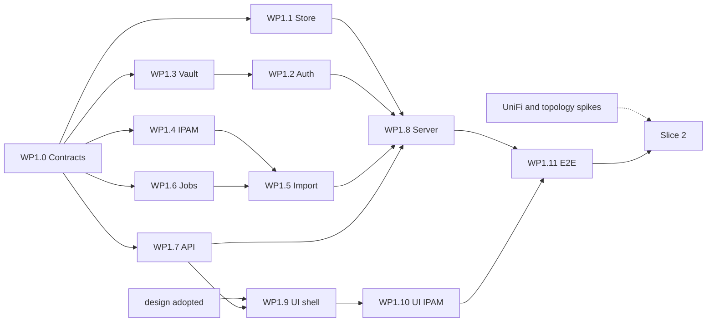

# Phase 1 execution plan: Platform and IPAM

- Status: Accepted by the owner on 2026-10-09 (decisions in 9.3)
- Date: 2026-10-09
- Scope: Phase 1 of [ROADMAP.md](../ROADMAP.md). Requirement IDs refer to [REQUIREMENTS.md](../REQUIREMENTS.md), toggles (TGL) and never-off items (NEVER) to [SECURITY-PROFILES.md](../SECURITY-PROFILES.md).

This plan splits Phase 1 into work packages (WP) that builders take in parallel: contracts first, one owning package per file, ordered merges. "(proposed)" marks a choice where the documents are silent; it binds once the owner accepts the plan and then changes only through rule 2.8.

Sizes: S up to one builder-week, M one to three, L three to six. Crates are `tenko-*`. There is one binary, `tenko` (ADR 0004): `tenko serve --roles …` runs the server roles, and the client subcommands (`login`, `import`, `export`, `prefix`, `audit verify`) talk to the public API; the `tenko-server` and `tenko-cli` crates of the Phase 0 skeleton merge into it in WP1.8. Home Assistant (HASS below) is the home-automation inventory source of CONN-04 (`tenko-connect-hass`).

## 1. Goal, exit criteria and increments

### 1.1 Goal

Replace the IPAM spreadsheet with Tenko's IPAM as the intent hub (ADR 0005), fed by discovery and connectors, on the replicated store of ADR 0002. No DNS or DHCP engine exists yet, so those move-job steps are manual tasks (IPAM-19).

### 1.2 Exit criteria

ROADMAP "Done when" and its Phase 1 verification rows, as checks:

| # | Check | Requirements | Slice |
|---|---|---|---|
| E1 | The owner's spreadsheet is imported, loss report empty or acknowledged; its CSV export re-imported into an empty instance previews zero changes | IPAM-11, MIG-14 | 1 |
| E2 | Passkey login over HTTPS on the configured host name (platform authenticator and hardware key) in each TLS mode of OPS-22 (internal CA, imported certificate, HAProxy in front); TOTP and PIN preset pass end to end | IAM-03, IAM-06, IAM-09, OPS-22 | 1 |
| E3 | OpenAPI served and committed under `docs/api/`; CI fails on drift | API-01 | 1 |
| E4 | Three LANs and the DMZ scanned, one probe each; compose lab inventory matches its answer key | SCAN-01 to SCAN-09 | 2 |
| E5 | Proxmox and HASS inventory visible in IPAM | CONN-02 to CONN-04 | 2 |
| E6 | Topology shows UniFi switches and APs with clients | IPAM-20, CONN-05 | 2 |
| E7 | A VLAN created in IPAM exists in UniFi after dry run and read-back diff | IPAM-03, CONN-06, CONN-08 | 2 |
| E8 | IoT device moved by drag and drop with manual DHCP and DNS steps; five-device lab: `static` device stops at its manual step, blocked step 5 rolls back, uplink and management port refused | IPAM-19, CONN-09, CON-10 | 2 |
| E9 | A 3-node cluster loses a controller: writes resume, no committed write lost, SSE clients and probes reconnect (DNS and DHCP serving is tested from Phases 2 and 3) | OPS-03, OPS-04 | 3 |
| E10 | Windows service and systemd start, stop, upgrade; Docker with macvlan runs | OPS-10, OPS-13, OPS-14 | 3 |
| E11 | Idle RSS below 100 MB with all Phase 1 roles | OPS-15 | 3 |
| E12 | Metrics overhead below 2 percent, p99 unchanged | OPS-21 | 3 |

### 1.3 Increments

| Slice | Content | Closes |
|---|---|---|
| 1. Thin vertical slice | Single-node store (openraft, one voter); first-run wizard; local login with presets, TOTP and passkeys; vault core; TLS; IPAM model; Excel/CSV import and CSV export; prefix tree, grid, host panel; chained audit; jobs; SSE; OpenAPI; CLI | E1 to E3 |
| 2. Discovery and connectors | Operator secrets; enrolment and mTLS; probes; Proxmox and HASS inventory; UniFi read and guarded write; VLAN sync; topology; reconciler; move job; RDP/SSH handoff | E4 to E8 |
| 3. Platform hardening | 3-node Raft; RBAC scopes; audit export; vault hardening and backup; metrics, dashboard, cost budget; deployment; language packs | E9 to E12 |

The owner's split stands, with four moves the documents force:

1. **Vault core into Slice 1.** Slice 1 already holds secrets (TOTP seeds, CA and TLS keys); NEVER-01 forbids plaintext, which the Raft log and snapshots would replicate. Slice 1 builds envelope encryption and KEK providers (IAM-15); operator secrets, reveal audit and rotation (IAM-16) follow in Slice 2.
2. **Audit chain in Slice 1, export in Slice 3.** NEVER-02 makes the chain never-off; added later, it would leave early records unchained.
3. **First-run wizard and TLS into Slice 1.** TGL-01, -02, -04, -06 and -07 default from the chosen profile (API-10); passkeys need a secure context and a host-name relying-party ID, so E2 fails on plain HTTP to an IP address (TGL-08).
4. **Enrolment and mTLS into Slice 2.** E4 needs a probe per segment and a DMZ probe in its own trust zone (SCAN-01), so remote probes must reach the controller before Slice 3, which reuses the channel for Raft (OPS-04).

### 1.4 Requirement coverage

| Slice | Phase 1 requirements |
|---|---|
| 1 | IPAM-01 to IPAM-11 (IPAM-03 as objects), IPAM-12 (intent), IPAM-17, IPAM-18 (warning), IPAM-23 (intent conflicts); IAM-03 to IAM-09, IAM-10 (personal tokens), IAM-15, IAM-18 (chain), IAM-19; API-01 to API-05, API-08 to API-10, API-21 (built-in sv, en); MIG-14; OPS-01, OPS-05 (health), OPS-19 |
| 2 | SCAN-01 to SCAN-09; CONN-01 to CONN-09; IPAM-03 (sync), IPAM-12 to IPAM-16, IPAM-19, IPAM-20, IPAM-23 (observed); IAM-07 (enforcement), IAM-16; API-11; OPS-02 (probes buffer offline), OPS-04 (probe channel) |
| 3 | OPS-03, OPS-04 (Raft), OPS-05, OPS-07, OPS-08, OPS-10, OPS-13 to OPS-15, OPS-20, OPS-21; IAM-01, IAM-06 (per role), IAM-10 (scopes, service accounts), IAM-18 (export); API-21 (runtime packs) |

## 2. Interface contracts

WP1.0 writes these as compiling code and merges them first. Derives and `pub` are implied; names are (proposed) unless a requirement or ADR fixes them.

### 2.1 Identifiers, principals and registries (tenko-core)

```rust
// One transparent newtype over a UUIDv7 (created by the proposer) per entity:
id_type!(TenantId, VrfId, SiteId, VlanId, PrefixId, RangeId, AddressId, HostId, InterfaceId,
         UserId, SessionId, ApiTokenId, JobId, ObservationId, ProposalId, ImportId,
         ConnectorId, SecretId, RequestId);
pub struct NodeId(pub u64);       // Raft node id, assigned at enrolment
pub struct Revision(pub u64);     // +1 per applied WriteBatch; also the SSE event id
pub struct AuditSeq(pub u64);     // gap-free
pub struct Timestamp(pub time::OffsetDateTime);          // UTC, RFC 3339 on the wire
pub struct ObjectRef { kind: ObjectKind, id: uuid::Uuid } // ObjectKind: one variant per entity

pub enum Principal {                                      // IAM-19, NEVER-03
    User   { id: UserId, session: SessionId, strength: AuthStrength },
    Token  { id: ApiTokenId, owner: UserId },
    System { component: SystemComponent, on_behalf_of: Option<UserId> },
    Node   { id: NodeId },                                // probes and peers, Slice 2
}
pub enum AuthStrength { Pin, Password, PasswordTotp, Passkey, HardwareKey }
pub struct RequestCtx { principal: Principal, request: RequestId, now: Timestamp,
                        source_ip: Option<IpAddr>, idempotency: Option<IdempotencyKey> }
pub trait Authorizer: Send + Sync {                       // implemented by tenko-auth
    fn check(&self, p: &Principal, action: Action, object: &ObjectRef) -> Result<(), Denied>;
    fn scope(&self, p: &Principal, action: Action, kind: ObjectKind) -> ScopeFilter; // All in Slice 1
}
```

Store tables, error codes, audit actions, SSE topics, step kinds and UI message keys are namespaced by owning area (`auth.`, `vault.`, `ipam.`, `import.`, `jobs.`, `sys.`), and only the owner adds names, so parallel builders cannot collide. Keys are order-preserving binary (`u64` big-endian, UUID bytes, IP family byte plus octets); values are CBOR with `#[serde(default)]` on new fields, so mixed versions coexist during rolling upgrades (OPS-08) (proposed).

### 2.2 IPAM model (tenko-core::ipam)

```rust
pub struct Meta { revision: Revision, created: Stamp, updated: Stamp, deleted: Option<Stamp>,
                  tags: BTreeSet<Tag>, custom: BTreeMap<FieldKey, CustomValue>, description: Option<String> }
pub struct Stamp { at: Timestamp, by: Principal }

pub struct Tenant { id: TenantId, name: String, meta: Meta }
pub struct Vrf    { id: VrfId, tenant: TenantId, name: String, rd: Option<String>, meta: Meta }
pub struct Site   { id: SiteId, name: String, parent: Option<SiteId>, ad_site: Option<String>, meta: Meta }
pub struct Vlan   { id: VlanId, vid: u16, vni: Option<u32>, name: String, site: Option<SiteId>, status: Status, meta: Meta }
pub struct Prefix { id: PrefixId, vrf: VrfId, cidr: ipnet::IpNet, role: PrefixRole, status: Status,
                    vlan: Option<VlanId>, site: Option<SiteId>, alarm: Option<UtilizationAlarm>, alloc: AllocPolicy, meta: Meta }
pub struct Range  { id: RangeId, prefix: PrefixId, first: IpAddr, last: IpAddr, role: RangeRole, status: Status, meta: Meta }
pub struct Address { id: AddressId, vrf: VrfId, ip: IpAddr, prefix: PrefixId /* most specific */,
                     status: Status, interface: Option<InterfaceId>, dns_name: Option<Fqdn>, meta: Meta }
pub struct Host   { id: HostId, tenant: TenantId, name: HostName, mode: AssignmentMode, lock: bool, site: Option<SiteId>, meta: Meta }
pub struct Interface { id: InterfaceId, host: HostId, name: String, mac: Option<macaddr::MacAddr6>,
                       duid: Option<Duid>, client_id: Option<Vec<u8>>, meta: Meta }

pub enum AssignmentMode { Static, Reserved, Dynamic, Unmanaged }   // IPAM-14
pub enum Status { Planned, Active, Reserved, Deprecated }          // IPAM-05, values proposed
pub enum PrefixRole { Supernet, Network }                          // IPAM-02
pub enum RangeRole { DhcpPool, Reserved, Infrastructure }
pub enum AllocPolicy { Lowest, Highest }                           // IPAM-07
pub struct UtilizationAlarm { warn_pct: u8, crit_pct: u8 }         // IPAM-10
pub struct CustomFieldDef { key: FieldKey, kind: CustomKind, applies_to: Vec<ObjectKind>, required: bool }
```

Anchors: VRFs IPAM-01, sites IPAM-04, VLANs IPAM-03, soft delete IPAM-09, tags and custom fields IPAM-08, `lock` IPAM-16. Rules: overlap only across VRFs (IPAM-23); a v6 prefix off a nibble boundary needs acknowledgement (IPAM-06); a `reserved` host without MAC or DUID warns (IPAM-18). The IPAM-12 intent sentence maps to Host (mode), Interface (MAC), Address (IP, DNS name), Prefix (network, VLAN). `tenko-core::ir` holds the IPAM part of the migration IR (`IrNetwork`, `IrVlan`, `IrHost`, `IrAddress`) and `LossReport { entries: Vec<LossEntry { location, code, detail }> }`, so the spreadsheet import has the adapter shape of ADR 0006 and MIG-01 from the start (proposed).

### 2.3 Observations and proposals (tenko-core::observe)

Fixed now so Slice 2 builds against one shape.

```rust
pub struct Observation { id: ObservationId, source: ObservationSource, subject: Observed,
    observed_at: Timestamp, received_at: Timestamp, expires_at: Option<Timestamp> }
pub enum ObservationSource { Probe { node: NodeId, method: ProbeMethod },  // SCAN-02, -04, -05
    Inventory { connector: ConnectorId }, NetworkController { connector: ConnectorId },
    DnsRecord { zone: Fqdn } /* Phase 2 */, DhcpLease { node: NodeId } /* Phase 3 */ }
pub enum ProbeMethod { Arp, Nd, Mdns, Lldp, Icmp, TcpSyn, OsFingerprint, Snmp }
pub enum Observed {
    Address    { vrf: VrfId, ip: IpAddr, mac: Option<MacAddr6> },
    Host       (ObservedHost),
    Services   { ip: IpAddr, open_tcp: Vec<u16> },      // SCAN-08
    Os         { ip: IpAddr, guess: String, confidence: u8 },
    Attachment { mac: MacAddr6, device: String, port: Option<String>, ssid: Option<String>, vlan: Option<u16> },
    Link       { a: Endpoint, b: Endpoint, kind: LinkKind },  // IPAM-20 edges
}
pub struct Proposal { id: ProposalId, kind: ProposalKind,  // DiscoveredHost | OrphanedRecord | Conflict
    evidence: Vec<ObservationId>, suggestion: SuggestedIntent,
    state: ProposalState }  // Open | Approved(Stamp) | Rejected(Stamp) | AutoAdopted { rule: ObjectRef }
```

`ObservedHost` carries the CONN-02 fields. Observations live in `ipam.obs.*` tables and never overwrite intent (IPAM-12); ingest writes changes only, with "last seen" refreshed at most every 15 minutes (proposed, R9).

### 2.4 Store (tenko-store)

Per ADR 0002: openraft 0.9 over redb, one Raft group, coalesced writes; one voter in Slice 1, three in Slice 3, same trait. A write is a set of physical mutations with preconditions, computed by the proposer from a read view and checked deterministically at apply (proposed). Domain logic never runs in the state machine, so replicas of different versions apply identically (OPS-08).

```rust
pub struct TableName(pub Cow<'static, str>);   // typed TableDef<K, V> helpers wrap it
pub struct WriteBatch {
    principal: Principal,                 // mandatory (NEVER-03)
    proposed_at: Timestamp,               // proposer clock: apply stays deterministic
    request: Option<RequestId>,
    idempotency: Option<IdempotencyKey>,  // API-04: replay returns the first result
    preconditions: Vec<Precondition>,
    mutations: Vec<Mutation>,
    audit: Vec<AuditDraft>,               // chained at apply, same entry (IAM-18)
}
pub enum Precondition {
    Version { table: TableName, key: Bytes, expect: Option<Revision> }, // None: must be absent
    Counter { counter: CounterKey, expect: u64 },                        // e.g. per-VRF tree version
}
pub enum Mutation { Put { table: TableName, key: Bytes, value: Bytes },
                    Delete { table: TableName, key: Bytes }, Bump { counter: CounterKey } }

#[async_trait::async_trait]
pub trait Store: Send + Sync + 'static {
    async fn propose(&self, batch: WriteBatch) -> Result<Committed, StoreError>;
    async fn read(&self, c: ReadConsistency) -> Result<Arc<dyn ReadView>, StoreError>;
    fn watch(&self, from: Option<Revision>, filter: WatchFilter) -> Result<ChangeStream, StoreError>;
    fn register_index(&self, index: Arc<dyn DerivedIndex>) -> Result<(), StoreError>;
    fn status(&self) -> StoreStatus;      // role, leader, revision, lag, cached sizes (OPS-20)
}
pub enum ReadConsistency { Local, AtLeast(Revision), Linearizable }
pub trait ReadView: Send + Sync {         // one redb MVCC read transaction
    fn revision(&self) -> Revision;
    fn get(&self, t: &TableName, key: &[u8]) -> Result<Option<Versioned>, StoreError>;
    fn scan(&self, t: &TableName, range: KeyRange, limit: usize, reverse: bool)
        -> Result<Vec<(Bytes, Versioned)>, StoreError>;
    fn counter(&self, c: &CounterKey) -> Result<u64, StoreError>;
}
pub struct Versioned { value: Bytes, revision: Revision }
pub struct Committed { revision: Revision, audit: Vec<AuditSeq>, replayed: bool }
pub struct ChangeSet { revision: Revision, principal: Principal, at: Timestamp,
                       changes: Vec<(TableName, Bytes /* key */, bool /* deleted */)> }
pub type ChangeStream = BoxStream<'static, Result<ChangeSet, WatchError>>; // Compacted | Lagged: SSE `reset`

pub trait DerivedIndex: Send + Sync + 'static {   // ADR 0002 follow-up: build aside, swap atomically
    fn build(&self, view: &dyn ReadView) -> Result<Box<dyn IndexImage>, StoreError>;
    fn install(&self, image: Box<dyn IndexImage>);   // ArcSwap: never a cleared index
    fn apply(&self, changes: &ChangeSet);            // incremental, in revision order
}
pub struct CoalescerConfig { max_batches_per_entry: usize /* 1,000 */, max_entry_bytes: usize /* 8 MiB */,
                             max_inflight_entries: usize /* 4 */, max_batch_bytes: usize /* 16 MiB */ }
#[derive(thiserror::Error)]
pub enum StoreError { PreconditionFailed(Vec<FailedPrecondition>), IdempotencyMismatch,
    BatchTooLarge { size: usize, limit: usize }, NoQuorum, Timeout, ShuttingDown,
    Compacted { oldest: Revision }, Storage(String), Codec(String) }
```

Invariants: a batch is atomic with one `Revision`; batches sharing a Raft entry apply in order, each against its own preconditions (ADR 0002 decision 4, defaults from Spike A); plaintext secrets never enter a batch (NEVER-01); the journal `sys.journal` feeds `watch` and SSE replay on any controller (ADR 0008 decision 4); snapshot-and-purge runs from Slice 1 (ADR 0002 condition 4). `MemStore` shares the semantics and one conformance suite tests both stores.

### 2.5 Audit (tenko-core::audit, chained in tenko-store)

```rust
pub struct AuditDraft { action: AuditAction, objects: Vec<ObjectRef>, outcome: AuditOutcome,
                        source_ip: Option<IpAddr>, details: AuditDetails } // diff, or old and new toggle value
pub struct AuditRecord { seq: AuditSeq, revision: Revision, at: Timestamp, principal: Principal,
                         request: Option<RequestId>, draft: AuditDraft,
                         prev: [u8; 32], hash: [u8; 32] }  // SHA-256 over deterministic CBOR of the rest
pub enum AuditOutcome { Success, Denied, Failed { code: &'static str } }
```

The state machine assigns `seq` and `hash` at apply, so the chain is identical on every replica and a change commits with its record (IAM-18, NEVER-02). Denied or failed actions (failed logins, refused guardrails) are batches with audit drafts and no mutations.

### 2.6 Job engine (tenko-jobs)

```rust
pub struct JobSpec { kind: JobKind, title: MessageKey, targets: Vec<ObjectRef>, steps: Vec<StepSpec>,
                     timeout: Duration, group: Option<GroupKey> /* parallelism, CONN-09 */,
                     idempotency: Option<IdempotencyKey> }
pub struct StepSpec { kind: StepKind, params: Bytes /* CBOR */, timeout: Option<Duration> }
pub struct Job { id: JobId, spec: JobSpec, state: JobState, steps: Vec<StepRecord>,
                 created: Stamp, runner: Option<NodeId>, revision: Revision }
pub enum JobState { Queued, Running, Waiting, RollingBack, Succeeded, Failed, RolledBack, Cancelled }
pub enum StepState { Pending, Running, Done, Skipped,
    WaitingForObservation { condition: ObservationCondition, deadline: Timestamp },
    WaitingForManual { task: ManualTask },
    Failed { error: CodedError }, Compensating, Compensated, CompensationFailed { error: CodedError } }
pub enum StepOutcome { Done { output: Option<Bytes> }, Skip, Manual(ManualTask),
                       Wait { condition: ObservationCondition, deadline: Timestamp } }
pub struct ManualTask { instruction: MessageKey, args: BTreeMap<String, String>, undo: Option<MessageKey> }
pub struct ObservationCondition { subject: ObjectRef, any_of: Vec<ObservedPredicate> }
pub enum ObservedPredicate { AddressSeen { vrf: VrfId, ip: IpAddr, mac: Option<MacAddr6> }, // ARP or ping
                             LeaseInPrefix { prefix: PrefixId, mac: MacAddr6 } }           // Phase 3

#[async_trait::async_trait]
pub trait StepHandler: Send + Sync + 'static {
    fn kind(&self) -> StepKind;
    fn idempotent(&self) -> bool;         // may be re-run after a crash
    async fn preview(&self, params: &[u8], view: &dyn ReadView) -> Result<StepPreview, StepError>;
    async fn execute(&self, params: &[u8], cx: &StepContext) -> Result<StepOutcome, StepError>;
    async fn compensate(&self, params: &[u8], output: Option<&[u8]>, cx: &StepContext) -> Result<(), StepError>;
}
impl JobEngine {
    pub fn register(&mut self, handler: Arc<dyn StepHandler>);
    pub async fn preview(&self, spec: &JobSpec, cx: &RequestCtx) -> Result<JobPreview, JobError>; // API-09
    pub async fn submit(&self, spec: JobSpec, cx: &RequestCtx) -> Result<JobId, JobError>;
    pub async fn run_inline(&self, spec: JobSpec, cx: &RequestCtx) -> Result<Job, JobError>;
    pub async fn cancel(&self, id: JobId, cx: &RequestCtx) -> Result<(), JobError>;
    pub async fn complete_manual(&self, id: JobId, step: u16, note: Option<String>, cx: &RequestCtx) -> Result<(), JobError>;
    pub async fn on_observation(&self, obs: &Observation);   // wakes waiting steps
}
pub enum JobError { NotFound(JobId), InvalidTransition { from: JobState, action: &'static str },
                    UnknownStepKind(StepKind), Step(StepError), Store(StoreError), Timeout }
```

`Wait` or `Manual` holds the job in `Waiting` until the observation matches, the task is done or the deadline passes; failure or deadline triggers `RollingBack`, compensating finished steps in reverse and turning non-compensable ones into manual undo tasks. End states: `Succeeded`, `RolledBack` ("move failed", IPAM-19), `Failed` (operator needed), `Cancelled`. Each transition is an audited store write and a `jobs` SSE event (IPAM-17); after a restart only `idempotent()` steps re-run. A single edit is an inline one-step job (proposed, Q4).

### 2.7 Connectors (tenko-connect)

```rust
#[async_trait::async_trait]
pub trait Connector: Send + Sync + 'static {
    fn info(&self) -> DriverInfo;
    async fn check(&self) -> Result<HealthReport, ConnectorError>;
}
#[async_trait::async_trait]
pub trait InventorySource: Connector {                                   // CONN-02
    async fn poll(&self, cursor: Option<Cursor>) -> Result<InventoryBatch, ConnectorError>;
    fn webhook(&self) -> Option<Arc<dyn WebhookHandler>> { None }
}
pub struct InventoryBatch { observed_at: Timestamp, hosts: Vec<ObservedHost>,
                            complete: bool /* absent hosts are gone */, cursor: Option<Cursor> }
#[async_trait::async_trait]
pub trait NetworkController: Connector {                                 // CONN-05 to CONN-09
    async fn topology(&self) -> Result<TopologySnapshot, ConnectorError>;
    async fn plan(&self, change: &L2Change) -> Result<L2Plan, ConnectorError>; // read back, diff, guardrails
    async fn apply(&self, plan: &L2Plan, mode: WriteMode) -> Result<L2Receipt, ConnectorError>; // DryRun | Apply
    async fn revert(&self, receipt: &L2Receipt) -> Result<(), ConnectorError>;
}
pub enum L2Change {
    EnsureNetwork   { vlan: u16, name: String, dhcp: ControllerDhcp },  // Disabled | RelayTo(addrs)
    SetPortProfile  { device: DeviceRef, port: u16, profile: ProfileRef },
    SetClientVlan   { mac: MacAddr6, network: NetworkRef },  // network `_id`, not the VLAN number
    ClearClientVlan { mac: MacAddr6 },
}
pub struct Guardrails { protected: Vec<ProtectedPath>, max_parallel: usize }   // CONN-09
pub enum ConnectorError { Unreachable, Unauthorized, Forbidden, NotFound, VerifyMismatch { diff: String },
    GuardrailRefused { rule: &'static str }, WritesDisabled /* TGL-20 */,
    RateLimited { retry_after: Duration }, Protocol(String), Unsupported }
```

`Actuator` (drivers from Phase 2) has the same `plan`, `apply(mode)`, `revert` shape over an `ActuatorIntent`; `MigrationSource` (Phase 4) has `read(scope) -> (Ir, LossReport)`. Credentials are vault `SecretRef`s resolved at call time (ADR 0006). Uplinks are always protected and the management path is derived from topology inside `plan()`; `apply()` re-reads and rejects a stale plan, so guardrails cannot be bypassed.

### 2.8 Errors and the contract change rule

Every error implements `tenko_core::Coded { fn code(&self) -> &'static str; fn http_status(&self) -> u16; fn params(&self) -> BTreeMap<&'static str, String>; }`. Codes are stable once merged (API-08). After the WP1.0 merge a contract change is a small pull request by the lead builder, reviewed by every package using the item; other packages never edit `tenko-core`.

## 3. Slice 1 work packages

| WP | Name | Owns (exclusive write access) | Depends on | Size |
|---|---|---|---|---|
| WP1.0 | Contracts and skeleton | root `Cargo.toml`, `crates/tenko-core/**`, `tenko-store/src/{lib,api,mem,testing}*`, `tenko-jobs/src/model.rs`, `crates/tenko-connect/**`, `tenko-api/src/{lib.rs,routes/mod.rs}`, `.github/workflows/**` | none | M |
| WP1.1 | Store engine | rest of `crates/tenko-store/**`, `bench/phase1-store/` | WP1.0 | L |
| WP1.2 | Authentication and settings | `crates/tenko-auth/**`, `tenko-api/src/routes/{auth,users,setup,settings}.rs` | WP1.0, WP1.3 interface | L |
| WP1.3 | Vault core and local CA | `crates/tenko-vault/**`, `crates/tenko-cluster/src/ca/**` | WP1.0 | M |
| WP1.4 | IPAM domain | `crates/tenko-ipam/**` except `src/{import,export}/`, `tests/fixtures/`; `tenko-api/src/routes/ipam.rs` | WP1.0 | L |
| WP1.5 | Import and export | `tenko-ipam/src/{import,export}/**`, `tenko-ipam/tests/fixtures/**`, `tenko-api/src/routes/import.rs` | WP1.4 plan API, WP1.6 | M |
| WP1.6 | Job engine | rest of `crates/tenko-jobs/**`, `tenko-api/src/routes/jobs.rs` | WP1.0 | M |
| WP1.7 | API platform | rest of `crates/tenko-api/**` (`build.rs`, server, errors, extractors, SSE, static UI, OpenAPI, `routes/{audit,events,system}.rs`), `docs/api/openapi.json` | WP1.0 | L |
| WP1.8 | Server and CLI | `crates/tenko-server/src/**`, `crates/tenko-cli/**` (merged into `crates/tenko/**`), `deploy/**` command lines | WP1.1 to WP1.7 | M |
| WP1.9 | UI shell, auth and setup | `ui/` root config, `ui/src/{app,shell,components,i18n,api,auth,setup,settings}/**` | WP1.7 spec, `design/` | L |
| WP1.10 | UI IPAM, import and audit | `ui/src/{grid,ipam,hosts,import,audit,jobs}/**` | WP1.9 shell | L |
| WP1.11 | Acceptance and E2E | `crates/tenko-server/tests/**`, `ui/e2e/**` | all | M |

Shared files: only WP1.0 edits the root `Cargo.toml`. It pre-declares every Slice 1 dependency, with `openraft =0.9.25` and `redb =4.3.0` pinned as in Spike A and the rest taken from the ARCHITECTURE.md library table plus `ciborium`, `calamine`, `csv`, `encoding_rs`, `arc-swap` (proposed); all must pass `cargo deny`. Later additions go through the lead; `Cargo.lock` conflicts are regenerated. WP1.0 also creates one stub per route module and the OpenAPI assembly listing them, so domain packages only fill their own files.

### WP1.0 Contracts and skeleton (M)

- Section 2 as code; key codecs with ordering property tests; `MemStore` and conformance suite; `Coded` to problem details; route stubs. CI builds the UI before Rust (ADR 0008); Rust-only jobs set `TENKO_UI_STUB=1`, a placeholder page refused in release builds (proposed); OpenAPI drift check (E3).
- Acceptance: `missing_docs` clean; conformance suite green on `MemStore`. Risk: contract churn (rule 2.8).

### WP1.1 Store engine (L)

- openraft 0.9, one voter; `log.redb` and `sm.redb` with page caches sized for the home profile (OPS-15); coalescer; state machine with preconditions, idempotency, revisions, audit chain, journal; chunked snapshots from an MVCC read; snapshot-and-purge; `DerivedIndex` swap at start and on install; `watch`. `fsync_probe()` warns when p50 exceeds 10 ms (OPS-19; Spike A measured 44.5 ms on SMR, under 4 ms on NVMe) (proposed).
- Acceptance: conformance suite, M1, M2, M5. Risks: R4, R5, R13.

### WP1.2 Authentication and settings (L)

- Argon2id (OWASP baseline, stronger for Hardened, proposed); presets PIN, Standard (12+ characters), Hardened (16+ character passphrase), Custom (regex, length, HIBP) with NIST SP 800-63B semantics (IAM-03, TGL-01); HIBP online by k-anonymity, offline as a binary fuse filter (proposed) (IAM-04); progressive lockout with in-memory throttling before any store write (IAM-05).
- TOTP with vault-held seed, WebAuthn with discoverable credentials, hashed recovery codes (IAM-06); MFA for administrators per TGL-02; sessions as a 256-bit `HttpOnly; Secure; SameSite=Strict` cookie stored hashed, lifetimes per TGL-04 (IAM-08).
- Break-glass: WebAuthn only, non-backup-eligible attested key, rate limited instead of locked out, every use alarms (IAM-09) (proposed). Personal tokens (IAM-10). Roles `admin`, `operator`, `viewer` behind `Authorizer` (proposed).
- First run (API-10): one-time setup token printed to console and log (proposed), profile, administrator, host name. First task: ADR 0010 on WebAuthn (R8).
- Acceptance: preset, lockout and RFC 6238 vectors; recorded HIBP and WebAuthn fixtures; break-glass refuses a synced passkey; E2.

### WP1.3 Vault core and local CA (M)

- DEK per secret, AES-256-GCM via `aws-lc-rs` (already used by rustls), KEK-wrapped, `zeroize` on plaintext (IAM-15). Classes `System` (TOTP seeds, CA and TLS keys, never revealable) and `Operator` (Slice 2) (proposed, Q3). KEK providers `Dpapi` (Windows), `SystemdCreds` (Linux, TPM2-sealed where available), `File` (containers and CI, loud warning) (proposed).
- `tenko-cluster::ca`: ECDSA P-256 root (`rcgen`), server certificate for host name and addresses, renewal, root download, imported certificate option (TGL-08).
- Interface: `KekProvider::{wrap, unwrap}`, `Vault::{put_system, get_system, put_operator, reveal, rotate_dek, has_operator_secrets}`, `InternalCa::{init, load, issue_server_cert, root_pem}`.
- Acceptance: no table holds a plaintext marker after the test run; start fails without the KEK; rustls validates the chain. Risk: R11.

### WP1.4 IPAM domain (L)

- `IpamCommand` (create, update with expected revision, soft delete, restore, lock, bulk). `IpamService::plan(cmds, view) -> IpamPlan` yields mutations, preconditions (per-VRF tree counter, per-prefix allocation counter), history rows, audit drafts and warnings without writing; `apply(plan, cx)` proposes it. The same plan is the API dry run (API-09) and the import preview.
- Per-VRF prefix tree as a `DerivedIndex`; next free (IPAM-07); alarms as `system` events (IPAM-10); nibble warning (IPAM-06); status transitions (IPAM-05); history (IPAM-09); tags and custom fields (IPAM-08); intent conflicts (IPAM-23); default tenant and VRF (proposed).
- Acceptance: property tests (no overlap in a VRF; next free never returns a used address; plan then apply equals direct apply); concurrent allocators get distinct addresses after one retry; /16 tree with utilization under 50 ms (proposed).

### WP1.5 Import and export (M)

- Uploads staged 24 hours, up to 20 MB (proposed). CSV in UTF-8 or Windows-1252 with delimiter sniffing; xlsx, xls, ods via `calamine` with sheet and header-row choice.
- Mapping to every model field and custom field, suggested from English and Swedish headers; transforms (split `192.0.2.10-20`, normalize MAC, mask to length). Output: IR plus a loss report by sheet, row and column.
- Plan via `IpamService::plan` (target VRF, conflict policy); apply as a job in 16 MiB chunks with rollback from history. CSV export in the import vocabulary (MIG-14) closes the round trip (IPAM-11).
- Acceptance: synthetic fixture corpus with expected IR and loss reports; zero-change round trip; M11; no half import after a kill. Risk: R7.

### WP1.6 Job engine (M)

- Section 2.6 in full, including observation wake-up tested with synthetic observations, so Slice 2 only adds handlers.
- Acceptance: tests per transition; reverse compensation; undo tasks; deadlines; restart of a non-idempotent step rolls back; group limit 10 holds across 1,000 jobs.

### WP1.7 API platform (L)

- axum on its own 2 to 4 worker runtime; rustls with HTTP/2; plain HTTP only where TGL-08 allows; headers, CSP, caching and `build.rs` embedding per ADR 0008. Extractors producing `RequestCtx`, `Origin`-based CSRF guard (proposed), problem details, pagination, idempotency, rate limits.
- **TLS modes (OPS-22, decided 2026-10-09):** (a) the internal CA of WP1.3; (b) an imported certificate and key with hot reload on file change and expiry warnings in the health view; (c) **termination in a reverse proxy** such as HAProxy with ACME certificates in front of Tenko: the listener accepts plain HTTP or the PROXY protocol only from a configured list of trusted proxy addresses, takes the client address, scheme and host from `X-Forwarded-For`, `X-Forwarded-Proto` and `X-Forwarded-Host` (or PROXY protocol), sets the WebAuthn relying-party ID and the `Secure` cookie flag from the public host name, and refuses forwarded headers from any other source. The wizard offers the three modes; certificate administration (upload, replace, expiry, renewal source) is one settings page. Built-in ACME is a Slice 3 Should.
- SSE per ADR 0008, with journal fallback for replay, topic and authorization filters, cookie authentication.
- OpenAPI via `utoipa`, dumped to `docs/api/openapi.json`; feature `client` gives the CLI the DTOs and a `reqwest` client without axum (API-03) (proposed).
- Acceptance: Spike C serving tests ported; SSE replay across restart; every route in the OpenAPI document.

### WP1.8 Server and CLI (M)

- One binary `tenko` (ADR 0004): `tenko serve --roles controller --data-dir <path> --config <file>` with start order KEK, vault, store, auth, IPAM and jobs, API, and graceful shutdown; the client subcommands on the public API (API-03): `login`, `import`, `export`, `prefix`, `audit verify`, `hibp build` (proposed). The `tenko-server` and `tenko-cli` skeleton crates merge into `crates/tenko` (binary) with the client code behind a `client` feature of `tenko-api`; `deploy/` templates switch to `tenko serve`.
- Acceptance: restart with state on Windows and Linux; headless CLI round trip for E1.

### WP1.9 UI shell, auth and setup (L)

- Adopts `design/` first; then shell, routing, i18n (XLIFF 2.0 sources for `en` and `sv` compiled at build time, ICU MessageFormat, language defaults per API-08 and API-21), dark mode, types from the OpenAPI document via `openapi-typescript` (proposed), SSE client with jittered reconnect, login, enrolment, first-run wizard, settings, user administration.
- Acceptance: axe checks per view (WCAG); lints against literal UI strings and against paths missing from the OpenAPI document (API-02).

### WP1.10 UI IPAM, import and audit (L)

- Virtualized keyboard-driven grid (API-08) and the IPAM, host, import, audit and job views of section 5. Acceptance: 65,536 rows filtered under 100 ms (proposed); keyboard-only import and bulk edit.

### WP1.11 Acceptance and E2E (M)

- Black-box tests against a spawned `tenko-server` (data in the OS temp directory, R13); Playwright for E1 and E2 (Chromium virtual authenticator), ending with `audit verify`; Slice 1 measurements.

## 4. API surface for Slice 1 (proposed)

Conventions:

- Base `/api/v1`, JSON, `snake_case`, RFC 3339 UTC. Cookie `tenko_session` for the UI (same-origin `Origin` on mutations), `Authorization: Bearer` for tokens.
- Lists: `limit` (max 1,000) and opaque `cursor`, returning `{ "items", "next_cursor", "revision" }`; the UI then subscribes to SSE from `revision`. Filters such as `status=`, `vrf=`, `tag=`, `within=192.0.2.0/24`, `q=`, `sort=-updated`; `at_least=<revision>` gives read-your-writes.
- Writes: `Idempotency-Key` on POST (API-04), `If-Match: "<revision>"` on PATCH and DELETE; responses carry `revision` and the inline `job_id`; long operations return `202` with a job; `?dry_run=true` returns the plan (API-09).
- Errors: RFC 9457 problem details with a stable `code`; English `title` and `detail`, translated by the UI from `code` and `params` (API-08):

```json
{ "type": "about:blank", "status": 409, "code": "ipam.prefix.overlap",
  "title": "Prefix overlaps an existing prefix in the VRF", "detail": "192.0.2.0/25 overlaps 192.0.2.0/24",
  "params": { "cidr": "192.0.2.0/24" }, "errors": [ { "field": "cidr", "code": "ipam.prefix.overlap" } ] }
```

| Area | Endpoints | Notes |
|---|---|---|
| Setup | `GET`, `POST /setup` | `{ setup_token, profile, admin, host_name, language }` → session; open only before setup (API-10) |
| Login | `POST /auth/login/password`, `/auth/login/{totp,recovery}`, `/auth/webauthn/login/{start,finish}`, `/auth/logout` | password returns a session or `{ challenge_id, methods }`; WebAuthn covers break-glass |
| Session | `GET /auth/session`, `GET /auth/sessions`, `DELETE /auth/sessions/{id}` | principal, roles, strength, expiry, banner flags (IAM-08) |
| Factors | `POST /auth/password[/check]`, `/auth/totp/enroll/{start,finish}`, `/auth/webauthn/register/{start,finish}`, `/auth/recovery-codes`; `GET`, `DELETE /auth/webauthn/credentials[/{id}]`, `DELETE /auth/totp` | live policy and HIBP feedback; codes shown once |
| Tokens | `GET`, `POST /auth/tokens`, `DELETE /auth/tokens/{id}` | shown once, expiry capped by TGL-05 (IAM-10) |
| Users | `/users[/{id}]` CRUD, `POST /users/{id}/unlock`, `DELETE /users/{id}/sessions`, `PUT /users/{id}/roles`, `GET /roles`, `PUT /system/break-glass` | global roles; break-glass needs fresh authentication (IAM-09) |
| Settings | `GET`, `PATCH /settings/security` | profile, toggles, deviations; audited |
| Tenancy | `/tenants`, `/vrfs`, `/sites`, `/vlans` CRUD | IPAM-01, IPAM-03, IPAM-04 |
| Prefixes | `/prefixes[/{id}]` CRUD, `GET /prefixes/tree`, `POST /prefixes/{id}/next-free-{address,prefix}`, `GET /prefixes/{id}/addresses?include_free=true`, `/prefixes/{id}/ranges`, `/ranges/{id}` | utilization and alarms in the tree; next free (IPAM-07) |
| Addresses, hosts | `/addresses[/{id}]`, `/hosts[/{id}]` CRUD, `POST /hosts/{id}/interfaces`, `PATCH`, `DELETE /interfaces/{id}` | mode, lock, MAC, DUID |
| Common | `GET /{collection}/{id}/history`, `POST /{collection}/{id}/restore`, `POST /{collection}/bulk`, `GET /tags`, `/custom-fields[/{key}]`, `GET /search?q=` | IPAM-08, IPAM-09, API-04 |
| Import | `POST /imports` (multipart), `PUT /imports/{id}/mapping`, `GET /imports/{id}/preview`, `POST /imports/{id}/apply`, `GET`, `DELETE /imports/{id}` | upload returns sheets, columns with samples and a suggested mapping; preview returns summary, rows and loss report; apply returns `202 { job_id }` |
| Export | `GET /exports/{prefixes,addresses,hosts}.csv` | import vocabulary (MIG-14) |
| Jobs | `GET /jobs[/{id}]`, `POST /jobs/{id}/cancel`, `POST /jobs/{id}/steps/{index}/complete` | IPAM-17 |
| Audit | `GET /audit[/{seq}]`, `GET /audit/verify` | chain check (IAM-18) |
| Events | `GET /events?topics=ipam,jobs,audit,import,system` | SSE, ids are revisions |
| Health | `GET /health`, `/health/ready`, `/system/status`, `/openapi.json`, `/metrics` | liveness open; metrics need a token with `metrics` scope (OPS-05) |

Events carry references, not bodies (`{ "topic": "ipam", "objects": [{ "kind": "address", "id": "..." }], "revision": 4712 }`); the UI refetches what it shows, so no event leaks fields a principal may not read. `system` carries alarms (IPAM-10), `reset` and `shutdown`.

## 5. UI scope for Slice 1

The visual design comes from the concurrent design spike in `design/`; WP1.9 adopts it (tokens, typography, components, grid and panel patterns) and the owner approves the adoption before any view is styled.

| View | Content | Requirements |
|---|---|---|
| Shell | Navigation, search, shortcuts, language, dark mode, SSE status, job panel, banner while Lab or a weaker-than-Home toggle is active | API-08, API-09 |
| Login and account | Passkey first; password then second factor; passkey and TOTP enrolment, recovery codes, sessions, tokens | IAM-03 to IAM-10 |
| First-run wizard | Setup token, profile and its toggles, administrator, host name, CA root download, disk check | API-10, OPS-19 |
| Prefix tree | VRF selector, utilization, status, VLAN, alarms, next free, edit with preview | IPAM-01 to IPAM-07, IPAM-10 |
| Address grid | Free gaps, inline edit, multiselect, bulk changes with preview, history | IPAM-05, IPAM-09, API-09 |
| Host panel | Mode, lock, interfaces with MAC and DUID (IPAM-18 warning), addresses, tags, custom fields, history; empty observation section for Slice 2 | IPAM-08, IPAM-14, IPAM-16 |
| Import wizard | Upload, sheet and header row, mapping with samples, preview with loss report, apply with progress, rejected rows as CSV | IPAM-11 |
| Audit and settings | Audit grid with diff and chain status; profile and toggles; users and roles | IAM-18, API-10 |

## 6. Order of work, parallelism and merging



| Merge | Contents | Gate |
|---|---|---|
| M0 | WP1.0 | Compiles; conformance suite green on `MemStore`; CI builds UI before Rust |
| M1 | WP1.3, WP1.6, WP1.7 skeleton | Unit tests; Spike C serving tests |
| M2 | WP1.1, WP1.4, WP1.2 | Raft store passes the conformance suite; IPAM and auth API tests on both stores |
| M3 | WP1.5, WP1.8, WP1.9, WP1.10 | Server boots with all parts; OpenAPI committed; UI typechecks against it |
| M4 | WP1.11 | E1 to E3; Slice 1 measurements recorded |

After M0 seven packages run at once (WP1.1 to WP1.4, WP1.6, WP1.7, WP1.9), all against `MemStore`; UI work uses a mock server from the OpenAPI stubs until M3 (proposed). The ROADMAP's UniFi and topology-library spikes need no Tenko code and run during Slice 1 (`bench/spike-d-unifi/`, `bench/spike-e-topology/`, proposed). Integration points: store semantics, `Authorizer`, `IpamService::plan`, `StepHandler`, OpenAPI types and SSE topics, design tokens.

## 7. Slices 2 and 3 in outline

Slice 2: discovery and connectors

| WP | Owns | Depends on | Content | Acceptance | Size, risk |
|---|---|---|---|---|---|
| WP2.1 Operator secrets | `tenko-vault`, `tenko-auth` IAM-07 check, vault and remote routes | Slice 1 | Revealable secrets with rotation and reveal audit (IAM-16), IAM-07 gate, RDP/SSH handoff (API-11) | PIN-only account blocks a secret; reveals audited | M, Q3 |
| WP2.2 Enrolment, mTLS | `tenko-cluster` | WP1.3 | Enrolment tokens, node certificates, gRPC over mTLS, version negotiation (OPS-04, OPS-08); probe buffering | Probe enrols, reconnects, rejects a foreign CA | M, `protoc` on Windows |
| WP2.3 Probe | `tenko-scan`, its `fuzz/` targets | WP2.2 | Passive (SCAN-02), active (SCAN-04), SNMPv3 (SCAN-05), schedules and limits with TGL-18, TGL-19 (SCAN-06), IDS guide (SCAN-07), on-demand scan jobs (SCAN-09) | E4; fuzz target per parser (API-15) | L, R12 |
| WP2.4 Reconciler | `tenko-ipam/src/{observe,reconcile,proposals}/` | Slice 1 | Ingest, proposals and auto-adopt (IPAM-15), lock (IPAM-16), observed conflicts (IPAM-23), jobs from drift (IPAM-13) | Unknown MAC becomes a proposal; locked host untouched | L, R9 |
| WP2.0 Plugin SDK and host | `tenko-connect` (protocol, host runner, helper library, manifest, conformance test), `tenko plugin` subcommands | Slice 1 | ADR 0012: process plugins over gRPC with handshake, supervision, secret injection, settings schema (CONN-19); the scheduler for inventory polling lives in the host | A sample plugin passes the conformance test; a crashing plugin is restarted and never affects the API | L, protocol design |
| WP2.5 Inventory | `tenko-connect-{proxmox,hass}` as reference plugins | WP2.0, WP2.1, WP2.4 | `InventorySource` plugins (CONN-02 to CONN-04, CONN-20) | E5 | M, API drift |
| WP2.6 UniFi | `tenko-connect-unifi` as the first reference plugin | spike, WP2.0, WP2.1 | Detection (CONN-07), read incl. SSIDs (CONN-05, CONN-18), guarded writes (CONN-06, CONN-08, CONN-09), TGL-20; the first plugin to exercise the whole contract | Dry run before first write; uplink refused; passes the conformance test | L, R6 |
| WP2.7 VLAN, topology | `tenko-ipam/src/{vlan_sync,topology}/`, UI map | WP2.3, WP2.6 | VLAN create job (IPAM-03); graph (IPAM-20) | E6, E7 | M, map scale |
| WP2.8 Move job | `tenko-ipam/src/move/`, UI drag and drop | WP2.4, WP2.6 | IPAM-19 steps 1 to 7 (2, 3, 6 manual), ARP or ping wait, step 4 rollback, parallelism limit | E8 | L, per-client VLAN support |
| WP2.9 UI discovery | `ui/src/{discovery,proposals,connectors,topology}/` | WP2.3 to WP2.7 | Ports and OS (SCAN-08), proposals, scans, connector settings | Keyboard and axe checks | L, design coverage |
| WP2.10 Releases and upgrades | `crates/tenko/src/upgrade/`, the store format version, `.github/workflows/release.yml`, `CHANGELOG.md`, `ui/src/updates/` | Slice 1 | OPS-23: format version and migrations, `tenko upgrade check`, compatibility test against the previous release, release workflow with checksums, changelog discipline checked in CI; OPS-24: release manifest with notes, update notice and what's new in the UI, installation from the UI for native single-node installs through a `current` link and a supervisor restart, rollback on failed health. Scheduled before WP2.6, because it fixes how the store format may change | A data directory from the previous release opens and migrates; an older binary refuses a newer directory; a tagged build publishes binaries, image and checksums; the UI shows the notice and notes against a mock manifest and installs on a single node in the acceptance run | M, R17 |

Slice 3: platform hardening (detailed in [slice-3-plan.md](slice-3-plan.md), written 2026-10-10 after Slice 2)

| WP | Owns | Content | Acceptance | Size |
|---|---|---|---|---|
| WP3.1 Raft cluster | `tenko-store` network module, `tenko-cluster` Raft service | Transport over mTLS, learner-then-voter membership, snapshot streaming with index swap, write forwarding, job lease takeover, one node grown to three (OPS-03) | E9, M1 to M4 | L |
| WP3.2 RBAC scopes | `tenko-auth` authorization, `tenko-ipam` scope filters | Object scopes and delegation (IAM-01), MFA per role (IAM-06), scoped tokens, service accounts (IAM-10) | Scope matrix; SSE filtered by scope | L |
| WP3.3 Audit export | `tenko-auth::audit_export` (proposed) | syslog, CEF, JSON with chain head, alert on failure (IAM-18, TGL-21) | A tampered record is detected | M |
| WP3.4 Vault, backup | `tenko-vault`, CLI backup | KEK rotation, TPM, consistent backup and restore (OPS-07) | Restore on a new host verifies | M |
| WP3.5 Observability | `tenko-core::metrics` (proposed), metrics route, dashboard | Per-shard counters (OPS-21), traces (OPS-05), dashboard (OPS-20) | M8, M9 | M |
| WP3.6 Deployment | `deploy/**`, `tenko-server` platform modules | Windows service (OPS-10), systemd hardening (OPS-13), Docker macvlan (OPS-14), upgrades (OPS-08) | E10 | M |
| WP3.7 Language packs | `ui/src/i18n/`, i18n route | Runtime XLIFF 2.0 packs (API-21) | Fallback to English | M |
| WP3.8 Phase exit | `tenko-server/tests/**`, `bench/phase1-*` | E1 to E12 with results | ROADMAP "Done when" | M |
| WP3.9 Partition behaviour | `tenko-store` quorum state, `tenko-api` isolated mode, `tenko-ipam` proposal queue, UI banner and staleness indicator | WP3.1 | OPS-26: isolated state surfaced by the store, writes refused with `cluster.no_quorum`, reads served with a staleness indicator, changes queued as proposals and re-planned on reconnection with conflicts shown, observations buffered on `dns`, `dhcp` and `probe` nodes and merged as per-source facts; ADR 0013 (partitions and multi-site ownership) | A three-controller cluster split 2 against 1: the minority refuses writes and serves reads, the data plane on its side keeps answering, a queued proposal on the minority applies after the split heals or is shown with its conflict, and no object differs between the nodes afterwards | M, R18 |

## 8. Phase 1 measurements

Results go to `bench/phase1-*/results/` with scripts, machine and versions, as in Phase 0; data on SSD or NVMe (OPS-19).

| # | Measurement (origin) | Threshold | Method | Slice |
|---|---|---|---|---|
| M1 | Index swap on snapshot install (ADR 0002) | No empty reads; p99 below 2x baseline during install | Spike A 6 M RRset index as a test `DerivedIndex` | 1, 3 |
| M2 | Crash and restart (ADR 0002) | No lost commit or partial batch; chain verifies | 100 kills under bulk and steady writes; one VM power cut | 1, 3 |
| M3 | Failover (ADR 0002) | Writes resume within 15 s (proposed) | Kill the leader at 100 writes/s, 20 runs | 3 |
| M4 | Network transport (ADR 0002) | 6 M RRset catch-up below 5 min on 1 Gbit; 1,000 updates/s, p99 below 250 ms | Spike A workload over mTLS, three hosts | 3 |
| M5 | Coalescer ceiling (ADR 0002) | At least 1,000 updates/s | Nightly and on openraft upgrades | 1 |
| M6 | Disk growth (ADR 0002) | `sm.redb` below 2x raw after re-seed | A week of synthetic churn | 1, 3 |
| M7 | UI and SSE on Linux, two hosts, TLS, HTTP/2 (ADR 0008) | Spike C targets: 200 ms cold start, 30 MB idle, 10,000 clients per GB | Spike C scripts against `tenko-server` | 1, 3 |
| M8 | Metrics cost (OPS-21) | Below 2 percent, p99 unchanged | Spike B responder with `tenko-core::metrics` on and off; again in Phase 2 | 3 |
| M9 | Idle RSS (OPS-15) | Below 100 MB, all Phase 1 roles | 10 minutes idle after import, Windows and Linux | 1, 3 |
| M10 | fsync probe (OPS-19) | Warns on SMR, silent on NVMe | Both workstation disks | 1 |
| M11 | Import speed (IPAM-11) | 10,000 rows: preview 2 s, apply 5 s (proposed) | WP1.5 bench | 1 |

## 9. Risks and open questions

### 9.1 Owner decisions needed before building starts

| # | Question | Proposed resolution |
|---|---|---|
| Q1 | Accept the slice moves in 1.3? | Yes; they follow from NEVER-01, NEVER-02, API-10, TGL-08 and SCAN-01 |
| Q2 | WebAuthn under the OpenSSL ban | An OpenSSL-free relying-party crate or a minimal in-house verifier (ES256, EdDSA, RS256; attestation `none`, `packed`), as ADR 0010 |
| Q3 | Do system keys (TOTP seeds, CA key) count as "the vault holds secrets" (IAM-07)? | No, only revealable operator secrets; otherwise the first TOTP enrolment ends PIN-only login |
| Q4 | Is every single edit a job (IPAM-17)? | Yes, an inline one-step job committed with the change |
| Q5 | Host name and trust for passkeys | The wizard requires a host name (an RP ID cannot be an IP address); the owner adds it to AD DNS and installs the local CA root on admin clients, or imports a certificate |
| Q6 | Store write model of 2.4 | Accept, as ADR 0011 (proposed) |
| Q7 | Spreadsheet sample | Header row and anonymized row patterns before WP1.5; the real file stays out of the repository (API-13) |

### 9.2 Risk register

| # | Risk | Proposed resolution |
|---|---|---|
| R1 | Licence undecided (API-20) | `deny.toml` stays permissive-only; nothing to decide before publication |
| R2 | Windows Server version of the lab | Phase 4 only; decide by the end of Phase 3 |
| R3 | No IPv6 at home | Dual-stack model from Slice 1 (IPAM-06); v6 scanning tested in the compose lab |
| R4 | openraft 0.9 caps single-entry writes near 120/s | All writes through the coalescer, never a direct `client_write`; M5 nightly and on upgrades |
| R5 | redb write amplification (about 4.2x), no online compaction | IPAM data is small; snapshot-and-purge from Slice 1; re-seed in Slice 3; RocksDB stays the fallback (ADR 0002) |
| R6 | UniFi classic API: the key may not work there; local login brings CSRF tokens and a self-signed certificate | Spike in Slice 1; vault-held local admin fallback (CONN-07); certificate pinned on first contact (proposed); read-back diff before writes (CONN-08) |
| R7 | Excel variability: merged cells, late header rows, formulas, ranges in a cell, semicolons, Windows-1252 | Sniffing, header-row choice, transforms, per-row loss report, fixture corpus, the owner's row patterns (Q7) |
| R8 | `webauthn-rs` (ARCHITECTURE.md candidate) pulls in OpenSSL, banned by `deny.toml` | Q2, confirmed with `cargo deny` first |
| R9 | Observation volume through Raft | Changes only, coarse last-seen, coalescing; fallback a per-controller cache (needs an ADR) |
| R10 | WebAuthn needs a secure context and host-name RP ID | Q5; `localhost` for development |
| R11 | DPAPI and Windows service API are FFI (API-16) | Safe wrapper crates, else one ADR naming the module |
| R12 | nmap's OS database is not permissive; Npcap may not be redistributed, and raw sockets need it to build | Own fingerprint signatures plus connector data; users install Npcap; active scanning behind a feature |
| R13 | The workstation's repository drive is SMR (store tests 93x slower) | Tests use the OS temp directory, override `TENKO_TEST_DATA_DIR` (proposed) |
| R14 | API-03 "shares the client library" cannot be literal across Rust and TypeScript | Both derive from one OpenAPI document |
| R16 | Plugin executables run with Tenko's identity on the host (ADR 0012) | Install from trusted sources only; manifest permissions enforced by the host; package signing and sandboxed Wasm with the hub (CONN-21) |
| R17 | Self-update of a network service is a supply-chain path (OPS-24) | Pinned release source, checksums now and signatures with API-19, step-up authentication and audit for installs, installation from the UI off in Hardened, dry-run migration and automatic switch-back on failed health |
| R18 | A cut-off site that must keep changing its own data cannot do so under one Raft group (OPS-26) | Make the isolated state visible and queue changes as proposals in Slice 3; site-local ownership groups in Phase 5 (OPS-27) for sites that need local writes |
| R15 | KEK directory trust: a plain-file KEK generation stays readable when a sealed provider (DPAPI, systemd-creds) is active, so anyone who can write the KEK directory could drop in a higher-numbered plain generation and make it active | Directory permissions (0700, service account only) from Slice 1; in Slice 3 refuse plain generations once a sealed one exists unless explicitly allowed, and alarm on a provider downgrade |

### 9.3 Decisions taken on 2026-10-09

| # | Decision |
|---|---|
| Q1 | Accepted: the four slice moves in 1.3 stand |
| Q2 | `webauthn-rs` is confirmed to pull in OpenSSL and is out. WP1.2 evaluates the OpenSSL-free relying-party crates on crates.io (`webauthn_rp`, `passkey-auth`) against `cargo deny`, `cargo audit`, test coverage and maintenance; if neither passes, a minimal in-house verifier (ES256, EdDSA, RS256; attestation `none` and `packed`) is written. The choice is ADR 0010 |
| Q3 | Accepted: system keys (TOTP seeds, CA and TLS keys) do not count as "the vault holds secrets" for IAM-07; only revealable operator secrets do |
| Q4 | Accepted: every single edit is an inline one-step job committed with the change |
| Q5 | Three TLS modes from Slice 1 (OPS-22): internal CA with a host name in AD DNS and the CA root installed on admin clients; an imported certificate with hot reload; and TLS termination in the owner's HAProxy with ACME certificates, which is the expected home deployment. Certificate administration must be a single, simple settings page. `localhost` is the relying-party ID during development |
| Q6 | Accepted as ADR 0011 (store write model) |
| Q7 | The owner places the real spreadsheet outside the repository (`C:\Users\plm\Documents\tenko-samples\`); the lead reads its structure there and writes anonymized fixtures into `tenko-ipam/tests/fixtures/`. The original is never committed |
| Binary | One binary `tenko` with `serve` and client subcommands (ADR 0004); WP1.0 creates the skeleton and removes `tenko-server` and `tenko-cli` |
| Q8 | Upgrades and releases (asked on 2026-10-09): the owner approved the upgrade package (OPS-23) and asked for in-app updates with an "update available" notice and release notes (OPS-24). The lead proposed the profile defaults of TGL-23 (install from the UI in Home, Standard with step-up, and Lab; file upload only in Hardened) and the single-node scope for the first version; open for the owner to override |
| Q9 | Separate installation of components (owner requirement 2026-10-09: DHCP apart from DNS and IPAM; DNS alone). Placement was already covered by roles (ADR 0004, OPS-01); the lead added the module switch (OPS-25) so that an installation can run one module alone with the others absent from API and UI. The controller role stays the management plane of every installation |
| Q10 | Sites that lose connectivity and change on both sides (owner requirement 2026-10-09). The lead's answer: the control plane stays a single source of truth (Raft), so an isolated controller never diverges; it shows the isolated state, keeps serving reads and queues changes as proposals that are re-planned on reconnection with conflicts shown, while the data plane keeps serving and observations and leases merge by their own rules (OPS-26, Slice 3). Sites that must keep writing while cut off get site-local Raft groups with explicit ownership in Phase 5 (OPS-27). An ADR follows when Slice 3 starts |
| Q11 | Zone replication over thin links (owner remark 2026-10-09): replication between sites must not require a full cluster. Answer: three tiers exist by design. Raft only among controllers on one site; data-plane nodes at other sites synchronize by resumable deltas with a bandwidth cap and serve from local copies (OPS-28, Slice 3); and standard IXFR and NOTIFY with TSIG or XoT between independent installations or third-party servers (DNS-09, Phase 2) |
