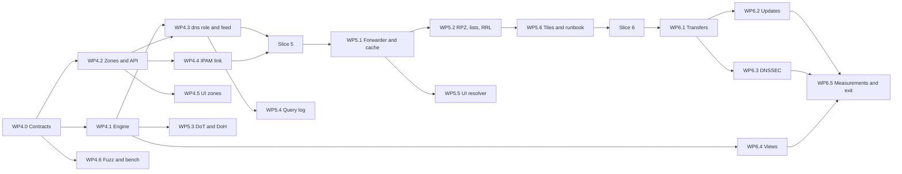

# Phase 2 plan: DNS

- Status: Draft for the owner's decisions (section 7); nothing in it binds until the owner answers. The owner's direction of 2026-10-17, single node first and the cluster data plane in Phase 5, is worked in (section 2.10)
- Date: 2026-10-17
- Scope: Phase 2 of [ROADMAP.md](../ROADMAP.md) (deliverables and "Done when"), written against `main` at `701a5ef` after the Phase 1 exit work recorded in [phase-1-exit.md](phase-1-exit.md). Requirement IDs refer to [REQUIREMENTS.md](../REQUIREMENTS.md), toggles (TGL) and never-off items (NEVER) to [SECURITY-PROFILES.md](../SECURITY-PROFILES.md), RFC targets to [CONFORMANCE.md](../CONFORMANCE.md). Exit criteria, measurements and risks continue the Phase 1 series (E13 onward, M16 onward, R38 onward) so that one trace covers the project.

This plan does for Phase 2 what [phase-1-execution.md](phase-1-execution.md) and [slice-3-plan.md](slice-3-plan.md) did for Phase 1: the goal, the exit criteria as checks, three slices, the contracts the packages share, the work packages with owners and acceptance, the order of merging, the measurements, the risks and the decisions only the owner can take. "(proposed)" marks a choice the documents leave open; it binds once the owner accepts the plan and then changes only through rule 2.8 of the execution plan. Sizes: S up to one builder-week, M one to three, L three to six.

Contents:

1. [Scope and exit](#1-scope-and-exit)
2. [Design decisions the packages share](#2-design-decisions-the-packages-share)
3. [Contracts and shared files (WP4.0)](#3-contracts-and-shared-files-wp40)
4. [Work packages](#4-work-packages)
5. [Order, parallelism and merging](#5-order-parallelism-and-merging)
6. [Measurements and exit checks](#6-measurements-and-exit-checks)
7. [Owner decisions](#7-owner-decisions)
8. [Risks](#8-risks)
9. [Owner actions](#9-owner-actions)
10. [Documents this phase writes](#10-documents-this-phase-writes)

## 1. Scope and exit

### 1.1 Goal

Tenko serves DNS: an authoritative engine fed from the replicated store and from IPAM, a forwarder and cache with policy zones in front of it, and the transfers, dynamic updates, DNSSEC and views that let it stand beside BIND and Windows DNS. The `dns` role serves from its local copy and keeps serving when the controllers are gone (OPS-02). From this phase the move job's DNS step is automatic (IPAM-19). Recursion stays forwarding plus cache (ADR 0007); the full resolver is Phase 5.

Phase 2 builds and measures a **single node**: one process with the `controller` and `dns` roles, the shape of the home lab (ADR 0004). The design stays cluster-aware so that nothing is done twice, but the multi-node data plane (a `dns` node fed by another controller) is Phase 5 work by the owner's direction of 2026-10-17 (section 2.10). The reason is practical: a working node early, so that trying, debugging and tuning happen while they are cheap, and performance measured on one node before anything is distributed, so that a later cluster figure can be compared against it and the slow link named.

### 1.2 Exit criteria

ROADMAP "Done when" for Phase 2 plus the verification rows that name DNS, as checks. E13 to E16 are the ROADMAP lines; E17 to E21 are what the requirements make testable and what the Phase 1 exit left to this phase.

| # | Check | Requirements | Slice |
|---|---|---|---|
| E13 | dnsperf and flamethrower numbers are documented for one Tenko node: per core on loopback and from a load generator on another host over a real link, UDP and TCP, with and without metrics | DNS-27, OPS-21 | 4 (loopback), 6 (real link) |
| E14 | A home network sends all of its queries through Tenko: the owner's clients resolve through a Tenko node that forwards AD zones to the domain controllers and everything else to a DoT upstream, with a blocklist active | DNS-02, DNS-15, DNS-21, DNS-23, TGL-14, TGL-22 | 5 |
| E15 | BIND as secondary receives Tenko's zones (AXFR, IXFR, NOTIFY, TSIG, XoT) and Tenko as secondary receives a BIND zone; Windows DNS as primary of one zone into Tenko on the owner's go | DNS-09, DNS-19, TGL-10 | 6 |
| E16 | Fuzz targets for the wire format, the zone file parser and TSIG run in the weekly fuzz smoke | API-14, API-15 | 4 (wire, zone file), 6 (TSIG) |
| E17 | Every IPAM address with a DNS name has its A or AAAA and PTR records in Tenko zones, reverse zones exist for the managed prefixes including an RFC 2317 delegation, and the five-device move lab of Phase 1 (E8) runs with the DNS step automatic | DNS-22, IPAM-19, IPAM-13 | 4 |
| E18 | An RFC 2136 update signed with TSIG from `nsupdate` is applied through the store and answered from the index, refused without the key or outside the ACL, and answered SERVFAIL when the store refuses the write (the no-quorum path, exercised with the store's test hook on one node) | DNS-11, TGL-09 | 6 |
| E19 | A zone signed by Tenko (NSEC and NSEC3) validates in an external validator, a ZSK rollover completes without a validation failure, and CDS and CDNSKEY are published for the KSK | DNS-12, OPS-09 | 6 |
| E20 | DoT and DoH are served with the certificate of the configured TLS mode and answer `kdig`; RRL slows a reflection pattern; ANY answers are minimal; a TXT over 255 bytes round-trips split | DNS-14, DNS-17, DNS-18, DNS-24, TGL-11 | 5 (DoT, DoH), 4 (the rest) |
| E21 | Idle RSS below 100 MB with all Phase 1 roles plus `dns` serving the home zones and a 10,000-entry cache, on the musl binary, one node; metrics overhead on the query path below 2 percent | OPS-15, OPS-21 | 6 |

### 1.3 Increments

| Slice | Content | Closes |
|---|---|---|
| 4. Authoritative core | Zone and record model in the store; the `dns` namespace; the UDP and TCP engine of ADR 0009 on `domain`; EDNS, cookies, minimal responses, ANY, TXT; the in-memory index with the atomic swap of M1, fed in-process; the `dns` role in the controller's process; a plain forwarder so the node is usable at home from this slice (P2-Q16); zone file import and export; the API, CLI and UI for zones and records; reverse zones from IPAM and the DNS actuator; fuzz targets; loopback measurements | E16 (two of three), E17, E20 (the rest), E13 (loopback) |
| 5. Resolver side | Forwarder and conditional forwarders, stub zones, the cache with serve-stale and prefetch, recursion ACL per view, DoT and DoH upstream, 0x20 and port randomisation, RPZ and blocklists, DoT and DoH served, the query log with GDPR controls, dnstap, dashboard tiles | E14, E20 (DoT, DoH) |
| 6. Transfers, updates, DNSSEC, views | AXFR, IXFR, NOTIFY, TSIG, XoT in and out with ACLs; catalog zones; RFC 2136 updates; DNSSEC signing with rollover; views and zone scopes in the API and UI; the BIND and Windows interop lab; two-host measurements; M8 and M9 again | E13 (two hosts), E15, E16 (TSIG), E18, E19, E21 |

Why this order (P2-Q1): the authoritative core is what every other part feeds on. The resolver side comes second because E14 is the owner's daily use (the Pi-hole and router resolver replacement) and because the cache and the view selection share the lookup path, which Slice 4 must leave room for. Transfers and DNSSEC come last because their value at home is interop with the existing AD DNS, which Phase 4 migrates anyway, and because they need the most lab work.

### 1.4 Requirements

| Slice | Phase 2 requirements |
|---|---|
| 4 | DNS-01, DNS-04, DNS-05, DNS-06, DNS-07, DNS-17 (minimal responses; RRL in 5), DNS-18, DNS-22, DNS-24, DNS-20 (the model and the per-query view selection; management in 6), MIG-15, IPAM-19 (DNS step), OPS-25 (the DNS module switch exists; the module gains content) |
| 5 | DNS-02, DNS-08, DNS-14, DNS-15, DNS-17 (RRL, per-client limits), DNS-21, DNS-23, DNS-26, OPS-06, OPS-20 (DNS tiles), TGL-11, TGL-14, TGL-15, TGL-22 |
| 6 | DNS-09, DNS-10, DNS-11, DNS-12, DNS-19, DNS-20 (views, scopes, weights in API and UI), DNS-27, OPS-09, TGL-09, TGL-10, TGL-13 |
| Could, last | DNS-25 (SPF, DKIM, DMARC wizard) if the UI package of Slice 6 has room |

### 1.5 Phase 1 follow-ups absorbed

From section 4 of the exit document:

| Item | Where |
|---|---|
| M8 again with the DNS engine on the hot path | M20 in Slice 6 |
| DNS tiles on the dashboard | WP5.6 |
| The 6 M RRset data set for M4 (needs the DNS module) | M18 loads it; M4 on the VMs is the owner's Phase 1 item and may use it |
| The allocator question if M5 drops on musl (S3-Q10) | Closed by the Linux memory results of 2026-10-16 (the musl binary passes M9 and is the only Linux binary); M21 keeps measuring on musl |
| The idle RSS bisect, allocator trim, compact index layout | The rise is explained (code size and the language packs, 2026-10-16 results); the compact index layout is M18's question, scheduled only if 6 M RRsets exceed the Spike A memory |
| Built-in ACME for the API certificate | P2-Q8; not built unless the owner says so |

### 1.6 Left out, with reasons

| Item | Reason | Goes to |
|---|---|---|
| DNS-03 own resolver, DNS-13 validation, DNS-34 QNAME minimisation and aggressive cache | ADR 0007: forwarder first | Phase 5 |
| DNS-16 DoQ | Should, Phase 5 by the requirement | Phase 5 |
| DNS-28 to DNS-33 (GSS-TSIG, aging, DC locator, GQBL, GlobalNames, netmask ordering) | Phase 4 with the AD work; the RRset ownership field they need is designed now (section 2.5) | Phase 4 |
| DHCP-13 DDNS from DHCP | Phase 3; the update path of section 2.4 is what it will use | Phase 3 |
| Webhook ingress route, SSID writes and DHCP relay verification on UniFi, raw-socket scanner methods | Connector and scanner work, not DNS; the owner's quota is better spent on the DNS slices | P2-Q13 |
| OPS-17 anycast hooks | Phase 5; the health endpoint the hooks read exists | Phase 5 |
| Per-node zone selection (a `dns` node serving a subset of the zones) | Every node serves every zone in Phase 2; sites and ownership are OPS-27 | Phase 5 |
| The multi-node data plane: the node-file feed, the `dns` subset in node sync, `Dns.Update` over the cluster channel, a `dns` node without a controller, the three-process and VM labs for DNS | The owner's direction of 2026-10-17: single node first; the store model, the feed trait and the ownership rules are built so that this adds on (section 2.10) | Phase 5 |

### 1.7 Starting point in the code

Facts the packages build on (read on `701a5ef`):

- **Crate.** `crates/tenko-dns` is a placeholder (a name and a version). `domain` 0.12.3 is already in `Cargo.lock` through `tenko-scan` (mDNS); `hickory-proto` is not a workspace dependency. The Spike B responder (`bench/spike-b-udp`, outside the workspace) holds the `Codec` trait, the blocking UDP workers with `SO_REUSEPORT`, the EDNS and truncation rules and the counting-allocator bench, written against `domain` 0.12.3 and `hickory-proto` 0.26.3.
- **Store.** Table names must start with one of the eleven namespaces in `tenko_core::names::NAMESPACES`; `dns` is not among them (the test there lists `dns.zones` as invalid). `DerivedIndex` and `IndexImage` in `tenko-store` give a derived in-memory index with the atomic swap on snapshot install that M1 measured at 6 M RRsets. Writes go through the coalescer; M5 measured at least 1,000 updates per second.
- **Node sync.** `Subset::new(node, roles)` filters the change stream by role; today only `probe` has a subset. Secret purposes are listed per role in `node_sync::secrets::PURPOSES` with one entry (`snmp`, probe); a test already asserts that `tsig` is not allowed for a probe. Nodes keep the synced rows in a file and apply deltas atomically (docs/node-sync.md section 4).
- **Roles.** `Role::Dns` exists with the description "DNS data plane: authoritative, forwarder, cache"; `TENKO_ROLES=dns` parses; the role starts nothing.
- **IPAM.** `Address.dns_name: Option<Fqdn>`, `Host.name: HostName`; `ObservationSource::DnsRecord { zone }` is defined and unused; the move job has the step `ipam.move.dns` as a manual task `dns.manual` (docs/moves.md section 4); the reconciler writes proposals from observations (docs/reconciliation.md).
- **Vault.** Operator secrets with purposes; TSIG keys are named in ARCHITECTURE.md as vault content; the WebAuthn verifier runs on `aws-lc-rs` (ADR 0010), so ECDSA P-256 and Ed25519 are available without OpenSSL.
- **TLS.** Three modes (internal CA, imported with hot reload, reverse proxy) with one settings page (decision Q5 of Phase 1); the server certificate is per host name; `tokio-rustls` and `hyper` 1 with `h2` are in the tree.
- **Metrics.** A registry with per-shard counters and fixed-bucket histograms (WP3.5), `/api/v1/metrics` behind a scoped token, the dashboard over SSE; M8 measured the Spike B responder, not a Tenko engine.
- **Lab and CI.** `deploy/compose/lab-cluster` (three controllers, HAProxy); `bench/phase1-cluster`; the self-hosted Linux runner with the weekly jobs (systemd smoke, fuzz smoke of 20 targets, cluster lab); the three owner VMs of Phase 1 for M2, M4 and M7 are still to be built.
- **Trace.** `scripts/requirement-trace.mjs` reads the Phase 1 rows and E1 to E12 only.

## 2. Design decisions the packages share

These are the choices the packages assume. The owner decides them in section 7; the ADRs of section 10 record them.

### 2.1 Zones live in the replicated store; nodes serve from an index

Zones, RRsets, views, forwarders, keys and lists are rows in the Raft store (ADR 0002, one group). The `dns` role builds an in-memory index from those rows (OPS-02) and answers from the index only: no store read, no lock, no allocation on the query path (ADR 0009). The index is fed through one `ZoneFeed` trait so the engine never knows where the rows come from: in Phase 2 the only implementation is the `DerivedIndex` of a controller that runs the `dns` role in its own process; the node-sync file feed for a `dns` node without a controller is Phase 5 (section 2.10). Rebuilds swap atomically (M1); deltas apply in revision order.

### 2.2 The engine

The UDP path is the Spike B design moved into `tenko-dns`: blocking workers, one `SO_REUSEPORT` socket per worker on Linux, one shared socket on Windows, `domain` behind the `Codec` trait, per-worker buffers and counters. TCP, DoT and DoH run on tokio with per-connection limits (RFC 7766 pipelining, idle timeout, a cap on open connections per client). The same `Resolver` function answers both paths: view selection, then the authoritative lookup, then the policy zones, then the forwarder and cache, in that order, with the result written by the codec. EDNS buffer 1232, cookies, minimal responses and RFC 8482 are in the lookup, not in the transport.

### 2.3 One lookup path, one view model

A query is tagged with a view before the lookup (DNS-20): the match rules (client subnet, transport, interface address, QTYPE, time of day, FQDN) run against an in-memory table; the first match wins, weights pick between zone scopes of one view. Slice 4 ships the model and the selection with one implicit default view; Slice 6 adds the management of views, scopes and weights. The cache is keyed by view, so split horizon never leaks through the cache.

### 2.4 Writes go through the controllers

The engine never changes zone data on its own. A dynamic update (RFC 2136) is checked by the engine (TSIG, ACL, prerequisites against the index) and becomes one change set that the store commits through the coalescer; the index applies the delta, and the client is answered when the index holds the change. When the store refuses the write (no quorum, OPS-26) the answer is SERVFAIL and the health view says why. On the single node of Phase 2 the engine and the store are one process, so the change set is a function call; in Phase 5 a `dns` node without a controller sends the same change set over the cluster channel (`Dns.Update`) and waits for its delta, and nothing in the engine changes. The same path serves DDNS from Tenko DHCP in Phase 3 and GSS-TSIG in Phase 4. Zone transfers in (Tenko as secondary) land in the store the same way, by a controller service.

### 2.5 Ownership per RRset

Every RRset carries an origin: `manual` (API, UI, zone file), `ipam` (the actuator), `dynamic` (RFC 2136, with the key name), `dhcp` (Phase 3) or `ad` (Phase 4). The DNS actuator touches only `ipam` records; a dynamic update may not replace an `ipam` record unless the zone policy allows; the reconciler treats a record whose origin is `ipam` but whose address has no intent as an orphan proposal. Aging timestamps (DNS-29) are a Phase 4 field on the same row.

### 2.6 Reverse zones from IPAM

A prefix with the setting `dns.reverse = managed` (default on when the prefix or its tenant has a forward zone in Tenko, P2-Q11) gets its reverse zone created and kept: `in-addr.arpa` or `ip6.arpa`, one zone per /24 or per nibble boundary, and for a prefix smaller than /24 the RFC 2317 form `<first>/<len>.<octet>.in-addr.arpa` as its own zone with the CNAME glue generated in the parent when Tenko serves the parent, else shown to the operator as the delegation to add. PTR records follow the `ipam` origin rule.

### 2.7 DNSSEC

Keys are vault secrets with the purpose `dnssec`. A leader-only service signs on the controller: on every change of a signed zone it re-signs the touched RRsets and the NSEC or NSEC3 chain, with inception jitter and a re-sign timer before expiry; nodes serve signed data and never sign. Algorithms ECDSAP256SHA256 (default) and Ed25519 through `aws-lc-rs`; NSEC3 without opt-out; CDS and CDNSKEY published on a rollover; the rollover is a job with the standard timing (pre-publish, DS wait confirmed by the operator or by a parent check, retire). "Offline signing" of DNS-12 is met by importing an already signed zone and serving it as is, with its expiry watched in the health view (P2-Q4).

### 2.8 Resolver side

Forwarders are rules (domain, upstream list, transport, TLS name) chosen by longest suffix; a stub zone is a rule whose upstreams are learnt from the NS set. The cache is per node and per view, bounded by entries (default 10,000 in Home, settable), with serve-stale (RFC 8767, stale answers for up to one day while the upstream fails) and prefetch at 10 percent of TTL for popular names. Outgoing queries use a random source port and 0x20 case (DNS-08) with a per-upstream fallback when an upstream breaks the case. DoT and DoH upstream per TGL-14 with the system roots or a configured CA. RPZ zones come in as secondary zones (XFR, Slice 6) or as uploaded files (Slice 5); blocklists in hosts-file and domain-list form are fetched by a controller service on a schedule, compiled to one list version in the store and distributed to the nodes through node sync (P2-Q6). Blocked answers carry the extended error of RFC 8914.

### 2.9 Query log and dnstap

Per node, off by default, written from the per-shard ring buffers to a local file in JSON lines or in dnstap frame streams, never through Raft. Retention by days and size, pseudonymisation of client addresses with a keyed hash whose key rotates daily, sampling 1 in N, and a kill switch. The API reads the log through a reader behind the node-command interface with a cursor (docs/node-sync.md section 5), so that a controller never holds a copy; on the single node the reader is local, and in Phase 5 the same command reaches a remote node. Defaults per profile are TGL-15.

### 2.10 Single node first, cluster-aware

The owner's direction of 2026-10-17: Phase 2 (and Phase 3) deliver a working single node as early as possible and measure on it; the multi-node data plane is Phase 5. Not a licence to ignore the cluster: the rule is to build now exactly what would otherwise be rebuilt later, and nothing more.

Built in Phase 2 because it would be rework later:

- Zones and every DNS setting as rows in the replicated store, never in node-local files (2.1); the `dns` namespace and tables; the role-based subset of node sync declared in the contracts (which tables the `dns` role will receive) even though no node consumes it yet.
- The `ZoneFeed`, `Index` and `Resolver` traits with the in-process implementation only; the engine takes revisions and deltas, never a store handle.
- No writes from the engine: every change is a change set the store commits (2.4), so a remote node later needs a transport, not a redesign.
- The RRset origin field (2.5), the per-worker metrics (OPS-21), the `dns.*` audit actions, the health rows in the shape the cluster page already shows for nodes.
- The `dns` role as a role (ADR 0004): it starts and stops with its own switch inside the one process, so moving it to another process is placement, not code.

Deferred to Phase 5:

- The node-file feed and the node-sync subset implementation, the `Dns.Update` cluster message, a `dns` node without a controller, per-node zone selection, the per-node status route through node commands (in Phase 2 the status of the one node is served locally), the DNS parts of the three-process and VM labs, and every measurement that needs more than one Tenko node.
- The same rule applies to Phase 3: DHCP on one node first; failover pairs and relay across nodes with the cluster work.

Measurement rule: every Phase 2 figure is a single-node figure (the load generator may be another host). A later cluster figure is compared against it, so a slow step shows as the difference, not as a mystery.

## 3. Contracts and shared files (WP4.0)

The lead writes these with one Opus builder before any other package starts, as WP3.0 did.

### 3.1 Model (`tenko-core::dns`)

- `Zone { id, name: Fqdn, kind: Primary | Secondary | Stub | Forward | Rpz, tenant, scopes: [ZoneScope], serial: SerialPolicy (Unixtime | Counter | DateCounter), soa: SoaDefaults, transfer: TransferPolicy, update: UpdatePolicy, dnssec: DnssecPolicy, source: Option<SecondarySource>, reverse_of: Option<PrefixId>, created, updated }`.
- `RrSet { zone, scope, name: Fqdn, rtype: Rtype, ttl, rdata: [Rdata], origin: Origin, key: Option<KeyName>, updated }` with `Rdata` as the wire form plus a typed accessor for the common types; unknown types are RFC 3597 bytes.
- `View { id, name, rules: [MatchRule], scope_map: [(ZoneId, ScopeName, weight)], order }`; `MatchRule` as the six tests of DNS-20.
- `ForwardRule { id, suffix: Fqdn, upstreams: [Upstream], transport: Plain | Dot | Doh, tls_name, view }`.
- `Acl { id, name, entries: [Prefix | KeyName | Any] }`, `KeyMeta { name, algorithm, secret: SecretRef }` (TSIG secrets in the vault), `DnssecKeyMeta`.
- `BlockList { id, name, source, format, schedule, action: Nxdomain | Nodata | Redirect(addr) }` and `ListVersion { list, revision, compiled: bytes }`.
- `Origin`, `SerialPolicy`, `UpdatePolicy { allowed: [AclRef], require_tsig, may_replace_ipam }`, `TransferPolicy { allow: [AclRef], notify: [Target], require_tsig, xot }`.
- Validation: names canonical and lowercase, TTL bounds, RRset rules (one CNAME, no CNAME beside other data, SOA and NS at apex), TXT splitting (DNS-24).

### 3.2 Store

- Namespace `dns` added to `NAMESPACES`; tables `dns.zones`, `dns.rrsets` (key `zone/scope/name/rtype`), `dns.views`, `dns.forwarders`, `dns.acls`, `dns.keys.meta`, `dns.lists`, `dns.list_versions`, `dns.journal` (per-zone serial history for IXFR, bounded), `dns.sign_state`.
- The `dns` role's subset in node sync: every `dns.*` table except `dns.sign_state`, plus the secret purposes `tsig` and `dnssec` (public parts only to nodes).
- One format bump (section 2.1 of the Slice 3 plan: compatibility rule) with the migration that adds the namespace.

### 3.3 Engine contracts (`tenko-dns`)

- `Codec` (from Spike B, with TSIG, OPT and EDNS error extensions), `ZoneFeed`, `Index` (lookup by name and type with the closest-encloser answer for NSEC and NSEC3, wildcard synthesis, CNAME chasing inside the index), `Resolver` (the one lookup path of 2.2), `Upstream` (plain, DoT, DoH), `PolicyEngine` (RPZ and lists), `RateLimiter` (RRL and per-client), `QueryLogSink`.
- Metrics names: `dns_queries_total{proto,view,rcode}`, `dns_query_duration_seconds`, `dns_cache_{hits,misses,stale}_total`, `dns_upstream_*`, `dns_rrl_dropped_total`, `dns_blocked_total`, `dns_zone_serial`, `dns_signing_*`, `dns_log_dropped_total`.

### 3.4 API, CLI, UI and node sync

- Routes under `/api/v1/dns/`: `zones`, `zones/{id}/records` (list, batch change with a dry run, import and export of a zone file), `views`, `forwarders`, `acls`, `keys`, `lists`, `nodes/{id}/dns` (status, cache, log read), `zones/{id}/dnssec` (keys, rollover), `zones/{id}/transfer` (trigger, status). Scopes `dns.read`, `dns.write`, `dns.keys` in the RBAC model of ADR 0015.
- SSE topic `dns` (zone changed, serial, transfer and signing events). Error codes `dns.*` listed in the contracts file; audit actions `dns.zone.*`, `dns.record.*`, `dns.key.*`, `dns.update.*`.
- CLI `tenko dns zone|record|view|forwarder|acl|key|list ...`, `tenko dns export <zone> [--file]` (MIG-15), `tenko dns import`.
- Node sync: the `dns` subset, the command kinds `dns.cache.flush`, `dns.log.read`, `dns.stats`, the node report `dns.status`; the cluster message `Dns.Update` (the change set of section 2.4).
- The UI gets a `dns` area with routes zones, records, views, forwarders, lists, keys; the design tokens of Phase 1 apply.

### 3.5 Shared files the lead owns

`Cargo.toml` (workspace dependencies: `domain` pinned after WP4.0's evaluation, `aws-lc-rs` already present), `deny.toml`, `crates/tenko-core/src/names.rs`, the table list of `docs/plans/slice-3-plan.md` section 2.2 continued in this plan, `docs/api/openapi.json` (regenerated by the gate), `ui/src/App.tsx` routes, `fuzz/Cargo.toml`, `.github/workflows/ci.yml`, `scripts/requirement-trace.mjs` (a phase parameter so it covers E1 to E21).

## 4. Work packages

### Slice 4: authoritative core

#### WP4.0 Contracts and shared files (M)

- **Owns:** section 3 in code: `tenko-core::dns`, the namespace and tables, the engine traits with `MemFeed` and a `MemIndex` reference implementation, the OpenAPI stubs at 501, the UI route stubs, the trace script's phase parameter, the format bump.
- **Depends on:** the owner's answers to section 7.
- **Content:** 1. the model with validation and property tests; 2. the `Codec` trait moved from Spike B with the `domain` implementation and the differential test harness on `hickory-proto` (dev-dependency only); 3. the `domain` version decision (evaluate the newest release once, pin it, record it in ADR 0017); 4. `ZoneFeed`, `Index` and `Resolver` signatures with the no-allocation rule enforced by the counting-allocator bench in CI; 5. the subset and purposes in node sync; 6. route stubs, scopes, SSE topic, error codes, audit actions; 7. `docs/dns-contracts.md` (temporary, folded into `docs/dns.md` by WP4.2).
- **Acceptance:** workspace builds; the conformance tests of the model pass; `cargo deny` passes with the new dependencies; the counting-allocator bench fails on a deliberate allocation.
- **Size and risk:** M; R38, R39.

#### WP4.1 Engine: transports, lookup, index (L)

- **Owns:** `tenko-dns` except the resolver side and the transfer code: `udp` workers (Linux `SO_REUSEPORT`, Windows shared socket), `tcp` (RFC 7766), the `Index` on the `DerivedIndex` and node-file feeds, the `Resolver` with the authoritative lookup, EDNS, cookies (RFC 7873 with a server secret rotated daily), minimal responses, RFC 8482, TC and truncation rules, the view selection of 2.3 with the implicit default view, the per-worker metrics.
- **Depends on:** WP4.0.
- **Content:** 1. the workers and the socket layout per platform with the worker count and the layout in the node health view; 2. the index: name tree with closest encloser, wildcards, CNAME chasing, zone cut and glue, the NSEC and NSEC3 ready layout (the chain is written by WP6.3, the lookup is ready for it); 3. the lookup: QNAME, QTYPE, class, RCODEs, SOA negative answers with the minimum TTL (RFC 2308), referrals, DNAME; 4. EDNS: buffer 1232, extended errors, cookies, unknown options ignored; 5. TCP: pipelining, idle timeout 10 s, 1,000 open connections per node and 10 per client by default; 6. the IPv6 transport for every listener (DNS-04); 7. the loopback measurement M16 with the Spike B load generator moved to `bench/phase2-dns`.
- **Acceptance:** byte-exact tests for every builder path (ADR 0009); the differential test on `hickory-proto` agrees for the corpus; M16 reaches 100k QPS per core on loopback on both platforms; zero allocations per query in the bench; the Phase 1 metrics test suite extended for the new names.
- **Size and risk:** L; R38, R40, R41.

#### WP4.2 Zones and records in the store, API, CLI, zone files (L)

- **Owns:** `tenko-dns::zone` (service), the routes `dns/zones`, `dns/zones/{id}/records`, `dns/acls`, `dns/keys` (TSIG metadata only here; DNSSEC in WP6.3), the CLI `tenko dns ...`, the zone file parser and writer (RFC 1035 on `domain`'s zone file module with `$ORIGIN`, `$TTL`, `$INCLUDE` refused, `$GENERATE` accepted), the serial policies, `docs/dns.md` sections 1 to 6.
- **Depends on:** WP4.0.
- **Content:** 1. zone and record CRUD as inline jobs with the validation of 3.1; 2. batch record changes with a dry run and a diff; 3. import of a zone file (upload, preview with the loss report pattern of the IPAM import, apply) and export (MIG-15, byte-stable ordering); 4. serial handling per policy and the per-zone journal for IXFR (bounded by entries and days); 5. ACLs and TSIG key metadata with the secret in the vault (purpose `tsig`, generated or imported, shown once); 6. the `dns.*` audit actions; 7. the DNS module switch (OPS-25) gates the routes and the role.
- **Acceptance:** a zone file of the Spike A kind with 1 M records imports and exports to the same bytes; route tests for every operation (none at 501); the journal stays within its bound under churn; the CLI round trip in the acceptance tests.
- **Size and risk:** L; R42.

#### WP4.3 The `dns` role in the process and the plain forwarder (M)

- **Owns:** `crates/tenko/src/serve` start step for the role, the in-process `ZoneFeed` on the `DerivedIndex`, the health rows (`dns.status`), the `[dns]` configuration, a plain forwarder (P2-Q16), the systemd and Windows service bits for port 53 (capability `CAP_NET_BIND_SERVICE`, documented in deploy/README.md).
- **Depends on:** WP4.0; WP4.1 for the index.
- **Content:** 1. start order: the role builds the index from the store before it listens, and a rebuild after a snapshot install swaps atomically; 2. the in-process feed with deltas in revision order; 3. the local implementations of the command kinds `dns.cache.flush`, `dns.stats`, `dns.log.read` and the report `dns.status`, behind the node-command interface so that Phase 5 adds the remote path; 4. the config file keys `[dns]` (listeners, worker count, cache size, log, upstreams) in `deploy/tenko.example.toml`; 5. the status route `nodes/{id}/dns` for the one node; 6. the plain forwarder: queries outside the authoritative zones go to the configured upstreams over UDP and TCP with a timeout and retry, no cache, no policy, so that the node can stand in for the home resolver from this slice; Slice 5 replaces it with the cache and the policy engine behind the same `Resolver`.
- **Acceptance:** the node serves its zones after a restart and after a snapshot install; a delta of 1,000 records applies in under one second and is visible in answers; a client behind the node resolves an outside name through the plain forwarder; the Phase 1 cluster lab stays green (regression only).
- **Size and risk:** M; R43.

#### WP4.4 Reverse zones, the DNS actuator, the move step (M)

- **Owns:** `tenko-ipam::dns` (the actuator and the reverse-zone planner), the `ipam.move.dns` step handler, the reconciler rules for `DnsRecord` observations, the prefix setting `dns.reverse`, docs/moves.md and docs/reconciliation.md updates, `docs/dns.md` section 7.
- **Depends on:** WP4.2.
- **Content:** 1. intent to records: `Address.dns_name` gives A or AAAA and PTR with origin `ipam`; host names without a zone in Tenko are left alone and listed; 2. reverse zones per 2.6 with RFC 2317; 3. the actuator as a reconciler driver (IPAM-13) with a dry run in the move preview; 4. the move step `ipam.move.dns` automatic when the zone is in Tenko, manual otherwise, with the collision rule of IPAM-19 unchanged; 5. `DnsRecord` observations from the zones for orphan proposals; 6. the UI shows the records of an address on the host panel.
- **Acceptance:** E17 on the Phase 1 move lab (the five-device scenario in `acceptance_move.rs` with the DNS step automatic); the RFC 2317 case with a /26 inside a /24 that Tenko serves and one it does not; a hand-edited `ipam` record is restored by the reconciler and audited.
- **Size and risk:** M; R44.

#### WP4.5 UI: zones and records (L)

- **Owns:** `ui/src/dns/**` except views and lists (Slices 5 and 6): the zone list, the zone page with the record grid (the Phase 1 grid component), inline edit, batch change with the diff, zone file import wizard and export, ACLs and keys pages, the host panel records, the DNS module in the first-run wizard.
- **Depends on:** WP4.2 (OpenAPI), WP4.0 (route stubs for the mock server).
- **Content:** as the Phase 1 UI packages: typed client from the OpenAPI document, msw mocks, XLIFF units in en and sv, Playwright scenarios for the zone page, import and export.
- **Acceptance:** UI tests per component; Playwright scenarios for create zone, add records, import a file, export; first-load bundle growth under 4 KB gzip (the DNS routes load their own packs).
- **Size and risk:** L; R45.

#### WP4.6 Fuzz targets and the bench harness (S)

- **Owns:** `fuzz/fuzz_targets/dns_wire.rs`, `dns_zonefile.rs`, `dns_edns.rs` with seeds; `bench/phase2-dns` (the load generator, dnsperf and flamethrower scripts, the results README).
- **Depends on:** WP4.0; WP4.2 for the zone file parser.
- **Acceptance:** the targets run in the weekly fuzz smoke (E16, two of three); `bench/phase2-dns/README.md` describes the loopback and the two-host procedures and says that Linux figures come from the musl binary.
- **Size and risk:** S.

### Slice 5: resolver side

#### WP5.1 Forwarder, cache, serve-stale, prefetch (L)

- **Owns:** `tenko-dns::resolver` (the forwarder, the cache, the upstream pool), `dns/forwarders` routes, the `[dns.cache]` settings, `docs/dns-resolver.md` sections 1 to 4.
- **Depends on:** WP4.1.
- **Content:** 1. forward rules by longest suffix, stub zones, per-view rules; 2. upstream pool with health, RTT-based choice, retry and timeout budget, the recursion ACL per view (TGL-22: prefixes known to IPAM by default); 3. the cache of 2.8 with negative caching (RFC 2308), serve-stale and prefetch, bounded memory; 4. outgoing port randomisation and 0x20 with the fallback; 5. plain, DoT and DoH upstream with the system roots or a configured CA (TGL-14); 6. cache metrics and the flush command.
- **Acceptance:** a client behind Tenko resolves through a plain, a DoT and a DoH upstream in the compose lab; serve-stale answers while the upstream is cut; 0x20 falls back for an upstream that breaks it; the cache holds its bound under a 1 M-name run.
- **Size and risk:** L; R46, R47.

#### WP5.2 RPZ, blocklists, RRL (M)

- **Owns:** `tenko-dns::policy`, the controller service that fetches and compiles lists, `dns/lists` routes, the RRL and per-client limiter, `docs/dns-resolver.md` sections 5 and 6.
- **Depends on:** WP5.1 (the lookup order); WP4.2 (RPZ zones as zones).
- **Content:** 1. RPZ zone semantics (QNAME, IP, NSDNAME, NSIP triggers; the five actions) on zones of kind `Rpz`; 2. list sources in hosts-file and domain-list form, fetched by a leader service on a schedule with ETag, compiled to a sorted suffix set, stored as a list version, distributed through node sync; 3. the compiled matcher in the lookup with the RFC 8914 extended error; 4. allow lists and per-client exemptions; 5. RRL per RFC-less BIND semantics (responses per second per client prefix and response type, slip 2) and per-client query limits (TGL-11); 6. the blocked counter per list for the dashboard.
- **Acceptance:** a 1 M-name list compiles under 2 s and matches in constant time per label; a blocked name answers per the list's action with the extended error; RRL drops a reflection pattern in the lab; the Pi-hole style list of the owner's choice imports.
- **Size and risk:** M; R48.

#### WP5.3 DoT and DoH served (M)

- **Owns:** `tenko-dns::tls` listeners on 853 and 443 (configurable), the HTTP/2 DoH endpoint `/dns-query` (GET and POST, RFC 8484) on the existing TLS material of OPS-22, the reverse-proxy mode for DoH and DoT (TCP mode in the owner's HAProxy), `docs/dns-resolver.md` section 7.
- **Depends on:** WP4.1.
- **Acceptance:** `kdig +tls` and `kdig +https` answer in all three TLS modes in the lab; the imported certificate hot-reloads without dropping the listener; connection limits as in TCP.
- **Size and risk:** M; R49.

#### WP5.4 Query log, GDPR controls, dnstap (M)

- **Owns:** `tenko-dns::log` (the ring drain, JSON lines and dnstap frame streams, rotation and retention, pseudonymisation), the node command `dns.log.read`, the settings and their profile defaults (TGL-15), the UI log page (last queries of a node with the client column pseudonymised or hidden per profile), `docs/dns-resolver.md` section 8.
- **Depends on:** WP4.3.
- **Acceptance:** the drop counter rises instead of blocking under a full disk; pseudonymisation keys rotate daily and old files stay readable; the retention purge runs; the log page reads a node's log through the command with a cursor; dnstap output parses in a dnstap reader.
- **Size and risk:** M; R50.

#### WP5.5 UI: resolver side (M)

- **Owns:** `ui/src/dns/{forwarders,lists,log}`, the settings pages for cache and limits, the first-run wizard's DNS step (upstreams, the Home preset of P2-Q5).
- **Depends on:** WP5.1 to WP5.4 (OpenAPI).
- **Acceptance:** UI tests; Playwright scenarios for forwarders, a list and the log page.
- **Size and risk:** M.

#### WP5.6 Dashboard tiles and the home cut-over runbook (S)

- **Owns:** the DNS tiles of OPS-20 (QPS sparkline, p50 and p99, cache hit ratio, RCODE mix, blocked per list) on the dashboard, `docs/dns-resolver.md` section 9 (the runbook for E14: DHCP option 6 on the existing DHCP, conditional forwarders to the domain controllers, the rollback).
- **Depends on:** WP5.1, WP5.2.
- **Acceptance:** the tiles show live data in the lab; the runbook is what the owner follows for E14.
- **Size and risk:** S.

### Slice 6: transfers, updates, DNSSEC, views

#### WP6.1 Zone transfers and NOTIFY (L)

- **Owns:** `tenko-dns::xfr` (AXFR and IXFR out on a node from the index and the journal; NOTIFY out from the controller when a serial changes; the controller service that runs AXFR and IXFR in for secondary zones and catalog zones), TSIG on the wire, XoT (RFC 9103) in and out, the transfer ACLs (DNS-19, TGL-10), `dns/zones/{id}/transfer`, `docs/dns.md` sections 8 and 9, the BIND compose lab `deploy/compose/lab-dns`.
- **Depends on:** WP4.2 (journal), WP4.3.
- **Content:** 1. AXFR out with TSIG and ACL; 2. IXFR out from the journal with the fallback to AXFR; 3. NOTIFY out with retries; 4. transfers in as a leader service with refresh, retry and expire from the SOA, NOTIFY in, TSIG verification, the result as one change set (2.4); 5. XoT with the node certificate or the imported one; 6. catalog zones (RFC 9432) in and out; 7. the lab with BIND 9 as secondary and as primary and the weekly CI job that runs it.
- **Acceptance:** E15 in the lab (both directions, TSIG, XoT, IXFR deltas, NOTIFY latency M19); the Windows DNS half as the owner's step; the catalog zone adds and removes member zones on BIND.
- **Size and risk:** L; R51.

#### WP6.2 Dynamic updates (M)

- **Owns:** `tenko-dns::update` (RFC 2136 parsing, prerequisites, TSIG, ACL, the forwarding of 2.4), the cluster message `Dns.Update` and its controller handler, `UpdatePolicy`, the fuzz target `dns_tsig.rs`, `docs/dns.md` section 10.
- **Depends on:** WP4.3, WP6.1 (TSIG code shared).
- **Acceptance:** E18 with `nsupdate` in the lab; M21 (update rate end to end); the origin rules of 2.5 enforced and audited; the fuzz target in the weekly smoke (E16 complete).
- **Size and risk:** M; R52.

#### WP6.3 DNSSEC signing and rollover (L)

- **Owns:** `tenko-dns::dnssec` (signing, NSEC and NSEC3 chain, key management on the vault, the rollover job, the re-sign timer, the import of signed zones), `dns/zones/{id}/dnssec`, the UI DNSSEC page, ADR 0018, `docs/dnssec.md`.
- **Depends on:** WP4.2, WP6.1 (the signed data must transfer).
- **Acceptance:** E19 with `delv` or `dnsviz`-class validation in the lab; M20 (signing time at 1 M records); the clock-skew health warning of OPS-09; TGL-13 defaults per profile.
- **Size and risk:** L; R53.

#### WP6.4 Views, scopes and weights in the API and UI (M)

- **Owns:** `dns/views` routes, zone scopes in the record routes, the view matcher's management, `ui/src/dns/views`, `docs/dns.md` section 11 and the migration mapping table check against MIGRATION.md.
- **Depends on:** WP4.1 (the selection exists), WP4.5.
- **Acceptance:** an internal and an external view on one zone answer differently by client subnet in the lab; a weighted scope pair splits as configured; the cache does not leak across views (test).
- **Size and risk:** M.

#### WP6.5 Measurements, M8 and M9 again, exit document (M)

- **Owns:** `bench/phase2-dns/results`, the two-host runs of E13 on the owner's VMs, M20 and M22 and M23 (M8 and M9 again), `docs/plans/phase-2-exit.md`, the trace file, the acceptance tests `crates/tenko/tests/acceptance_dns*.rs`, the SPF wizard (DNS-25) only if time remains.
- **Depends on:** everything above.
- **Acceptance:** E13, E21; the exit document with every criterion's state and the owner-run steps as in Phase 1 section 6.
- **Size and risk:** M.

## 5. Order, parallelism and merging

| Merge | Contents | Gate |
|---|---|---|
| M4.0 | WP4.0 | Workspace builds, model tests, deny, the allocator bench |
| M4.1 | WP4.1, WP4.2, WP4.6 (three builders at once after M4.0) | Engine byte-exact tests, M16 loopback, zone round trip, fuzz targets listed |
| M4.2 | WP4.3, WP4.4, WP4.5 | One node serves its zones and forwards the rest; E17; UI scenarios; the Phase 1 cluster lab still green |
| M5.1 | WP5.1, WP5.3, WP5.4 (parallel) | Lab resolution through three upstream kinds; DoT and DoH in three TLS modes; log page |
| M5.2 | WP5.2, WP5.5, WP5.6 | Lists and RRL; tiles; the E14 runbook; then the owner's cut-over |
| M6.1 | WP6.1, WP6.4 (parallel) | BIND lab both directions; views |
| M6.2 | WP6.2, WP6.3 | E18, E19 |
| M6.3 | WP6.5 | E13, E21, the exit document |

Builders run as in Slice 3: local Opus agents in their own worktrees, briefed by the lead, Sonnet for the leaf tasks (fixtures, XLIFF units, scripts); the lead gates and squashes in `F:\tenko-verify` with the Phase 1 gate plus the allocator bench and the DNS lab job. Up to three builders at once after M4.0 within the weekly quota (section 9).

## 6. Measurements and exit checks

Results go to `bench/phase2-dns/results/` with scripts, machine and versions. Linux figures come from the static musl binary, the one that ships; Windows figures from the release build. Loopback numbers are upper bounds and are labelled so. Every figure is a single-node figure (section 2.10): one Tenko process, the load generator on the same host (loopback) or on another (real link).

| # | Measurement | Threshold | Method | Slice |
|---|---|---|---|---|
| M16 | QPS per core, loopback, UDP and TCP (DNS-27) | Above 100k per core UDP; TCP documented | The Spike B load generator against `tenko serve --roles dns` with a 100,000-name zone, workers 1 to 16 | 4 |
| M17 | One node over a real link (DNS-27, ADR 0009) | Documented; the Phase 2 number that may be published | dnsperf and flamethrower from a VM and from the workstation against one Tenko node on another VM | 6 |
| M18 | Zone load and index memory at 1 M and 6 M RRsets | Load under 60 s at 6 M; index memory under 1.5 GiB at 6 M, else the compact layout is scheduled | The Spike A data set through the zone file import and the feed | 4 |
| M19 | IXFR delta and NOTIFY latency | A 100-record change reaches BIND within 5 s; the delta carries only the change | The lab-dns compose | 6 |
| M20 | Signing time and re-sign rate | 1 M records signed under 5 min; a 100-record change re-signed under 1 s | The Spike A data set, ECDSAP256 and Ed25519 | 6 |
| M21 | Dynamic update rate end to end | 1,000 updates/s sustained, p99 under 250 ms from `nsupdate` to the answer | One node; the same run on a cluster is a Phase 5 comparison | 6 |
| M22 | M8 again: metrics cost on the query path (OPS-21) | Below 2 percent, p99 unchanged | M16 with metrics on and off | 6 |
| M23 | M9 again: idle RSS with every role and the DNS module (OPS-15) | Below 100 MB on the musl binary | The Phase 1 M9 procedure with the `dns` role, the home zones and a 10,000-entry cache | 6 |
| M24 | Cache behaviour | Hit ratio and p99 at a 1 M-name mixed run; serve-stale answers under an upstream cut | `bench/phase2-dns` scenario | 5 |
| M25 | Blocklist compile and match | 1 M names under 2 s; match cost constant per label | WP5.2 bench | 5 |

## 7. Owner decisions

Ordered by when they are needed. Each recommendation is what the plan assumes if the owner accepts it.

**P2-Q1. Does the slice order stand: authoritative core, resolver side, then transfers and DNSSEC?**
- Options: (a) as in 1.3; (b) transfers and DNSSEC before the resolver side; (c) resolver side first, before the authoritative core.
- Trade-offs: (a) gives the owner the daily use (E14) after two slices and keeps the lookup path's design in one package. (b) brings BIND interop earlier but delays E14, and the AD zones are migrated in Phase 4 anyway. (c) builds a cache before the index it must sit behind, which forces a second pass on the lookup path.
- Recommendation: (a). Needed before: WP4.0.

**P2-Q2. Where do zones live and how do `dns` nodes get them?**
- Options: (a) in the Raft store (ADR 0002 as written), nodes fed through node sync, one `ZoneFeed` trait with an in-process variant on a controller (section 2.1); (b) `dns` nodes as Raft learners; (c) internal IXFR between controllers and nodes.
- Trade-offs: (a) reuses Slice 3's deltas, snapshots, pacing and the atomic apply, and keeps thin-link sites covered (OPS-28). (b) ships the whole store to every node and ties node upgrades to the Raft version. (c) duplicates the transfer code for an internal purpose and loses the non-zone tables (views, lists) that nodes also need.
- Recommendation: (a), recorded as ADR 0017. Needed before: WP4.0.

**P2-Q3. Dynamic updates through the controllers, SERVFAIL without quorum?**
- Options: (a) section 2.4: the node checks, the controller commits, the node answers after its copy holds the change; SERVFAIL while there is no quorum; (b) nodes accept updates locally and reconcile later; (c) updates only at the controllers' own listeners.
- Trade-offs: (a) keeps one source of truth and the audit trail; the cost is a commit round trip (milliseconds on a LAN) and an honest failure during a partition, which clients retry. (b) diverges copies and needs a merge rule that no DNS client expects. (c) breaks the usual model where the server named in the SOA takes updates.
- Recommendation: (a). Needed before: WP4.0 (the cluster message).

**P2-Q4. DNSSEC: controller-side online signing with vault keys; "offline" as imported signed zones?**
- Options: (a) section 2.7; (b) signing on each node from a replicated private key; (c) offline signing with an external signer and only serving.
- Trade-offs: (a) keeps private keys in the vault on the controllers and signs once per change; nodes need no secrets. (b) sends private keys to every node and signs N times. (c) covers the strict-offline operators but does not give the home user automatic signing.
- Recommendation: (a), with ECDSAP256SHA256 as the default and Ed25519 offered; keys never leave the vault except in the backup (OPS-07). Recorded as ADR 0018. Needed before: WP6.3, but the key purpose is in WP4.0.

**P2-Q5. What are the upstream defaults in the Home profile?**
- Options: (a) no vendor baked in: the wizard asks for upstreams and offers DoT when the upstream supports it, with "the resolvers your system uses" detected as the first suggestion; (b) a public resolver as the default; (c) the router.
- Trade-offs: (a) makes no choice for the user and avoids sending anyone's queries to a party they did not pick. (b) is convenient and makes a privacy decision silently. (c) is what most homes have and gives the worst privacy and no DoT.
- Recommendation: (a); the docs list well-known DoT resolvers as examples. Needed before: WP5.5.

**P2-Q6. Are blocklists fetched by the controller and distributed, or by each node?**
- Options: (a) section 2.8: one leader service fetches, compiles and stores a list version; nodes receive it through node sync; (b) each node fetches its lists; (c) lists only as RPZ zones through XFR.
- Trade-offs: (a) gives one policy, one egress point to audit and nodes that need no internet access; a 1 M-name list costs one store value of a few megabytes per version. (b) is simpler but lets nodes drift and needs egress from every segment. (c) excludes the hosts-file lists that home users have.
- Recommendation: (a); RPZ feeds come through XFR in Slice 6 as well. Needed before: WP5.2.

**P2-Q7. Query logs stay on the node and are read through a command?**
- Options: (a) section 2.9; (b) logs shipped to the controllers and stored there; (c) logs only to an external collector.
- Trade-offs: (a) keeps personal data where it is produced, with retention and pseudonymisation enforced locally and no copy in the replicated store. (b) gives a cluster-wide search at the price of copies of personal data through Raft. (c) is the enterprise path and is covered by dnstap and the audit export pattern, but leaves the home user without a view.
- Recommendation: (a), with (c) available through dnstap. Needed before: WP5.4.

**P2-Q8. Certificates for DoT and DoH, and ACME?**
- Options: (a) reuse the three TLS modes of OPS-22 as they are (internal CA, imported with hot reload, reverse proxy with the owner's HAProxy terminating DoT in TCP mode and DoH as HTTPS); no ACME in Phase 2; (b) build ACME with DNS-01 and HTTP-01 in Slice 5; (c) ACME in Phase 5.
- Trade-offs: (a) costs nothing new and matches the owner's deployment; phones and other clients that cannot install the internal CA root use the reverse-proxy or the imported mode. (b) is about a builder-week of work for an unknown number of users and adds an outbound dependency. (c) is (a) with a note.
- Recommendation: (a), ACME stays an open item for Phase 5 (it was Phase 2 in the exit document's section 4 because DNS-01 becomes possible; possible is not needed). Needed before: WP5.3.

**P2-Q9. Where are the two-host measurements run (E13, M17, M21)?**
- Options: (a) the three Linux VMs the owner planned for Phase 1's M2, M4 and M7, with dnsperf and flamethrower installed on one of them, plus one run from the workstation over the physical LAN; (b) two physical hosts; (c) loopback only, labelled.
- Trade-offs: (a) reuses what Phase 1 already asks for and gives a real virtual link plus one physical-link run. (b) is the honest maximum but needs hardware the owner may not want to dedicate. (c) does not meet ADR 0009's condition for publishing a number.
- Recommendation: (a). Needed before: WP6.5; the VMs are also Phase 1's open owner item.

**P2-Q10. Interop lab: BIND in compose, Windows DNS as an owner step?**
- Options: (a) BIND 9 in `deploy/compose/lab-dns`, run weekly on the self-hosted runner; the Windows half of E15 as an owner step with one AD zone allowed to transfer to a Tenko node (read only, revocable); (b) a Windows Server VM in the lab for Phase 2; (c) BIND only.
- Trade-offs: (a) automates the half that can be automated and uses the owner's real AD DNS for the other, which is what Phase 4 will meet. (b) costs a Windows VM and a licence now, which Phase 4 needs anyway but Phase 2 does not. (c) does not meet DNS-09's "and Windows".
- Recommendation: (a). Needed before: WP6.1.

**P2-Q11. Reverse zones: default on for prefixes whose tenant has a forward zone in Tenko, RFC 2317 names as `<first>/<len>`?**
- Options: (a) section 2.6; (b) reverse zones only when the operator switches them on per prefix; (c) always on for every prefix.
- Trade-offs: (a) gives the home user PTR records without a step and leaves prefixes that belong to someone else alone. (b) is safest and means most homes never get PTRs. (c) creates reverse zones for prefixes Tenko does not own, which then shadow the real ones for clients behind Tenko.
- Recommendation: (a); the `<first>/<len>` form is what RFC 2317 shows and what BIND and Windows operators expect. Needed before: WP4.4.

**P2-Q12. Ownership per RRset from the start (section 2.5)?**
- Options: (a) the `origin` field on every RRset with the rules of 2.5; (b) no ownership until Phase 4.
- Trade-offs: (a) costs one field and three rules now and lets the actuator, dynamic updates and the reconciler coexist; Phase 4's GSS-TSIG and aging need it and retrofitting touches every record. (b) is simpler now and expensive later.
- Recommendation: (a). Needed before: WP4.0.

**P2-Q13. The carried connector and scanner items (webhook ingress, SSID writes and DHCP relay verification, raw-socket scanner methods): out of Phase 2?**
- Options: (a) out; SSID writes and relay verification go with the DHCP work of Phase 3, the raw-socket methods become a side package when the quota allows, the webhook route waits for its first source; (b) one small package in Slice 5 for the raw-socket methods; (c) all in Phase 2.
- Trade-offs: (a) keeps three slices of DNS work within the quota. (b) is possible if a builder is idle while the lab runs. (c) spends the phase on things the "Done when" does not name.
- Recommendation: (a), with (b) if a slot opens. Needed before: WP4.0 (only so the exit document says where they went).

**P2-Q15. The Phase 1 cluster parts that wait for the VMs (E9 on three VMs, M2 power cut, M4 catch-up, M7 on two hosts): move them to Phase 5 with the cluster work?**
- Options: (a) record them in the Phase 1 exit document as deviations that Phase 5 closes, so Phase 1 exits on the one-machine lab results (20 of 20 kills, no committed write lost); (b) keep them as Phase 1 owner steps and run them before Phase 3; (c) run them now.
- Trade-offs: (a) follows the single-node direction and frees the owner's VM work for the DNS measurements; the risk is that a transport defect waits until Phase 5. (b) keeps the Phase 1 promise but spends the VM effort on cluster checks before anyone runs DNS. (c) is the opposite of the direction.
- Recommendation: (a); the cluster lab job in CI keeps the regression check weekly. Needed before: the Phase 1 exit document is closed.

**P2-Q16. A plain forwarder in Slice 4, so the node is usable at home after the first slice?**
- Options: (a) WP4.3 includes a forwarder without cache or policy (queries outside the zones go to the configured upstreams); (b) nothing until Slice 5.
- Trade-offs: (a) costs about two builder-days and makes the first node a complete resolver for a test client at M4.2, which is the point of the direction; the Slice 5 resolver replaces it behind the same trait. (b) leaves the first node authoritative only, usable for its own zones but not as a client's resolver.
- Recommendation: (a). Needed before: WP4.3.

**P2-Q14. Does the owner want the home cut-over (E14) during Slice 5 or at the end of the phase?**
- Options: (a) as soon as M5.2 is green, with the runbook and the rollback (point option 6 back); (b) at the end, after Slice 6.
- Trade-offs: (a) gives real traffic and real findings early, on the owner's network, with a one-line rollback. (b) is safer for the family and delays the findings.
- Recommendation: (a), on a day the owner chooses, with the AD zones forwarded to the domain controllers and the blocklist on. Needed before: WP5.6.

## 8. Risks

| # | Risk | Proposed resolution |
|---|---|---|
| R38 | `domain` is pre-1.0; signing, XFR and zone-tree helpers are behind `unstable-*` features and the API moves between minor versions | Pin once in WP4.0 after evaluating the newest release; the `Codec` trait isolates the wire layer; signing and XFR message handling are written against the stable record types (ADR 0009); the differential tests on `hickory-proto` catch encoding drift |
| R39 | The no-allocation rule meets real features (TSIG, cookies, NSEC3 hashing, 0x20) | Per-worker scratch buffers and fixed-size state; the counting-allocator bench runs on the full lookup path in CI, not only on the codec; a documented exception list in the crate if one is unavoidable |
| R40 | `SO_REUSEPORT` balances by flow hash; a few clients saturate one worker | The health view shows the per-worker share; the worker count is configurable; BPF steering stays a later option (ADR 0009) |
| R41 | Port 53 on the development machines and on the runner is taken or privileged | Tests use ephemeral ports; the lab binds 53 inside containers; the systemd unit gets the capability; the Windows service runs as a service account |
| R42 | A 6 M RRset zone through the API, the journal and the node file | Batch changes stream; the journal is bounded and falls back to AXFR; M18 says whether the compact index layout is needed |
| R43 | A `dns` node with a stale copy serves old data after a long outage | The SOA expiry rule applies to synced zones as to transferred ones: past expiry the node answers SERVFAIL for the zone and reports it; the health view shows the lag |
| R44 | The DNS actuator and a human edit the same records | The origin rules of 2.5; the reconciler restores `ipam` records and audits it; a per-zone switch lets an operator take a zone out of IPAM's hands |
| R45 | The record grid at 1 M rows in the UI | The Phase 1 grid is virtualised and pages through the API; search by name prefix; the zone page shows counts, not everything |
| R46 | Upstream breakage with 0x20, cookies or EDNS | Per-upstream capability memory with fallback, as BIND and Unbound do; the health view lists upstreams that needed a fallback |
| R47 | Cache memory against OPS-15 | The entry bound is the memory bound (fixed-size entries); 10,000 entries default in Home; M23 measures with the cache full |
| R48 | Blocklist sizes and licences | Lists are fetched by URL the operator enters; nothing is bundled; a 1 M-name list is one store value per version with old versions purged |
| R49 | DoH on 443 collides with the API and UI port or the owner's proxy | DoH is served on the API port under `/dns-query` by default and separately on request; the reverse-proxy mode is documented for HAProxy |
| R50 | Query logs are personal data | Off by default outside Lab; pseudonymisation and retention are enforced on the node; the API never copies a log into the store; the kill switch of node sync applies |
| R51 | BIND and Windows interop details (IXFR condensation, NOTIFY sources, TSIG algorithms, XoT ALPN) | The compose lab runs weekly; the Windows half is an owner step with a written checklist; HMAC-SHA256 is the default key algorithm, SHA-1 accepted for Windows |
| R52 | Update storms (Netlogon, DHCP in Phase 3) against the coalescer | M21 measures; the node batches updates that arrive within 50 ms into one change set; a per-zone update rate limit with a clear RCODE |
| R53 | DNSSEC timing: clock skew, DS wait at the parent, expiry during an outage | OPS-09 health warning on skew; the rollover job waits for an operator confirmation or a parent check; the re-sign timer runs ahead of expiry by a configurable margin; signed zones expiring are an alarm |
| R54 | Quota: three slices of Opus work within the weekly pools | Builders start after the Thursday reset; at most three at once; Sonnet for leaf tasks; the lab and measurement runs happen while builders are idle |

## 9. Owner actions

| When | Action |
|---|---|
| Before WP4.0 | Answer section 7 (P2-Q1 to P2-Q16); the recommendations are the plan's assumptions |
| Before M4.2 | Nothing new: the three-process lab runs on the workstation |
| Before WP5.6 and E14 | Choose the cut-over day; allow the change of DHCP option 6 on the existing DHCP server (reversible); confirm which upstreams the home uses (P2-Q5) |
| Before WP6.1 and E15 | Allow zone transfer of one AD zone to the Tenko node's address on a domain controller (read only, revocable); the checklist comes with the package |
| Before WP6.5 | The three Linux VMs of Phase 1 (2 vCPU, 4 GB, SSD-backed) with dnsperf and flamethrower installed on one; the owner installs, the lead gives the commands |
| During the phase | Time synchronisation on the nodes that will sign (OPS-09) |

## 10. Documents this phase writes

| Document | Package |
|---|---|
| ADR 0017: the DNS data model and serving path (zones in the store, the index, the feed, updates through the controllers) | WP4.0 |
| ADR 0018: DNSSEC key handling and signing | WP6.3 |
| `docs/dns.md` (zones, records, zone files, the actuator and reverse zones, transfers, updates, views), `docs/dns-resolver.md` (forwarders, cache, policy, DoT and DoH, the query log, the cut-over runbook), `docs/dnssec.md` | their packages |
| `deploy/README.md` (port 53, capabilities, DoT and DoH behind HAProxy), `deploy/tenko.example.toml` (`[dns]`), `deploy/compose/lab-dns` | WP4.3, WP5.3, WP6.1 |
| `bench/phase2-dns/README.md` and results | WP4.6, WP6.5 |
| `docs/plans/phase-2-status.md` (the hand-over file, as phase-1-status.md), `docs/plans/phase-2-exit.md`, the trace file for E1 to E21 | the lead; WP6.5 |
| CONFORMANCE.md rows from Planned to Implemented as each RFC lands; CHANGELOG entries per package | every package |

The lead links this plan from `ROADMAP.md`'s Phase 2 section and from `phase-1-status.md`, records the owner's answers to section 7 here, and keeps the package states in the status document as in Phase 1.
