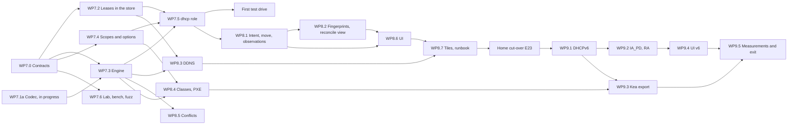

# Phase 3 plan: DHCP

- Status: Draft for the owner's review on 2026-10-22. The owner decided P3-Q1 to P3-Q11 on 2026-10-21 (section 7); P3-Q12 to P3-Q18 are recommendations. The plan binds once the owner accepts it and then changes only through rule 2.8 of the execution plan. The owner's standing direction, single node first and cluster-aware (section 2.10 of [phase-2-plan.md](phase-2-plan.md)), binds this phase; section 2.12 says how
- Date: 2026-10-21
- Scope: Phase 3 of [ROADMAP.md](../ROADMAP.md) (deliverables and "Done when"), written against `main` at `a3ac150`, with Phase 2 at its last package ([phase-2-status.md](phase-2-status.md)). Requirement IDs refer to [REQUIREMENTS.md](../REQUIREMENTS.md), toggles (TGL) and never-off items (NEVER) to [SECURITY-PROFILES.md](../SECURITY-PROFILES.md), RFC targets to [CONFORMANCE.md](../CONFORMANCE.md). Exit criteria, measurements and risks continue the series of Phases 1 and 2 (E22 onward, M26 onward, R55 onward) so that one trace covers the project.

This plan does for Phase 3 what [phase-2-plan.md](phase-2-plan.md) did for Phase 2: the goal, the exit criteria as checks, three slices, the contracts the packages share, the work packages with owners and acceptance, the order of merging, the measurements, the risks and the decisions only the owner can take. "(proposed)" marks a choice the documents leave open. Sizes: S up to one builder-week, M one to three, L three to six.

Contents:

1. [Scope and exit](#1-scope-and-exit)
2. [Design decisions the packages share](#2-design-decisions-the-packages-share)
3. [Contracts and shared files (WP7.0)](#3-contracts-and-shared-files-wp70)
4. [Work packages](#4-work-packages)
5. [Order, parallelism and merging](#5-order-parallelism-and-merging)
6. [Measurements and exit checks](#6-measurements-and-exit-checks)
7. [Owner decisions](#7-owner-decisions)
8. [Risks](#8-risks)
9. [Owner actions](#9-owner-actions)
10. [Documents this phase writes](#10-documents-this-phase-writes)

## 1. Scope and exit

### 1.1 Goal

Tenko serves DHCP: a DHCPv4 server on one node that takes its scopes, pools, options, classes and reservations from the replicated store and from IPAM, receives the traffic of every network through relay agents, commits each lease before it answers, writes the names of its clients into Tenko zones, and tells IPAM what it sees without being polled. From this phase Tenko DHCP is IPAM's DHCP actuator (DHCP-16): the move job becomes fully automatic for `reserved` hosts and the IoT move is one click (IPAM-19, CON-10). DHCPv6 and the Kea JSON export close the phase. The reference home-lab environment (three LANs and a DMZ behind a UniFi gateway, AD-integrated Windows DNS and DHCP today) moves its DHCPv4 to Tenko through relay as the owner-run step of the phase.

Phase 3 builds and measures a **single node**: one process with the `controller`, `dns`, `dhcp` and `probe` roles. The failover pair (DHCP-12), its chaos test (DHCP-18) and DHCP nodes that are fed by another node's controller move to the cluster work of Phase 5 by the owner's decision P3-Q2 of 2026-10-21. Phase 3 builds the lease model so that pairing two nodes later is placement and a protocol, not a redesign (section 2.12).

### 1.2 Exit criteria

ROADMAP "Done when" for Phase 3 plus the verification rows that name DHCP, as checks. E22 and E23 are the ROADMAP lines that stay in Phase 3; the ROADMAP's failover line moves to Phase 5 (P3-Q2, section 1.6) and E24 is its single-node stand-in; E25 to E32 are what the requirements make testable.

| # | Check | Requirements | Slice |
|---|---|---|---|
| E22 | kea perfdhcp numbers are documented for one Tenko node: 4-way exchanges and renewals per second and the p99 from DISCOVER to ACK, every lease committed to the store before its ACK, on loopback and from the load VM over a real link, with and without metrics | DHCP-17, DHCP-07, OPS-21 | 7 (loopback), 9 (real link) |
| E23 | The reference home-lab environment runs DHCPv4 through Tenko for all four networks: the gateway relays each network to one Tenko node, giaddr and option 82 select the scope, clients keep their addresses across the switch, option 6 and option 42 reach them, and the rollback is one setting on the gateway | DHCP-01, DHCP-02, DHCP-04, DHCP-15 | 8 (owner-run) |
| E24 | Leases survive the node: the node is killed (SIGKILL, and a power-off of the lab VM) under perfdhcp load and restarted, no lease that was acknowledged is lost, no address is leased to two clients, and the role's lease table equals the store's rows; while the store refuses writes (the test hook of WP6.2) the role behaves as P3-Q14 decides | DHCP-07, OPS-02, OPS-26 | 7 |
| E25 | The five-device move lab of Phase 1 (E8) runs with the DHCP step automatic for the `reserved` devices: the reservation in the target scope from IPAM intent, the observation from the new lease without polling, the old reservation and lease removed in the cleanup, the `static` device stopping at its manual step, the rollback on a blocked step | IPAM-19, DHCP-16, IPAM-18, CON-10 | 8 |
| E26 | A client with option 81 and a legacy client that sends only option 12 get their A and PTR records and a DHCID in Tenko zones on ACK, the records go on release and on expiry, and a second client that claims the first one's name is refused by name protection (RFC 4703); the profile defaults of P3-Q6 hold | DHCP-13 | 8 |
| E27 | The relay and options lab: four networks in compose behind a relay; giaddr and link selection (RFC 3527) choose the scope, option 82 is echoed, a shared network with two subnets fills both, options inherit from server to scope to class to reservation, vendor class, user class and MAC wildcard classes select policies, a MAC deny list and an allow list on a restricted scope hold, a squatter is detected before the offer, a DECLINE quarantines the address, and a BIOS, a UEFI and a UEFI HTTP client boot over PXE (iPXE in QEMU) | DHCP-01 to DHCP-06, DHCP-08, TGL-16, TGL-17 | 8 |
| E28 | The reconciliation view shows the four truths (intent, leases, DNS records, scans) for the lab data with the ghost, rogue, orphan and PTR-mismatch lists and the "who wins" rule of each, and a lease's options 55 and 60 set the OS field of an unmanaged host | IPAM-21, DHCP-14, IPAM-23 | 8 |
| E29 | DHCPv6 through a relay in the lab: IA_NA from a pool, IA_PD from a delegation pool, a DUID reservation from IPAM intent, RFC 6939 correlation with the DHCPv4 lease of the same MAC, the names of RFC 4704, and the M and O flag check of DHCP-10 in the health view | DHCP-09, DHCP-10, DHCP-11, DHCP-13 | 9 |
| E30 | The Kea JSON export of the lab configuration and its leases is accepted by `kea-dhcp4 -t` and `kea-dhcp6 -t`, and a Kea server started from it hands the exported reservations to their clients | MIG-16 | 9 |
| E31 | Fuzz targets for the DHCPv4 and DHCPv6 wire formats, the option parsers and the relay information run in the weekly fuzz smoke | API-14, API-15 | 7 (v4), 9 (v6) |
| E32 | Idle RSS below 100 MB with every role including `dhcp` serving the home scopes, on the musl binary, one node; metrics overhead on the DORA path below 2 percent; the memory of 100,000 leases measured | OPS-15, OPS-21 | 9 |

### 1.3 Increments

| Slice | Content | Closes |
|---|---|---|
| 7. DHCPv4 core on one node | The `dhcp` model and namespace; the DHCPv4 codec (WP7.1a, in progress); leases as store rows with the commit before ACK; the engine: sockets, DORA, renew, rebind, release, decline, inform, scope selection by giaddr, pools, exclusions, reservations from IPAM, options with inheritance, MAC filters; scopes and options through API and CLI; the `dhcp` role in the process; the DHCP lab and the perfdhcp harness; fuzz targets; loopback measurements; the first test drive on the lab VMs (P3-Q11) | E22 (loopback), E24, E31 (v4) |
| 8. Integration | Reservations from IPAM intent and the automatic move step; leases as observations at commit; fingerprinting; the reconciliation view; DDNS; classes and policies; PXE and UEFI; conflict detection through the probe role and DECLINE; the UI; dashboard tiles and the cut-over runbook; the home cut-over | E23, E25, E26, E27, E28 |
| 9. DHCPv6 and exit | The DHCPv6 codec and server (IA_NA, relay, RFC 6939, RFC 4704), IA_PD and the RA check, the Kea JSON export, the UI for DHCPv6, the two-host measurements, the exit document | E22 (real link), E29, E30, E31 (v6), E32 |

Why this order (decided as P3-Q3 and P3-Q9): Slice 7 is what every other package needs and what the first test drive runs on. Slice 8 is the reason for the phase at home: the move job, DDNS and the relayed networks of E23. PXE and classes come in Slice 8, not first, because the home cut-over needs neither on day one. DHCPv6 is its own last slice, after DHCPv4 runs in the reference environment, and may slip to Phase 5 without moving any other criterion; the Kea export comes with it so that it covers both families.

### 1.4 Requirements

| Slice | Phase 3 requirements |
|---|---|
| 7 | DHCP-01 (scopes, pools, exclusions, reservations; superscopes as shared networks), DHCP-02 (options at every level, custom definitions; class level in 8), DHCP-04 (giaddr selection, option 82 echo, link selection, shared networks), DHCP-07 (leases committed in the store, lease history), DHCP-08 (MAC allow and deny), DHCP-15 (option 42), DHCP-17 (loopback), OPS-25 (the DHCP module gains content), OPS-02 and OPS-26 (the role's behaviour when the store refuses, P3-Q14) |
| 8 | DHCP-03, DHCP-05, DHCP-06, DHCP-13 (DHCPv4), DHCP-14, DHCP-16, IPAM-19 (DHCP step), IPAM-21, IPAM-23 (lease conflicts), CON-10 (the move waits for the lease), OPS-20 (DHCP tiles), TGL-16, TGL-17 |
| 9 | DHCP-09, DHCP-10, DHCP-11, DHCP-13 (RFC 4704), DHCP-17 (real link), MIG-16 |
| Phase 5 | DHCP-12, DHCP-18 (decision P3-Q2) |

### 1.5 Carried items

| Item | Where |
|---|---|
| The move job's DHCP step `ipam.move.dhcp`, a manual task `dhcp.manual` since Phase 1 (docs/moves.md section 4) | WP8.1 makes it automatic |
| `ObservationSource::DhcpLease { node }`, defined in Phase 1 and unused | WP8.1 writes it at commit |
| `Origin::Dhcp` on RRsets, defined in Phase 2 and unused | WP8.3 (DDNS) |
| The Phase 1 scanner's raw-socket methods (WP3.14: `arp_sweep`, `tcp_syn`, passive `lldp`, `os_fingerprint`; deviation 53 of the Phase 1 exit document) | Built now by another builder in parallel, decided by the owner on 2026-10-21; a Phase 1 carry-over that closes alongside Phase 3, not a Phase 3 package. The conflict probe of WP8.5 uses its ARP method when it lands |
| DHCP snooping as a passive source (SCAN-03) | Not built: Tenko's own leases are the better source once Tenko serves DHCP; a probe beside a foreign DHCP server stays a Phase 4 coexistence question |
| SSID writes and DHCP relay verification on UniFi (P2-Q13 moved them to the DHCP work) | P3-Q18 |
| The DNS and DHCP tiles of OPS-20 (item 29 of the Phase 1 exit document) | DNS tiles in Phase 2; DHCP tiles in WP8.7 |
| The owner's backlog of the test drive (phase-2-status.md) | Not DHCP; stays in the Phase 2 status file for the lead to schedule |

### 1.6 Left out, with reasons

| Item | Reason | Goes to |
|---|---|---|
| DHCP-12 failover between Tenko nodes (hash split per RFC 3074, MCLT, hot standby and load balance, partner-down, lease sync, RFC 8156 for DHCPv6) | Decision P3-Q2: single node first; the lease rows carry the fields the protocol needs, the allocator asks a pool-ownership trait, so pairing adds a protocol and a placement (section 2.12) | Phase 5 |
| DHCP-18 the failover chaos test | Needs the pair; E24 is the single-node stand-in (no ACKed lease lost, no address twice across a kill under load). The ROADMAP's "Done when" line for the pair is a recorded deviation of the Phase 3 exit | Phase 5 |
| A `dhcp` node without a controller (fed through node sync), relay between Tenko nodes, a node per VLAN | Decision P3-Q5: the gateway relays every network to one node; node sync's `dhcp` subset is declared and consumed by nobody, as for `dns` in Phase 2 | Phase 5 |
| CONN-12 external DHCP actuators (Windows DHCP, Kea Control Agent) | Phase 4 with the coexistence work; Tenko DHCP is the only DHCP actuator until then (ADR 0005) | Phase 4 |
| MIG-08 Windows DHCP and MIG-12 Kea and dhcpd as migration sources | Decision P3-Q10: Phase 4 migration; the mapping of the Windows DHCP export onto the Phase 3 model is written now (WP7.0, `docs/dhcp.md`), so the Phase 4 adapter fills a table rather than a model | Phase 4 |
| DDNS to a DNS server that is not Tenko (RFC 2136 or Windows DNS with GSS-TSIG) | CONN-13 and DNS-28 are Phase 4; Phase 3 writes only into Tenko zones (ADR 0020) | Phase 4 |
| DHCPv4 over DHCPv6 (RFC 7341), DHCPv4 leasequery (RFC 4388) and bulk leasequery, FORCERENEW (RFC 3203, deliberately skipped) | No requirement asks for them; leasequery is listed in CONFORMANCE.md as Phase 5 for relays that need it | Phase 5, or never |
| A general expression language for classes (Kea's `test`) | P3-Q12: conditions in the Windows policy shape; an expression language can follow if a migration needs it | Later, if needed |

### 1.7 Starting point in the code

Facts the packages build on (read on `a3ac150`):

- **Crate.** `crates/tenko-dhcp` is a placeholder (a name and a version, no dependencies). A sibling builder writes the DHCPv4 wire codec in `crates/tenko-dhcp/src/v4/` now (WP7.1a, on its own branch, no commit on `main` yet). ARCHITECTURE.md names `dhcproto` as the candidate wire crate; it decodes into owned structures and allocates per message, so the plan keeps it as the differential test crate only, as `hickory-proto` is for DNS (ADR 0019).
- **Roles and modules.** `Role::Dhcp` exists ("DHCP data plane: DHCPv4 and DHCPv6 service") and `TENKO_ROLES=dhcp` parses; the role starts nothing. `TENKO_MODULES=dhcp` parses (OPS-25). The Linux installer, the Proxmox script and the MSI pass roles through (`TENKO_ROLES`), so a `dhcp` role needs no installer change beyond the capabilities.
- **Store.** Twelve namespaces in `tenko_core::names::NAMESPACES`; `dhcp` is not among them. The data format is 3 (WP4.0). The coalescer measured 1,000 updates per second with deferred durability and 998 with immediate durability, closed loops of 6,271 and 3,156 per second (M5); an RFC 2136 update through the zone service, the store and the index answered with p99 14.9 to 19.4 ms at 1,000 updates per second on one node (M21). The store's test hook `TENKO_TEST_REFUSE_WRITES_FILE` makes it answer NoQuorum (WP6.2). The fsync probe measured p50 3.7 ms on the NVMe drive (M10).
- **Feed pattern.** `tenko_dns::store_feed` is the in-process derived index of the store that the `dns` role serves from (WP4.3): an image at a revision, then deltas in revision order, a reset after a snapshot install. The DHCP role's configuration and lease tables use the same pattern.
- **IPAM.** `Prefix` (CIDR, VLAN, site, alarm), `Range` with `RangeRole::DhcpPool` and `lease_secs` (informational until now, the source of the move timeout), `Address` with `interface` and `dns_name`, `Host` with `AssignmentMode::Reserved` and `lock`, `Interface` with `mac`, `duid` and `client_id`. `Observed::Address`, `Observed::Os`, `Observed::Name` and `Observed::Vendor` exist; observations are ingested as per-source facts that are rewritten only on change or when a refresh is due (`tenko-ipam::observe::ingest`). The move job's steps and preview kinds are in docs/moves.md section 4.
- **DNS.** The zone service writes change sets with an origin per RRset; `Origin::Dhcp` exists with the comment "Tenko DHCP (Phase 3)", and `Origin::may_replace` already lets DHCP replace an `ipam` RRset only where the zone's policy allows. Reverse zones are kept from IPAM (WP4.4). The update path of WP6.2 serialises updates per zone and answers after the index serves the revision.
- **Probe.** `tenko-scan` has a `Pinger` trait with unprivileged ICMP datagram sockets on Linux and `ping.exe` on Windows; the raw-socket methods are being built now (section 1.5).
- **Deployment.** The systemd unit lists at its end what the `dhcp` role will need: `CAP_NET_BIND_SERVICE` and `CAP_NET_RAW`, and the address families `AF_NETLINK` and `AF_PACKET`. The home node runs in an Ubuntu LXC with the musl binary and jemalloc (S3-Q10).
- **Trace.** `scripts/requirement-trace.mjs` traces Phases 1 and 2 (E1 to E21).

## 2. Design decisions the packages share

These are the choices the packages assume. Section 7 records the owner's decisions and the open recommendations; ADR 0019 and ADR 0020 record the design.

### 2.1 A lease is a row in the store, committed before the ACK

Decision P3-Q1 of 2026-10-21. A lease is a row of `dhcp.leases` in the one Raft group, written through the coalescer like every other change; the ACK (DHCPv4) or REPLY (DHCPv6) leaves only after the store has committed the row. There is no separate lease file. This replaces what DHCP-07, ARCHITECTURE.md ("What lives where") and point 4 of ADR 0002 say about a local lease WAL outside Raft; section 7 lists the document changes the decision implies.

- **What is written.** The REQUEST (or a renewal, a rebind, a release, a decline, an expiry) becomes one change: the lease row, its client index row, the history row and, when it changed, the IPAM observation fact (2.8). The DISCOVER is not written: the offered address is held in the role's memory for the offer lifetime (default 10 s), so a lost OFFER costs nothing and a crash forgets only offers. The allocator never offers an address that a committed lease or an unexpired offer holds.
- **The latency budget per exchange.** DISCOVER to OFFER: parse, scope selection, allocation and the reply build in memory, no store call, target well under a millisecond on the node (plus the conflict probe of 2.7 for an address never leased before, capped near 300 ms). REQUEST to ACK: the same work plus one commit. The commit is the budget: on one node the measured RFC 2136 path, which also commits through the coalescer and waits for the index, gave p99 15 to 19 ms at 1,000 changes per second (M21), and the coalescer's ceiling with immediate durability was about 3,000 changes per second closed loop (M5). The lease path is shorter (no zone service, one table), so the plan expects a few milliseconds median and a p99 near M21's at the same rate. M26 and M28 measure it.
- **Renewals are writes.** A renewal moves the lease's end time; if it were not durable, a crash could let the lease look expired and the address be given to another client while the first still uses it. A renewal therefore commits like a new lease. At home rates (dozens of clients, leases of hours) this is a few writes per minute; at 100,000 clients with a one-hour lease it is about 55 renewals per second, far below the coalescer's ceiling.
- **The fallback, if the measurements say so.** The owner's condition of 2026-10-21: if the measured performance is too poor, an asynchronous publication model is reconsidered (the node keeps a local durable log, acknowledges after the local write and publishes lease rows to the store afterwards). The measurements that decide it are M26 and M28 on the shipped musl binary on one node: the plan proposes the fallback line at fewer than 1,000 4-way exchanges per second sustained, or a p99 from REQUEST to ACK above 100 ms at 1,000 per second (P3-Q1). The contracts keep the fallback open: the engine commits through one `LeaseStore` trait whose production implementation is the store, so a local log is a second implementation, not a second engine.
- **When the store refuses.** On one node the store refuses a write only when its disk fails or through the test hook; in Phase 5 a node also loses quorum. The role then cannot commit, and what it answers is P3-Q14: the recommendation is to answer a renewal of an unexpired lease with an ACK for the time the lease still has (no extension, nothing written), to drop new requests (the client retries), and to show the state in the health view, so that no answer promises what is not durable.
- **Disk and memory.** Each lease change is a few hundred bytes in the Raft log and in `sm.redb`; the log is purged behind snapshots (ADR 0002). M29 measures the growth under churn. The role keeps its own lease table in memory, derived from the rows (2.2), so the DORA path never reads the store.
- **Backup.** Leases are in the store, so the backup (ADR 0016) carries them with the configuration and the keys, and OPS-07's consistency across the database, leases and keys holds without a separate step.
- **Personal data.** A lease holds a MAC address, a client identifier and often a host name; it is personal data like the query log. Leases are visible only to `dhcp.read`, reading them is audited as `dhcp.lease.read` (as the cache browse is), and lease history has a retention (P3-Q13). In Phase 5 the rows replicate to every controller; ADR 0019 says so.

### 2.2 Configuration and leases are served from in-memory tables

Scopes, shared networks, pool settings, option definitions and option sets, classes, policies, filters and the reservations derived from IPAM (2.3) are rows in the store (ADR 0002). The `dhcp` role builds an in-memory configuration image from them and an in-memory lease table from `dhcp.leases`, both fed through one `DhcpFeed` trait in the shape of `ZoneFeed`: an image at a revision, then deltas in revision order, a new image after a snapshot install. The engine never holds a store handle and never reads the store while it answers (OPS-02). The role applies its own committed leases to its table at once and the feed's copy of them idempotently, so the table equals the rows. In Phase 2 terms: the configuration is the zone, the lease table is a second index of the same kind; in Phase 5 a second node fed with the same rows sees the first node's leases, which is what makes pairing placement (2.12).

### 2.3 One model: a scope is a prefix with a DHCP policy

Decision P3-Q4. There is no second register of networks or hosts.

- **Scope.** A `dhcp.scopes` row is keyed by the IPAM prefix it serves (a network, not a supernet) and adds only what DHCP needs: enabled, lease times (default, minimum, maximum), T1 and T2, the server identifier, the authoritative flag, the option set, the DDNS settings (ADR 0020), the shared network it belongs to, the restricted flag for MAC allow lists, the classes it admits. Deleting the prefix in IPAM is refused while a scope exists (the same rule as for reverse zones).
- **Pools and exclusions.** Pools are IPAM ranges with `RangeRole::DhcpPool`; their `lease_secs` becomes the pool's lease time, as the move timeout already reads it. Exclusions are the other ranges of the prefix (`Reserved`, `Infrastructure`), every address IPAM holds as `active` or `planned` for a host that is not `dynamic` (a static server inside a pool is never offered), and explicit exclusion ranges of the scope. A `dhcp.pools` row keyed by the range adds per-pool options and class restrictions when someone sets them.
- **Shared networks.** Several scopes on one link (Windows superscopes, Kea shared networks, DHCP-01 and DHCP-04) are one `dhcp.shared_networks` row the scopes name; a request selected to one scope of the group may be served from any of them.
- **Reservations.** A reservation is the IPAM host with mode `reserved`: an interface with a MAC or client identifier (DUID for DHCPv6) and an address inside a served prefix gives the reservation of that address in that scope (DHCP-16). The role's configuration image derives them from `ipam.hosts`, `ipam.interfaces` and `ipam.addresses`; nothing is copied, so there is nothing to drift and no actuator to write it. IPAM-18 holds: a `reserved` host without a MAC, client identifier or DUID is shown with the warning before the reservation can exist. Reservation-level options are a `dhcp.host_options` row keyed by the interface. A `locked` host (IPAM-16) keeps the reservation it has. During a move the interface has the old address and the new `planned` one, so both scopes hold a reservation until the cleanup, which is what IPAM-19 asks (keep the old one until the move is observed).
- **What clients see first.** Reservations win over pools; a client that has an unexpired lease gets it again; the address it requests comes next if it is free; then the allocator picks from the pool in a hashed order (so two nodes in Phase 5 do not collide on the lowest free address).

### 2.4 Options, classes and policies

- **Definitions.** The standard DHCPv4 options of RFC 2132 and its successors are a built-in catalog with their types (address, address list, u8, u16, u32, bool, string, FQDN list in RFC 1035 form, classless routes of RFC 3442, binary); custom definitions (`dhcp.option_defs`, DHCP-02) add a code, a name, a type and an optional vendor space (option 43 sub-options per vendor class, as Windows and Kea do). Codes 224 to 254 are site-specific (RFC 3942); a custom definition for a code the catalog knows is refused.
- **Inheritance.** Options are set at five levels: server, shared network, scope, class (through a policy), reservation. The effective set for a client is computed in that order with the more specific level winning per code, and the configuration image keeps it precompiled per scope and per policy so that the DORA path only merges a few short lists into the reply. The UI shows the effective set for a client (MAC, scope, classes) so an operator can see why a client got a value. Option 6 carries two addresses where the operator gives two (CON-04); option 42 is in the server-level defaults when the operator names NTP servers (DHCP-15, OPS-09).
- **Long options and the parameter list.** Options longer than 255 octets are split and concatenated per RFC 3396; the reply carries the options the client asked for in option 55 plus those the scope forces, in the client's order, within the size the client allows (option 57, at least 576 octets), with option overload into `file` and `sname` when the scope allows it.
- **Classes and policies (P3-Q12).** A class is a named match on the request: vendor class (option 60, prefix or exact), user class (option 77, RFC 3004), MAC address with wildcards, client identifier, relay agent circuit-id and remote-id, client architecture (option 93), host name. A policy is an ordered list of conditions joined by AND or OR over classes and fields, as Windows DHCP policies are, with an action: an option set, a pool or address range restriction, a lease time, a DDNS setting. Policies apply in order per scope and at server level; the first matching policy per action wins. This shape maps from the Windows export of Phase 4 and onto Kea's `client-classes` with `test` expressions in the export (WP9.3). The matcher is compiled into the configuration image and costs a few comparisons per request.

### 2.5 Relay, option 82, sockets and the topology of E23

Decision P3-Q5: the gateway relays every network to one Tenko node; no node per VLAN before Phase 5.

- **Scope selection.** A relayed request selects its scope by the link selection sub-option of option 82 (RFC 3527) or option 118 (RFC 3011) when present, else by giaddr; the server identifier override sub-option (RFC 5107) sets option 54. A request without giaddr arrives on an interface and selects by that interface's address (`IP_PKTINFO`). A selected scope that belongs to a shared network extends the choice to its siblings. This is the topology-based selection RFC 7969 describes, and the same rule picks the DHCPv6 link from the relay's link address in Slice 9.
- **Option 82.** The relay agent information is read (circuit-id, remote-id, link selection, server identifier override), made available to classes and policies, kept on the lease row and echoed unchanged in the reply (RFC 3046). Many small gateways relay without adding option 82; then giaddr alone selects, which is enough for one scope per network.
- **Sockets.** Two listening modes per configured address: `relay` binds the unicast address on port 67, so broadcasts never reach it and only relayed (unicast) traffic arrives; `direct` binds the interface for broadcasts as well and answers clients on the link. The reference topology of E23 runs relay mode only: the gateway relays all four networks, including the one the node sits in, so the node never answers a broadcast and the same request cannot arrive twice (risk R56). Relay mode needs only UDP and `CAP_NET_BIND_SERVICE`, works in an unprivileged LXC and on Windows, and is what perfdhcp exercises, since perfdhcp sends as a relay. Direct mode answers by broadcast where the client has no address yet (the broadcast flag or no ARP entry), and by unicast to `chaddr` through an `AF_PACKET` socket on Linux when `CAP_NET_RAW` is present; Windows answers direct clients by broadcast only.
- **Workers.** The DNS design of ADR 0009 carries over: blocking UDP workers, one socket per worker with `SO_REUSEPORT` on Linux, a shared socket on Windows; the commit is awaited off the worker (the worker hands the change to the coalescer and the reply is sent when the commit returns), so a worker never sleeps on the disk.

### 2.6 The engine and the codec

The DHCPv4 codec is Tenko's own, allocation-free, in the manner of the DNS codec: a borrowed view over the received octets that validates the fixed header and walks the options once (with RFC 3396 concatenation into a per-worker scratch buffer), and a reply builder into a fixed-capacity buffer that writes the options in order and refuses to overflow. The sibling builder writes it now (WP7.1a) with tests and a fuzz target; `dhcproto` is a dev-dependency only, for a differential test over a corpus (ADR 0019). The engine is a pure function of the configuration image, the lease table, the request and the clock, which returns the reply and the lease change to commit; the role wraps it in the sockets and the commit. Every message type of RFC 2131 is handled: DISCOVER, REQUEST in its four states (SELECTING, INIT-REBOOT, RENEWING, REBINDING), DECLINE, RELEASE, INFORM; NAK where RFC 2131 asks for it and only when the scope is authoritative (an INIT-REBOOT for an address of another network). Client identity follows RFC 4361 and RFC 6842: the client identifier (option 61) when present, else hardware type and `chaddr`, and option 61 is echoed in the reply.

### 2.7 Conflict detection and DECLINE

Decision P3-Q7: an ICMP or ARP probe through the probe role in the same process when that role runs, else none, logged; never blocking an offer more than about 300 ms.

- **When.** Before offering an address that has no lease history for this client and was not probed clean within the probe cache's time (default 10 minutes). Renewals, reservations already in use by their owner and the client's previous address are never probed.
- **How.** The role asks the in-process probe through a `ConflictProbe` trait: ARP where the probe sits on the address's link, ICMP echo otherwise (the `Pinger` of `tenko-scan`, unprivileged datagram sockets on Linux, `ping.exe` on Windows). The DISCOVER waits in a pending table, not in a worker; the OFFER goes out on "no answer" or at the 300 ms cap, whichever comes first. An answer marks the address as a conflict for the decline hold time, writes a conflict observation for IPAM-23 and offers the next address.
- **Without a probe.** A node without the `probe` role offers without probing, logs once per start that conflict detection is off for want of a probe, and shows it in the health view. TGL-16 ("on" in Home, Standard and Hardened, "off" in Lab) therefore means "on when a probe runs"; the health finding names the missing role.
- **DECLINE.** A DECLINE marks the address declined for a hold time (default 24 hours, Kea's default probation period), writes the conflict observation, and is audited; the client gets a new address on its next DISCOVER. A flood of DECLINEs from one client is rate limited so that a broken client cannot drain a pool.

### 2.8 Leases become observations at commit; IPAM owns the conflict rules

Decision P3-Q8: the role writes the observation at commit, with no polling; IPAM's reconciler owns the conflict rules (IPAM-21).

- **The write.** The lease change of 2.1 carries, in the same batch, the IPAM fact of the source `dhcp:<node>` (`ObservationSource::DhcpLease`): `Observed::Address` with the address and the MAC, `Observed::Name` from the client's host name or FQDN, `Observed::Os` from the fingerprint, `Observed::Vendor` from option 60. The rules of `observe::ingest` apply: a fact is written only when an attribute changed, when it had expired or when its refresh is due, so a renewal usually adds nothing; a release or an expiry expires the fact. The helper that builds the fact change lives in `tenko-ipam` so the rules stay in one crate; the role calls it while it builds the batch. A move job's observation step completes on the fact as on a probe sighting (docs/moves.md section 5).
- **Fingerprinting (DHCP-14).** The option 55 parameter list in order, option 60 and the presence of options 77, 81 and 93 form a fingerprint; a rule table in the project maps known fingerprints to an OS family and version with a confidence (P3-Q15). The guess becomes `Observed::Os` with the source `dhcp:<node>`; the reconciler's existing precedence decides whether it fills the OS field (an active scan's guess outranks it).
- **The reconciliation view (IPAM-21).** One view over the four truths per address and per host: intent (IPAM), leases (this role's facts), DNS records (the zones' facts of Phase 2), scans (the probes' facts). Ghosts are intent with no observation for longer than the scope's lease time; rogues are leases or sightings without intent (with the "discovered host" proposal of IPAM-15); orphans are records without a host (Phase 2's `dns_orphaned_record`); PTR mismatches are PTR records whose name disagrees with the address's DNS name or forward record. The "who wins" rules per kind: intent wins for managed hosts (IPAM-16), the lease wins for `dynamic` hosts, the newest sighting wins between observations, and a conflict of two MACs on one address (IPAM-23) is never resolved automatically. The view reads facts and proposals; it writes nothing itself.

### 2.9 DDNS through the zone service

Decision P3-Q6, recorded in ADR 0020. Option 81 (RFC 4702) and the DHCID record with name protection (RFC 4701, RFC 4703); the update is an in-process change set through the zone service with the RRset origin `dhcp`; PTR records in the reverse zones Tenko keeps; updates on commit, on expiry and on release.

- **The origin.** `Origin::Dhcp` exists in `tenko_core::dns` and is the variant the plan uses; no new variant is needed. The A or AAAA set, the PTR set and the DHCID set written for a lease carry it. The rules: DHCP replaces a `dhcp` RRset only when its DHCID matches the client (RFC 4703); an `ipam` RRset only where the zone's policy allows (`Origin::may_replace` as it stands); `manual`, `dynamic`, `transfer`, `dnssec` and `ad` RRsets never. A `reserved` host with a DNS name in IPAM already has its records from the DNS actuator (origin `ipam`), so DDNS skips names IPAM manages.
- **Names.** The client's FQDN from option 81 under the scope's forward zone (a name outside it is cut to its first label under the zone, or refused by policy), else option 12 for legacy clients ("update for legacy clients", DHCP-13), else no name. The server always writes the PTR; it writes the A record too unless the client asked to do it itself and the scope allows that (Windows' default behaviour is to let the client write A; Tenko's default is to write both, since clients cannot write into Tenko zones without a key). The reply's option 81 tells the client what the server did (flags S, O, N).
- **When.** After the commit, never inside it: the DORA path enqueues the update and answers; a DDNS worker applies the change set, retries with a backoff when the store refuses, and records the outcome on the lease row (names written, DHCID). On release and on expiry the records go if their DHCID still matches.
- **Who may update which zone.** Home always writes into the scope's zones; Standard and Hardened only where the zone's policy allows DHCP updates (a new `UpdatePolicy` field, `dhcp`, defaulting to the profile's value; the scope names the zone). TGL-09 does not govern this path (SECURITY-PROFILES.md, note on TGL-09); section 7 proposes a toggle row so the profile values are visible.
- **DHCPv6.** The same path with RFC 4704's client FQDN option and DUID-based DHCID in Slice 9.

### 2.10 The role, capabilities and platforms

`dhcp` is a role in the one process, like `dns` (ADR 0004): it starts after the API and the `dns` role, builds its tables from the store before it listens, and stops with its own switch; the DHCP module switch (OPS-25) gates the routes, the role, the UI area and the integrations (DDNS needs the DNS module, reservations from intent and observations need IPAM). On Linux the systemd unit gains `CAP_NET_BIND_SERVICE` for ports 67 and 547 (already present for 53) and, only for direct mode, `CAP_NET_RAW` with `AF_PACKET`; `AF_NETLINK` reads the interfaces. Relay mode needs nothing new, which is why the reference topology uses it. The installers keep passing `TENKO_ROLES`; the docs list the drop-in for direct mode as `probe.conf` is listed today. On Windows the service binds the configured addresses in relay mode, and direct mode answers by broadcast; the Windows firewall rule of the MSI gains UDP 67 when the `dhcp` role is chosen. Containers need macvlan or host networking for direct mode (OPS-14); relay mode works through published UDP ports.

### 2.11 Security profile toggles

| Toggle | Home | Standard | Hardened | Lab | Where |
|---|---|---|---|---|---|
| TGL-16 DHCP conflict detection | On (when a probe runs) | On (when a probe runs) | On; the health view warns while no probe runs | Off | WP8.5 |
| TGL-17 DHCP MAC filtering | Off | Off | Allow list on scopes marked restricted | Off | WP7.3 |
| DDNS from DHCP (proposed new row, P3-Q6 as decided) | Always writes into the scope's zones | Only where the zone's policy allows | Only where the zone's policy allows; name protection cannot be switched off | Always writes | WP8.3 |
| Lease history retention (proposed new row, P3-Q13) | 30 days | 90 days | Per policy, default 90 days, exported with the audit stream | 7 days | WP7.2 |

The failover shared secret (IAM-16, NEVER-01) gets its vault purpose `dhcp.failover` declared in WP7.0 and used in Phase 5. No DHCP setting weakens a never-off item.

### 2.12 Single node first, cluster-aware

Phase 2's rule (section 2.10 of the Phase 2 plan) applied to DHCP: build now exactly what would be rebuilt later, and nothing more.

Built in Phase 3 because it would be rework later:

- The configuration and the leases as rows in the store, the `dhcp` namespace and its tables, and the `dhcp` role's node-sync subset declared (which tables a `dhcp` node will receive) though no node consumes it.
- The lease row with the fields the failover protocol needs (ISC's failover draft `draft-ietf-dhc-failover-12` as the reference for DHCP-12): the binding state (free, active, expired, released, abandoned, reset, backup), the client's end time and the times told to the partner (`tstp`, `tsfp`, `atsfp`), the client's last transaction time (`cltt`), the node that wrote it and the pool share it came from; on one node the partner fields stay empty.
- The `PoolOwnership` trait the allocator asks before it offers an address: on one node every address is the node's; in Phase 5 the RFC 3074 hash bucket of the client (load balance) or the backup share (hot standby) answers, and Kea's high-availability design (lease updates to the partner before the answer, hot standby and load balancing as modes) and the failover draft's MCLT are the two models to choose between then.
- The `grant_time` function the engine calls for every lease time: on one node it returns the scope's time; with a partner it caps the time at what the partner acknowledged plus the MCLT.
- The `LeaseStore` trait between the engine and the store, so the asynchronous fallback of 2.1 or a partner protocol is another implementation.
- Lease reads, releases and history through the node-command interface (`dhcp.leases.list`, `dhcp.lease.release`, `dhcp.history.read`), local on the one node and remote in Phase 5, as the DNS log read is.
- DDNS as a change set that a remote node would send as the `Dns.Update` message of Phase 2's design.
- The `dhcp` role as a role: moving it to another process is placement.

Deferred to Phase 5: the failover protocol and its state machine, partner-down, RFC 8156, the chaos test, a `dhcp` node fed through node sync, relay between Tenko nodes, per-site scope ownership (OPS-27), and every measurement that needs more than one Tenko node.

Measurement rule: every Phase 3 figure is a single-node figure (the load generator may be another host), on the musl binary on Linux.

## 3. Contracts and shared files (WP7.0)

The lead writes these with one Opus builder before any other Slice 7 package starts, as WP4.0 did; WP7.1a runs beside it because the codec owns its own files.

### 3.1 Model (`tenko-core::dhcp`)

- `Scope { prefix: PrefixId, enabled, lease: LeaseTimes { default, min, max, t1, t2 }, authoritative, server_id: Option<IpAddr>, options: OptionSetRef, ddns: DdnsPolicy, shared_network: Option<SharedNetworkId>, restricted, classes: [ClassRef], meta }`; `SharedNetwork { id, name, interface: Option<String>, options }`; `PoolSettings { range: RangeId, options, classes, lease: Option<LeaseTimes> }`; `ExclusionRange { scope, first, last }`.
- `OptionDef { space, code, name, kind: OptionKind, array, vendor_class: Option<String> }`; `OptionValue { code, space, data }` stored in wire form with a typed view (as `Rdata` is); `OptionSet { level: Server | SharedNetwork | Scope | Pool | Policy | Host, owner, values: [OptionValue] }`.
- `Class { id, name, matches: [Match] }` with `Match` over vendor class, user class, MAC with wildcards, client identifier, circuit-id, remote-id, architecture, host name; `Policy { id, scope: Option<PrefixId>, order, conditions: Condition (AND | OR tree of class and field tests), action: PolicyAction { options, range: Option<(IpAddr, IpAddr)>, lease, ddns } }`.
- `Filter { mac: MacPattern, kind: Allow | Deny, note }`; `HostOptions { interface: InterfaceId, options }`.
- `Lease { addr, scope, client: ClientKey { htype, chaddr, client_id }, state: BindingState, cltt, ends, tstp, tsfp, atsfp, node, share, hostname, fqdn, ddns: DdnsState, fingerprint: Option<Fingerprint>, relay: Option<RelayInfo>, observed_at }` for DHCPv4 and `Lease6 { addr_or_prefix, kind: Na | Pd, iaid, duid, ... }` for Slice 9; `LeaseEvent` (the change with its revision) for the history.
- `DdnsPolicy { enabled, forward_zone: Option<ZoneId>, reverse: bool, ttl: Option<u32>, conflict: Protect | Replace, client_may_update_a: bool }`.
- The DHCP part of the migration IR (`tenko_core::ir`): scopes, pools, exclusions, reservations, options, classes, policies, filters, superscopes, failover relationships, leases, with the Windows DHCP export mapping in `docs/dhcp.md` (decision P3-Q10: the format is planned now).
- Validation: a scope's prefix is a network with no other scope; pools and exclusions inside it; T1 below T2 below the lease time; option data matches its definition; a reservation inside a pool is allowed (it wins) but warned when another host's address collides (IPAM-23).

### 3.2 Store

- Namespace `dhcp` added to `NAMESPACES`; tables `dhcp.settings` (server level), `dhcp.scopes` (key: prefix), `dhcp.shared_networks`, `dhcp.pools` (key: range), `dhcp.exclusions`, `dhcp.option_defs`, `dhcp.option_sets`, `dhcp.classes`, `dhcp.policies`, `dhcp.filters`, `dhcp.host_options` (key: interface), `dhcp.leases` (key: VRF, address), `dhcp.leases.by_client` (key: scope, client key), `dhcp.history` (bounded by retention, key: time, address), `dhcp.leases6` and `dhcp.pd_pools` in Slice 9.
- The `dhcp` role's subset in node sync, declared and consumed by nobody: every `dhcp.*` table except `dhcp.history`, plus the IPAM rows the reservations derive from (`ipam.hosts`, `ipam.interfaces`, `ipam.addresses` of reserved hosts, `ipam.prefixes` and `ipam.ranges` of served prefixes), and the secret purpose `dhcp.failover`.
- One format bump to 4 with the migration that adds the namespace; the fixtures' size limit (3.42 of 4 MiB after format 3) is raised or the fixtures compressed in the same change.

### 3.3 Engine contracts (`tenko-dhcp`)

- `v4::Message` (the borrowed view) and `v4::ReplyBuilder` from WP7.1a; `v6::Message` and `v6::ReplyBuilder` in Slice 9.
- `DhcpFeed` (configuration and lease deltas), `ConfigImage` (precompiled scopes, effective option lists, classes, policies, reservations, filters), `LeaseTable`, `Allocator`, `PoolOwnership`, `LeaseStore` (commit a lease change and its companions; production on the store), `ConflictProbe`, `DdnsQueue`, `Fingerprinter`, with in-memory reference implementations (`MemFeed`, `MemLeaseStore`) as the test oracles.
- The no-allocation rule on the DORA path from parse to the commit hand-off, enforced by the counting-allocator test as for DNS.
- Metrics: `tenko_dhcp_packets_total{family,type,outcome}`, `tenko_dhcp_exchange_duration_seconds{step}` (DISCOVER to OFFER, REQUEST to ACK), `tenko_dhcp_commit_duration_seconds`, `tenko_dhcp_leases{state}` and `tenko_dhcp_pool_utilization{scope}` (lazy gauges, OPS-21), `tenko_dhcp_naks_total`, `tenko_dhcp_declines_total`, `tenko_dhcp_conflicts_total`, `tenko_dhcp_probe_duration_seconds`, `tenko_dhcp_ddns_total{outcome}`, `tenko_dhcp_ddns_queue`, `tenko_dhcp_dropped_total{reason}`, `tenko_dhcp_store_refused_total`.

### 3.4 API, CLI, UI and node sync

- Routes under `/api/v1/dhcp/`: `settings`, `scopes` (with `scopes/{prefix}/utilization` and `scopes/{prefix}/effective-options?mac=`), `shared-networks`, `pools`, `exclusions`, `option-defs`, `option-sets`, `classes`, `policies`, `filters`, `reservations` (a read view over IPAM reserved hosts with the DHCP fields, writes go to IPAM's host routes plus `host-options`), `leases` (list, search by address, MAC, name; the one node's table), `leases/{addr}/release`, `history`, `export?format=kea` (Slice 9). Under `/nodes/{id}/dhcp`: status, the lease commands of 2.12. Under `/ipam/reconcile`: the IPAM-21 view. Scopes `dhcp.read` and `dhcp.write` in the RBAC model of ADR 0015; object kinds `dhcp_scope`, `dhcp_class`, `dhcp_policy`, `dhcp_option_def`, `dhcp_filter`, global-only for grants as the DNS kinds are, except `dhcp_scope`, which follows its prefix's scope (IAM-01 names DHCP scopes).
- SSE topic `dhcp`: lease events for the live lease view, sampled to at most 50 per second per subscriber, with counts when sampled.
- Error codes `dhcp.*` (`dhcp.scope.exists`, `dhcp.scope.not_network`, `dhcp.pool.outside`, `dhcp.option.invalid`, `dhcp.option.code_reserved`, `dhcp.class.in_use`, `dhcp.lease.not_found`, `dhcp.store_refused`, ...) listed in the contracts file; audit actions `dhcp.scope.*`, `dhcp.option.*`, `dhcp.class.*`, `dhcp.policy.*`, `dhcp.filter.*`, `dhcp.lease.release`, `dhcp.lease.read`, `dhcp.decline`, `dhcp.export`.
- CLI `tenko dhcp scope|pool|option|class|policy|filter|lease|history ...`, `tenko dhcp export --format kea [--file]` (MIG-16).
- Config keys `[dhcp]`: `listen` (address and mode `relay` or `direct` per entry), `workers`, `offer_secs`, `[dhcp.probe]` (`timeout_ms` 300, `cache_secs` 600), `[dhcp.decline]` (`hold_secs` 86,400), `[dhcp.ddns]` (`retries`, `backoff_ms`), `[dhcp.history]` (`days` per profile), `[dhcp.v6]` in Slice 9; documented in `deploy/tenko.example.toml`.
- The UI gets a `dhcp` area with routes scopes, scope page, shared networks, options, classes and policies, filters, leases (with the live view), history; the reservations block on the host page; `/ipam/reconcile`; `/settings/dhcp`; the first-run wizard's DHCP step; i18n units in en and sv per area, loaded with the area's chunk.

### 3.5 Shared files the lead owns

`Cargo.toml` (workspace dependencies: `dhcproto` as a dev-dependency after WP7.0's evaluation), `deny.toml`, `crates/tenko-core/src/names.rs`, `crates/tenko-cluster/src/node_sync/tables.rs`, `docs/api/openapi.json` (regenerated by the gate), `ui/src/App.tsx` routes, `fuzz/Cargo.toml`, `.github/workflows/ci.yml` (the DHCP lab job), `deploy/systemd/tenko.service` and its drop-ins, `scripts/requirement-trace.mjs` (`--phase 3` with E22 to E32).

## 4. Work packages

### Slice 7: DHCPv4 core on one node

#### WP7.0 Contracts and shared files (M)

- **Owns:** section 3 in code: `tenko-core::dhcp` and the DHCP IR, the namespace and tables, the engine traits with the in-memory reference implementations, the node-sync declaration, the OpenAPI stubs at 501, error codes, audit actions, the SSE topic, the UI route stubs, the trace script's phase 3, the format bump, `docs/dhcp-contracts.md` (folded into `docs/dhcp.md` by WP7.4), ADR 0019 and ADR 0020 refined.
- **Depends on:** the owner's acceptance of this plan; WP7.1a's message view for the trait signatures (it can start before WP7.1a merges and adopt the view at the end).
- **Content:** 1. the model with validation and property tests; 2. the IR types and the Windows DHCP export mapping table; 3. the traits with the counting-allocator test wired; 4. the subset and the purpose `dhcp.failover`; 5. route stubs, scopes, error codes, audit actions, metric names; 6. the `dhcproto` evaluation as the differential crate (version, licence, `cargo deny`).
- **Acceptance:** workspace builds; model and property tests pass; `cargo deny` passes; the counting-allocator test fails on a deliberate allocation; the trace script runs `--phase 3`.
- **Size and risk:** M; R55, R67.

#### WP7.1a DHCPv4 wire codec (S, in progress)

- **Owns:** `crates/tenko-dhcp/src/v4/**`: the allocation-free message view and the reply builder, the RFC 3396 concatenation, the option iterator, tests, the fuzz target.
- **State:** being written now by a sibling builder on its own branch from `main` at `a3ac150` (nothing merged yet).
- **Acceptance:** byte-exact tests for every builder path and the RFC 2131 header rules; zero allocations under the counting allocator; the fuzz target in the weekly smoke; the differential test against `dhcproto` once WP7.0 adds it.
- **Size and risk:** S; R67.

#### WP7.2 Leases in the store (M)

- **Owns:** `tenko-dhcp::lease` (the `LeaseStore` on the store, the in-memory `LeaseTable` with indexes by address and by client, the lease change batch, the history rows and their retention service, the offer hold), the store-refusal behaviour of P3-Q14, the crash test harness, `docs/dhcp.md` section on leases.
- **Depends on:** WP7.0.
- **Content:** 1. the lease change as one batch (lease row, client index, history row, observation fact placeholder filled by WP8.1) through the coalescer, the ACK released on the commit; 2. the table derived from the rows through `DhcpFeed`, its own commits applied at once and idempotently again from the feed; 3. expiry as a leader service that writes expired states in batches; 4. history retention per profile (P3-Q13); 5. the refusal path: renewals answered for the remaining time, new requests dropped and counted, the health finding; 6. the crash test: SIGKILL of the node under perfdhcp load, restart, compare the rows, the role's table and perfdhcp's received ACKs.
- **Acceptance:** E24 on the workstation and in the lab VM (twenty kills, five power-offs on the VM per M32); a 100,000-lease table rebuilds from the store in under 5 seconds; the refusal path tested with the store hook; history purged on time.
- **Size and risk:** M; R57, R58, R59.

#### WP7.3 DHCPv4 engine (L)

- **Owns:** `tenko-dhcp::v4::engine` and `tenko-dhcp::server`: the sockets and workers of 2.5, scope selection (giaddr, RFC 3527, RFC 3011, RFC 5107, interface), shared networks, the allocator with `PoolOwnership`, reservations from the image, the message handling of 2.6, the option assembly with inheritance and RFC 3396, MAC filters (DHCP-08, TGL-17), option 82 echo, `grant_time`, the per-worker metrics.
- **Depends on:** WP7.0, WP7.1a.
- **Content:** 1. the engine as a pure function with table-driven tests per RFC 2131 state; 2. the relay and direct listeners, `IP_PKTINFO`, the `AF_PACKET` reply on Linux when allowed; 3. the allocator's hashed order and its exclusions; 4. the option merge and the parameter-list order; 5. the filters and the restricted scopes; 6. the DORA path allocation-free up to the commit hand-off; 7. the loopback measurement M26 to M28 with perfdhcp.
- **Acceptance:** RFC 2131 state tests; perfdhcp 4-way and renewals against the engine with a `MemLeaseStore` and with the store; zero allocations on the path; option assembly agrees with the expected bytes for a corpus of real client requests (captured in the lab with RFC 5737 addresses and RFC 7042 MACs).
- **Size and risk:** L; R56, R60.

#### WP7.4 Scopes, options, classes: service, API, CLI (L)

- **Owns:** `tenko-dhcp::config` (the service on the store: scopes, shared networks, pool settings, exclusions, option definitions and sets, filters; classes and policies as rows, their matching in WP8.4), the routes of 3.4 except leases, history, reservations, export and reconcile, the CLI, the derived reservations of 2.3 in the image, `docs/dhcp.md` sections 1 to 6.
- **Depends on:** WP7.0.
- **Content:** 1. CRUD as inline jobs with validation and audit; 2. the scope's link to the prefix and the deletion rule on IPAM's side; 3. the option catalog of RFC 2132 and its successors with custom definitions; 4. the effective-options route; 5. the configuration image build from the rows plus IPAM's reserved hosts, with the IPAM-18 warning; 6. the module switch gates routes and role.
- **Acceptance:** route tests for every operation (none at 501 except those of later packages); the image equals the reference implementation over random configurations; the CLI round trip in the acceptance tests.
- **Size and risk:** L.

#### WP7.5 The `dhcp` role in the process (M)

- **Owns:** `crates/tenko/src/serve` start step for the role, the in-process `DhcpFeed`, `[dhcp]` configuration, the node status route `nodes/{id}/dhcp` and the local node commands, the health rows (`dhcp.role.not_serving`, `dhcp.role.store_refused`, `dhcp.probe.missing`), the systemd unit lines and the direct-mode drop-in, the MSI firewall rule, `deploy/README.md` for ports 67 and 547 and the LXC and container notes.
- **Depends on:** WP7.2, WP7.3, WP7.4.
- **Content:** 1. start order: tables built before the listeners open; a snapshot install resets them atomically; 2. the commands `dhcp.leases.list`, `dhcp.lease.release`, `dhcp.history.read`, `dhcp.stats` behind the node-command interface; 3. the status route with listeners, workers, scopes, lease counts, the last commit latency; 4. the capabilities for relay and direct mode; 5. `acceptance_dhcp.rs`: a node serves perfdhcp through the binary, restarts and serves the same leases.
- **Acceptance:** the node serves after a restart and after a snapshot install; the Phase 2 acceptance tests stay green with all roles in one process; the systemd smoke with the new unit lines; the MSI smoke with the `dhcp` role.
- **Size and risk:** M; R55.

#### WP7.6 The DHCP lab, the bench harness and the fuzz targets (M)

- **Owns:** `deploy/compose/lab-dhcp` (four client networks, a relay container with ISC's relay agent or a small Tenko-independent relay, client containers with dhclient and systemd-networkd, perfdhcp, the Tenko node from the musl image) and its weekly CI job; `bench/phase3-dhcp` (scripts for perfdhcp on loopback and from a second host, the results README with the musl rule and the comparison caveats of section 6); fuzz targets `dhcp4_options`, `dhcp4_relay_info`.
- **Depends on:** WP7.0; WP7.5 for the end-to-end runs.
- **Acceptance:** the lab runs twice green from the musl image; the bench README describes loopback and two-host procedures and refuses a dynamic binary on Linux; the fuzz targets in the weekly smoke (E31, v4 part).
- **Size and risk:** M; R68.

### Slice 8: integration

#### WP8.1 Reservations from intent, the move step, observations at commit (M)

- **Owns:** the `tenko-ipam` helper that builds the lease fact (2.8), the `ipam.move.dhcp` step handler, the move preview kind `dhcp.reservation`, the observation step's lease source, the cleanup's release of the old lease, docs/moves.md and docs/reconciliation.md updates.
- **Depends on:** WP7.2, WP7.4.
- **Content:** 1. the fact change in the lease batch with ingest's rules; 2. the move step automatic when the target prefix has a Tenko scope: it waits until the role's image holds the new reservation (the revision), manual otherwise; 3. the observation completes on the lease from the right MAC in the target scope; 4. the cleanup releases the old lease and the old reservation disappears with the old address; 5. the move timeout from the scope's lease time (IPAM-19's rule unchanged).
- **Acceptance:** E25 in `acceptance_move.rs` (the five-device lab, DHCP and DNS steps automatic, a cancel restores both reservations, the `static` device stops at its task); renewals write no fact unless a refresh is due (counted).
- **Size and risk:** M; R64.

#### WP8.2 Fingerprinting and the reconciliation view (M)

- **Owns:** `tenko-dhcp::fingerprint` (the rule table and the matcher), the `Observed::Os` and `Observed::Vendor` facts from leases, the IPAM-21 view in `tenko-ipam::reconcile::view` and its route, the lease-conflict findings of IPAM-23.
- **Depends on:** WP8.1.
- **Content:** 1. the fingerprint from options 55, 60, 77, 81 and 93; 2. the rule table of P3-Q15 with tests on captured requests; 3. the four-truth view with ghost, rogue, orphan and PTR-mismatch lists, filters by prefix and host, the "who wins" rule per row; 4. the conflict finding when two MACs hold one address across leases and sightings.
- **Acceptance:** E28 on the lab data; the view lists every seeded case and nothing else; the OS field follows the reconciler's precedence.
- **Size and risk:** M; R66.

#### WP8.3 DDNS from DHCP (M)

- **Owns:** `tenko-dhcp::ddns` (the queue, the worker, the DHCID computation of RFC 4701, the name rules of 2.9, RFC 4703 conflict resolution), the `UpdatePolicy.dhcp` field and its profile default in `tenko-core::dns`, the option 81 reply, ADR 0020, `docs/dhcp.md` DDNS section.
- **Depends on:** WP7.2, WP7.3; the zone service of Phase 2.
- **Content:** 1. names from option 81 and option 12 under the scope's zone; 2. A, PTR and DHCID as one change set with `Origin::Dhcp`; 3. removal on release and expiry when the DHCID matches; 4. retries with backoff and the outcome on the lease row; 5. the profile defaults of P3-Q6; 6. skip names IPAM manages.
- **Acceptance:** E26 in the lab (a dhclient with option 81, a client with option 12 only, a second client with the same name refused, the records gone after release and after expiry); M31 (the DDNS rate) on one node.
- **Size and risk:** M; R62.

#### WP8.4 Classes, policies, PXE and UEFI (M)

- **Owns:** `tenko-dhcp::class` (the compiled matcher and policy evaluation of 2.4), the PXE handling: options 43, 60, 66, 67 and 93 (RFC 4578), the boot file per architecture, iPXE chain detection (user class `iPXE`), UEFI HTTP boot (vendor class `HTTPClient`, URL in the file field, option 60 echoed), PXELINUX options (RFC 5071), ProxyDHCP on port 4011 as P3-Q16 decides; the PXE section of `docs/dhcp.md`.
- **Depends on:** WP7.3, WP7.4.
- **Acceptance:** E27's class and PXE rows in the lab: QEMU with its iPXE ROM in BIOS and UEFI mode boots a test image from a TFTP and an HTTP server in the compose lab, an HTTP boot client gets its URL, a policy by vendor class and one by MAC wildcard select their options and ranges.
- **Size and risk:** M; R71.

#### WP8.5 Conflict detection and DECLINE (S)

- **Owns:** `tenko-dhcp::conflict` (the pending table, the `ConflictProbe` on `tenko-scan`'s pinger and ARP method, the probe cache, the decline hold, the rate limit), the conflict observation, TGL-16's defaults.
- **Depends on:** WP7.3; the raw-socket ARP method of the carried WP3.14 when it lands (ICMP before).
- **Acceptance:** E27's conflict rows (a squatter in the lab answers the probe and is skipped; a DECLINE quarantines; no probe role means no probe and one log line plus the finding); M35 (the offer delay stays under the 300 ms cap, renewals unaffected).
- **Size and risk:** S; R63.

#### WP8.6 UI: scopes, options, classes, leases, reconciliation (L)

- **Owns:** `ui/src/dhcp/**`: the scope list with utilization, the scope page (pools from IPAM ranges, exclusions, options with the effective view, DDNS, classes, the policy list), shared networks, option definitions, classes and policies with the condition editor, filters, the lease list with search and the live view over SSE, lease history, the reservations block on the host page (with the IPAM-18 warning), `/ipam/reconcile`, `/settings/dhcp`, the wizard's DHCP step.
- **Depends on:** WP7.4, WP8.1, WP8.2 (OpenAPI); WP7.0 route stubs for the mocks.
- **Content:** as the Phase 2 UI packages: typed client from the OpenAPI document, mocks, XLIFF units in en and sv, Playwright scenarios.
- **Acceptance:** UI tests per component; Playwright scenarios for a scope with a pool, an option override, a class and policy, the live lease view, the reconciliation view; first-load growth under 1 KB gzip (the DHCP routes load their own chunks).
- **Size and risk:** L; R45 (the grid at size, as in Phase 2).

#### WP8.7 Dashboard tiles and the cut-over runbook (S)

- **Owns:** the DHCP tiles of OPS-20 (leases per second with the sparkline, the REQUEST to ACK p99, pool utilization per scope with the three fullest, NAKs and declines, DDNS outcomes), `MetricsSample.dhcp`, the cut-over runbook in `docs/dhcp.md` (E23, placeholders only: the scopes and reservations entered or imported into IPAM, the Windows DHCP scopes deactivated before the gateway's relay is switched on, the lease time shortened on the old server days before, the check from one client per network, the first hour, the rollback, the verification rows).
- **Depends on:** WP8.1, WP8.3, WP8.6.
- **Acceptance:** tiles with live lab data; the runbook is what the owner follows for E23.
- **Size and risk:** S; R61.

### Slice 9: DHCPv6 and exit

#### WP9.1 DHCPv6 codec and server: IA_NA, relay, RFC 6939, RFC 4704 (L)

- **Owns:** `crates/tenko-dhcp/src/v6/**` (the allocation-free codec with its fuzz target `dhcp6_wire`), the DHCPv6 engine on the same image and lease store: SOLICIT, ADVERTISE, REQUEST, CONFIRM, RENEW, REBIND, REPLY, RELEASE, DECLINE, INFORMATION-REQUEST, rapid commit, DUID types, RELAY-FORW and RELAY-REPL with interface-id and link-address selection, options 23 and 24 (RFC 3646) and 56 (RFC 5908), RFC 6939 client link-layer address for the correlation with DHCPv4 (DHCP-11), DUID reservations from IPAM, the RFC 4704 path of ADR 0020, `Lease6` rows and their facts.
- **Depends on:** Slice 8.
- **Acceptance:** E29's IA_NA, relay and correlation rows with dhclient and systemd-networkd in the lab; the fuzz target in the smoke (E31 complete).
- **Size and risk:** L; R70.

#### WP9.2 IA_PD and the RA check (M)

- **Owns:** delegation pools from IPAM prefixes (a supernet with a delegated length), IA_PD in the engine, the health check of DHCP-10 (the M and O flags a probe sees in router advertisements against the DHCPv6 service of the link; DHCPv6 never sets a default route), the DHCPv6 section of `docs/dhcp.md`.
- **Depends on:** WP9.1.
- **Acceptance:** E29's IA_PD row with a delegating client in the lab; the RA finding fires when a link has a DHCPv6 scope and router advertisements without M or O.
- **Size and risk:** M.

#### WP9.3 Kea JSON export (M)

- **Owns:** `tenko-dhcp::export::kea` (Dhcp4 and Dhcp6 configurations: subnets with their prefixes, pools, reservations, `option-data` and option definitions, `shared-networks`, `client-classes` with `test` expressions translated from the policies, the DDNS settings as `kea-dhcp-ddns` hints; the leases as memfile CSV), the loss report for what Kea cannot express, `tenko dhcp export --format kea`, the export route, the MIG-16 row of MIGRATION.md's exit table checked.
- **Depends on:** WP7.4, WP8.4; WP9.1 for the DHCPv6 half.
- **Acceptance:** E30 in the lab (`kea-dhcp4 -t` and `kea-dhcp6 -t` accept the export; a Kea container started from it gives the exported reservations to their clients; the loss report lists every policy that did not translate).
- **Size and risk:** M.

#### WP9.4 UI for DHCPv6 (S)

- **Owns:** the DHCPv6 parts of `ui/src/dhcp/**` (IA_NA and IA_PD pools, DUID reservations on the host page, v6 leases, the RA finding).
- **Depends on:** WP9.1, WP9.2.
- **Acceptance:** UI tests and Playwright scenarios for a v6 scope and a delegation pool.
- **Size and risk:** S.

#### WP9.5 Measurements, exit document (M)

- **Owns:** `bench/phase3-dhcp/results`, the two-host runs on the lab VMs, M26 to M35 final, `docs/plans/phase-3-exit.md`, the trace file, the acceptance tests `crates/tenko/tests/acceptance_dhcp*.rs` completed.
- **Depends on:** everything above.
- **Acceptance:** E22, E32; the exit document with every criterion's state, the recorded deviation for the failover line of the ROADMAP, and the owner-run steps.
- **Size and risk:** M.

## 5. Order, parallelism and merging

| Merge | Contents | Gate |
|---|---|---|
| M7.0 | WP7.0, and WP7.1a when it is ready (they touch different files) | Workspace builds, model tests, deny, the allocator test, the codec's byte-exact tests and fuzz target listed |
| M7.1 | WP7.2, WP7.3, WP7.4 (three builders at once after M7.0) | Engine state tests, perfdhcp against the engine, the crash test on the workstation, route tests |
| M7.2 | WP7.5, WP7.6 | One node serves perfdhcp through the binary; the DHCP lab job green; M26 to M28 on loopback; then the first test drive on the lab VMs (P3-Q11) |
| M8.1 | WP8.1, WP8.3, WP8.5 (parallel) | E25, E26, the conflict rows of E27 |
| M8.2 | WP8.2, WP8.4 | E27 complete, E28 |
| M8.3 | WP8.6, WP8.7 | UI scenarios; tiles; the E23 runbook; then the owner's cut-over on a day the owner chooses |
| M9.1 | WP9.1, WP9.3 (the DHCPv4 half of the export can start during Slice 8) | E29's IA_NA rows, E30 |
| M9.2 | WP9.2, WP9.4 | E29 complete |
| M9.3 | WP9.5 | E22 on the real link, E32, the exit document |

Builders run as in Phase 2: local Opus agents in their own worktrees with their own `CARGO_TARGET_DIR` under `F:\`, briefed by the lead, Sonnet for the leaf tasks (fixtures, XLIFF units, the option catalog table, captured requests); the lead gates and squashes in `F:\tenko-verify` with the Phase 2 gate (workspace clippy and tests, lab acceptance, UI tests, Playwright, the traces, the changelog, deny, the fuzz crate's `cargo check --locked`, the embedded build) plus the DHCP lab job and a perfdhcp smoke. Up to three builders at once within the weekly quota.

## 6. Measurements and exit checks

Results go to `bench/phase3-dhcp/results/` with scripts, machine and versions. Linux figures come from the static musl binary, the one that ships; Windows figures from the release build. Loopback numbers are upper bounds and labelled so. Every figure is a single-node figure (section 2.12): one Tenko process, perfdhcp on the same host (loopback) or on the load VM. Thresholds are proposals; M26 and M28 also carry the fallback line of P3-Q1.

| # | Measurement | Threshold | Method | Slice |
|---|---|---|---|---|
| M26 | 4-way exchanges per second (DORA), every lease committed before the ACK (DHCP-17) | Documented ceiling; the fallback line of P3-Q1 is 1,000 per second sustained without loss | perfdhcp with 100,000 simulated clients at rising rates against `tenko serve --roles controller,dhcp`, workers 1 to 8 | 7 (loopback), 9 (load VM) |
| M27 | Renewals per second (2-way REQUEST and ACK on existing leases) | Documented | perfdhcp's renew mode after a fill of 100,000 leases | 7, 9 |
| M28 | p99 from DISCOVER to ACK, and the commit's share of it | At 1,000 per second: p99 below 100 ms (the fallback line); median documented | perfdhcp's latency report plus `tenko_dhcp_commit_duration_seconds` | 7, 9 |
| M29 | Store growth under lease churn | The data directory stays bounded across snapshot and purge during a one-hour run at 500 renewals per second | Disk usage sampled every minute with the store's own gauges | 7 |
| M30 | Memory of 100,000 leases (OPS-15) | Below 50 MiB for the role's lease table and indexes; the store's share documented | RSS after a fill, against an empty node | 9 |
| M31 | DDNS rate end to end (the M21 method) | 1,000 lease commits per second with DDNS, p99 from ACK to the answered A record below 250 ms; the DORA p99 within 10 percent of M28 | perfdhcp with option 81 against one node with a Tenko zone | 8 |
| M32 | Crash and restart under load (E24) | 0 acknowledged leases lost, 0 addresses on two clients, over 20 SIGKILLs and 5 power-offs of the lab VM | The WP7.2 harness | 7 (kills), 9 (power-offs) |
| M33 | Metrics cost on the DORA path (OPS-21) | Below 2 percent, p99 unchanged | M26 with metrics on and off | 9 |
| M34 | Idle RSS with every role including `dhcp` (OPS-15) | Below 100 MB on the musl binary | The M9 procedure with the home scopes and 200 leases | 9 |
| M35 | Conflict probe cost | Offer delay at most the 300 ms cap for new addresses, none for renewals; a squatter detected in 20 of 20 tries | Lab with a squatter container | 8 |

Comparison points, with their caveats. ISC publishes performance reports per Kea release (reports.kea.isc.org) with DORA and SARR rates per lease backend; WP9.5 records the figure of the release current at the time beside Tenko's. They are not like for like: other hardware, Kea's multi-threading settings, perfdhcp options, and Kea's memfile backend, whose lease file write is not a replicated commit and whose durability depends on its settings, while Tenko commits every lease to the Raft store before the ACK. An old figure from the Kea developers' list (2014, Kea 0.9: about 4,100 leases per second with the memfile on a RAM disk, 4,900 without persistence) shows the order of magnitude only. ISC dhcpd writes its lease file before the ACK and is the closer durability model; Windows DHCP publishes no comparable figure. The DNS-side reference points of Phase 2 do not apply.

## 7. Owner decisions

**Decided by the owner on 2026-10-21:** P3-Q1 to P3-Q11 below, with the options and trade-offs kept as written. P3-Q12 to P3-Q18 were decided by the owner on 2026-10-22 (each marked "Decided by the owner on 2026-10-22" below).

Document changes the decisions imply (the lead's files, proposed here): DHCP-07 to read "Durable leases in the replicated store, committed before the answer, with lease history" (it says today that leases never pass through the global Raft group); ARCHITECTURE.md "What lives where" and "Storage and replication" point 4 the same; ADR 0002 point 4 superseded for leases by ADR 0019 once that is accepted; DHCP-12 and DHCP-18 to Phase 5 in REQUIREMENTS.md; the ROADMAP's Phase 3 "Done when" failover line moved to Phase 5 and its "DHCPv4/v6, failover" theme adjusted; OPS-02 and OPS-26 noted for the DHCP behaviour while the store refuses (P3-Q14); a toggle row for DDNS from DHCP and one for lease history in SECURITY-PROFILES.md (2.11); the ROADMAP's open question "IPv6 in the reference home network today" answered by P3-Q3.

**P3-Q1. How are leases made durable?**
- Options: (a) a lease is a row in the replicated store, committed through the coalescer before the ACK; (b) a local lease write-ahead log per node with group commit and a checkpoint, leases outside Raft (DHCP-07 as written, Kea's memfile and ISC dhcpd's lease file in spirit); (c) a node-local `redb` database for leases.
- Trade-offs: (a) is one durability story for everything, puts leases in the backup and in the feed a second node will read, and lets the reconciler see leases without another channel; its cost is a store commit per lease (M21's path gave p99 15 to 19 ms at 1,000 per second on one node) and a write load on the Raft log, and in Phase 5 a quorum loss stops new leases unless the failover protocol serves from local state. (b) answers in one local fsync (p50 3.7 ms on NVMe, M10) and keeps serving without quorum, but is a second durability format with its own recovery, backup and replication, and the reconciler then needs leases pushed separately. (c) is (b) with a heavier commit.
- **Decided: (a).** If the measured performance is too poor, an asynchronous publication model (a local log first, publication to the store after the answer) is reconsidered; the measurements that decide it are M26 and M28 on the musl binary on one node, and the plan proposes the line at fewer than 1,000 4-way exchanges per second sustained or a p99 from REQUEST to ACK above 100 ms at 1,000 per second (the owner confirms the line with the plan). The `LeaseStore` trait keeps the fallback a second implementation. Recorded in ADR 0019.

**P3-Q2. Failover pairs (DHCP-12) and the chaos test (DHCP-18): Phase 3 or Phase 5?**
- Options: (a) Phase 5 with the cluster work; Phase 3 builds the lease model so that pairing is placement, and E24 is the single-node stand-in; (b) Phase 3, with a pair of Tenko processes on one host (two network namespaces) as the stand-in for two machines; (c) the protocol built in Phase 3 but run only in the lab.
- Trade-offs: (a) follows the single-node direction and spends Phase 3 on what the reference environment uses; the ROADMAP's "Done when" line becomes a recorded deviation, and the home network has no second DHCP server until Phase 5 (the rollback is the gateway's relay setting). (b) meets the ROADMAP but costs a large package (the protocol, its state machine, partner-down, the chaos harness) before anyone runs a single node at home, and a one-host pair proves less than two machines. (c) has the cost of (b) and the value of (a).
- **Decided: (a).** The lease row, `PoolOwnership`, `grant_time` and the node commands of section 2.12 are built now; the deviation is recorded in the exit document.

**P3-Q3. DHCPv6 in Phase 3, or split?**
- Options: (a) its own last slice (Slice 9) after DHCPv4 runs in the reference environment, allowed to slip; (b) DHCPv6 beside DHCPv4 in Slice 7; (c) DHCPv6 to Phase 5.
- Trade-offs: (a) delivers the home cut-over first and keeps DHCPv6 in the phase that names it; the risk is a slip, which moves no other criterion. (b) doubles Slice 7 before the first node runs. (c) is (a)'s slip made certain.
- **Decided: (a).**

**P3-Q4. One model or a DHCP register beside IPAM?**
- Options: (a) a scope is an IPAM prefix with a DHCP policy (pools, exclusions, options) and a reservation is the IPAM host with mode `reserved`; (b) DHCP scopes and reservations as their own objects, kept in step with IPAM by the actuator.
- Trade-offs: (a) has nothing to drift and makes "create the reservation" in the move job a wait for the role to serve the revision; the cost is that every reservation is a host in IPAM, which migration (Phase 4) creates. (b) mirrors how Windows DHCP looks, and needs an actuator, a drift check and conflict rules between two registers.
- **Decided: (a).** Section 2.3.

**P3-Q5. Relay from the gateway to one node, or a node per network?**
- Options: (a) the reference gateway relays every network to one Tenko node, giaddr and option 82 select the scope; (b) a Tenko node (or a `dhcp` role on a probe) in each network serving directly.
- Trade-offs: (a) needs one node, works in relay mode with UDP only (no raw sockets, fine in an unprivileged LXC and on Windows) and is the shape DHCP-04 describes; the node depends on the gateway's relay, and the gateway is already the router of every network. (b) avoids the relay but needs a fed `dhcp` node per network, which is Phase 5 work.
- **Decided: (a);** no node per VLAN before Phase 5. The node's own network is relayed too (section 2.5).

**P3-Q6. DDNS: how, and who may update which zone?**
- Options for the path: (a) option 81 and DHCID per RFC 4702 and 4703, an in-process change set through the zone service with the RRset origin `dhcp`, PTR in the reverse zones, updates on commit, expiry and release; (b) RFC 2136 messages from the DHCP role to the DNS role over the loopback with a TSIG key. Options for the defaults: (i) on everywhere; (ii) on in Home, by the zone's policy in Standard and Hardened; (iii) off until enabled per zone everywhere.
- Trade-offs: (a) reuses the change-set path of Phase 2 with one audit trail and no key to manage; (b) is what external servers need (Phase 4) and adds a key and a wire round trip for nothing on one node. (i) is convenient and lets any client publish a name in any served zone under Hardened. (ii) gives the home user names without a step and leaves business zones to their owners. (iii) is safest and means most homes never get names.
- **Decided: (a) with (ii):** Home always writes; Standard and Hardened only where the zone's policy allows it. The origin is the existing `Origin::Dhcp` (no new variant). ADR 0020.

**P3-Q7. How is a conflict detected before an offer?**
- Options: (a) an ICMP or ARP probe through the probe role in the same process when it runs, else none (logged), never blocking the offer more than about 300 ms; (b) ICMP from the `dhcp` role itself on every node; (c) no probing, DECLINE and IPAM's knowledge only.
- Trade-offs: (a) reuses the probe's privileges and methods and costs nothing where no probe runs; a node without a probe has no conflict detection, which the health view says. (b) gives the `dhcp` role ICMP privileges of its own and duplicates the probe. (c) relies on clients that send DECLINE, which many do not.
- **Decided: (a).** Section 2.7.

**P3-Q8. How does a lease become an IPAM observation?**
- Options: (a) the role writes the observation at commit, in the lease's batch, with no polling, and IPAM's reconciler owns the conflict rules (IPAM-21); (b) the reconciler reads the lease table on its schedule; (c) the role pushes observation batches through the probe's ingest path after the commit.
- Trade-offs: (a) makes the observation exactly as durable and as timely as the lease and needs no second channel; the role writes into an IPAM table, through a helper of `tenko-ipam` so the rules stay there. (b) is polling, which DHCP-16 rules out. (c) is how a remote node would do it in Phase 5, with a delay and a buffer to lose.
- **Decided: (a).** Section 2.8.

**P3-Q9. When do PXE, UEFI and classes come?**
- Options: (a) Slice 8, after the core; (b) Slice 7 with the core.
- Trade-offs: (a) gets the first node serving sooner; the home cut-over needs neither. (b) makes the first node complete for lab boot tests at the cost of the first test drive.
- **Decided: (a).** The depth of PXE is P3-Q16.

**P3-Q10. The Kea JSON export (MIG-16) and the Windows DHCP import?**
- Options: (a) the Kea export in Slice 9; the Windows DHCP scope import stays Phase 4 migration, but its format is planned now; (b) both in Slice 8; (c) the export at the end, no Windows planning now.
- Trade-offs: (a) covers both families in the export and makes the Phase 4 adapter a mapping onto a model that already fits. (b) brings migration work into the integration slice. (c) risks a model that the Windows export does not fit.
- **Decided: (a).** WP7.0 writes the IR and the mapping table; WP9.3 the export. The scope of the export is P3-Q17.

**P3-Q11. What does the first test drive on the lab VMs do?**
- Options: (a) a lab network between the two lab VMs: perfdhcp on the load VM against the node, then one home network through the relay when the owner chooses; (b) straight to one home network; (c) compose on the workstation only until Slice 8.
- Trade-offs: (a) finds the faults of a real link and a real disk before any family device depends on Tenko. (b) finds real client behaviour first and risks the household's network. (c) never meets a real link.
- **Decided: (a).** After M7.2; section 9 lists what the owner prepares.

**P3-Q12. Classes and policies: conditions in the Windows shape, or an expression language?**
- Options: (a) classes as named matches and policies as ordered AND or OR conditions with an action (section 2.4); (b) Kea's expression language for classes; (c) only vendor class, user class and MAC wildcard, no policies.
- Trade-offs: (a) covers DHCP-03 and what Windows policies express, maps from the Phase 4 Windows export and onto Kea's `test` expressions, and compiles to a few comparisons. (b) is the most expressive and needs a parser, a fuzz target and an evaluator on the DORA path, and a UI nobody can use without the manual. (c) is too little for PXE by architecture and for option 82 policies.
- Recommendation: (a). Decided by the owner on 2026-10-22: (a). Needed before: WP7.0.

**P3-Q13. Lease history: where and how long?**
- Options: (a) a bounded `dhcp.history` table in the store with a retention per profile (Home 30 days, Standard 90, Hardened by policy with export, Lab 7) and a toggle row in SECURITY-PROFILES.md; (b) a node-local file like the query log; (c) no history beyond the IPAM observation facts.
- Trade-offs: (a) follows P3-Q1 (one durability story), is in the backup and is read through the API with a cursor; the cost is personal data in the replicated store, bounded by the retention. (b) keeps the data on the node and needs its own backup step, which P3-Q1 avoided. (c) misses DHCP-07's lease history and the "who had this address on Tuesday" question.
- Recommendation: (a). Decided by the owner on 2026-10-22: (a). Needed before: WP7.2.

**P3-Q14. What does the role answer while the store refuses a lease write?**
- Options: (a) answer a renewal of an unexpired lease with the time it still has (no extension, nothing written), drop new requests (the client retries), report the state; (b) answer nothing at all until the store accepts; (c) answer from memory and write later (the asynchronous model of P3-Q1's fallback).
- Trade-offs: (a) keeps every client that has an address working through a short outage and never promises more than is durable; new clients wait. (b) is the simplest and turns a short store outage into renewals that fail and clients that drop their addresses at expiry. (c) keeps serving fully but is the fallback model the owner reserved for poor measurements.
- Recommendation: (a). On one node this path runs only on a disk failure or the test hook; in Phase 5 it is the quorum-loss behaviour until the failover protocol takes over. Decided by the owner on 2026-10-22: (a). Needed before: WP7.2.

**P3-Q15. Where does the fingerprint knowledge come from?**
- Options: (a) a rule table written in the project from captured requests of common systems (the lab clients, the owner's devices with their consent, published descriptions of client behaviour), offline, small and testable; (b) a fingerprint database or an online lookup service; (c) no OS guess, only the vendor class in the vendor field.
- Trade-offs: (a) is honest about coverage (common systems, families rather than builds), has no licence question and no outbound call. (b) has wide coverage and comes with licence terms or an online dependency that the Hardened profile would refuse. (c) does not meet DHCP-14.
- Recommendation: (a), with the confidence field showing how strong a match is. Decided by the owner on 2026-10-22: (a), a project-written table. p0f's signature file was considered as a seed and set aside: it describes TCP/IP stacks, not DHCP requests (the scanner's `os_fingerprint` is where such data would belong), it is LGPL-2.1 and unmaintained since 2016; a better source may replace the owner's decision later. Needed before: WP8.2.

**P3-Q16. How deep does PXE go in Phase 3?**
- Options: (a) the boot options per architecture, iPXE chain detection, UEFI HTTP boot and PXELINUX options in WP8.4, with ProxyDHCP on port 4011 as the package's last item; (b) the same without ProxyDHCP, which moves to Phase 5; (c) options 66 and 67 only.
- Trade-offs: (a) meets DHCP-05 as written; ProxyDHCP matters where another server hands out addresses or clients use PXE boot-server discovery, and costs a few builder-days and a lab case. (b) saves those days; DHCP-05 would then be partial. (c) breaks UEFI clients, which need a different boot file than BIOS clients.
- Recommendation: (a), with ProxyDHCP dropped to (b) only if WP8.4 runs long. Decided by the owner on 2026-10-22: (a). Needed before: WP8.4.

**P3-Q17. What does the Kea export contain?**
- Options: (a) Dhcp4 and Dhcp6 configurations with subnets, pools, reservations, options and definitions, shared networks, client classes translated from the policies, plus the leases as memfile CSV and a loss report; (b) the configuration only; (c) (a) plus a `kea-dhcp-ddns` configuration.
- Trade-offs: (a) is a working exit: Kea starts with the configuration and keeps the clients' addresses. (b) loses every dynamic lease at the switch. (c) needs the DNS side to be a server Kea's DDNS daemon can update, which is the operator's choice after leaving.
- Recommendation: (a), with the DDNS settings as comments in the loss report. Decided by the owner on 2026-10-22: (a). Needed before: WP9.3.

**P3-Q18. The carried UniFi items: DHCP relay verification and SSID writes?**
- Options: (a) the relay is set and checked by hand in the cut-over runbook (the classic API shows no relay targets to verify, Phase 1 deviation 47); SSID writes stay out until a move needs them; (b) a connector package for both in Slice 8; (c) relay verification through a test request from the probe instead of the controller's API.
- Trade-offs: (a) costs nothing and E23 needs only four relay settings once. (b) spends a builder on a vendor API that may not show what is needed. (c) is a real check that needs a probe in each network, which the reference environment has (SCAN-01): a DHCP INFORM from the probe through the gateway shows the relay works.
- Recommendation: (a), with (c) as a small addition to WP8.7 if the probes are in place. Decided by the owner on 2026-10-22: (a) with (c). Needed before: WP8.7.

## 8. Risks

Phase 2 used R38 to R54; this phase continues at R55.

| # | Risk | Proposed resolution |
|---|---|---|
| R55 | Capabilities on the target platforms: port 67 in an unprivileged LXC, raw sockets for direct mode, Windows without raw layer-2 send | Relay mode needs only `CAP_NET_BIND_SERVICE` and UDP and is the reference topology; direct mode is optional with a drop-in; Windows answers direct clients by broadcast; the health view names the mode and why |
| R56 | A request heard twice (broadcast on the node's own link and the relayed copy) | Relay mode binds the unicast address, so broadcasts never arrive; direct and relay on one link is refused by `tenko config check` unless the operator sets the interface aside |
| R57 | The commit per lease against the store's write path: slow disks, the coalescer under a boot storm, Raft log growth | M26, M28 and M29 measure on the musl binary; OPS-19's disk warning applies; the fallback of P3-Q1 is designed in through `LeaseStore`; renewals at T1 spread the steady load |
| R58 | A lease committed but the ACK lost, or the ACK sent and the commit lost | The ACK leaves only after the commit returns; a lost ACK is a client retry that finds its lease; the crash test (M32) checks both directions |
| R59 | Restore from an older backup gives addresses back to the pool that clients still use | After a restore the role treats addresses whose lease ended within one maximum lease time as in use until probed or renewed; conflict detection catches the rest |
| R60 | Client and relay quirks (client identifier forms, broadcast flag, option 81 flag handling, relays without option 82, giaddr from an unexpected interface) | The lab's client containers and captured requests from the reference environment (sanitised to documentation addresses) as a regression corpus; the scope selection logs its reason at debug level |
| R61 | Two DHCP servers on a network during the cut-over, or a rollback that leaves clients on the wrong server | The runbook deactivates the Windows scope before the relay switch, shortens lease times days before, and keeps the old server ready for the one-setting rollback; split scopes (CON-05) are the alternative for a slow cut-over |
| R62 | DDNS storms and name clashes (many clients with the same host name, devices that change names) | The queue is off the DORA path with a rate limit per zone; RFC 4703 protection refuses clashes and the lease shows why; M31 measures |
| R63 | The conflict probe delays offers or reports false conflicts (hosts that drop ICMP, firewalls, the cost of `ping.exe` on Windows) | The 300 ms cap; probes only for addresses never leased to the client; the clean cache; ARP where the probe is on the link; a host that drops ICMP is simply not detected, never a false conflict |
| R64 | The observation write per lease change loads the store | Ingest's rules: renewals write nothing unless a refresh is due; the fact is in the lease's batch, not a second commit; WP8.1 counts the writes |
| R65 | The lease model does not fit the failover protocol of Phase 5 | The fields of the failover draft are in the row now with a model test; `PoolOwnership` and `grant_time` are called on every path; the Phase 5 design reads ADR 0019 first |
| R66 | Fingerprint coverage and accuracy | A confidence per guess; the reconciler's precedence puts active scans above it; the rule table grows from captured requests with tests |
| R67 | Tenko's own DHCPv4 and DHCPv6 codecs carry the parser bugs that DHCP servers are known for | Allocation-free, bounds-checked views; fuzz targets before merge (API-15); the differential test on `dhcproto`; no `unsafe` |
| R68 | perfdhcp on WSL2 loses packets on the loopback relay (as M24 did for DNS) and its rates differ from real clients | Linux figures on the lab VMs; the workstation gives Windows figures and functional runs; real clients in the lab containers and at E23 |
| R69 | Quota: three slices of builder work within the weekly pools | Builders start after the Thursday reset; at most three at once; Sonnet for leaf tasks; the lab and measurement runs happen while builders are idle |
| R70 | DHCPv6 in the reference environment depends on the gateway's router advertisements (M and O flags) and on whether IPv6 is used at all | The RA check of DHCP-10; Slice 9 may slip (P3-Q3); the lab covers the protocol without the home network |
| R71 | PXE testing needs firmware and VMs | QEMU with its iPXE ROM in BIOS and UEFI mode in the compose lab; one real PXE boot of a throw-away VM on the owner's Proxmox host as an owner step |

## 9. Owner actions

| When | Action |
|---|---|
| Before WP7.0 | Read the plan; confirm the fallback line of P3-Q1 and answer P3-Q12 to P3-Q18 (the recommendations are the plan's assumptions) |
| Before M7.2 and the first test drive (P3-Q11) | On the two lab VMs: a separate virtual network between them (a Proxmox bridge or VLAN with no other DHCP server on it); perfdhcp from the distribution's Kea packages or ISC's packages on the load VM; the node VM with the musl binary through `deploy/install.sh`; the lead gives the commands |
| Before WP8.4 | Optional: a throw-away VM on the lab network that boots over PXE, for one real boot besides the QEMU cases |
| Before WP8.7 and E23 | Choose the cut-over day; shorten the lease time on the existing DHCP server a few days before; confirm that the gateway can relay each of the four networks to one address (the relay setting per network on the UniFi gateway, described generically in the runbook); make sure the reservations of the four networks exist in IPAM (from the spreadsheet import, or entered) |
| Before WP7.0 (for the Phase 4 mapping, P3-Q10) | Optional: run `Export-DhcpServer` with leases on the existing Windows DHCP server and keep the XML on the owner's machine; the builder writes the mapping against the published structure and a hand-written fixture with documentation addresses, and the owner checks the mapping against the real file locally; nothing from the real export enters the repository |
| Before WP9.5 | The two lab VMs for the real-link runs and the power-off runs of M32 (the owner powers the VM off from the Proxmox host on the lead's signal) |
| During the phase | A third VM only if the client simulation in containers proves too thin (real DHCPv6 and PXE client behaviour); not needed by the plan as it stands |

## 10. Documents this phase writes

| Document | Package |
|---|---|
| ADR 0019: the DHCP data model and lease path (configuration and leases in the store, the one model with IPAM, the served tables, the commit before ACK, the codec, single node first) | Written as Proposed with this plan; refined by WP7.0 |
| ADR 0020: DDNS from DHCP (the in-process change set, `Origin::Dhcp`, DHCID and name protection, profile defaults) | Written as Proposed with this plan; refined by WP8.3 |
| `docs/dhcp.md` (scopes and the model, options and inheritance, classes and policies, relay and sockets, leases and history, conflict detection, PXE, DDNS, DHCPv6, the Windows export mapping, the cut-over runbook), with `docs/dhcp-contracts.md` folded in | every package |
| docs/moves.md and docs/reconciliation.md (the automatic DHCP step, the lease observations, the IPAM-21 view) | WP8.1, WP8.2 |
| `deploy/README.md` (ports 67 and 547, relay and direct mode, capabilities, LXC and containers), `deploy/tenko.example.toml` (`[dhcp]`), `deploy/compose/lab-dhcp` | WP7.5, WP7.6 |
| `bench/phase3-dhcp/README.md` and results | WP7.6, WP9.5 |
| `docs/plans/phase-3-status.md` (the hand-over file), `docs/plans/phase-3-exit.md`, the trace file for E22 to E32 | the lead; WP9.5 |
| CONFORMANCE.md rows from Planned to Implemented as each RFC lands (the DHCP rows this plan adds: RFC 3011, 3396, 3442, 3646, 3942, 4361, 4388, 5071, 5908, 6842, 7969 and the PXE and UEFI specifications); CHANGELOG entries per package | every package |

The lead links this plan from `ROADMAP.md`'s Phase 3 section, records the owner's answers to section 7 here, makes the document changes listed at the head of section 7, and keeps the package states in the status document as in Phase 2.
