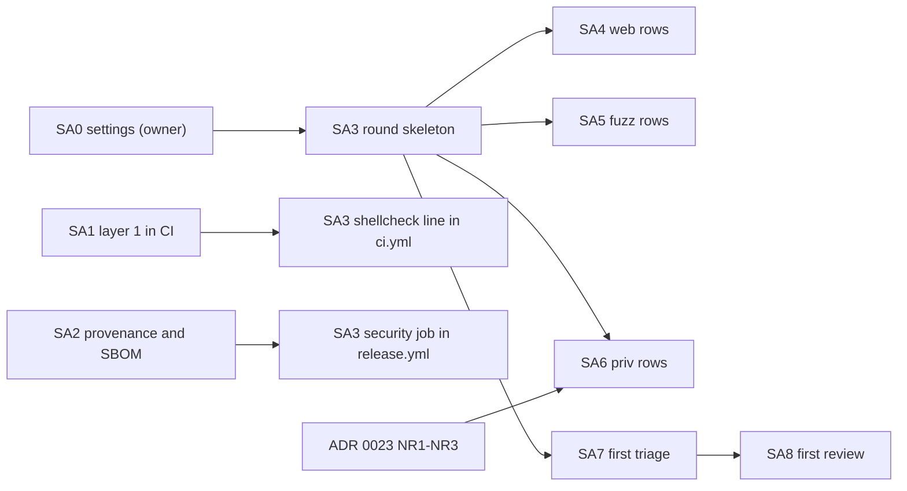

# Security audit plan: a security check at every release, in three layers

- Status: Accepted by the owner on 2026-10-24, with every decision of section 9 (SA-Q1 to SA-Q3) taken as recommended; the plan changes only through rule 2.8 of the execution plan.
- Date: 2026-10-24
- Scope: the owner's question of 2026-10-24, how to get a regular security audit or pentest with reasonable effort and whether it can run and report at every release build. Written against `main` at `354adeb`, with ADR 0023 ([0023-no-root-after-installation.md](../adr/0023-no-root-after-installation.md), Proposed) and [no-root-plan.md](no-root-plan.md) on their own branch at `2e55126`, not yet merged (the two links resolve once it is). Requirement IDs refer to [REQUIREMENTS.md](../REQUIREMENTS.md), toggles and never-off items to [SECURITY-PROFILES.md](../SECURITY-PROFILES.md), the invariants I1 to I9 to ADR 0023. Exit checks, risks and decisions carry the prefix `SA-` as the no-root plan's carry `NR-`.

This plan does not add a product feature. It adds three layers of checks around the release, each cheaper and more frequent than the one after it: **layer 1**, deterministic checks in CI on every push and in the release workflow; **layer 2**, a lab round `security` that runs against the binary being released and leaves a report with stable finding IDs; **layer 3**, a review of the diff since the last reviewed release that asks an attacker's questions. A human pentest stays planned for 1.0 or for the first external user, whichever comes first; the three layers exist to shorten its list, not to replace it. Sizes: S up to one builder-day, M two to four builder-days, L a builder-week or more. "(proposed)" marks a choice the documents leave open.

Contents:

1. [Threat model and goal](#1-threat-model-and-goal)
2. [What exists today](#2-what-exists-today)
3. [Layer 1: deterministic checks on every push and at release](#3-layer-1-deterministic-checks-on-every-push-and-at-release)
4. [Layer 2: the lab round `security` at every release](#4-layer-2-the-lab-round-security-at-every-release)
5. [Layer 3: the release review](#5-layer-3-the-release-review)
6. [Work packages](#6-work-packages)
7. [Order, parallelism and dependencies](#7-order-parallelism-and-dependencies)
8. [Wednesday afternoon 2026-10-29](#8-wednesday-afternoon-2026-10-29)
9. [Owner decisions](#9-owner-decisions)
10. [Risks](#10-risks)
11. [Owner actions](#11-owner-actions)
12. [Documents this plan writes](#12-documents-this-plan-writes)
- [Appendix A: the triage brief](#appendix-a-the-triage-brief)
- [Appendix B: the release review brief](#appendix-b-the-release-review-brief)

## 1. Threat model and goal

### 1.1 The owner's principle

ADR 0023 records it in the owner's words: "even if an attacker manages to break into Tenko, they must not get root for free and must not be able to carry out remote code execution beyond what they already have." The attacker of that ADR fully controls the service account `tenko` through a bug in the server; whatever they do, they stay inside that account's radius (the data directory, the log directory, the sockets it listens on) and get neither root nor code execution anywhere else. The owner added on the same day which way in they would choose themselves: piggyback on an update from a public GitHub repository. That is the attack this plan is built around: not a clever packet, but a release that every node installs because it came from the expected place.

### 1.2 The attackers the layers check for

| # | Attacker | Reaches | What must hold | Checked by |
|---|---|---|---|---|
| A1 | On the network, unauthenticated | The ports a node listens on: DNS on 53 (UDP and TCP), DoT on 853, the API and UI on 8443, the cluster port 8444 while an enrolment waits, DHCP on 67 with the `dhcp` role | Only the expected ports answer; TLS is current; no operation of the API answers without authentication unless it is documented as public; no parser of network data crashes or hangs | Layer 2 rows `net.*`, `tls.*`, `web.*`, `fuzz.*`; layer 1 fuzz smoke; layer 3 questions 1 and 3 |
| A2 | Authenticated with little privilege | A session or API token with the narrowest role | Scoped authorization (ADR 0015) holds for every route; no reveal of a secret without step-up (TGL-24) | Layer 2 row `web.unauth` (and later `web.scope`); layer 3 question 1 |
| A3 | Owns the service account | Everything the account can (ADR 0023, threat model) | I1 to I9: no root process executes or follows what the account can write; no step after the installer needs root; the capabilities stay those of the unit; a binary enters the layout only with a matching digest (and, with API-19, a signature) | Layer 2 rows `priv.*` and `unit.*`; layer 1 offline unit check; layer 3 question 4 |
| A4 | The supply chain: the owner's vector | The release path: a stolen GitHub token or session, a compromised third-party action in a workflow, a malicious or vulnerable dependency, a container image the release job pulls | A release that nodes install is the one the owner meant to publish, built from the tagged source by the expected workflow, and a node can tell when it is not | Layer 1 rows L1.1 to L1.10; API-19 (section 7.2); layer 3 questions 5 and 6 |

A4 is where the GitHub-side controls of layer 1 raise the bar but do not close the door: whoever holds a token with write access to the repository can push a tag, and the release workflow then builds, attests and publishes exactly as it does for the owner. Section 7.2 says what closes it.

### 1.3 Exit checks

| # | Check | Package |
|---|---|---|
| SA-E1 | The repository settings of section 2.1 are on (secret scanning, push protection, Dependabot alerts and security updates, private vulnerability reporting); the triage reads them and lists them in every report | SA0 |
| SA-E2 | Every third-party action in every workflow is pinned to a full commit SHA; the workflow linter reports nothing of High severity; `npm audit`, dependency review and the offline unit check run on every push and pull request and pass on `main` | SA1 |
| SA-E3 | A release carries an SBOM for the Linux binary, the Windows binary, the web UI and the container image, and a build provenance attestation for every asset and the image digest; `gh attestation verify` passes for each, and `SECURITY.md` says how to run it | SA2 |
| SA-E4 | The round `security` runs at release on the binary being released, before `publish`, prints one `PASS`, `FAIL` or `SKIP` line per row, and a blocking row that fails stops the release (shown once with a deliberate failure on a dispatched run) | SA3 |
| SA-E5 | The first report `release-<version>.md` exists in the form of section 4.5 with stable finding IDs; the second report says for each finding of the first whether it is new, still open, fixed or decided | SA3, SA7 |
| SA-E6 | The rows `web.*` and `fuzz.*` run in the round with their rule files | SA4, SA5 |
| SA-E7 | The rows `priv.*` pass on a release that has ADR 0023 built; they replace the hand-run lab round NR7 as the evidence of NR-E3 from then on | SA6 |
| SA-E8 | The first release review exists in the form of Appendix B, and its findings are in the release report with IDs | SA8 |

## 2. What exists today

### 2.1 Facts that correct the starting assumptions

Read on 2026-10-24 from the repository and its settings:

- **The repository is public** since 2026-10-22, not private. Every job of `ci.yml` and `release.yml` runs on GitHub's hosted runners (`ubuntu-latest`, `windows-latest`); the self-hosted runner of `.github/runner/README.md` is no longer used (its page says so), although the repository variable `LINUX_RUNNER` is still set and read by nothing. Two consequences for this plan: GitHub's security features (secret scanning, push protection, code scanning, dependency review, artifact attestations) cost nothing on a public repository, and hosted minutes for standard runners are unlimited; but **workflow logs and artifacts are public**, so a security round must not print its evidence into the log (section 4.6).
- **The settings of the publication checklist's steps 7 to 9 are off.** Secret scanning, push protection, non-provider patterns, Dependabot security updates and private vulnerability reporting all read `disabled` from the API. `SECURITY.md` names private vulnerability reporting as the preferred way to report, so the preferred way does not exist yet. These are the owner's clicks (SA0), five minutes, free.
- **Branch protection is a ruleset on the default branch** (no deletion, no force push, linear history); it requires no status check and no pull request, which matches how the lead merges (gate on the development machine, then push). No rule covers tags: any token with write access can push `v*`.
- **No signing secret exists**, so the Windows binary and the MSI ship unsigned (the release workflow leaves a notice), and the Linux binary, `releases.json` and `SHA256SUMS` have only the marked `SIGNING (later)` places.
- **Releases are frequent.** 0.0.3 on 2026-10-22 and 0.0.4 on 2026-10-23; between them 32 commits and about 31,000 changed lines under `crates/`, `deploy/`, `.github/` and `scripts/`. Any per-release cost in layer 3 is multiplied by that pace (SA-Q2).
- `SECURITY.md` still says there is no tagged release; its supported-versions table needs the release lines (SA7).

### 2.2 Per layer

| Layer | Exists today | Missing |
|---|---|---|
| 1. Deterministic, every push | `cargo deny --all-features check` on push and pull request (advisories, licences with a permissive allow list, crates.io as the only source, no git dependencies, OpenSSL banned); `cargo audit` on push and weekly; the npm licence check; clippy, tests and `cargo fmt`; the DCO and changelog jobs; shellcheck of the deploy scripts; `--locked` builds; the default `GITHUB_TOKEN` read-only with jobs raising what they need; `unsafe_code = "forbid"` in every crate | Secret scanning and push protection (off); Dependabot (off); dependency review; `npm audit`; a linter for the workflows themselves; actions pinned to commit SHAs (every `uses:` today names a moving tag, among them `dtolnay/rust-toolchain@stable` and `@nightly`, which are branches); code scanning; a unit check on every push (today weekly only, below) |
| 1. Deterministic, at release | `SHA256SUMS` and `releases.json` built from the binaries; the static-binary check; the smoke in Debian 12 and RHEL 9 containers; the installer smoke; the MSI install, upgrade and removal | SBOM; build provenance; signatures (API-19) |
| 2. Lab | The DNS, DHCP and cluster labs with their rounds (weekly and by hand; `deploy/compose/lab-*/smoke.sh`, one `PASS` or `FAIL` line per row); the weekly systemd smoke with the exposure gate of `systemd-analyze security` below 2.5 (`deploy/systemd/smoke.sh` step 10); the weekly fuzz smoke, 60 s for each of the 38 targets under `fuzz/fuzz_targets/` with the seeds of `fuzz/seeds/` | Any round that looks at a node from outside (ports, TLS, the web surface); the ADR 0023 invariants as checks; any of it on the binary being released; any report that a later run can compare with |
| 3. Review | The lead's gate on the development machine before every merge; the `/security-review` command, available to every session and used by nobody as a rule | A review per release with fixed questions; a rule for when a branch runs `/security-review` |

## 3. Layer 1: deterministic checks on every push and at release

### 3.1 The checks

"GitHub feature" means a setting or a service of GitHub that needs no job of ours (or only a short one that calls it); "hosted job" means a job of our workflows on `ubuntu-latest`. Costs are wall time on the runner; hosted minutes cost nothing on this public repository.

| # | Check | Tool | Where | When | Cost per run | Blocks or reports | Leaves |
|---|---|---|---|---|---|---|---|
| L1.1 | Known secret shapes never land | Secret scanning with push protection and non-provider patterns | GitHub feature (setting, SA0) | Every push, and once over the whole history when switched on | None | Push protection **blocks** the push; alerts for the history **report** | Alerts in the Security tab |
| L1.2 | Known vulnerabilities in the dependency graph | Dependabot alerts and security updates for Cargo, npm and GitHub Actions; `.github/dependabot.yml` with weekly version updates for `github-actions` only, so the SHA pins of L1.6 stay current | GitHub feature (setting, SA0) and one configuration file (SA1) | When an advisory is published | None | **Reports** (alerts and pull requests); `cargo audit` and L1.4 are what block | Alerts, pull requests |
| L1.3 | A pull request adds no vulnerable or disallowed dependency | `actions/dependency-review-action`, failing on High and Critical and on a licence outside the allow list of `deny.toml` | GitHub feature called by a hosted job | Pull requests (outside contributions and builder pull requests; the lead's direct pushes are covered by `cargo deny` and L1.4) | 30 s | **Blocks** the pull request | A comment on the pull request |
| L1.4 | No vulnerable production dependency of the UI | `npm audit --omit=dev --audit-level=high` in the `UI` job of `ci.yml` and of `release.yml`; the full `npm audit` (with development dependencies) printed beside it | Hosted job | Every push, pull request and release | 10 s | High and Critical in production dependencies **block**; the rest **reports** | Job summary |
| L1.5 | Rust advisories, licences, sources | `cargo deny` and `cargo audit` (exist) | Hosted job | Every push; `cargo audit` also weekly | Exists | **Blocks** (exists) | Job log |
| L1.6 | The workflows cannot be turned against the release | Every `uses:` pinned to a full commit SHA with the tag in a comment; `zizmor` over `.github/workflows/` (unpinned actions, template injection from event fields, `pull_request_target`, credentials kept by `actions/checkout`, permissions wider than needed), configured in `.github/zizmor.yml` | Hosted job | Every push and pull request that changes `.github/**`, and at release | 15 s | High findings **block**; Medium and below **report** | Job summary |
| L1.7 | Code-level patterns | CodeQL for Rust, JavaScript and TypeScript, and GitHub Actions (`.github/workflows/codeql.yml`); Rust with the build mode CodeQL supports when SA1 starts | GitHub feature called by a hosted job | Pull requests and weekly; not every push, for wall time | 20 to 40 min | **Reports** only (SA-Q1); its alerts are an input of the triage | Code scanning alerts |
| L1.8 | The shipped unit stays hardened | `systemd-analyze security --offline=true` over `deploy/systemd/tenko.service` alone and with each drop-in of `deploy/systemd/` (`probe.conf`, `dhcp-direct.conf` and the data-directory drop-in; a drop-in through a staged tree and `--root=`, or a unit file the job assembles, whichever `systemd-analyze` 255 reads correctly, decided in SA1), each against its own gate: the unit below 2.5 as the weekly smoke has it, each drop-in below the value it measures in SA1 plus 0.1 | Hosted job | Every push that changes `deploy/systemd/**`, and at release | 10 s | **Blocks** | Job summary with the scores |
| L1.9 | What a release is made of is published | An SBOM in CycloneDX JSON per asset: the Linux and Windows binaries from `Cargo.lock` through `cargo cyclonedx` (or `cargo auditable` builds read by `syft`, decided in SA2 by which one lists exactly the crates linked into the musl binary), the UI from `ui/package-lock.json` through `@cyclonedx/cyclonedx-npm --omit dev`, the image through `syft`; each attached to the release and attested with `actions/attest-sbom` | Hosted job in `release.yml`; the attestation is a GitHub feature | Every release | 2 to 3 min | **Blocks** only when generation fails | Release assets `tenko-<version>-<platform>.cdx.json`, SBOM attestations |
| L1.10 | Where a release came from can be checked | `actions/attest-build-provenance` (SLSA build provenance, signed through Sigstore's public instance and recorded in its transparency log) for every binary, the MSI, `releases.json`, `SHA256SUMS`, the installers and the image digest (`push-to-registry`); `gh attestation verify <file> --repo <owner>/<repo>` documented in `SECURITY.md` | GitHub feature called by a hosted job in `release.yml` | Every release | 1 min | **Blocks** when attesting fails | Attestations on the repository and the image |
| L1.11 | Signatures a node verifies | API-19, not this plan (section 7.2) | Release workflow | Every release, once built | Unknown | **Blocks**, once built | Signatures next to the assets |

### 3.2 Permissions and the release job

The checks that read (L1.3, L1.4, L1.6, L1.8, the SBOM generation of L1.9) run with `contents: read` and no secret. Only one job of `release.yml` holds `id-token: write` and `attestations: write` (and `packages: write` for the image attestation): a new job `attest`, after the builds and before `publish`, that downloads the artifacts and attests them, with no third-party action other than GitHub's own `attest-*` actions pinned by SHA. The scanner images of layer 2 never run in a job that holds a token able to write (section 4.6, SA-R6).

### 3.3 Blocks and reports, in one line each

Blocks from the first run: L1.1 (push protection), L1.3, L1.4 (High and Critical, production), L1.5, L1.6 (High), L1.8, L1.9 and L1.10 when they fail to produce. Reports: L1.1 (history), L1.2, L1.4 (the rest), L1.6 (Medium and below), L1.7. SA-Q1 decides whether that split stands.

## 4. Layer 2: the lab round `security` at every release

### 4.1 Where it runs

A reusable workflow `.github/workflows/security-round.yml` with two triggers:

- **`workflow_call` from `release.yml`**: a job `security` with `needs: [verify, build]`, given the name of the build artifact `binary-linux-x86_64`. It tests the binary being released, before anything is published (the rule of the project: smokes and measurements run on the shipped binary). Whether `publish` lists `security` in its `needs` is SA-Q1.
- **`workflow_dispatch` with a tag**: downloads the Linux asset of that published release and checks it against the release's `SHA256SUMS` before testing it. That is how the round is rehearsed between releases and how it is first run on Wednesday, against 0.0.4, without a new tag.

The job runs on `ubuntu-latest`, which has systemd as PID 1 and Docker, as the weekly systemd smoke already relies on. The node under test is installed **as a user installs it**: `deploy/install.sh` with the binary under test, as root, unattended, roles `controller,dns` (the `dhcp` role in relay mode is a later row group; direct mode needs the `dhcp-direct.conf` drop-in and its own gate), then the first-run setup through the API with the **Standard** profile, the API on 8443 with the internal CA (OPS-22 mode a), DNS on 53, DoT on 853 with a certificate of a lab CA as the DNS lab's round `xfr` makes one. The scanners run in containers on a Docker network that reaches the host's address, so they see the node as another machine on the link would; checks that need root on the host (`ss`, `/proc`, `auditd`, `find`) run on the host. The runner is not an empty machine: `systemd-resolved` holds port 53 on its stub address (the reason the weekly systemd smoke installs the controller role only), so the round turns the stub listener off before the install, and every `net.*` row first scans the host before the install and compares the ports the install added, while `net.listeners` attributes each socket to its process.

The scripts live in `deploy/security/` (`round.sh` with the row helper of the DNS lab, `compose.yml` for the scanner containers, `rules/` for the rule files, `README.md` with the rows table); `SECURITY.md` counts the lab directories under `deploy/compose/` as out of scope for reports, and SA2 adds this one to them. Run by hand on any Linux host with systemd and Docker: `sudo BINARY=<path> bash deploy/security/round.sh`, with `ROWS="net tls"` to run a group.

### 4.2 The rows

One `PASS`, `FAIL` or `SKIP` line per row, as in the DNS lab (`row <name> <description> <command...>`; a failing check is repeated with a trace in the log). `SKIP` carries its reason (for example "ADR 0023 not built"). Each row also writes one JSON line to the evidence bundle: the row, the state, the duration, the tool and version, and the paths of its raw output inside the bundle.

**Network surface (`net.*`, SA3)**

| Row | What is checked | How |
|---|---|---|
| `net.tcp` | Only the expected TCP ports answer | `nmap -sT -p- --open` from the scanner container against the node's address, before and after the install: the ports the install added are exactly {53, 853, 8443} |
| `net.udp` | Only the expected UDP ports answer | `nmap -sU` over the 1,000 most common ports plus 53, 67, 68, 123, 161, 547, 5353 and 9464, before and after the install: the install added exactly {53}; a port that turned `open|filtered` fails the row, since Linux answers a closed UDP port with ICMP |
| `net.listeners` | No socket of a Tenko process listens where it should not | `ss -tulpnH` as root on the host, filtered to the processes of the unit: every listening socket is in the expected list (address and port); the metrics listener, when configured, is on `127.0.0.1` or `[::1]` only |
| `net.cluster_port` | The cluster port opens only while an enrolment waits | 8444 closed after setup; open after an enrolment token is created through the API; closed again after the token is revoked or expires, as long as no node has enrolled |
| `net.ipv6` | The IPv6 surface is the IPv4 one | `net.tcp` and `net.udp` again against the host's IPv6 address on the Docker network (`nmap -6`) |

**TLS (`tls.*`, SA3)**

| Row | What is checked | How |
|---|---|---|
| `tls.api` | The API's TLS is current | `testssl.sh --jsonfile` against 8443 with the node's internal CA added (`--add-ca`): TLS 1.2 and 1.3 only, no cipher testssl rates weak or insecure, no finding of severity Medium or above except those listed with a reason in `rules/testssl-allow.txt`, the certificate chain verifies, the certificate names the configured host |
| `tls.dot` | DoT's TLS is current | The same against 853, with ALPN `dot` offered |
| `tls.headers` | The API sends the transport headers the profile asks for | `curl -sI` against `/`: `Strict-Transport-Security` present when configured; no plain-HTTP listener answers on 8443 |

**The unit (`unit.*`, SA3)**

| Row | What is checked | How |
|---|---|---|
| `unit.exposure` | The installed unit keeps its exposure score | `systemd-analyze security tenko.service` on the installed node, below 2.5 (the gate of the weekly smoke, now on the released binary and the installer's unit) |
| `unit.account` | The service account is what ADR 0023 says | `getent passwd tenko`: shell `nologin`, no password, no supplementary group; no `sudo` rule, `cron` or `at` entry; no lingering user manager |

**The web surface (`web.*`, SA4)**

| Row | What is checked | How |
|---|---|---|
| `web.unauth` | No operation answers without authentication unless the document says it may | For every operation of the OpenAPI document served by the node (which declares the security requirement of every operation since `96c16b0`), a request without credentials with a placeholder for each path parameter: an operation with a security requirement answers 401; the operations without one are exactly the list in `rules/public-operations.txt` |
| `web.ui_baseline` | The UI has no passive finding above the rules | ZAP baseline scan (`zap-baseline.py`, passive, a one-minute spider) of `https://<node>:8443/`, signed in through a session the round creates, with `rules/zap-baseline.tsv` mapping each ZAP rule to `FAIL`, `WARN` or `IGNORE` (every `IGNORE` with a reason) |
| `web.api_baseline` | The API has no passive finding above the rules | ZAP's API scan importing the node's OpenAPI document, passive rules only, with a token of the read-only role, and the same rule file |

**Fuzzing (`fuzz.*`, SA5)**

| Row | What is checked | How |
|---|---|---|
| `fuzz.targets` | No in-process target crashes in a fixed budget | Every target of `cargo fuzz list` for 120 s, four at a time, on the release commit, starting from `fuzz/seeds/` and the corpus the previous run left in the Actions cache; a crash fails the row and its input goes into the bundle |
| `fuzz.dns_wire` | The running node survives malformed DNS on the wire | For 10 minutes, a mutator (`deploy/security/dnswire.py`, Python standard library only) sends mutations of the DNS seeds over UDP and TCP to port 53 of the installed node at a bounded rate, while a probe asks a known name once a second: every probe is answered within 1 s, the unit never restarts (`NRestarts=0`), the journal shows no panic, and resident memory at the end is within 20 percent of the start |

**The ADR 0023 invariants (`priv.*`, SA6)**

These rows use the lab mirror of NR7: a second release built from the same source with a bumped version, served to the node over TLS from a container (`updates.source_url`), so that the round can update, roll back and switch back. Until ADR 0023's packages NR1 to NR3 are merged they run as reports only and are expected to fail where today's design differs (the bootstrap binary on `PATH`, `--uninstall` as root inside the data directory); that failure is the gap the ADR closes and is recorded as such, not triaged as new findings.

| Row | What is checked | How |
|---|---|---|
| `priv.no_root_exec` | No root process executes a file the account can write (I1) | An `auditd` rule on `execve` with `euid=0` for paths below the data directory and the log directory, armed from the end of the installer to the end of the round: it records nothing |
| `priv.uid` | Every step after the installer runs without root (I3, I5) | While the round updates from the API, rolls back, lets the watchdog and the guard switch back (the new version killed before it confirms, three starts in a row), restarts and takes a backup, `/proc` is sampled every 200 ms: every process of the unit has a real and effective uid other than 0 |
| `priv.ownership` | Root's files and the account's files stay apart (I2, I4) | As the account (`runuser -u tenko -- find / -xdev -writable`), the writable paths are exactly the data directory, the log directory and the temporary directories; the unit, its drop-ins, `/etc/tenko` and `tenko.toml` are owned by root and not writable by the account |
| `priv.layout` | Two versions, nothing on `PATH` (I5, I6) | After the install, the rollback and the switch back, the layout holds exactly the versions `current` and `previous` name; `command -v tenko` as root finds nothing from the layout and `/usr/local/bin/tenko` does not exist |
| `priv.caps` | The capabilities stay the unit's (I7) | `CapEff` of the service process equals the unit's grant (`CAP_NET_BIND_SERVICE` for these roles) before and after the update and the rollback; `getcap -r` over the layout prints nothing; no file in the layout has the set-user-ID or set-group-ID bit |
| `priv.digest` | A binary that does not match its digest never enters the layout (I8) | The mirror serves a release whose binary differs from its `SHA256SUMS` line: the install is refused, the refusal is audited, `current` is unchanged |
| `priv.signature` | An unsigned or wrongly signed release never enters the layout (I8 with API-19) | `SKIP` until API-19 is built; then the mirror serves an unsigned release and one signed by another key: both refused and audited |
| `priv.audit` | The steps leave their trail (I9) | The install, the rollback and the switch back each have their audit record, and `GET /audit/verify` answers that the chain is intact |
| `priv.root_refuses` | The layout's binary refuses to run as root when others can write it (ADR 0023 item 8) | With the layout's directory made group-writable by the round, the binary run as root exits with status 2 and the code `exec.unsafe_owner` |

### 4.3 Cost per run

| Group | Wall time |
|---|---|
| Install and setup | 3 min |
| `net.*` | 5 to 8 min (`net.udp` is most of it) |
| `tls.*`, `unit.*` | 3 min |
| `web.*` | 10 to 15 min |
| `fuzz.targets` | 38 targets at 120 s, four at a time: about 20 min plus the fuzz build (10 min) |
| `fuzz.dns_wire` | 10 min |
| `priv.*` | 15 min with the mirror build |
| **Round** | **About 60 to 75 minutes**, in parallel with the MSI job and the Linux smoke, so the release takes about 30 to 45 minutes longer than today |

Hosted minutes cost nothing here. The cost that matters is the triage (section 4.7): a short session per release.

### 4.4 What blocks

As SA-Q1 decided (option b): from the first run `net.*`, `tls.*`, `unit.*`, `fuzz.*` and `web.unauth` block (deterministic, and expected to pass on today's `main`); `web.ui_baseline` and `web.api_baseline` report until their rule files have been through two releases; `priv.*` reports until ADR 0023's packages are merged and blocks from the first release after.

### 4.5 The report

One file per release, `release-<version>.md`, in the places SA-Q3 decided (option b): the full report with its evidence in a private repository, a summary at `docs/security/release-<version>.md` in this one. The round writes the deterministic part (sections 1 and 2 below) with `scripts/security-report.mjs` from the bundle's JSON lines; the triage (section 4.7) writes sections 3 to 5.

```markdown
# Security report: Tenko <version>

- Tag and commit: v<version>, <sha>
- Date: <yyyy-mm-dd>
- Round: <workflow run URL>, bundle <sha256 of the encrypted bundle>
- Compared with: release-<previous version>.md
- Reviewed diff (layer 3): <tag>..<tag>, or "none for this release" with the reason

## 1. Layer 1
| Check | State | Note |                  (L1.1 to L1.11; open alert counts by severity)

## 2. Layer 2 rows
| Row | State | Duration | Evidence |     (one line per row; Evidence = path inside the bundle)

## 3. Findings
| ID | Severity | State | Source | Fingerprint | Title | First seen | Evidence |

## 4. Changes since <previous version>
New: SF-…   Fixed: SF-… (by <commit>)   Still open: SF-…   Decided: SF-… (accepted or not a finding)   Not seen: SF-…

## 5. Notes for the owner
```

**Finding IDs.** `SF-NNNN`, four digits, sequential across the project, never reused and never renumbered. Each finding also carries a **fingerprint** that a later run can recompute: `<tool>:<rule>:<location>`, for example `zap:10038:/api/v1/dns/zones/{id}`, `testssl:cipher_negotiated:8443`, `nmap:tcp/8444`, `row:priv.caps`, `codeql:rust/cleartext-logging:crates/tenko-auth/src/session.rs#create`, `review:auth-boundary:crates/tenko-api/src/routes/backup.rs#restore`. The triage matches a new run's findings to open ones by fingerprint (paths with identifiers normalised to their OpenAPI template; line numbers never part of a fingerprint); a finding that matches nothing gets the next ID.

**States.** `new` (first seen in this report), `open` (seen again), `fixed` (no longer seen **and** a commit since the last report addresses it, named), `not seen` (no longer seen without a commit that explains why: a scanner that did not reach the page, a flaky row; it stays on the list and becomes `fixed` only when a second report confirms it with a reason), `accepted` (the owner decided to live with it, with the reason and a date to look again), `not a finding` (the owner decided it is a false positive, with the reason), `reopened` (fixed or decided earlier, seen again). Only the owner moves a finding to `accepted` or `not a finding`, in writing in the report's section 5 of the next release or in a note the triage is given; the triage never does.

**Severity.** Critical, High, Medium, Low, Info. A tool's own severity is kept as the starting point; the triage may raise it with a reason (for example a ZAP Medium on an unauthenticated route) and may lower it only with the owner's agreement.

### 4.6 What is public and what is not

On a public repository the log and the artifacts of every run are public. So the round:

- prints only the row lines (`PASS net.tcp …`) and counts to the log and to the job summary; raw scanner output never goes to the log;
- packs the evidence (raw outputs, the JSON lines, crash inputs, the journal of the node) into a tar file encrypted with `age` to the owner's public key (the repository variable `SECURITY_AGE_RECIPIENT`; a public key is not a secret) and uploads only that, with a retention of 90 days;
- runs its scanners (nmap, testssl.sh, ZAP, all pulled by digest) in a job with `contents: read`, no secret and no `id-token`, so a compromised scanner image can read the binary it tests and nothing else.

The owner (or the lead on the owner's machine) decrypts the bundle; the triage gets the decrypted directory, never the key.

### 4.7 The triage

After the release run (or a dispatched run), the lead starts one triage session with the fixed brief of Appendix A. It is a leaf task: matching fingerprints, reading evidence and writing a report, which a Sonnet session does well; it escalates to the lead what needs judgement. Inputs: the decrypted bundle, the previous report, the open alerts of layer 1 (`gh api` over code scanning, Dependabot and secret scanning alerts), the repository settings of section 2.1 as `gh api` reads them, and the layer 3 review of this release when there is one. Output: the report, nothing else. Its rule: **a finding is reported with its evidence and never silently closed**; anything that leaves the list goes through a state of section 4.5 with its reason. Cost: about 150,000 to 300,000 tokens per release on Sonnet, rising with the number of open findings.

## 5. Layer 3: the release review

### 5.1 What it is

One Opus session per release (or per the cadence of SA-Q2) with the fixed brief of Appendix B. It reads the diff between the last reviewed tag and the new one, filtered to the security paths of section 5.2 and read in their order, and asks of every change the attacker's questions of the brief: who can reach this, with what, and what do they get. It writes findings with the fingerprints of section 4.5 and evidence (a path, a function, the input that reaches it, the reasoning, and a reproduction against the lab when one is cheap), which the triage merges into the release report. It never fixes, commits, pushes or files anything (Appendix B, "Never").

### 5.2 The security paths

One list, used by the review to order its reading and by the rule for `/security-review` (section 5.4). Kept in `deploy/security/paths.txt` so that both read the same file:

1. The authentication and authorization boundary: `crates/tenko-auth/**`, `crates/tenko-api/src/middleware/**`, `crates/tenko-api/src/extract.rs`, `crates/tenko-api/src/redact.rs`, every new or changed route under `crates/tenko-api/src/routes/**`.
2. Privilege crossings and the update path: `crates/tenko/src/upgrade/**`, `crates/tenko/src/platform/**`, `crates/tenko/src/plugin/**`, `crates/tenko/src/backup/**`, `deploy/install.sh`, `deploy/systemd/**`, `deploy/windows/**`, `deploy/Dockerfile`, `deploy/proxmox/**`.
3. Parsers of network and file input: every module a target under `fuzz/fuzz_targets/` names, and any new parser in `crates/tenko-dns/**`, `crates/tenko-dhcp/**`, `crates/tenko-scan/**`, `crates/tenko-connect*/**`, `crates/tenko-cluster/**`.
4. Secrets and keys: `crates/tenko-vault/**`, `crates/tenko/src/kek.rs`, `crates/tenko-cluster/**` (enrolment, the internal CA).
5. The release path: `.github/workflows/**`, `scripts/release-manifest.mjs`, `Cargo.lock`, `ui/package-lock.json`, `deny.toml`, `.cargo/audit.toml`.

### 5.3 Cost

The diff from 0.0.3 to 0.0.4 changed about 31,000 lines in the paths that matter; a release of that size is the upper case. Filtered to the security paths, such a diff is roughly 10,000 to 15,000 lines, 150,000 to 250,000 tokens to read once, plus the surrounding code the questions send the session to. An estimate for one review of a release of that size on Opus: 2 to 5 million input tokens, most of them read from the cache, and 40,000 to 80,000 output tokens, about the cost of one S builder package; a patch release with a few hundred changed lines in those paths costs a tenth of that. A diff above 20,000 filtered lines is split in two sessions by the groups of section 5.2 (1 and 2, then 3 to 5). The first review has no earlier tag to start from: it is a baseline over the security paths at the reviewed tag, split in four sessions (groups 1, 2, 3, then 4 and 5), and costs about four packages once.

### 5.4 `/security-review` on branches before the gate

The rule, recorded in the lead's local instructions for the checkout (the gate is the lead's, not the repository's):

- A branch that changes any path of section 5.2 runs `/security-review` in its worktree before it asks for the gate, and puts the result in its hand-over note under "Security review": the findings with a one-line answer each (fixed in the branch with the commit, or why it is not a problem). A branch that changes no such path writes "Security review: not needed, no security path changed".
- The lead's gate refuses a branch whose note lacks the section, or that leaves a High or Critical finding unanswered.
- The command reviews the branch's own diff against its base; it does not replace layer 3, which reads a release's changes together, where interactions between branches show.
- Cost: one short pass per branch, small next to the package that produced the branch.

## 6. Work packages

#### SA0 Repository settings (owner, 15 minutes, no code)

- **Owns:** the settings of section 2.1: secret scanning with push protection and non-provider patterns, Dependabot alerts and security updates, private vulnerability reporting; a ruleset for tags `v*` (creation, update and deletion restricted to the repository's administrators); the unused variable `LINUX_RUNNER` deleted; an `age` key pair made on the owner's machine with `age-keygen`, the public key stored as the repository variable `SECURITY_AGE_RECIPIENT`, the private key kept off GitHub.
- **Acceptance:** `gh api repos/<owner>/<repo> --jq .security_and_analysis` reads `enabled` for the four; `gh api repos/<owner>/<repo>/private-vulnerability-reporting` reads `true`; the triage lists them in the first report (SA-E1).

#### SA1 Layer 1 in CI (S)

- **Owns:** `.github/workflows/ci.yml` (the `npm audit` step in `UI`, a `dependency-review` job on pull requests, a `workflow-lint` job running `zizmor`, a `unit-check` job running L1.8, every `uses:` pinned to a full SHA), `.github/workflows/codeql.yml` (new), `.github/dependabot.yml` (new, `github-actions` weekly), `.github/zizmor.yml` (new), the drop-in gates measured and written into the `unit-check` job, `deploy/systemd/README.md` (a line on the gates).
- **Depends on:** nothing; SA0 for Dependabot to act on the file.
- **Tests:** `actionlint` and `zizmor` clean at High on the edited workflows before the lead's gate; the `unit-check` job's script run locally in WSL against the unit and each drop-in (a deliberate `ProtectSystem=` removal fails it); the jobs green on their first run after the lead pushes.
- **Acceptance:** SA-E2.
- **Not here:** the pinning of `release.yml`, which is SA2's file.

#### SA2 Provenance and SBOM at release (S)

- **Owns:** `.github/workflows/release.yml`: the SBOM steps of L1.9 in `build` and `image`, the new job `attest` of section 3.2, `publish` attaching the SBOMs and needing `attest`, the `npm audit` step in its `UI` job, every `uses:` pinned to a full SHA, the `SIGNING (later)` comments pointing at section 7.2 of this plan; `SECURITY.md` (a section "Verifying a release" with `gh attestation verify` and the SBOM files; the supported-versions table with the release lines; `deploy/security/` added to the out-of-scope lab directories); `scripts/release-manifest.mjs` only if SBOM files must stay out of `SHA256SUMS` (decided by reading it; the default is that they are listed).
- **Depends on:** nothing.
- **Tests:** `actionlint` and `zizmor` clean; the SBOM tools run locally on the musl build in WSL and list the crates `cargo tree -e normal --target x86_64-unknown-linux-musl` lists; the release workflow itself is only exercised by the next tag (an `-rc` tag is the cheap way when the owner wants it sooner).
- **Acceptance:** SA-E3 at the next release.

#### SA3 The round `security`: skeleton, network, TLS and unit rows, the report (M)

- **Owns:** `deploy/security/` (`round.sh` with the row helper and the evidence bundle, `compose.yml` with the scanner images pinned by digest, `install-node.sh` for the install and the setup through the API, `rules/testssl-allow.txt`, `paths.txt`, `README.md` with the rows table), `.github/workflows/security-round.yml` (both triggers of section 4.1, the `age` encryption, the job summary), `scripts/security-report.mjs` with `scripts/security-report.test.mjs` (the deterministic part of the report from the JSON lines, and the fingerprint normaliser the triage uses), the `security` job in `release.yml` calling the reusable workflow (a final small commit after SA2 merges, since `release.yml` is SA2's file until then), `docs/security/README.md` (the process, the report format, the IDs, the states; section 4.5 of this plan in the repository's words), the `deploy-scripts` job of `ci.yml` extended to shellcheck `deploy/security/*.sh` (after SA1 merges, for the same reason).
- **Depends on:** SA0 for the `age` recipient (the round refuses to upload unencrypted evidence and says why).
- **Tests:** `node --test scripts/security-report.test.mjs` (the report from a recorded set of JSON lines, the fingerprint normalisation of paths with identifiers, IDs carried over from a previous report); `bash -n` and shellcheck; a dispatched run against 0.0.4 with every row of `net.*`, `tls.*` and `unit.*` passing; one dispatched run with a deliberate extra listener (a configured metrics listener on `0.0.0.0`) that fails `net.tcp` and `net.listeners`.
- **Acceptance:** SA-E4 and the deterministic half of SA-E5.

#### SA4 The web rows (M)

- **Owns:** `deploy/security/web.sh` (the rows `web.*`), `rules/zap-baseline.tsv`, `rules/public-operations.txt`, the round's session and read-only token for ZAP; `docs/security/README.md` (the rule files and how a rule changes).
- **Depends on:** SA3.
- **Tests:** `web.unauth` against a node with one route's security requirement removed in a test build fails naming that operation; the ZAP rows on 0.0.4 with every `IGNORE` carrying a reason.
- **Acceptance:** the `web.*` part of SA-E6.

#### SA5 The fuzz rows (S)

- **Owns:** `deploy/security/fuzz.sh` and `deploy/security/dnswire.py` (the rows `fuzz.*`), the corpus cache in `security-round.yml`; `fuzz/README.md` (the release budget beside the weekly one).
- **Depends on:** SA3.
- **Tests:** `fuzz.dns_wire` against a node started with a deliberately small `LimitNOFILE` that makes TCP fail shows the row failing on the probe; `fuzz.targets` reports a planted crash input as a failure with the input in the bundle.
- **Acceptance:** the `fuzz.*` part of SA-E6.

#### SA6 The invariant rows (M)

- **Owns:** `deploy/security/priv.sh` (the rows `priv.*`), the lab mirror (reused from NR7's script under `deploy/proxmox/test/` when NR7 leaves one, else written here and offered to NR7), the `auditd` setup on the runner.
- **Depends on:** SA3; ADR 0023's NR1 to NR3 merged for the rows to pass (they run as reports before, section 4.2); API-19 for `priv.signature`.
- **Tests:** each row against a node where the invariant is broken on purpose (a root-owned `ExecStartPre=+` line, a file capability set on the layout's binary, a third version directory left behind) fails with the expected line.
- **Acceptance:** SA-E7.

#### SA7 Triage brief and the first triage (S, lead)

- **Owns:** the brief of Appendix A kept with the lead's instructions; the first triage after SA3's dispatched run against 0.0.4, which writes `release-0.0.4.md` as the baseline report and gives every finding its first ID.
- **Depends on:** SA3; the private repository of SA-Q3 (owner action 2).
- **Acceptance:** SA-E5 once a second report exists.

#### SA8 The first release review (lead, four sessions once, then per SA-Q2)

- **Owns:** the baseline review of section 5.3 at the first release after this plan is accepted, in four sessions with the brief of Appendix B; the gate rule of section 5.4 in the lead's local instructions.
- **Depends on:** quota after a Thursday reset; then the cadence SA-Q2 decided.
- **Acceptance:** SA-E8.

## 7. Order, parallelism and dependencies

### 7.1 Order



| Step | Packages | In parallel? | Why |
|---|---|---|---|
| 0 | SA0 | Before everything, by the owner | Free, and push protection and private reporting matter now, not at the next release |
| 1 | SA1, SA2, SA3 | Yes, three builders at most | Disjoint files: `ci.yml` and the new CI files (SA1), `release.yml` and `SECURITY.md` (SA2), `deploy/security/`, `security-round.yml` and the new scripts (SA3); SA3's two lines in `ci.yml` and `release.yml` wait for SA1 and SA2 |
| 2 | SA4, SA5 | Yes | Separate scripts and rule files under `deploy/security/`; `round.sh` calls them through a marked block each |
| 2 | SA7 | After SA3's first dispatched run | Needs a bundle |
| 3 | SA6 | When NR1 to NR3 are merged (it may be built before, as reports) | Needs ADR 0023 built to pass |
| 3 | SA8 | After a quota reset | Four Opus sessions |

### 7.2 Dependency on release signing (API-19)

API-19 ("Signed releases (Sigstore, Authenticode) and SBOM", Phase 5) is half done by this plan: SA2 delivers the SBOM and the Sigstore-backed provenance of every asset. What remains is the part that stops the owner's vector:

- **A signature the node checks before a binary enters the layout** (ADR 0023 I8, "against a trust root compiled into the running binary"). Until it exists, a node trusts whatever the release it fetched says about itself: the checksum comes from the same release as the binary.
- **Whose key.** A signature made inside the release workflow, keyless through Sigstore or with a key stored as a repository secret, proves that the workflow of this repository built the file. Whoever can push a tag gets exactly that proof for their own release, so it does not stop A4. The key the node trusts must be one GitHub never holds: a hardware-backed key on the owner's machine that signs `SHA256SUMS` (and with it `releases.json`) after the round has passed, making a release a two-party act: GitHub builds and attests, the owner's key releases. The provenance attestation stays useful beside it, for the owner to check before signing and for anyone auditing a release. This plan proposes that API-19 gets its own ADR (proposed ADR 0024) that decides the key, the format (a detached signature over `SHA256SUMS` is the smallest) and the rotation, and that the round's `priv.signature` row is its acceptance test.
- **Authenticode** for the Windows binary and the MSI needs a certificate the owner buys (the release workflow signs as soon as the secrets exist); it is independent of the above.

Until API-19 is built: Hardened installs only from uploaded files (TGL-23), ADR 0023 lets an installation turn installing off (`updates.install = false`), and the tag ruleset of SA0 and push protection make a stolen token less useful without making it useless.

### 7.3 Dependency on ADR 0023

The `priv.*` rows are ADR 0023's invariants made into checks. They can be written before the ADR's packages merge and then fail on today's design in the places the ADR names; they pass only once NR1 (the layout, the guard, the owner check), NR2 (rollback through the API) and NR3 (the unit and the installer) are merged. NR7, the ADR's hand-run lab round, is the first evidence; SA6 makes it repeatable at every release, and the ADR's acceptance (NR-E3) can cite the round's report from then on. If the owner answers NR-Q1 with "capabilities per role" (the recommendation), `priv.caps` checks the grant of the roles the round installs; a later row group with the `probe` role checks `CAP_NET_RAW` comes only with the `probe.conf` drop-in.

## 8. Wednesday afternoon 2026-10-29

A half day of two Opus builders, if the week's quota allows it (the pools reset on Thursday at 11:00; the lead checks the remaining share that morning and spends no more than the remaining share divided by the days left). What lands first, in this order:

**Before Wednesday, by the owner:** SA0 (15 minutes, including the `age` key pair); SA-Q1 to SA-Q3 were decided on 2026-10-24. Without SA0 the round runs but refuses to upload its evidence.

**Builder 1: layer 1 complete (SA1, then SA2).** Both are S and touch only workflow and configuration files. SA1 first: the pinning, `zizmor`, `npm audit`, dependency review, the unit check, Dependabot's file and CodeQL. Then SA2: the SBOMs, the `attest` job and the `SECURITY.md` section. The lead gates and pushes SA1 in the afternoon so that its jobs run on `main` the same day; SA2 is exercised by the next release tag.

**Builder 2: the round's skeleton with the port and TLS rows (SA3, its first half).** `deploy/security/round.sh` with the row helper and the bundle, `install-node.sh`, `compose.yml`, the rows `net.tcp`, `net.udp`, `net.listeners`, `net.cluster_port`, `tls.api`, `tls.dot`, `unit.exposure`, `security-round.yml` with the dispatch-by-tag trigger and the encryption. The lead pushes it and dispatches it against 0.0.4 before the end of the afternoon.

**What spills to Thursday or later, in this order:** the rest of SA3 (`net.ipv6`, `tls.headers`, `unit.account`, `scripts/security-report.mjs` with its tests, `docs/security/README.md`, the `release.yml` hook after SA2 merges); SA7, the first triage over the 0.0.4 bundle (a Sonnet session, cheap); SA4 (ZAP and `web.unauth`); SA5 (fuzz rows); SA8, the baseline review, which needs four Opus sessions and waits for the quota after the reset; SA6 waits for ADR 0023's packages; `priv.signature` and the rest of API-19 wait for their own ADR.

**If the quota allows only one builder:** builder 2's work first (the round is new capability; layer 1 is small and SA0 alone already turns on the most valuable part of it, push protection), then SA1.

## 9. Owner decisions

**SA-Q1. Which checks block a release from the first run?**
- Options: (a) everything blocks from the first run, layer 3 included; (b) a ratchet: the deterministic checks that pass on today's `main` block from the first run (L1.1 push protection, L1.3, L1.4 for High and Critical in production dependencies, L1.5, L1.6 for High, L1.8, L1.9 and L1.10 when they fail to produce; the rows `net.*`, `tls.*`, `unit.*`, `fuzz.*`, `web.unauth`), while CodeQL, Dependabot, the ZAP rows and the review report; a reporting check becomes blocking after two releases in a row without a new finding of High or above, recorded in the report; `priv.*` blocks from the first release after ADR 0023's packages are merged; a Critical or High finding of any source holds the release until the owner decides it in the report; (c) nothing blocks for the first month, everything reports.
- Trade-offs: (a) stops releases on the first false positive of a scanner nobody has tuned yet, and the release pace (two releases in two days) makes that expensive; it also invites ignore lists written in a hurry. (b) blocks on what is deterministic and already true, so the first run proves the gate works instead of drowning it, and tightens on evidence. (c) is cheapest to start but leaves the most important release, the next one, unguarded, and a report nobody must act on tends to stay unread.
- **Recommendation: (b). Decided by the owner on 2026-10-24: (b).**

**SA-Q2. Does layer 3 run per release or per month?**
- Options: (a) every release; (b) once a month over everything since the last review; (c) per release whose diff touches a security path of section 5.2, the review covering everything since the last reviewed tag (so small releases are batched into the next review), with at least one review a month even when no release touched those paths, and the one-time baseline of section 5.3 first.
- Trade-offs: (a) at the current pace costs up to one S package per release, most of it on releases that changed the UI or a document. (b) is cheap and predictable but lets a month of changes reach nodes unreviewed, and a month's diff is too big for one careful session. (c) spends the review where the attack surface changed, keeps each review to one or two sessions, and still bounds the gap; its cost follows the work rather than the calendar.
- **Recommendation: (c). Decided by the owner on 2026-10-24: (c).**

**SA-Q3. Where do the reports live?**
- Options: (a) `docs/security/release-<version>.md` in this repository, complete; (b) the complete report and the decrypted evidence in a private repository of the owner's beside this one, and in this repository a summary per release at `docs/security/release-<version>.md`: the rows with their states, the counts of findings by severity and state, the fixed findings with their ID, title and fixing commit, and the open findings by ID and severity only, their details published when they are fixed or when the disclosure window of `SECURITY.md` ends; (c) everything private, nothing in this repository.
- Trade-offs: (a) publishes open findings, with their evidence, to anyone the moment the report is committed: a list of unfixed weaknesses of a released version, against the coordinated disclosure that `SECURITY.md` promises reporters. (b) keeps that promise, keeps the history comparable (the triage reads the private report), and still shows users that every release was checked and what was fixed; it costs one private repository and a summary step in the triage. (c) is simplest but gives users and a later pentester nothing to look at.
- **Recommendation: (b). Decided by the owner on 2026-10-24: (b).**

## 10. Risks

| # | Risk | Mitigation |
|---|---|---|
| SA-R1 | Scanner noise (ZAP, CodeQL) makes the reports long and the owner stops reading them | Rule files with a reason for every ignore; the ratchet of SA-Q1; the report's section 4 lists only what changed |
| SA-R2 | `auditd` or `/proc` sampling does not work on the hosted runner (a kernel without audit support, a container instead of a VM) | SA6 checks it first; the fallback is the Proxmox lab container of NR7, run by hand at release until a runner that supports it exists |
| SA-R3 | The round makes the release 30 to 45 minutes slower | It runs beside the MSI job and the Linux smoke; only `publish` waits for it |
| SA-R4 | Evidence of an open weakness becomes public through a log or an artifact | Row names and counts only in the log; the bundle encrypted to the owner's key; the reviewers' notes stay in the private place of SA-Q3 |
| SA-R5 | The review misses what a human would find, and its fluency gives false confidence | The review is a supplement with fixed questions and evidence for every claim; the human pentest at 1.0 stays planned; the report says what was not reviewed |
| SA-R6 | The security tooling is itself a supply-chain risk: a third-party action or scanner image in the release path | Every action pinned by SHA, every image by digest; the scanners run in a job without write permissions or secrets; only GitHub's own `attest-*` actions see `id-token` |
| SA-R7 | The quota: the baseline review and the per-release reviews compete with product work | SA-Q2 (c); the baseline after a reset; the triage on Sonnet |
| SA-R8 | A stolen token with write access publishes a release that nodes install (A4) before API-19 exists | Push protection and the tag ruleset (SA0) reduce the ways a token leaks and what it may do; Hardened installs only uploaded files; the node-side signature of section 7.2 is the fix and is prioritised as API-19's ADR |
| SA-R9 | The fingerprints change when code moves (renames, new path templates), and old findings reappear as new | Fingerprints exclude line numbers and normalise identifiers; the triage proposes a match with its reason when a new finding resembles an open one, and the report lists such pairs for the owner |

## 11. Owner actions

1. SA0: the settings of section 2.1, the tag ruleset, the variable `LINUX_RUNNER` deleted, the `age` key pair with the public key as `SECURITY_AGE_RECIPIENT`.
2. Create the private repository for the reports (SA-Q3 decided as option b on 2026-10-24).
3. Decide on API-19's key (section 7.2): accept that a proposed ADR 0024 decides it, and whether a hardware-backed key on the owner's machine is the trust root.
4. When the first external user or 1.0 comes into sight: book the human pentest, giving the tester the latest report and the open list.

## 12. Documents this plan writes

| Document | Change | Package |
|---|---|---|
| `docs/plans/security-audit-plan.md` | This plan | Lead |
| `SECURITY.md` | "Verifying a release"; the supported-versions table with release lines | SA2 |
| `docs/security/README.md` | New: the layers, the report, the IDs and states, the rule files | SA3, SA4 |
| `docs/security/release-<version>.md` | New per release (the summary under SA-Q3 (b)) | SA7 onward |
| `deploy/security/README.md` | New: the rows table and how to run the round by hand | SA3 to SA6 |
| `deploy/systemd/README.md` | The gates of L1.8 | SA1 |
| `fuzz/README.md` | The release budget | SA5 |
| `docs/REQUIREMENTS.md` | API-19 note: SBOM and provenance delivered by SA2, signatures pending ADR 0024 (the lead's file) | Lead |
| `docs/adr/0024-…` | Proposed: release signing and the node's trust root | Lead, after the owner's answer to action 3 |

## Appendix A: the triage brief

Given to the triage session as it stands; the lead fills the angle brackets.

> **Task.** Write the security report for Tenko `<version>` from the evidence of its security round, comparing it with the previous report. You write one file, `<path of the new report>`, and nothing else.
>
> **Inputs.** The decrypted evidence bundle at `<directory>` (one JSON line per row in `rows.jsonl`, the raw output of each tool beside it); the previous report at `<path>`; the open alerts of the repository, read with `gh api` (code scanning, Dependabot, secret scanning) at the time you run; the repository's security settings as `gh api` reads them; the release review of this release at `<path>`, if there is one; the owner's decisions since the previous report at `<path>`, if any; the report format and the fingerprint rules in `docs/security/README.md`.
>
> **Steps.** 1. Fill sections 1 and 2 of the format from the bundle (the round's script has done most of this; check it against the raw outputs). 2. Turn every failed row, every scanner finding the rule files mark `FAIL` or `WARN`, every open alert and every review finding into a finding with its fingerprint. 3. Match each to the previous report's findings by fingerprint; give an unmatched finding the next free ID; where a new finding resembles an open one without the same fingerprint, say so in section 5 and do not merge them yourself. 4. Set each state as the format defines it. 5. Write section 4 and, in section 5, what the owner should decide, most severe first.
>
> **Rules.** A finding is reported with its evidence: the bundle path, the alert URL or the review reference, and enough of the output to see the problem without opening the bundle, never secrets or tokens from it. A finding is never silently closed: it is `fixed` only with the commit that addresses it, `not seen` when it merely disappeared, and `accepted` or `not a finding` only when the owner's decision says so, quoted. You do not change severities downwards. You do not edit code, rule files, workflows or earlier reports; you do not commit, push, open issues or comment anywhere; you do not run scanners or anything against a network beyond the `gh api` reads above. When the evidence is missing or unreadable for a row, the row's state is "no evidence" and section 5 says so.
>
> **Report back.** The path of the report, the counts of new, open, fixed, not seen and decided findings, and the IDs of every Critical and High finding.

## Appendix B: the release review brief

Given to the review session as it stands; the lead fills the angle brackets.

> **Task.** Review the changes of Tenko between `<from tag>` and `<to tag>` as an attacker would, and write your findings to `<path>`. You find and explain; you change nothing.
>
> **The range.** `git diff <from tag>..<to tag>` restricted to the paths of `deploy/security/paths.txt`, read in the order of its groups. For each changed hunk read as much of the surrounding code as the questions need. When the filtered diff is longer than 20,000 lines, review groups `<the groups for this session>` only and say in the output which groups were not reviewed. Other paths (documentation, UI styling, tests) you skim only to see whether they change a security path's behaviour, for example a test that was weakened.
>
> **The threat model.** The attackers A1 to A4 of `docs/plans/security-audit-plan.md` section 1.2, and the owner's principle: an attacker who breaks into Tenko must get neither root nor code execution beyond what the service account already has. Read ADR 0023's invariants I1 to I9; a change that weakens one is a finding even when no exploit is in sight.
>
> **The questions.** For every change, the ones that apply:
>
> 1. **Authentication and authorization boundaries.** Can this be reached without authentication, or with a weaker role or scope than intended? Is the scope check done on the object being changed, not on the one named in the request? Does the OpenAPI security requirement of a new operation match what the handler enforces? Does a new route reveal a secret, a hash, a token or another tenant's object? Is step-up required where TGL-24 asks for it?
> 2. **Deserialization and input.** What does this accept from outside (a request body, a header, a file upload, an import, a backup archive, a cluster message, a plugin's output), and what happens with a value that is too large, too deep, negative, duplicated or of the wrong kind? Can it allocate without bound, loop without bound, or reach a panic? Is every new parser of network or file data covered by a fuzz target (the project rule API-15)?
> 3. **DNS and DHCP on the wire.** For changes in the DNS and DHCP engines: lengths and offsets, name compression loops, label counts, EDNS options, TSIG and cookies, amplification (answers much larger than queries to an unauthenticated source), cache poisoning (bailiwick, the answer's question and ID and case, glue), and anything a single client can do to exhaust a table.
> 4. **Privilege crossings.** Does any process running as root or SYSTEM now execute, load, parse or follow a link in a path the service account can write (I1, I2)? Does any step after installation now need root (I3)? Does the unit, a drop-in, the installer or the MSI grant more than before (I4, I7)? Does the update path accept a binary without its digest, or from another origin than the manifest's (I8)? Is anything new written to the audit log, or removed from it (I9, NEVER-02)?
> 5. **New and changed dependencies.** For each crate or package new in `Cargo.lock` or `ui/package-lock.json`: who publishes it, how widely it is used, whether it runs code at build time (`build.rs`, a proc macro, an install script), whether it does more than Tenko needs, and whether a smaller existing dependency would do. A version change of a dependency on a security path: what changed in it that Tenko relies on.
> 6. **The release path.** For changes in `.github/workflows/**` and the release scripts: a new action, an action not pinned by SHA, a permission raised, an event field used in a shell line, a secret or `id-token` reachable by a step that runs third-party code, a change in what `releases.json` or `SHA256SUMS` contain or who produces them.
> 7. **Secrets.** Can a secret reach a log, an error message, a metric label, an export, a backup in clear, or an API answer? Is a new secret stored through the vault (NEVER-01)?
>
> **Output.** One file in this form: a header with the range, the groups reviewed and not reviewed, and the commit you read; then one entry per finding with a title, a severity (Critical, High, Medium, Low, Info) with one sentence of reasoning, the attacker (A1 to A4) and what they gain, the location (path and function, never only a line number), the fingerprint in the form `review:<question>:<path>#<function>`, the evidence (the input that reaches the code and the path it takes, quoted code under 20 lines), a reproduction against the lab when it is cheap and harmless, and the invariant or requirement it touches; then a short list of things you checked and found sound, so that the next review knows what was covered. No finding without evidence; a suspicion you could not confirm is listed separately as a question with what would settle it.
>
> **Never.** Do not fix anything, edit any file other than your output, commit, push, open a pull request or an issue, or comment on GitHub. Do not run anything against a host other than a local lab you started yourself, and do not put a working exploit beyond the minimal reproduction in the output. Do not read or print secrets from the development machine or from any environment. When you are unsure whether something is allowed, it is not; write it down as a question instead.
>
> **Report back.** The path of the output, the counts by severity, and every Critical and High finding in one line each.
