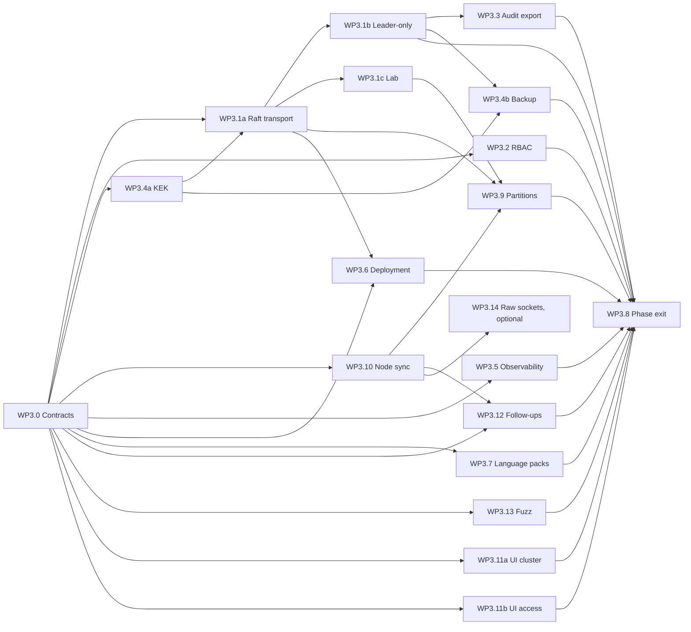

# Slice 3 plan: platform hardening

- Status: Proposed; the owner's decisions are in section 7
- Date: 2026-10-10
- Scope: Slice 3 of [phase-1-execution.md](phase-1-execution.md) (sections 1.2, 1.3, 7 and 8), written against `main` at `a3be4e8` after the Slice 2 packages recorded in [phase-1-status.md](phase-1-status.md). Requirement IDs refer to [REQUIREMENTS.md](../REQUIREMENTS.md), toggles (TGL) and never-off items (NEVER) to [SECURITY-PROFILES.md](../SECURITY-PROFILES.md), risks R1 to R18 and measurements M1 to M11 to the execution plan.

This plan turns the Slice 3 outline of the execution plan (WP3.1 to WP3.9) into work packages written like its section 3: what each package owns, what it depends on, numbered deliverables, acceptance checks, size and risk, and the changes it needs in lead-owned files. It adds the packages that the Slice 2 reports asked for, the order of work, new risks, the measurement method and the decisions that only the owner can take. "(proposed)" marks a choice the documents leave open; it binds once the owner accepts the plan and then changes only through rule 2.8 of the execution plan. Sizes are those of the execution plan: S up to one builder-week, M one to three, L three to six.

Contents:

1. [Scope and exit](#1-scope-and-exit)
2. [Contracts and shared files (WP3.0)](#2-contracts-and-shared-files-wp30)
3. [Work packages](#3-work-packages)
4. [Order, parallelism and merging](#4-order-parallelism-and-merging)
5. [Measurements and exit checks](#5-measurements-and-exit-checks)
6. [Risks](#6-risks)
7. [Owner decisions](#7-owner-decisions)
8. [Owner actions](#8-owner-actions)
9. [Documents this slice writes](#9-documents-this-slice-writes)

## 1. Scope and exit

### 1.1 Exit criteria

Slice 3 closes E9 to E12 and runs the phase exit for all twelve criteria (WP3.8).

| # | Check | Requirements | Closed by |
|---|---|---|---|
| E9 | A 3-node cluster loses a controller: writes resume, no committed write lost, SSE clients and probes reconnect | OPS-03, OPS-04 | WP3.1a to WP3.1c; verified in WP3.8 on the lab and on three VMs (S3-Q2) |
| E10 | Windows service and systemd start, stop, upgrade; Docker with macvlan runs | OPS-10, OPS-13, OPS-14 | WP3.6 |
| E11 | Idle RSS below 100 MB with all Phase 1 roles | OPS-15 | WP3.5 (budget at every merge), WP3.8 (M9) |
| E12 | Metrics overhead below 2 percent, p99 unchanged | OPS-21 | WP3.5 (M8) |
| E1 to E3 | Re-run on the final build; E2 also by hand with a hardware key, an imported certificate and HAProxy in front | see execution plan 1.2 | WP3.8 |
| E4 to E8 | The live parts: probes in the owner's segments, Proxmox and Home Assistant inventory, UniFi topology, the VLAN write, the IoT move | see execution plan 1.2 | WP3.8, with the owner's inputs (section 8) |

### 1.2 Requirements

| Requirement | State after Slice 2 | What Slice 3 adds | Package |
|---|---|---|---|
| OPS-03 | One voter. `RaftStore` already has `add_learner`, `change_membership`, the `PeerTransport` trait, `InProcessNetwork` with partitions and an in-process three-voter failover test; a follower answers every proposal with `NoQuorum` | Three controllers over the cluster transport, write forwarding, failover | WP3.1a, WP3.1b, WP3.1c |
| OPS-04 | Node-to-controller gRPC over mTLS (tonic 0.14, TLS 1.3, majors in `Hello`); controller enrolment refused with `cluster.enrolment.roles` | Controller enrolment and Raft over the same port | WP3.1a |
| OPS-05 | Hand-rolled counters at `/api/v1/metrics` (`Read` on `System`); health endpoints; no traces, no metrics registry | Metrics core, OpenMetrics with histograms, OpenTelemetry traces | WP3.5 |
| OPS-07 | A pre-migration copy of the store; manual copies in `docs/upgrades.md` 7.2 | Consistent encrypted backup, verify, scheduled backups, restore on a new host | WP3.4b |
| OPS-08 | Node protocol majors; nothing between controllers; the UI installs nothing on a cluster | Capabilities and Raft wire version between controllers, rolling order, leader-gated migrations | WP3.1a, WP3.6 |
| OPS-10 | `tenko service` through the SCM, never run under a real SCM; a file log without rotation | Event Log, log rotation, an elevated smoke test | WP3.6 |
| OPS-13 | A hardened unit, never verified on a host; the KEK goes through the `file` provider with "PLAIN FILE" warnings | Verified unit, systemd credential provider, capability drop-in for the probe | WP3.6, WP3.4a |
| OPS-14 | Dockerfile and macvlan example; 8444 not exposed | 8444, host networking, LXC notes, compose lab | WP3.6, WP3.1c |
| OPS-15 | M9 passed with margins (Linux 75.1 MiB at 200 prefixes, 86.4 MiB at 1,000) | RSS budget per merge, final M9 on a single node and on a cluster member | WP3.5, WP3.8 |
| OPS-20 | Dashboard tiles fed by REST lists | One snapshot per second over SSE, per node and cluster-wide | WP3.5 |
| OPS-21 | Nothing | Per-shard counters and fixed-bucket histograms, M8 | WP3.5 |
| OPS-22 ACME (Should) | Not built | Deferred by recommendation (S3-Q15) | none |
| OPS-24 cluster order (Should) | Notice only | Documented rolling order; the UI shows member versions | WP3.6 |
| OPS-26 | Nothing | Isolated state, writes refused, staleness, queued changes, buffering on nodes | WP3.9, with WP3.1a, WP3.10, WP3.11a |
| OPS-28 (delta sync) | The probe's disk buffer (node to controller) | Controller-to-node configuration as resumable deltas with a bandwidth cap | WP3.10 |
| IAM-01 | Global roles `admin`, `operator`, `viewer`; `ScopeFilter::Only` and `auth.out_of_scope` exist but nothing produces them | Scopes over sites, VRFs and prefixes, delegation, filtered lists, search and SSE | WP3.2 |
| IAM-06 (per role) | TGL-02 and TGL-03 are global | MFA requirement per role | WP3.2 |
| IAM-10 | Personal tokens act with the owner's full roles | Scoped tokens, service accounts, the `metrics` scope | WP3.2 |
| IAM-15 | DPAPI, systemd-creds, file; the R15 hole; rotation offline and not cluster-aware | Refuse plain generations once sealed, downgrade alarm, systemd credential provider, one KEK across controllers, online rotation | WP3.4a |
| IAM-16 | Reveal rate limit per controller; SNMPv3 passwords in the probe's files | Cluster-wide reveal limit; SNMPv3 credentials from the vault | WP3.4a, WP3.10 |
| IAM-18 (export) | Chain and `audit verify` over the API | syslog, CEF and JSON export with chain checkpoints; TGL-21; offline verification of an export | WP3.3 |
| API-21 | `en` and `sv` compiled at build time; languages hard-coded in `tenko-auth` | Runtime packs: upload, validation, preview, activation, export; RTL layout | WP3.7 |
| SCAN-05 (vault), SCAN-09 | Command line only | Scan jobs from the UI and the API with progress and diff, remote kill switch, credentials from the vault | WP3.10 |
| SCAN-02 (LLDP), SCAN-04 (SYN, OS fingerprinting) | Declared and capability-checked, not implemented | Only if the owner says so (S3-Q17) | WP3.14 |
| API-14, API-15 | Fuzz targets for the scanner and the connectors; no fuzz smoke in CI | The missing targets and the CI smoke | WP3.13 |

### 1.3 Measurements

M1 (over the network), M2 (VM power cut), M3, M4, M5 (through forwarding), M6 (rejoin), M7, M8 and M9 are taken in this slice, plus four new ones (M12 to M15). Thresholds, methods and scripts are in section 5.

### 1.4 Slice 2 follow-ups absorbed

| From | Follow-up | Recorded in | Slice 3 package |
|---|---|---|---|
| WP1.1 | M2 VM power cut; M7 on two Linux hosts | status "Follow-ups recorded"; ADR 0002 | WP3.8 |
| WP1.2 | WebAuthn ceremonies in memory: sticky routing or replicated challenges | status; `crates/tenko-auth/src/challenge.rs` | WP3.1b |
| WP1.2 | MDS3 vendor attestation roots for Hardened | status; ADR 0010 | S3-Q16 |
| WP1.2 | `password_change_required` is enforced by the UI only | status | WP3.2 |
| WP2.1 | A flaky test asserts a PIN substring against random ids | status (secrets items) | WP3.2 |
| WP1.3, R15 | KEK directory trust: refuse plain generations once a sealed one exists, alarm on downgrade | execution plan 9.2; status | WP3.4a |
| WP1.7b | Cluster-wide idempotency key material | status | WP3.1b |
| WP1.7 | `/fonts/` without long-lived cache headers (only `assets/` is immutable) | status | WP3.12 |
| WP1.7 | `GET /api/v1/openapi.json` serves compact JSON, the committed file is pretty-printed | status | WP3.0 (lead) |
| WP1.8 | Windows service under the SCM; Event Log sink | status; `crates/tenko/src/platform/windows.rs` | WP3.6 |
| WP1.8 | systemd credential protection kind; the root `systemd-creds encrypt` path end to end | status | WP3.4a (provider), WP3.6 (run) |
| WP1.8 | M9 margins: about 14 KiB per prefix, 19 MiB of Argon2 buffers kept by glibc (returned by musl, the shipped binary) | status | WP3.5, WP3.8 |
| WP1.5 | Fuzz target for the multipart parser of `POST /imports` | status | WP3.13 |
| WP2.0 | Every controller would run every connector instance: leader-only scheduling | status; `docs/plugins.md` | WP3.12 (handle), WP3.1b (supervisor) |
| WP2.10 | Cluster rolling order (OPS-08); free-space check before the copy; `deploy/README.md` step count | `docs/upgrades.md` 8.10 and 11; status | WP3.6 |
| WP2.10 | Fuzz target for the release manifest parser | `docs/upgrades.md` 11 | WP3.13 |
| WP2.10 | `ui/src/api/client.ts` should accept a Blob body | status | WP3.0 (lead) |
| WP2.4 | `[reconciler]` settings; leader-only scheduling; the orphan rule without the scan scope; unused `tenko_core::observe` proposal types | status; `docs/reconciliation.md` 3 and 8 | WP3.12 (scope data from WP3.10; core types by the lead) |
| WP2.4, WP2.5 | The `vendors` adoption constraint ignores vendor facts from probes, controllers and Home Assistant | status; `docs/reconciliation.md` 8 | WP3.12 |
| WP2.1 | Reveal rate limit per controller | `docs/secrets.md` 8 | WP3.4a |
| WP2.1 | The import credential gate checks only the importing account; a re-import can delete a secret a connector references | `docs/secrets.md` 8 | WP3.12 |
| WP2.2 | Dockerfile and compose files do not publish 8444 | status; `docs/cluster.md` 7.3 | WP3.6 |
| WP2.2 | Resend recognition per controller and in memory; revocations and node state replicate between controllers; no cap on concurrent TLS handshakes | status; `docs/cluster.md` 3 and 12 | WP3.10 (resend), WP3.1a (the rest) |
| WP2.2 | No fuzz target for protobuf decoding | status | WP3.13 |
| WP2.3 | Scan configuration and command channel over the cluster transport, SNMP credentials from the vault (called "WP3.1" in `docs/scanning.md` 14); on-demand scan jobs (SCAN-09) and the remote kill switch; a batch over 16 MiB fails instead of being split | `docs/scanning.md` 14; status | WP3.10 |
| WP2.3 | Raw-socket methods (`arp_sweep`, `tcp_syn`, `os_fingerprint`, passive `lldp`) | `docs/scanning.md` 9 and 14 | S3-Q17, WP3.14 |
| WP2.6, WP2.7, WP2.8 | `tenko serve` loads no protected paths; nothing reads `Guardrails::max_parallel`; `revert_l2` does not re-check the guardrails; no setting for the move parallelism | status | WP3.12 |
| WP2.6 | The setup token of a first start is written to a WARN log line | status | WP3.0 (lead, `serve/mod.rs`) |
| WP2.5, WP2.6 | The host does not refuse `tls = insecure` outside the Lab profile | status | WP3.12 |
| WP2.5 | Textarea for `tls_ca` in the schema form; plain-HTTP health wording differs between `connectors.md` and `connectors-unifi.md` | status | WP3.11b, WP3.12 |
| WP2.12 | `.gitattributes` rule for `*.ts` and `*.tsx`; test ids for the profile dialog; unit tests for the cluster health task and the connectors event forwarder | status | WP3.0, WP3.11b, WP3.1a and WP3.12 |
| WP2.9 | `rawRequest` ignores `ifMatch` on POST; one `.latest` guard in `api/live.ts`; "scan now"; status-bar item for open proposals | status | WP3.0 (api files), WP3.11a |
| Jobs API | Kind of the current step in `JobSummary`; job-group filter on `GET /jobs` | status | WP3.2 (owns `routes/jobs.rs`) |
| WP2.8 | A cancelled move shows as `cancelled`, not as rolled back; the L2 hint in the group checklist; the raw step kind in `jobs.undo.step` | status | WP3.11b |

### 1.5 Left out, with reasons

| Item | Reason | Where it goes |
|---|---|---|
| IR extension (interfaces by name, VRF and tenant names, secret references) | Needed by the migration plugins | Phase 4 |
| Webhook ingress route `POST /connectors/{id}/webhook` | No bundled plugin uses webhooks | Phase 2, with the first webhook source |
| Plugin egress enforcement, named-pipe DACL (R16) | Needs the sandbox of the plugin hub | Phase 5 (CONN-21) |
| Per-source VRF, "learn the MAC" proposal | No overlapping networks in the reference environment; a convenience | Backlog |
| SSID writes (CONN-18 write) | Phase 2 by the requirement | Phase 2 |
| DHCP relay verification on UniFi | The classic API shows no relay targets | Open with the vendor API |
| Site-to-controller association | One site and one network controller in Phase 1 | Phase 5, with OPS-27 |
| mDNS on IPv6 per interface, ICMP retry | Scanner quality without an exit criterion | Backlog, or WP3.14 if accepted |
| DHCP snooping (SCAN-03, Should), CDP | Leases come with Tenko DHCP | Phase 3 |
| Alarm listing endpoint, `level=` filter | The UI derives alarms from the tree | Backlog |
| `JobEngine` staging sink, migrations over 16 MiB, redb file conversion | Nothing needs them yet | When needed |
| Signed releases and SBOM (API-19) | Phase 5 | Phase 5 |
| Home Assistant `via_device`, Proxmox SDN VLAN objects, firmware facts | Left out on purpose in WP2.5 | Backlog |

### 1.6 Starting point in the code

Facts the packages build on (read on `a3be4e8`):

- **Store.** `RaftStore` runs openraft `=0.9.25` over redb with one voter (`[node] id = 1`, empty address). It already exposes `add_learner`, `change_membership`, `handle_append_entries`, `handle_vote` and `receive_snapshot` (1 MiB chunks into a file, installed with the atomic index swap of M1). `PeerTransport` is the transport trait; `NoPeers` and `InProcessNetwork` implement it. A follower's `propose` returns `NoQuorum` (`coalescer.rs`), `Linearizable` reads call `ensure_linearizable` on the local node, and the store-level error code is `sys.store.no_quorum`. openraft 0.9 has no leadership transfer call; `trigger().elect()` on a caught-up follower serves instead, and `RaftMetrics::millis_since_quorum_ack` reports a leader's quorum contact.
- **Cluster transport.** `tenko.cluster.v1` has `Handshake.Hello`, `Node.Heartbeat`, `Node.Renew` and `Observations.Ingest`; TLS 1.3 by hand with `tokio-rustls`; the client verifier requires `urn:tenko:node:<id>`; handlers authorise against `cluster.nodes`. Controllers are not in `cluster.nodes`, so they cannot be revoked. In memory per controller: connected sessions, resend recognition, the revocation set (reloaded hourly), the `last_seen` throttle, mismatch dedupe and the on-demand listener. The only controller-to-node message is `Directive { renew, revoked }`.
- **Jobs.** A per-node lease in `jobs.runners` (TTL 30 s) and `Job.runner`; any runner may claim a queued job; takeover after the lease expires (up to about 45 s, wall-clock based); group limits and waiters in memory per runner; no fencing of external side effects. `sys.update.*` steps and the import stash are tied to the process that created them.
- **Background work.** The reconciler, connector polling, the update check, the import and idempotency purges and the cluster prune write to the store and run on every controller today; alarms, certificate installation, the TLS watcher, store maintenance and the SSE hub are local.
- **Authorization.** `RbacAuthorizer` over a derived `AuthIndex`; `scope()` returns `All` or `Nothing`; `GET /events` checks no topic or object; `EventFilter` exists with the single implementation `AdmitAll`. In memory per controller: WebAuthn and TOTP ceremonies (`Ceremonies`), login throttling, the API rate limiter, the reveal rate limit and the idempotency HMAC key (a record of another controller answers `sys.idempotency_not_replayable`). Sessions are in the store and read with `Local` consistency.
- **Vault.** KEK generations per host (`kek-NNNNNN.{dpapi,cred,plain}`) with random ids, except the `file` provider whose id derives from the key; `tenko kek rotate` runs offline and does not work for `file`; a plain generation loads beside sealed ones (R15).
- **Observability.** No registry; `routes/system.rs` renders counters held under a `RwLock<BTreeMap>`; logging through `tracing-subscriber` with no OpenTelemetry.
- **Deployment.** Windows service through the `windows-service` crate, no Event Log; the systemd unit is hardened but unverified; the Dockerfile exposes 8443 only; `release.yml` pushes `ghcr.io/linkztream/tenko:<version>` and `:latest` and builds the Linux binary on `ubuntu-latest` with glibc (the state before S3-Q10).
- **UI.** `ui/i18n/en.xlf` and `sv.xlf` (3,286 units each) compiled at build time into 15 route packs; no runtime loader; 87 physical CSS properties and no `dir` handling.

## 2. Contracts and shared files (WP3.0)

The lead writes these as compiling code and merges them first, as WP1.0 did for Slice 1. Names are (proposed) unless a requirement fixes them.

### 2.1 Compatibility rule and one format bump

A rollback must never widen access or misread data (`docs/upgrades.md` 4.1). Slice 3 needs new variants of stored enums (`SystemComponent::{AuditExport, Backup, Languages, Leader}`, and `RoleName::Auditor` if S3-Q18 is accepted). WP3.0 adds every one of them at once and raises the data format by one step with an empty migration (proposed), so a Slice 2 binary refuses a Slice 3 data directory and no later package needs a format change. After that bump the rule for the slice is: new fields carry `#[serde(default)]`; new kinds of records go into new tables; a change that an older Slice 3 build would read too permissively (a token restriction, a scope) lives in a table that build does not read, or goes to the lead for another bump. No release has been tagged yet, so the bump costs only the compatibility fixture.

### 2.2 Store

```rust
// tenko-store::api (WP3.0); MemStore reports Single and is always leader.
pub enum QuorumState {
    Single,                                        // one voter: never isolated
    Healthy,
    Electing { since: Timestamp },
    Isolated { since: Timestamp, last_contact: Option<Timestamp>, applied: Revision },
}
pub struct Leadership { pub leader: NodeId, pub term: u64, pub is_self: bool }
pub struct MemberStatus { pub node: NodeId, pub voter: bool, pub matched: Option<u64>,
                          pub lag_entries: Option<u64>, pub last_contact_ms: Option<u64> }
// StoreStatus gains, each with #[serde(default)]:
//   quorum: QuorumState, term: u64, members: Vec<MemberStatus> (filled on the leader)
pub trait Store {
    // existing methods unchanged
    fn leadership(&self) -> tokio::sync::watch::Receiver<Option<Leadership>>;
}
```

`is_self` turns true only after the new leader has applied every entry up to its first commit in the term, so leader-only work never starts on a stale view. `propose` keeps its signature: on a follower it forwards (WP3.1a) and returns after the follower has applied the committed revision, so read-your-writes holds on the controller that served the request. `Linearizable` works on every member. The conformance suite gains cases for a follower handle (writes, linearizable reads, watch replay after a leader change) that `MemStore` passes trivially and WP3.1a's three-node fixture must pass.

### 2.3 Leadership and leader-only services

```rust
// tenko-core::cluster (WP3.0)
#[async_trait::async_trait]
pub trait LeaderService: Send + Sync + 'static {
    fn name(&self) -> &'static str;
    /// Runs until `stop` fires. `epoch` is the value of the counter `sys.leader_epoch`
    /// after this node bumped it on taking office; leader-only writes carry it as a
    /// counter precondition (`fence(epoch)`), so a deposed leader's writes fail.
    async fn run(&self, epoch: u64, stop: tokio_util::sync::CancellationToken) -> Result<(), String>;
}
pub fn fence(epoch: u64) -> tenko_store::Precondition; // Counter { sys.leader_epoch, expect: epoch }
```

The supervisor (`crates/tenko/src/serve/leader.rs`, WP3.1b) bumps `sys.leader_epoch` when `is_self` turns true, starts every registered service, and cancels them when leadership is lost or the node shuts down. Services are registered by the lead in `serve/mod.rs`; each owning package exposes its loop as a `LeaderService` instead of spawning it.

| Leader-only service | Today | Exposed by |
|---|---|---|
| Job runner (execution, deadlines, takeover) | `JobEngine::start` on every controller | WP3.1b |
| Reconciler loop and hourly purge | `Reconciler::run` on every controller | WP3.12 |
| Connector polling schedule (plugin processes stay on every controller for on-demand reads) | `ConnectorHost` tick on every controller | WP3.12 |
| Update check | `Updates::spawn_checks` | WP3.6 |
| Cluster prune (revocations, old tokens) | `node/controller.rs` `maintenance` | WP3.1a |
| Idempotency and import purges (store part) | `spawn_housekeeping`, `serve/imports.rs` | WP3.1b |
| Start-time one-shots: `ensure_defaults`, `adopt_unmanaged`, leader-gated migrations | `serve/mod.rs` | lead, WP3.6 |
| Audit export | new | WP3.3 |
| Scheduled backups | new | WP3.4b |
| Command dispatch to nodes, scan jobs | new | WP3.10 |

Stays on every controller: alarms (deduplicated by their revision precondition), certificate renewal of the controller's own cluster certificate, installation of the shared API certificate, the TLS watcher, store maintenance and re-seed checks, the SSE hub, the node sessions, the metrics collector and the import stash sweep.

### 2.4 Cluster protocol

New files in `crates/tenko-cluster/proto/tenko/cluster/v1/`, all additive within major 1. WP3.0 creates them with the messages below and stub services that answer `UNIMPLEMENTED`, so the owning packages fill disjoint files.

| File | Service and methods | Owner |
|---|---|---|
| `handshake.proto` (changed) | `HelloRequest.capabilities`, `HelloResponse.capabilities` and `HelloResponse.endpoints` (the current controller endpoints) as new fields; `Hello` itself stays frozen | WP3.1a |
| `raft.proto` | `Raft.AppendEntries`, `Raft.Vote`, `Raft.InstallSnapshot(stream SnapshotChunk)`; payloads are openraft request types in CBOR in `bytes` fields with a `wire` version (`openraft-0.9/cbor-1`) | WP3.1a |
| `membership.proto` | `Cluster.Join`, `Cluster.Propose` (forwarded batch), `Cluster.ReadIndex`, `Cluster.Members`, `Cluster.Digest(revision)`, `Cluster.TransferKek` | WP3.1a (KEK payload format from WP3.4a) |
| `config.proto` | `Config.Watch(from_revision) -> stream ConfigDelta`, `Config.Secrets(purposes)` | WP3.10 |
| `commands.proto` | `Commands.Subscribe -> stream Command`, `Commands.Report(CommandEvent)` | WP3.10 |
| `metrics.proto` | `Metrics.Snapshot` (one node's one-second snapshot) | WP3.5 |

Peers authenticate by certificate: the Raft and `Cluster` services require the role `controller` and a member record; `Config` and `Commands` require a node record with the role the call needs. The lead also splits `crates/tenko-cluster/src/server.rs` into `server.rs` (listener and router) and `service/{handshake,node,observations}.rs` before builders start, so the services have separate owners.

### 2.5 Authorization

```rust
// tenko-core::principal (WP3.0): ScopeFilter and ScopeRule exist; subtree semantics added.
pub enum ScopeRule { Tenant(TenantId), Vrf(VrfId), Site { id: SiteId, subtree: bool },
                     Prefix { id: PrefixId, subtree: bool }, Object(ObjectRef) }
pub struct Anchors { pub tenant: Option<TenantId>, pub vrf: Option<VrfId>,
                     pub sites: Vec<SiteId>,      // the site and its ancestors
                     pub prefixes: Vec<PrefixId> } // most specific first, with ancestors
pub enum AnchorMode { Any, All }                   // read: any anchor in scope; write: all
pub trait AnchorResolver: Send + Sync {            // implemented by tenko-ipam (WP3.2)
    fn anchors(&self, view: &dyn ReadView, object: &ObjectRef) -> Result<Anchors, StoreError>;
}
impl ScopeFilter { pub fn admits(&self, anchors: &Anchors, mode: AnchorMode) -> bool; }
```

Grants, service accounts and scoped tokens are tables of `tenko-auth` (WP3.2), not core types. `Action` and `ObjectKind` stay as they are: grants are audited as children of `ObjectKind::User`, and the special token scopes (`metrics`, audit read) are token grants, not actions.

### 2.6 Where settings live in a cluster

`tenko.toml` keeps what belongs to one host: the data directory, listen and advertise addresses, the node id, the KEK provider and its paths, log sinks, telemetry endpoints, local buffer sizes. Behaviour that must be the same on every controller lives in the store, is changed through the API with audit, and replicates: reconciler intervals, guardrail protected paths, move parallelism, audit export sinks, backup schedule, probe scan configuration, language packs (S3-Q8). This turns the WP2.4 follow-up "a `[reconciler]` section in `tenko.toml`" into a settings page and API (proposed); `tenko.toml` values for these keys are read once as the initial seed when the store has none and are otherwise ignored with a warning.

### 2.7 Error codes, SSE topics, routes and start order

- **Error codes.** A write refused because the controller is isolated answers 503 `cluster.no_quorum` with `Retry-After` and the params `since` and `queueable` (OPS-26); the store-level `sys.store.no_quorum` stays for internal paths (a job step, a timed-out forward). New code families: `cluster.member.*`, `cluster.join.*`, `cluster.forward.*`, `auth.grant.*`, `auth.scope.*`, `auth.service_account.*`, `audit.export.*`, `vault.kek.transfer.*`, `vault.kek.downgrade`, `backup.*`, `i18n.pack.*`, `scan.job.*`, `node.config.*`, `queue.*`.
- **SSE topics.** New topic `metrics` (one snapshot per second, not from the journal). New table namespaces map as follows: `cluster.*` (members, commands, ingest cursors) to `cluster`; `scan.*` (probe configuration, scopes) to `discovery`; `i18n.*`, `backup.*` and `sys.audit_export*` to `system`; `auth.grants` and `auth.scoped_tokens` to `admin`. `EventHub::set_filter` is called with WP3.2's filter.
- **Routes.** New stub modules in `routes/mod.rs`: `cluster` (WP3.1a), `access` (grants and service accounts, WP3.2), `audit_export` (WP3.3), `kek` (WP3.4a), `backup` (WP3.4b), `metrics` (split from `system.rs`, WP3.5), `i18n` (WP3.7, partly public), `queue` (WP3.9, IPAM module), `scans` (WP3.10, Discovery module). A layer slot for the quorum gate (WP3.9) is mounted pass-through.
- **Start order** of `tenko serve` (lead, `serve/mod.rs`), from today's ten steps to eleven plus the supervisor (proposed):

| Step | Today | Slice 3 |
|---|---|---|
| 1 | `kek` | `kek` |
| 2 | `store` | `store` (a member of a cluster opens without bootstrap) |
| 3 | `vault` | `cluster`: peer transport and Raft service, join or rejoin, fetch of missing KEK generations, catch-up gate (applied revision reaches the leader's read index, or the node starts isolated after `[cluster] catch_up_timeout_secs`) |
| 4 | `tls` | `vault` |
| 5 | `auth` | `tls` |
| 6 | `ipam` | `auth` |
| 7 | `jobs` | `ipam` (one-shots move to the leader supervisor) |
| 8 | `connectors` | `jobs` (engine built; the runner is a leader service) |
| 9 | `cluster` | `connectors` (processes; the schedule is a leader service) |
| 10 | `api` | `nodes`: node sessions, ingest, configuration sync, commands (the rest of today's `cluster` step) |
| 11 | | `api` |
| after 11 | | leader supervisor |

  Step 3 comes before the vault because a controller that was offline during an online KEK rotation must fetch the new generation before the vault can open its envelopes; for that, every controller's cluster identity lives in `<data_dir>/node/` with a sealed key, like a probe's, and the vault-held key of controller 1 moves there when the first peer joins. On a single node, step 3 is a no-op.

### 2.8 Dependencies

Root `Cargo.toml` additions (licences to be confirmed by `cargo deny` in the pull request that adds them):

| Crate | Licence | For | Package |
|---|---|---|---|
| `opentelemetry`, `opentelemetry_sdk`, `opentelemetry-otlp` (the release built on tonic 0.14) | Apache-2.0 | OTLP traces, off by default | WP3.5 |
| `tracing-opentelemetry` | MIT | Bridge from `tracing` | WP3.5 |
| `tokio-util` (`CancellationToken`) if not yet a workspace dependency | MIT | Leader services | WP3.0 |
| An Event Log wrapper for Windows (candidates evaluated against `cargo deny` and `#![forbid(unsafe_code)]` in Tenko's crates; none chosen yet) | MIT or Apache-2.0 expected | OPS-10 | WP3.6 |

No new dependency is needed for HPKE-style KEK sealing (X25519, HKDF and AES-GCM from `aws-lc-rs`), syslog and CEF encoding (own encoders over `tokio-rustls`), XLIFF parsing (`quick-xml` 0.41 is already in the graph through `calamine`), compression (`flate2` with `miniz_oxide` is already in the graph), the backup container (own framed format) or the metrics core (own code).

### 2.9 Shared files

The Slice 2 bottlenecks were `serve/mod.rs`, `routes/mod.rs`, the SSE topics, `CHANGELOG.md` and the XLIFF files. In Slice 3:

| File | Rule |
|---|---|
| `crates/tenko/src/serve/mod.rs`, `crates/tenko/src/config.rs`, `crates/tenko/src/lib.rs`, `deploy/tenko.example.toml` | Lead only. WP3.0 adds every new start step, config section and subcommand stub of this plan up front; packages fill their own modules |
| `crates/tenko-api/src/{lib.rs,routes/mod.rs,sse/mod.rs}` | Lead only; stubs in WP3.0 |
| `CHANGELOG.md` | Lead only; each package hands its entry text over with its report and the lead adds it at merge |
| `docs/api/openapi.json`, `ui/src/api/generated/**` | Regenerated by the lead at each merge, followed by `npm run test` in `ui/` (rule of 2026-10-10) |
| `ui/i18n/en.xlf`, `ui/i18n/sv.xlf` | WP3.0 extends the compiler to read fragments `ui/i18n/<lang>.d/<area>.xlf` and to refuse duplicate keys; each UI package adds keys only in its own fragment; the lead folds fragments into the main files at the end of the slice |
| `ui/src/api/{client.ts,live.ts}`, `ui/src/api/mock/handlers.ts`, `ui/src/shell/{Shell.tsx,areas.ts,routes.ts}`, `ui/src/app/router.ts`, `ui/vite.config.ts` | Lead only; WP3.0 registers the new areas, mock route files and placeholders, and fixes the WP2.9 and WP2.10 items in `client.ts` and `live.ts` |
| `fuzz/Cargo.toml`, `.github/workflows/ci.yml`, `.gitattributes` | Lead only; packages own their target files and ask for jobs |
| Mock handlers | A Rust package that adds routes is paired with the UI package that owns the area's `ui/src/api/mock/routes-<area>.ts` |

## 3. Work packages

| WP | Name | Owns (exclusive write access) | Depends on | Size, risk |
|---|---|---|---|---|
| WP3.0 | Contracts and shared files | Section 2 and the files of 2.9; `crates/tenko-core/src/**` except `metrics/**`; `tenko-store/src/{lib,api,mem,testing}.rs`; the format bump and its empty migration; pre-split of `tenko-cluster/src/server.rs`; proto stubs | none | M; contract churn |
| WP3.1a | Raft over the cluster transport | `tenko-store/src/raft/**`, `tenko-store/tests/**`; `tenko-cluster/**` except the WP3.10 and WP3.5 files; `crates/tenko/src/node/controller.rs`, `crates/tenko/src/cluster/**` (new CLI); `tenko-api/src/routes/{cluster,nodes}.rs`; `docs/cluster.md`; ADR 0014 | WP3.0; WP3.4a transfer format | L; R19, R20, R21, R22 |
| WP3.1b | Leader-only work and cluster-wide state | `tenko-jobs/src/**` except `model.rs` and `query.rs`, `tenko-jobs/tests/**`; `crates/tenko/src/serve/{leader.rs,imports.rs}`; `tenko-api/src/middleware/{idempotency,rate_limit}.rs`, `tenko-api/src/server/**`; `tenko-auth/src/challenge.rs` | WP3.0; WP3.1a forwarding | M; R20, R35 |
| WP3.1c | Cluster lab and failover measurements | `crates/tenko/tests/cluster_*.rs`, `crates/tenko/tests/cluster_support/**`; `deploy/compose/lab-cluster/**`; `bench/phase1-cluster/**` | WP3.1a join | M; R23 |
| WP3.2 | RBAC scopes, service accounts, scoped tokens, MFA per role | `tenko-auth/**` except `challenge.rs` and `audit_export/**`; `tenko-ipam/src/scope.rs`; `tenko-jobs/src/query.rs`; `tenko-api/src/extract*`, `sse/filter.rs` and the routes `common, users, auth, settings, access, tenancy, prefixes, addresses, hosts, vlans, observations, proposals, topology, export, moves, remote, events, audit, jobs, secrets`; `bench/phase1-rbac/**`; ADR 0015 | WP3.0 | L; R24, R25 |
| WP3.3 | Audit export | `tenko-auth/src/audit_export/**`; `tenko-api/src/routes/audit_export.rs`; `crates/tenko/src/client/audit.rs`; `docs/audit-export.md` | WP3.0; WP3.1b supervisor | M; R28 |
| WP3.4a | KEK hardening and distribution | `crates/tenko-vault/**`; `crates/tenko/src/kek.rs`; `tenko-api/src/routes/kek.rs`; `docs/secrets.md` | WP3.0 | M; R15, R22 |
| WP3.4b | Backup and restore | `crates/tenko/src/backup/**`; `tenko-api/src/routes/backup.rs`; `bench/phase1-backup/**`; `docs/backup.md`; ADR 0016 | WP3.4a; WP3.1b supervisor | M; R36 |
| WP3.5 | Observability | `tenko-core/src/metrics/**` (delegated by the lead); `tenko-api/src/{middleware/metrics.rs,routes/metrics.rs,sse/metrics.rs}`; `tenko-cluster/src/service/metrics.rs`; `crates/tenko/src/telemetry.rs`; `ui/src/dashboard/**`; `bench/phase1-metrics/**`, `bench/phase1-server/**`; `docs/observability.md` | WP3.0 | M; R29 |
| WP3.6 | Deployment and rolling upgrades | `deploy/**` except `deploy/compose/lab-*/**`; `crates/tenko/src/{platform,upgrade}/**`, `crates/tenko/src/logging.rs`; `.github/workflows/release.yml`; `docs/upgrades.md`, `deploy/README.md` | WP3.0; WP3.1a for the cluster parts | M; R26, R31, R33 |
| WP3.7 | Language packs | `ui/src/i18n/**`, `ui/scripts/i18n*` (after WP3.0), `ui/src/settings/languages/**`, the one-time RTL pass over `ui/src/**/*.css`; `tenko-api/src/{routes/i18n.rs,i18n/**}`; `ui/e2e/language*.spec.ts` | WP3.0 | M; R32 |
| WP3.8 | Phase exit | New acceptance files `crates/tenko/tests/acceptance_*` of Slice 3; new specs in `ui/e2e/**`; `bench/phase1-exit/**`; `docs/plans/phase-1-exit.md` | all | L; owner inputs |
| WP3.9 | Partition behaviour | `tenko-api/src/{middleware/quorum.rs,routes/queue.rs}`; `tenko-ipam/src/queue/**`; `crates/tenko/src/serve/queue.rs`; `docs/partitions.md`; ADR 0013 | WP3.1a quorum state; S3-Q13 | M; R18, R30 |
| WP3.10 | Node configuration sync and probe commands | `tenko-cluster/src/{client,identity,buffer,probe}.rs`, `tenko-cluster/src/service/{observations,config,commands}.rs` and their protos; `crates/tenko-scan/**`; `crates/tenko/src/node/**` except `controller.rs`; `tenko-api/src/routes/scans.rs`; `docs/scanning.md`, `docs/node-sync.md` | WP3.0 | M; R37 |
| WP3.11a | UI: cluster, partition, probes | `ui/src/{cluster,scans,nodes,discovery}/**`; `ui/src/shell/{ClusterBanner.tsx,StatusBar.tsx}`; their mock route files and XLIFF fragments | WP3.0; API stubs | M |
| WP3.11b | UI: access, audit export, vault, backup; UI follow-ups | `ui/src/settings/**` except `languages/`; `ui/src/{auth,audit,hosts,ipam,grid,jobs,connectors,secrets}/**`; their mock route files and XLIFF fragments | WP3.0; API stubs | L |
| WP3.12 | Slice 2 follow-ups, host side | `tenko-ipam/src/{observe,reconcile,proposals,move,vlan_sync,import}/**`; `tenko-connect/src/host/**`; `tenko-api/src/{routes/connectors.rs,routes/import.rs,ui/assets.rs}` and the network-controller adapter; `docs/{reconciliation,moves,connectors,connectors-unifi,plugins,topology}.md` | WP3.0 | M |
| WP3.13 | Fuzz targets and the fuzz smoke | `fuzz/fuzz_targets/{api_multipart,upgrade_manifest,cluster_messages,webauthn_authdata,webauthn_attestation}.rs`, `fuzz/README.md` | WP3.0 | S |
| WP3.14 | Raw-socket scanner methods (only if S3-Q17 says so) | The raw-socket method files under `crates/tenko-scan/src/methods/` | WP3.10 merged | L; R12 |

### WP3.0 Contracts and shared files (M)

- **Owns:** the files of section 2.9, `crates/tenko-core/src/**` (except `metrics/**`, delegated to WP3.5 after the lead creates the module), `tenko-store/src/{lib,api,mem,testing}.rs`, the format constant and the empty migration under `crates/tenko/src/upgrade/migrations` (before WP3.6 starts).
- **Depends on:** nothing.
- **Content:**
  1. Section 2 as compiling code: `QuorumState`, `Leadership`, `MemberStatus`, `Store::leadership`, `LeaderService`, `fence`, `Anchors`, `AnchorMode`, `AnchorResolver`, `ScopeFilter::admits`; `MemStore` implementations; conformance cases for a follower handle.
  2. The new enum variants of 2.1 and one format bump with an empty migration; the compatibility fixture updated.
  3. Proto files of 2.4 with stub services; the split of `tenko-cluster/src/server.rs` into `server.rs` and `service/*.rs`.
  4. Route stubs, the quorum layer slot, SSE topic `metrics` and the namespace mapping of 2.7; TGL-21 added to `SecuritySettings::toggles()`; the language check in `tenko-auth` (`valid_language`) reads the active language set from the replicated `i18n.packs` table through the auth index instead of the hard-coded `["en","sv"]`.
  5. Start order of 2.7 with empty steps; config sections `[cluster]` additions (`isolation_after_ms`, `catch_up_timeout_secs`, `auto_promote`, `promote_lag_entries`, `sync_kbps`), `[telemetry]`, `[metrics]` (S3-Q7), `[backup]` (local target directory only); subcommand stubs `tenko cluster …`, `tenko backup …`, `tenko audit export …`.
  6. The setup token leaves the WARN log line: the log names `tenko setup token`, which reads it from `<data_dir>/setup-token` (mode 0600, or the service account's ACL on Windows); stdout keeps printing it for interactive starts.
  7. Shared UI files: XLIFF fragment support in the compiler, area registration, mock route stubs, `client.ts` Blob bodies and `ifMatch` on POST, the `.latest` guard in `api/live.ts`; `.gitattributes` with `*.ts` and `*.tsx` as LF.
  8. `GET /api/v1/openapi.json` serves the committed pretty-printed bytes (proposed), so byte equality holds for the route too.
  9. CI (`ci.yml`): a quick cluster job on every Linux push (in-process and three-process smoke under three minutes); nightly jobs for the full cluster lab, the Windows service smoke, the systemd smoke and the fuzz smoke (API-14).
- **Acceptance:** the workspace compiles with every stub; conformance green on `MemStore` including the follower cases; a Slice 2 data directory is refused with `upgrade.format_newer` by a Slice 2 binary after migration and migrates cleanly in the compatibility test; OpenAPI regenerated; UI typecheck and mock coverage green.
- **Size and risk:** M; contract churn (rule 2.8).

### WP3.1a Raft over the cluster transport (L)

- **Owns:** see the table.
- **Depends on:** WP3.0; the KEK transfer format of WP3.4a (deliverable 1 of WP3.4a, merged early).
- **Content:**
  1. **Peer transport.** `PeerTransport` implemented over the cluster port: one HTTP/2 connection per peer with the controller's node certificate as client certificate; the server side requires the role `controller` and a member record. Peer endpoints are resolved from the replicated member records, not from the `BasicNode` address in the Raft membership (controller 1 joined with an empty address). Deadlines per RPC from `RaftTimings`; the gRPC message limit is derived from the coalescer limits and openraft's `max_payload_entries`, so no `AppendEntries` exceeds it. The `wire` field is checked; a peer with another wire version is refused with `cluster.forward.wire`.
  2. **Raft service.** `AppendEntries` and `Vote` call `handle_append_entries` and `handle_vote`. **Snapshot streaming:** `InstallSnapshot` is a client stream of 1 MiB chunks; the first chunk carries the vote, the snapshot metadata and the SHA-256 of the file; the receiver writes through `receive_snapshot` and installs only when the digest matches, building every derived index aside and swapping atomically (M1). A broken transfer restarts from the beginning (openraft 0.9 sends full snapshots); `cancel` from openraft ends the stream.
  3. **Controller enrolment.** `POST /nodes/enrolments` accepts the role `controller` for administrators with a sign-in within the last five minutes (the fresh-authentication rule that break-glass changes and installs already use), with a lifetime of at most one hour. `tenko cluster join --controller URL --token T --ca-fingerprint F --address HOST:PORT --data-dir D` enrols like `tenko node enrol` (key generated on the host and sealed there, certificate with `urn:tenko:role:controller`), receives the member endpoints and the installation KEK generations (`Cluster.TransferKek`, sealed to an ephemeral key of the joiner, S3-Q5), seals them with the local KEK provider and writes a `tenko.toml` fragment with `[node] id` and `[cluster]`. Controllers get records in `cluster.nodes` with the role `controller`, so they can be listed, renewed and revoked; node ids continue the registry counter (1001 and up), and the Raft node id is the registry id.
  4. **Membership protocol, learner then voter.** `tenko serve` on a joined host opens an empty store without bootstrap, calls `Cluster.Join` on any member (forwarded to the leader), and the leader adds it as a learner without blocking. The learner catches up from the log or a snapshot; `GET /cluster/members` shows matched index and lag. The leader promotes when the lag stays below `promote_lag_entries` (100, proposed) for 10 seconds and `auto_promote` is on, and only to an odd number of voters: with one voter and one caught-up learner it waits for the second learner, because two voters are less available than one (R21); `tenko cluster promote --force` overrides. **Removal** is `tenko cluster remove <id>` (joint consensus without the member, then revocation of its certificates). **Replacement** of a dead voter is one joint change that removes it and adds the new member, so the cluster never passes through two or four voters. **Planned restart of the leader:** `tenko cluster step-down` triggers `elect` on the most caught-up follower and waits for the change before the leader stops.
  5. **How the single node becomes three.** Controller 1 keeps its data directory. Growing the cluster writes Raft membership entries and member records, which are state, not a format change: the only format bump in the slice is the empty one of WP3.0. Controller 1's cluster identity moves from the vault-held `cluster.node_key` to `<data_dir>/node/` when the first peer joins. A joining node writes its format marker from the `sys.format` record of the snapshot it installs and refuses to join a cluster whose format is newer than its binary knows (`cluster.join.format_newer`).
  6. **Write forwarding.** A follower's `propose` sends the encoded batch (it is CBOR already) to the leader with `Cluster.Propose`; the leader queues it to its coalescer and answers with `Committed`; the follower waits until its own applied revision reaches it and returns, so read-your-writes holds on the serving controller. A forward is retried only when the answer proves the batch was not queued (`not_leader` before enqueue); a lost answer after enqueue returns `Timeout`, as on a single node, and the caller's idempotency key or precondition makes a retry safe. `Linearizable` reads on a follower ask the leader with `Cluster.ReadIndex` and wait for that index locally. Preconditions keep their meaning because they are checked at apply on every replica (ADR 0011).
  7. **Quorum state and leadership** of 2.2 from openraft metrics (`millis_since_quorum_ack` on the leader, the time since the leader's last message tracked in `handle_append_entries` on a follower); isolated after `isolation_after_ms` (3,000, proposed) without contact; `Single` for one voter.
  8. **Registry across controllers.** Revocations reload on a watch of `cluster.revocations` and close the streams of the revoked node on every controller within a second; `authenticate` reads with `ReadIndex` before refusing a node it does not know (a node enrolled through another controller is not stalled for five minutes); the connected view of `GET /nodes` is the same on every controller (connection records written at connect and disconnect name the controller, and the records of a controller that left the membership are shown as disconnected); the on-demand listener opens on every controller when a token exists; the hourly prune is a leader service; a cap on concurrent TLS handshakes per listener (WP2.2 item); unit tests for the cluster health task (WP2.12 item).
  9. **State digest.** `Cluster.Digest(revision)` returns a SHA-256 over every table at a revision; `tenko cluster verify` compares the members. Used by tests, by E9 and by WP3.9's acceptance.
  10. **API and CLI.** `GET /cluster/members`, `POST /cluster/members/{id}/promote`, `DELETE /cluster/members/{id}`, `POST /cluster/step-down`; `tenko cluster status|members|join|promote|remove|step-down|verify`. Membership changes are inline jobs `cluster.edit` with audit (`cluster.member.join`, `.promote`, `.remove`).
  11. Fuzz target for the Raft and `Cluster` payload decoding (CONTRIBUTING rule 3); the target file is WP3.1a's, registered by the lead.
  12. ADR 0014 (controller cluster: membership, forwarding, leader-only work, KEK distribution) and `docs/cluster.md` sections for controllers.
- **Acceptance:** the conformance suite passes through a follower handle of a three-process cluster; the lab grows 1 to 3 under 100 writes/s with no failed write; a write on a follower is readable on the same controller immediately; a foreign-CA peer and a probe certificate are refused on the Raft service; a learner that joins a store of 6 M test records installs the snapshot over mTLS with no empty reads (M1); kill the leader: a new leader within the M3 threshold and equal digests after the old one rejoins; a revoked controller's handshake fails on every member within a second; a 1 to 2 promotion is refused without `--force`.
- **Size and risk:** L; R19 (openraft wire and upgrades), R20 (side effects of a deposed leader), R21 (two-voter window), R22 (KEK path).
- **Contract notes:** start step 3 and step 10 in `serve/mod.rs`; route module `cluster`; SSE `cluster.*` already maps to `cluster`; no new crate.

### WP3.1b Leader-only work and cluster-wide state (M)

- **Owns:** see the table.
- **Depends on:** WP3.0; WP3.1a's forwarding with its in-process `LeaderLink` (first WP3.1a merge).
- **Content:**
  1. **Supervisor** in `serve/leader.rs` as in 2.3, with the epoch bump, start and cancel, a log line and a `cluster` event per transition, and the leader services' health in `/system/status`.
  2. **Job runner as a leader service.** The new leader claims every `Running` and `Waiting` job at once (no wait for the 30-second lease), with the existing optimistic claim batch plus `fence(epoch)`; every drive and renew batch carries `fence(epoch)`, so a deposed runner's next write fails. After a takeover, `Running` steps follow the restart rules (idempotent steps re-run, others fail and compensate), `Waiting` steps are re-parked from their deadlines, and the waiter index is rebuilt from `jobs.by_state`. Group limits and `workers` hold cluster-wide because there is one runner. Before every `execute` or `compensate` of a non-idempotent step the engine confirms leadership with a read index; a step that cannot confirm is not started.
  3. **Observations reach the leader's waiters** through a watch on `ipam.obs.last_seen` (an observation ingested on any controller wakes the move's observe step on the leader).
  4. **Node-pinned work.** `JobSpec` gains an optional `node` (stored with `#[serde(default)]`); `sys.update.*` steps are pinned to the controller that downloaded the release, and installs from the UI stay refused on a cluster (S3-Q14). The import stash (today process-local under an in-memory key) is stored in the store as vault envelopes in chunks under the 16 MiB batch limit with a per-import data key, so preview, apply and purge work on any controller (proposed; the alternative is routing an import's requests to its controller).
  5. **Cluster key material.** A system secret `sys.cluster_key` (created at the first start after this package, replicated as an envelope) with HKDF subkeys for the idempotency fingerprint and for ceremony sealing. The idempotency middleware uses it, so a retry served by another controller replays instead of answering `sys.idempotency_not_replayable`.
  6. **Ceremonies without stickiness.** `Ceremonies` seals the pending state (second factor, WebAuthn login and registration, TOTP enrolment with its seed) with AES-256-GCM under the ceremony subkey into the opaque challenge id it already returns; `take` opens it and checks the expiry; single use is enforced by a row in `auth.used_challenges` that the finishing handler stages in its own batch (the staged mutation is part of `take`'s return value; WP3.2 adds it to the login and enrolment batches). No store write at the start of a ceremony.
  7. **Per-controller limits, documented.** The API rate limiter and the login throttle stay per controller (an attacker spread over three controllers gets three times the free attempts before the persisted lock, which is replicated, takes over); `docs/cluster.md` says so, and WP3.2 clears the throttle entries on every controller when an administrator unlocks a user.
  8. Idempotency purge and the store part of the import purge as leader services; the stash sweep stays local.
- **Acceptance:** two engines on a three-node in-process cluster never run the same job; a leader killed during a move's L2 step leaves the job either re-run (idempotent) or compensating, never both; a deposed leader's job write fails with the epoch precondition; a WebAuthn login started on one controller finishes on another; a replayed challenge is refused; an idempotent POST retried on another controller replays the first answer; group limit 10 holds across 1,000 jobs on three controllers.
- **Size and risk:** M; R20, R35.
- **Contract notes:** the supervisor and its registrations in `serve/mod.rs` (lead); no new route; `JobSpec.node` in `tenko-jobs/src/model.rs` (lead, WP3.0).

### WP3.1c Cluster lab and failover measurements (M)

- **Owns:** see the table.
- **Depends on:** WP3.1a's join and forwarding.
- **Content:**
  1. **Three processes on one machine** (S3-Q2): a `ClusterLab` harness that spawns `tenko serve` processes with their own data directories under the OS temporary directory on SSD (R13), allocated ports, a fault proxy per peer link inside the harness (a TCP relay that can cut, delay or drop one direction), and helpers for kill and restart, partitions by set, waiting for a leader, state digests, an SSE client, a probe process and a write load. Joins run through the real `tenko cluster join` command.
  2. Scenarios: grow 1 to 3; kill the leader under load; kill a follower; 2 against 1 partition (shared with WP3.9); rejoin with an empty data directory (M6); restart all; replace a dead voter; revoke a controller; mixed versions (with WP3.6).
  3. **Compose lab** in `deploy/compose/lab-cluster/`: three controllers, two probes, HAProxy in front (S3-Q3), a fault container that partitions with `docker network disconnect`; runs on a Linux Docker host and Docker Desktop; README with the commands.
  4. `bench/phase1-cluster/`: M3 (20 runs), M4 (the Spike A workload over the real transport), M1 over the network, M5 through a follower, M12; result files in the house format.
- **Acceptance:** every scenario green three times in a row on Windows and on Linux; the compose lab comes up with one command and passes its smoke; M3 and M12 recorded.
- **Size and risk:** M; R23 (disk and memory on the workstation).
- **Contract notes:** CI jobs of WP3.0 deliverable 9 point at these tests.

### WP3.2 RBAC scopes, service accounts, scoped tokens, MFA per role (L)

- **Owns:** see the table.
- **Depends on:** WP3.0.
- **Content:**
  1. **Grants (IAM-01).** A grant is (subject: user or service account, role, scope: global, VRF, site with or without subtree, prefix with or without subtree; zones and DHCP scopes join in Phases 2 and 3), with `granted_by`, `granted_at` and `delegable`. Global roles stay in `UserRecord.roles` with today's meaning; scoped grants live in a new table `auth.grants`, so an older build never reads them as global.
  2. **Evaluation.** `AnchorResolver` in `tenko-ipam/src/scope.rs` over the prefix-tree index: a prefix anchors to itself, its ancestors, its VRF and site; a range and an address to their most specific prefix; a host to its site and the prefixes of its addresses; an interface to its host; a VLAN to its site; observations and proposals to the prefix of their subject address; a job to its targets. Read needs any anchor in scope; create, update and delete need all anchors in scope (a scoped operator cannot move a host out of a prefix it does not hold). Imports, connectors, nodes, secrets, settings, users and system stay global-only in Phase 1. The authorizer caches a compiled scope per principal and index revision.
  3. **Delegation.** A holder of a delegable grant may create grants with a role no higher and a scope inside its own, for users and service accounts; revoking a delegable grant revokes the grants issued under it in the same batch; every change is audited (`auth.grant.create`, `.revoke`).
  4. **Filtering.** `scope()` returns `Only(rules)` and every list, tree, search, history, export, observation, proposal, job, topology and audit route applies it; the prefix tree shows out-of-scope ancestors of an in-scope prefix as context rows with the CIDR only (proposed). The SSE filter (`sse/filter.rs`, set with `EventHub::set_filter`) drops object references outside the scope and table-level events of kinds the principal cannot read; a frame left with no reference is not sent. An OpenAPI-driven test calls every route as a scoped principal and asserts that no out-of-scope object appears.
  5. **MFA per role (IAM-06).** A policy per role (`optional`, `totp_or_stronger`, `passkey`) in `auth.role_policies`, defaulted from TGL-02 and TGL-03 of the profile; the effective requirement of a user is the strictest of the profile floor and the policies of every role the user holds at any scope; enforced through the existing `required_strength` path, step-up and enrolment flags.
  6. **Service accounts (IAM-10).** `UserRecord.kind` (`person` by default, `service`); a service account has no password, passkey or session, holds grants, owns tokens, and is created and owned by an administrator. Its tokens are scoped tokens only.
  7. **Scoped tokens (IAM-10).** A token carries grants that are a subset of its owner's (role no higher, scope inside) plus the special scopes `metrics` and `audit:read`; the effective right of a request is the intersection of the token's grants and the owner's grants at request time. Scoped tokens live in `auth.scoped_tokens` (a table an older build does not read, so a rollback refuses them instead of widening them). TGL-05 is re-checked at use, so a tightened cap shortens existing tokens.
  8. **Auditor role** if S3-Q18 is accepted: read on audit, audit export status and system status, nothing else; usable globally only.
  9. Follow-ups: API enforcement of `password_change_required` (every route except the password change, sign-out and session answers 403 `auth.password_change_required`); the flaky PIN substring test; the login throttle cleared on every controller when a user is unlocked (watch on the user record); the session lookup on a follower retries with a read index before answering 401; the challenge single-use row staged in the finishing batches (WP3.1b); `JobSummary` with the current step's kind and a `group` filter on `GET /jobs`.
  10. ADR 0015 (scoped authorization) and `docs/access.md`.
- **Acceptance:** a scope matrix (role by scope by action by object kind) runs against both stores; a scoped operator sees and edits only the subtree of the granted prefix and gets 403 `auth.out_of_scope` elsewhere; SSE for that operator carries no foreign reference; a token narrower than its owner cannot exceed its grants and loses rights when the owner does; a service account cannot sign in; a per-role passkey policy forces step-up for that role only; M13 within its threshold.
- **Size and risk:** L; R24 (cost and leaks), R25 (rollback widening).
- **Contract notes:** route module `access`; SSE filter installed in `serve/mod.rs` (lead); TGL-02 and TGL-03 keep their profile values as defaults.

### WP3.3 Audit export (M)

- **Owns:** see the table.
- **Depends on:** WP3.0; WP3.1b supervisor.
- **Content:**
  1. **Sinks** (S3-Q6): syslog over UDP (RFC 5426), TCP with octet counting (RFC 6587) and TLS (RFC 5425, server verified against a configured CA or the system roots, optional client certificate from the internal CA); a JSON lines file with size rotation and a retention count. Several sinks at once, each with its own format and cursor.
  2. **Formats:** RFC 5424 with structured data `[tenko@32473 seq= hash= prev=]` and the record as JSON in the message (32473 is the documentation enterprise number of RFC 5612 until a number is registered); CEF (`CEF:0|Tenko|Tenko DDI|<version>|<action>|…` with sequence, hash and outcome in custom fields); JSON with every field of `AuditRecord` plus `cbor`, the canonical bytes in base64, so a receiver can verify the chain exactly.
  3. **Chain checkpoints:** every 100 records or 5 minutes a checkpoint message with the head sequence and hash, so truncation is visible; gaps are visible by sequence.
  4. **Delivery:** a leader service follows `sys.audit` from a per-sink cursor in `sys.audit_export_cursors`, written every 5 seconds or 500 records; at least once, the sequence lets receivers drop duplicates after a failover.
  5. **Failure:** retry with backoff; after `alert_after` (5 minutes) the alarm `audit.export.failing` (system event, health warning, status warning); TGL-21 in Hardened requires at least one sink (the profile change and the settings refuse to leave Hardened without one, and a banner shows while the only sink fails).
  6. **Settings API** (sinks in the store, 2.6): `GET`, `PUT /settings/audit-export`, `POST /settings/audit-export/test` (sends a test record), status per sink; the TLS client key in the vault.
  7. **Offline verification:** `tenko audit verify --file export.jsonl [--from <seq>:<hash>]` checks the chain of a JSON export with `ChainVerifier::resume`; `tenko audit export --from <seq> --format json` writes an export through the API.
- **Acceptance:** export to a local syslog TLS listener and a file in all three formats; a record changed in the exported JSON is detected by `audit verify --file`; a sink down for 6 minutes raises the alarm and catches up without gaps after recovery; a leader change during export produces duplicates only, never a gap.
- **Size and risk:** M; R28.
- **Contract notes:** route module `audit_export`; leader service registration; TGL-21 entry from WP3.0.

### WP3.4a KEK hardening and distribution (M)

- **Owns:** see the table.
- **Depends on:** WP3.0; S3-Q4 and S3-Q5.
- **Content:**
  1. **Transfer format** (merged first, for WP3.1a): KEK generations as (id, material) sealed to the joiner's ephemeral X25519 key with HKDF-SHA-256 and AES-256-GCM (`aws-lc-rs`), inside the mTLS channel; single use per join token; audit `vault.kek.transfer` with the generation ids, never the material.
  2. **Import with local sealing:** every provider can seal transferred material (DPAPI, systemd-creds, file) and keeps the id of the material, so envelopes unwrap on every controller.
  3. **R15:** a plain generation is refused once a sealed generation exists, unless `[kek] allow_plain = true` (logged loudly); the store records the strongest protection seen (`vault.kek_protection`), and a start with a weaker active KEK raises `vault.kek.downgrade` (audit record and system alarm).
  4. **systemd credential provider:** `provider = systemd_credential` reads `$CREDENTIALS_DIRECTORY/tenko_kek` from `LoadCredentialEncrypted=` and reports the protection as systemd-creds (host or TPM2) instead of a plain file; the unit switches to it (with WP3.6).
  5. **Online, cluster-aware rotation:** `POST /system/kek/rotate` (administrator, step-up) runs on the leader in two phases: generate the new generation and distribute it to every member, each sealing and acknowledging; then bump `vault.kek_epoch` and re-wrap in paged batches. Members reload their ring on the epoch watch. A member that was offline fetches missing generations at start (start step 3). `tenko kek rotate` stays for a stopped single node and now works for the `file` provider by writing the next generation into the directory provider.
  6. **Reveal rate limit cluster-wide** from the replicated reveal records (`vault.reveals`) instead of per-controller memory.
  7. KEK status in `/system/status` (provider, protection, generations, epoch) and `GET /system/kek`.
- **Acceptance:** a joined controller opens every envelope; a plain generation dropped beside a DPAPI or systemd generation is refused and alarmed; an online rotation on a three-node cluster with one member stopped completes, and the stopped member opens after fetching the generation; ten reveals spread over three controllers hit the limit; the plaintext scan of the vault tests stays clean.
- **Size and risk:** M; R15, R22.
- **Contract notes:** start step 3 fetch (lead, with WP3.1a); route module `kek`; ADR 0014 KEK section supplied to WP3.1a.

### WP3.4b Backup and restore (M)

- **Owns:** see the table.
- **Depends on:** WP3.4a; WP3.1b supervisor; S3-Q11.
- **Content:**
  1. **Format** (ADR 0016): an own framed container `TKBK1` with a manifest (Tenko version, data format, revision, audit head, CA fingerprint, part list with SHA-256) and parts: a store snapshot taken through `snapshot_now` and `current_snapshot`, the KEK generations wrapped under the backup key (S3-Q11), the imported TLS files, optionally `tenko.toml`, and an empty `leases` part reserved for Phase 3 (OPS-07), so the format does not change when leases arrive. Encrypted in chunks with AES-256-GCM under a random backup key, which is wrapped by a passphrase through Argon2id (Hardened parameters) or by a recipient key file. No unencrypted backup exists (NEVER-01).
  2. `tenko backup create` online through the API (administrator, step-up, audited, inline job) or offline with `--data-dir`; `POST /system/backups` writes to the configured target directory; no download through the UI in Phase 1 (proposed).
  3. `tenko backup verify <file>`: decrypt, check every part, open the snapshot in a temporary directory, verify the whole audit chain, unwrap every envelope (wiped after the check), report.
  4. `tenko backup restore <file> --data-dir <new>`: a new single-voter store from the snapshot (a cluster is rebuilt by joining members with empty data directories), KEK generations sealed with the local provider, the format marker from the snapshot (migrated at the first start if older), the CA kept so enrolled nodes keep trusting the controller, a restore notice in `/system/status` and the audit record `sys.backup.restore` at the first start.
  5. **Scheduled backups** as a leader service (`backup` settings in the store: schedule, target directory, keep count); the age of the last good backup in `/system/status` and on the dashboard; Standard and Hardened warn after 7 days without one (proposed).
  6. Fuzz target for the container reader.
- **Acceptance:** a backup of a populated installation restores on another host (another VM or container, another OS account) with the same sign-in, the same CA fingerprint, a probe that reconnects without re-enrolment, an intact chain and every secret revealable; a corrupted byte in any part is refused by `verify`; a wrong passphrase is refused without partial output; M14 within threshold.
- **Size and risk:** M; R36 (a backup is a copy of every secret).
- **Contract notes:** route module `backup`; subcommand `tenko backup`; leader service registration; `docs/upgrades.md` 7.2 links to `docs/backup.md` (WP3.6 edits).

### WP3.5 Observability (M)

- **Owns:** see the table.
- **Depends on:** WP3.0; S3-Q7 for the route's authorization only.
- **Content:**
  1. **`tenko-core::metrics` (OPS-21):** counters and fixed-bucket histograms per shard in their own cache lines, updated with relaxed atomics, no locks, allocation, formatting or I/O on update; static descriptors; a collector that aggregates once per second or on scrape; cached gauges computed on a timer (30 s default); an OpenMetrics text encoder. Unit tests with a counting allocator prove zero allocations on update.
  2. The API middleware moves to it, with latency histograms per route class; the existing series keep their names.
  3. **Gauges from status APIs on the timer:** store size and ratio, Raft role, term, lag per member, revision, journal, coalescer, jobs by state, SSE subscribers, connector health, nodes connected and their buffers, leader services, KEK protection, audit export lag, backup age, TLS expiry. No other crate needs instrumentation edits in Phase 1.
  4. **`/api/v1/metrics`** with the authorization of S3-Q7 (a token with the `metrics` scope by recommendation); an optional `[metrics] listen` on loopback, off by default.
  5. **Traces (OPS-05):** a `tracing-opentelemetry` layer with an OTLP exporter in `crates/tenko/src/telemetry.rs`, off by default (`[telemetry] otlp_endpoint`, sampling ratio); spans for HTTP requests, store proposals (coalescer wait and commit), job steps, connector calls and cluster RPCs, with the context carried in gRPC metadata between controllers and to plugins. WP3.6 composes the layer in `logging.rs`.
  6. **Dashboard (OPS-20):** SSE topic `metrics` with one snapshot per second while at least one client listens, per node and cluster-wide (peers through `Metrics.Snapshot`, probes through their beats); tiles with a 60-second sparkline, numbers with SI suffixes, no dial gauges. Phase 1 content: API requests per second with p50 and p99, store size on disk and in memory, Raft role and replication lag per controller, commit p99, jobs running and waiting, ingest batches and facts per second, SSE clients, node buffers and drops; DNS and DHCP tiles arrive with their modules.
  7. **M8** in `bench/phase1-metrics/`: the Spike B responder with the new counters and histograms on its hot path, on and off, in paired runs on Windows and Linux; **M9** script reruns at every merge (RSS budget: no merge may raise idle RSS by more than 3 MiB without the lead's consent), with an allocator trim after the Argon2 buffers (WP1.8 follow-up).
- **Acceptance:** M8 below 2 percent and p99 unchanged; the dashboard updates once per second for 100 clients with one aggregation per second (CPU measured); `/metrics` parses with an OpenMetrics parser test; idle RSS unchanged within the budget.
- **Size and risk:** M; R29.
- **Contract notes:** route module `metrics` split out of `system.rs`; SSE topic `metrics`; `[telemetry]` and `[metrics]` sections; dependencies of 2.8.

### WP3.6 Deployment and rolling upgrades (M)

- **Owns:** see the table.
- **Depends on:** WP3.0; WP3.1a for deliverables 5 and 6; WP3.4a for the systemd credential provider.
- **Content:**
  1. **Windows (OPS-10):** Event Log sink with the source registered by `tenko service install` and removed by `uninstall`, levels mapped from `tracing`, through a safe wrapper crate (or an ADR naming an `unsafe` module, API-16, R31); size-based rotation of the file log; errors before the log opens go to the Event Log.
  2. **Windows service smoke under elevation:** a nightly CI job on the hosted Windows runner (which runs elevated) installs, starts, checks `/health/ready` and the Event Log entries (`Get-WinEvent`), upgrades through the version layout with exit 12, stops and uninstalls; the same script documented for an elevated PowerShell on the workstation (owner action, section 8).
  3. **systemd (OPS-13):** a nightly CI job on the hosted Linux runner (systemd is PID 1 there) installs the unit, runs `systemd-analyze security tenko` and records the exposure score (it must not rise; target below 2.5, proposed), starts, stops, upgrades through the layout, restarts on exit 12, and runs the root `systemd-creds encrypt` path end to end with the WP3.4a provider; `LogsDirectory=`; a drop-in for the probe role with `CAP_NET_RAW` and `AF_PACKET` documented; `EXTEND_TIMEOUT_USEC` sent while a migration runs, so a long migration does not hit `TimeoutStartSec`.
  4. **Containers (OPS-14):** `EXPOSE 8444`; compose files publish it; a host-networking example; the macvlan example with a probe service and `NET_RAW` commented; LXC notes (unprivileged containers, raw sockets, the cluster port); smoke of the macvlan example on a dummy parent interface in CI and once on the owner's Docker host.
  5. **Rolling upgrades (OPS-08, OPS-24):** documented order (followers one at a time, then `tenko cluster step-down` and the old leader); `tenko cluster upgrade-check` lists each member's version, protocol majors, Raft wire version and the formats its binary knows; **leader-gated migrations:** the leader runs a format migration only when every voter's binary knows the target format, otherwise the cluster keeps the old format and `/system/status` says which member blocks it; the UI on a cluster shows member versions and the order and installs nothing (S3-Q14); a mixed-version test with the lab (WP3.1c).
  6. **Release workflow:** the image per S3-Q9; the Linux binary per S3-Q10, with a smoke run of the binary in Debian 12 and RHEL 9 compatible containers; free-space check before the pre-migration copy (and in `tenko upgrade check`); `deploy/README.md` start steps updated.
- **Acceptance:** E10: the Windows smoke and the systemd smoke green in CI and once by hand; the macvlan compose example runs on a Linux host with a probe that sees its segment; a three-node rolling upgrade from build N to N+1 keeps writes flowing and runs a pending migration only after the last voter is upgraded.
- **Size and risk:** M; R26, R31, R33.
- **Contract notes:** `logging.rs` composes WP3.5's telemetry layer; release workflow secrets unchanged (`GITHUB_TOKEN` with `packages: write`).

### WP3.7 Language packs (M)

- **Owns:** see the table.
- **Depends on:** WP3.0 (fragment support in the compiler); S3-Q8 for storage.
- **Content:**
  1. **RTL first** (merged before other UI packages edit CSS): the 87 physical CSS properties become logical ones, `dir` follows the locale (`rtl` for Arabic, Hebrew, Persian, Urdu and the like), a lint rule refuses physical properties, a pseudo-RTL test locale.
  2. **Pack format:** XLIFF 2.0 named by BCP 47 tag with the metadata the built-in files already carry (display name, author, version, source language); `en` and `sv` stay built in and serve as templates.
  3. **Server-side validation** in `tenko-api/src/i18n/` with `quick-xml`: well-formed XLIFF 2.0 subset, tag and metadata, size limit (2 MiB, proposed), unit ids against the running key set (missing, extra, completeness percent), argument names of each target a subset of its source, ICU syntax checked by a small parser, inline markup refused; a fuzz target for the parser.
  4. **Storage and activation** per S3-Q8 (the store by recommendation, with `<data_dir>/i18n/*.xlf` imported at start as uploaded by the system and audited); states uploaded, previewed, active; built-in languages cannot be removed but can be overridden by an uploaded pack of the same tag and reverted.
  5. **API:** `GET /i18n/languages` and `GET /i18n/packs/{tag}` public (active packs only; the login page needs them), compiled JSON with an ETag and long caching by content hash; `POST /i18n/packs` (multipart, administrator, returns the report), `GET /i18n/packs/{tag}/report`, `POST /i18n/packs/{tag}/activate`, `DELETE /i18n/packs/{tag}`, `GET /i18n/template.xlf` (the current key set with English sources); the installation default language becomes editable in settings.
  6. **UI loader:** a runtime pack is fetched for a non-built-in language, its messages are parsed in the browser with the full ICU parser loaded lazily only then (the build keeps the no-parser alias for built-ins), missing keys fall back to English per key, and everything renders as text; a preview mode renders the UI in a candidate pack for the administrator's session only; the language page under settings (upload, report, preview, activate, export with one click).
  7. Tests asserting Swedish strings stay (built-ins ship); new tests use a pseudo-locale pack.
- **Acceptance:** a `fr` pack with 90 percent of the keys reports 90 percent, renders English for the rest, previews, activates without a restart on every controller; the pseudo-RTL pack mirrors the layout; markup in a translation shows as literal text; the exported template re-imports at 100 percent; the first-load bundle grows by no more than 2 KB gzip for users of built-in languages.
- **Size and risk:** M; R32.
- **Contract notes:** route module `i18n` (public subset); `i18n.*` to topic `system` (clients reload a pack on activation); the auth language check of WP3.0 deliverable 4.

### WP3.8 Phase exit (L)

- **Owns:** see the table.
- **Depends on:** every other package; the owner's inputs of section 8.
- **Content:**
  1. Acceptance tests and Playwright specs for the Slice 3 areas: cluster page and member actions, the isolated banner on a partitioned lab, a scoped operator's views, a service account token against the API, language packs, audit export settings, backup status.
  2. E1 to E12 run on the final build, E2 also by hand (hardware key, imported certificate, HAProxy mode), E4 to E8 live with the owner (probes in the owner's segments, Proxmox and Home Assistant with their fixed credentials, UniFi with a local view-only account, the VLAN write and the IoT move on the owner's go).
  3. Measurements M1 to M9 and M12 to M15 on the final build (section 5), including M2, M4 and M7 on three VMs (S3-Q2).
  4. A requirement trace: every Phase 1 requirement ID with the test, measurement or document that covers it, generated where possible from test names.
  5. `docs/plans/phase-1-exit.md`: results, deviations, open items carried to Phase 2.
- **Acceptance:** ROADMAP Phase 1 "Done when" met or each deviation accepted by the owner; no flake over three repeats of the browser suite.
- **Size and risk:** L; owner inputs and lab hosts.

### WP3.9 Partition behaviour (M)

- **Owns:** see the table.
- **Depends on:** WP3.1a quorum state; WP3.10 node-side buffering; S3-Q13; ADR 0013 written first.
- **Content:**
  1. **ADR 0013** (partitions and multi-site ownership): the control plane never diverges (one Raft group), the isolated mode and its limits, the local queue, buffering and merging per source, DHCP failover later, site-local groups in Phase 5 (OPS-27).
  2. **Isolated state:** `/system/status` carries `store.quorum`; a `cluster` SSE event on every change; every API answer of an isolated controller carries the header `Tenko-Staleness: since=<time>; revision=<n>`; the CLI prints a warning from it.
  3. **Write gate:** the quorum layer refuses every mutating request on an isolated or electing controller with 503 `cluster.no_quorum`, `Retry-After` and `queueable`, before any planning; reads continue from the local copy.
  4. **Queued changes:** IPAM writes that go through `IpamService::plan` (create, update, delete, bulk of tenancy, sites, VLANs, prefixes, ranges, addresses, hosts) can be queued with `POST /queue` on the isolated controller; imports, settings, users, secrets and connector changes cannot. The queue is local and durable (`<data_dir>/queue/`, one file per item, the request, the plan's read revision, the principal and the time), visible in `GET /queue` on that controller, and expires after 7 days (proposed).
  5. **Heal:** once quorum is back and the node has caught up, the queue drains on that controller: each item is re-planned against the current state with the author's current rights; per S3-Q13, an item whose plan is unchanged applies as a job with the principal `System { component: Ipam, on_behalf_of: author }` and audit context `queued_at`, `queued_on`, `original_session`; any other item becomes a record in `ipam.queued_changes` (a new table, not a new proposal kind) shown with its conflict to the author, who re-applies or discards it. Nothing applies silently: every applied item is listed to its author.
  6. **Observations:** a controller that cannot write refuses `Ingest` with `cluster.no_quorum`, and the probe keeps the batch and tries the next endpoint (WP3.10); the in-process scanner of an isolated controller writes into its local buffer (WP3.10); on heal the facts merge per source as in `docs/reconciliation.md`.
  7. UI (WP3.11a): banner with the time since isolation, staleness in the status bar, "Queue this change" in the 503 dialog, the queue and conflict views.
- **Acceptance:** the lab split 2 against 1: the minority refuses writes and serves reads with the staleness header; a probe on the minority's side keeps its observations and delivers them to the majority; a queued address change applies after the split heals, a conflicting one is shown with its conflict; equal digests on all three afterwards (no object differs).
- **Size and risk:** M; R18, R30.
- **Contract notes:** quorum layer slot and route module `queue` (lead); error code `cluster.no_quorum`.

### WP3.10 Node configuration sync and probe commands (M)

- **Owns:** see the table.
- **Depends on:** WP3.0; S3-Q19 for deliverable 3.
- **Content:**
  1. **Configuration sync (OPS-28):** `Config.Watch(from_revision)` streams the node's configuration as deltas from the journal, or a compressed snapshot of its subset when the journal no longer covers `from`; served by any controller from its local copy; a token-bucket cap per stream (`[cluster] sync_kbps`); the node applies atomically, stores the configuration and its revision in `<data_dir>/node/config/` and keeps using it across outages. Built generic for `dns` and `dhcp` nodes of Phases 2 and 3.
  2. **Probe configuration in the store:** `scan.probe_config` per node with the rules of `[scan]`; `GET`, `PUT /nodes/{id}/scan-config` (served by WP3.10's `routes/scans.rs`, like the kill-switch routes of deliverable 5, so `routes/nodes.rs` stays WP3.1a's); the controller's configuration wins once synced; the local `[scan]` section serves before the first sync and for `tenko node scan run --dry-run`; at the first connection the node offers its local configuration as the initial one (inline passwords refused).
  3. **SNMPv3 credentials from the vault (SCAN-05, IAM-16):** the configuration names operator secrets by purpose `snmp`; the probe asks `Config.Secrets` over mTLS, the controller injects them per request with audit (as for plugins) and the probe keeps them in memory only (S3-Q19).
  4. **Commands:** `cluster.node_commands` rows (scan run with method, target and run id; stop with reason; resume); every controller streams the pending commands of its connected nodes (`Commands.Subscribe`), so a node reached through a follower gets them; acknowledgements and progress come back as `CommandEvent`s; results travel through the observation buffer tagged with the run id.
  5. **On-demand scan jobs (SCAN-09):** `POST /scans` (target prefix, address or host; kinds passive refresh, port scan, SNMP poll, OS fingerprint when available) → a job that picks the probes covering the target, sends commands, waits for completion or the deadline, and stores the diff against the previous facts of the target (new, changed, gone per fact type); remote kill switch `POST /nodes/{id}/scan/stop|resume` and an installation-wide stop.
  6. **Scan scope:** probes report their effective scope (prefixes, exclusions, methods) to `scan.scopes` for the orphan rule (WP3.12).
  7. **Node agent:** rotate to the next endpoint on 503 `cluster.no_quorum`; retry quickly on `cluster.node.unknown` in the first minutes after enrolment; refresh the endpoint list from `HelloResponse.endpoints`; persist (epoch, sequence) per node in the batch that ingests it (`cluster.ingest_cursors`), so resend recognition holds across controllers and restarts; split a batch over 16 MiB instead of failing; the in-process scanner of a controller hands batches through a local buffer when ingest fails.
- **Acceptance:** M15 (a change in the UI reaches the probe within 5 seconds; the cap holds within 10 percent); a probe offline during two changes catches up on reconnect, and from a snapshot when the journal was compacted; SNMP polling with vault credentials and no password on the probe's disk; a scan job from the API with progress and diff; the kill switch from the API stops a running scan within 2 seconds; a batch resent to another controller after a lost answer is not ingested twice.
- **Size and risk:** M; R37 (credentials leave the controller).
- **Contract notes:** route module `scans` behind the Discovery module; `scan.*` to topic `discovery`; `config.proto` and `commands.proto` from WP3.0.

### WP3.11a UI: cluster, partition, probes (M)

- **Owns:** see the table.
- **Depends on:** WP3.0 stubs; works against mocks until the Rust packages merge.
- **Content:**
  1. Cluster page: members with role, voter or learner, lag, version, last contact, leader marker; join token creation for controllers (shown once); promote, remove, step-down with previews; digest check.
  2. Partition: banner with the time since isolation, staleness in the status bar, "Queue this change" in the 503 dialog, the local queue and the conflict views of WP3.9.
  3. Probes: per-probe scan configuration form, "scan now" on prefixes and hosts (a component the hosts page embeds), scan job progress and diff, remote kill switch; the `name` and `vendor` fact types; a status-bar item for open proposals (WP2.9 items).
  4. Mock route files and Swedish and English strings in the area's XLIFF fragments; axe checks and keyboard paths per view.
- **Acceptance:** keyboard and axe checks; mock coverage green; Playwright scenarios against the lab handed to WP3.8.
- **Size and risk:** M.

### WP3.11b UI: access, audit export, vault, backup; UI follow-ups (L)

- **Owns:** see the table.
- **Depends on:** WP3.0 stubs; mocks until the Rust packages merge.
- **Content:**
  1. Grants on the user page and a scope picker (VRF, site, prefix, subtree, delegable); service accounts; scoped token creation with grants and the `metrics` and `audit:read` scopes; MFA policy per role.
  2. Display gating: the session carries the principal's grants and the views disable actions outside them (display only; the server decides).
  3. Audit export settings with sink test and status; KEK status and online rotation; backup status, "back up now", schedule and target.
  4. Follow-ups: `tls_ca` textarea in the schema form; test ids for the profile dialog; a cancelled move shown as rolled back by cancellation, the `move-failed` reason and the L2 hint in the group checklist; the generic undo text naming the step in words.
- **Acceptance:** keyboard and axe checks; a scoped operator sees no action outside the scope in the grid and the panels; mock coverage green.
- **Size and risk:** L.

### WP3.12 Slice 2 follow-ups, host side (M)

- **Owns:** see the table.
- **Depends on:** WP3.0; WP3.10 for the scan scope.
- **Content:**
  1. **Reconciler:** settings in the store (2.6) with the code defaults (interval 300 s, orphan age 7 days, retention 30 days, refresh 15 minutes, debounce 2 s, purge hourly, adoption on) and a settings route; the loop and purge exposed as a leader service; a watch on `ipam.obs.*` so ingest on another controller triggers the debounce; the orphan rule uses `scan.scopes` to tell "gone" from "not scanned"; the `vendors` constraint reads vendor facts from probes, network controllers and Home Assistant.
  2. **Connector host:** the poll schedule as a leader service, processes on every controller for on-demand reads; `tls = insecure` refused outside the Lab profile at settings validation and at run time (`connect.tls.insecure_refused`).
  3. **Guardrails:** protected paths and the move parallelism as settings in the store (2.6), loaded by the host adapter; `Guardrails::max_parallel` honoured; `revert_l2` re-checks the guardrails.
  4. **Imports and secrets:** the credential gate checks every account that may reveal (as `POST /secrets` does); a re-import never deletes a secret a connector references.
  5. `/fonts/` with long-lived cache headers (hashed names); the plain-HTTP health wording aligned between the connector documents; unit tests for the connectors event forwarder (WP2.12 item).
- **Acceptance:** each item has a test; the reconciler runs once per interval on a three-node cluster; a configured protected port is refused by a move.
- **Size and risk:** M.

### WP3.13 Fuzz targets and the fuzz smoke (S)

- **Owns:** see the table.
- **Depends on:** WP3.0.
- **Content:** targets for the multipart parser of `POST /imports`, `ReleaseManifest::parse`, the protobuf requests of the cluster port, the WebAuthn authenticator data and attestation object; the nightly fuzz smoke (60 seconds per target) through the lead's CI change; the README table.
- **Acceptance:** every target builds on nightly and runs its smoke; any crash found is fixed or recorded with an issue before the package closes.
- **Size and risk:** S.

### WP3.14 Raw-socket scanner methods (L, only if S3-Q17 says so)

- **Owns:** the raw-socket method files under `crates/tenko-scan/src/methods/`.
- **Depends on:** WP3.10 merged.
- **Content:** `arp_sweep`, `tcp_syn` and passive `lldp` on Linux with `CAP_NET_RAW` and `AF_PACKET`; on Windows only with a user-installed Npcap behind a build feature (R12); OS hints from TTL and TCP window as `os` facts with low confidence; fuzz targets for every frame parser.
- **Acceptance:** E4 in the compose lab with the methods on; capability errors as today when absent.
- **Size and risk:** L; R12.

## 4. Order, parallelism and merging



| Merge | Contents | Gate |
|---|---|---|
| S3-M0 | WP3.0 | Compiles; conformance with follower cases on `MemStore`; format bump in the compatibility test; OpenAPI and UI types regenerated |
| S3-M1 | WP3.4a deliverable 1 (transfer format), WP3.7 deliverable 1 (RTL pass), WP3.13, WP3.12 items without cluster dependency | Unit tests; lint; fuzz smoke |
| S3-M2 | WP3.1a, WP3.1c harness, WP3.10, WP3.2, WP3.5 | Three-process lab grows 1 to 3; conformance through a follower; scope matrix; M8 |
| S3-M3 | WP3.1b, WP3.4a rest, WP3.6, WP3.12 rest | Leader-only scenarios; online rotation on three nodes; Windows and systemd smokes |
| S3-M4 | WP3.9, WP3.3, WP3.4b, WP3.7 rest, WP3.11a, WP3.11b, WP3.14 if accepted | Partition scenario; export tamper test; restore on a new host; packs; UI suites |
| S3-M5 | WP3.8 | E1 to E12 and the measurements recorded |

**Critical path:** WP3.0 → WP3.4a deliverable 1 → WP3.1a (L) → WP3.1b → WP3.9 → WP3.8. Everything else runs beside it.

**Parallelism.** After S3-M0, up to nine packages can run: WP3.1a, WP3.2, WP3.4a, WP3.10, WP3.5, WP3.6 (Windows and Linux parts), WP3.7, WP3.12 and WP3.13, plus the two UI packages against mocks. The workstation sets the limit, not the plan: a Rust builder's `CARGO_TARGET_DIR` takes tens of gigabytes on `F:`, which filled up once in Slice 2, and `C:` has little room for the page file (section 8). The lead runs at most four Rust builders at once (proposed: WP3.1a, WP3.2, WP3.10, WP3.4a first; WP3.5, WP3.6 and WP3.12 as slots free up), each with its own target directory under `F:`, `CARGO_BUILD_JOBS=6`, and removes a target directory when its package closes. UI builders (WP3.7, WP3.11a, WP3.11b) do not count against that limit. Builders hand well-specified leaf tasks (mock handlers, XLIFF strings, fuzz targets, test matrices) to helpers of their own, as in Slice 2.

**What can start today without any owner decision:** WP3.0 (all of it; the KEK and backup parts are contracts only), WP3.1a (the KEK step of the join is stubbed until S3-Q5), WP3.1c (three-process harness), WP3.2 (everything except the auditor role of S3-Q18), WP3.5 (everything except the route's authorization of S3-Q7), WP3.6 (Windows Event Log and smoke, systemd verification, 8444, host networking, LXC notes; not S3-Q9 and S3-Q10), WP3.7 deliverables 1 to 3 and 6 (not storage), WP3.10 (everything except the credential delivery of S3-Q19), WP3.12, WP3.13, WP3.11a and WP3.11b against mocks. Waiting for decisions: WP3.3 (S3-Q6), WP3.4a (S3-Q4, S3-Q5), WP3.4b (S3-Q11), WP3.9 (S3-Q13 and ADR 0013), WP3.14 (S3-Q17).

## 5. Measurements and exit checks

Results go to `bench/phase1-*/results/` with scripts, machine and versions, as in Phases 0 and 1; data on SSD or NVMe (OPS-19). Bench packages stay outside the workspace (`exclude = ["bench", "fuzz"]` in the root manifest; each has its own empty `[workspace]`).

| # | Measurement | Threshold | Method | Where | Package |
|---|---|---|---|---|---|
| M1 | Index swap during a snapshot install on a learner joining over mTLS | No empty reads; lookup p99 below 2x baseline during the install | The Spike A 6 M RRset test index in the store; a learner joins through the real transport while lookups run | `bench/phase1-cluster` | WP3.1c, final in WP3.8 |
| M2 | VM power cut | No lost commit or partial batch; chain verifies | 10 hard power-offs of the leader VM and 10 of a follower under steady writes; digests compared after restart | `bench/phase1-cluster/power-cut` | WP3.8 on VMs |
| M3 | Failover | Writes resume within 15 s; no committed write lost | `kill -9` of the leader at 100 writes/s, 20 runs; time from the kill to the first committed write; digests | `bench/phase1-cluster` | WP3.1c; final on VMs |
| M4 | Network transport | 6 M RRset catch-up below 5 min on 1 Gbit; 1,000 updates/s with p99 below 250 ms | The Spike A `load --steady --catch-up` workload over mTLS on three hosts | `bench/phase1-cluster` | WP3.1c on one host; WP3.8 on three VMs |
| M5 | Coalescer ceiling, also through a follower | At least 1,000 updates/s | The WP1.1 bench plus a run that proposes on a follower | `bench/phase1-store`, `bench/phase1-cluster` | WP3.1a |
| M6 | Disk growth after a rejoin with an empty data directory | State file below 2x raw at rest | Churn, then rejoin a member empty | `bench/phase1-cluster` | WP3.1c |
| M7 | UI and SSE on Linux, two hosts, TLS, HTTP/2 | Restated for the full server (S3-Q12): first UI byte within 200 ms after readiness; at least 10,000 SSE clients per GB of RSS growth; idle RSS covered by M9 | The Spike C `measure` tool extended with TLS, HTTP/2, cookie sign-in and `/api/v1/events` | `bench/phase1-server` | WP3.5 (tool), WP3.8 (run on two VMs) |
| M8 | Metrics cost (OPS-21, E12) | Below 2 percent throughput at saturation; p99 unchanged | The Spike B responder with `tenko-core::metrics` counters and histograms on its hot path, on and off, paired runs (`run-ab.sh` style), Windows and Linux | `bench/phase1-metrics` | WP3.5 |
| M9 | Idle RSS (OPS-15, E11) | Below 100 MB with all Phase 1 roles | The M9 scripts: controller with the probe role in process, connectors configured, 1,000 prefixes, 10 minutes idle, Windows and Linux; also a member of a three-node cluster. Plugin processes are reported separately (they are processes per connector instance, not roles) | `bench/phase1-server` | WP3.5 (budget per merge), WP3.8 |
| M12 | Forwarded write latency (new) | Follower p99 at most the leader's p99 plus 20 ms at 100 writes/s (proposed) | Same load proposed on the leader and on a follower | `bench/phase1-cluster` | WP3.1a, WP3.1c |
| M13 | Scope filtering cost (new) | A list of 10,000 hosts for a scoped principal within 1.5x the unscoped time; SSE fan-out of 100 events/s to 1,000 scoped subscribers below one core (proposed) | Synthetic tree with 50 scoped grants | `bench/phase1-rbac` | WP3.2 |
| M14 | Backup and restore (new) | 1 M records: create below 2 min, restore and verify below 5 min (proposed) | The WP3.4b commands on the M6 data set | `bench/phase1-backup` | WP3.4b |
| M15 | Configuration sync (new) | A change reaches a connected probe within 5 s; the bandwidth cap holds within 10 percent (proposed) | Lab probe with a capped stream | `bench/phase1-cluster` | WP3.10 |

**E9:** the compose lab (three controllers, two probes, HAProxy in front, one browser session and an SSE test client through HAProxy) under 100 writes/s; kill the leader, then a follower, in separate runs. Pass: writes resume within the M3 threshold; the digests of all members agree at the last committed revision of the load generator (no committed write lost); the SSE clients receive every event after reconnecting from their `Last-Event-ID` or a `reset`; both probes reconnect and their buffers drain. Repeated on three VMs in WP3.8.

**E10:** the WP3.6 smokes (Windows under the SCM with Event Log and an upgrade through exit 12; systemd with the security score, upgrade and restart), green in CI and once on the owner's machines; the macvlan compose example with a probe on a Linux Docker host.

**E11:** M9 on the final build. **E12:** M8 on the final build.

## 6. Risks

New entries for the register of the execution plan (9.2), continuing from R18.

| # | Risk | Proposed resolution |
|---|---|---|
| R19 | Raft messages travel as serde forms of openraft 0.9 types; an openraft upgrade can change them, and openraft 0.9 has no leadership transfer and sends snapshots whole | openraft stays pinned (`=0.9.25`); the Raft service carries a wire version and refuses another; an openraft upgrade is a planned full-cluster change with its own test; step-down through `elect` on a caught-up follower; snapshot size and M4 measured |
| R20 | A deposed leader performs an external side effect (a UniFi write, a plugin call) after the new leader took over | Epoch fencing on every leader-only write; a read-index check before each non-idempotent step; verify-before-write in the host (CONN-08); idempotent steps re-run, others compensate |
| R21 | Two voters are less available than one; a replacement passing through two or four voters loses tolerance | Promotion only to odd voter counts without `--force`; replacement as one joint change; documented order |
| R22 | The KEK leaves a host for the first time (controller join, online rotation) | Transfer only to an enrolled controller whose token needed an administrator's step-up; sealed to the joiner's ephemeral key inside mTLS; single use; audited; never in the store; ADR 0014 |
| R23 | The cluster labs need disk and memory that the workstation lacks (`F:` filled once, `C:` low, paging file small) | Temporary directories on SSD with cleanup; at most four Rust builders; `CARGO_BUILD_JOBS=6`; owner actions in section 8; heavy runs on VMs |
| R24 | Scope checks miss an endpoint or an event path (search, export, history, topology, SSE) and leak objects, or cost too much on lists and fan-out | Deny by default for routes without a scope decision; an OpenAPI-driven test over every route as a scoped principal; cached evaluators; M13 |
| R25 | A rollback to an older build reads a restriction it does not know and widens access | One format bump in WP3.0; afterwards restrictions in tables an older build does not read; the compatibility test asserts a scoped token's rights after a rollback |
| R26 | A format migration in a cluster with mixed versions | Migrations run on the leader only when every voter's binary knows the target format; joining nodes refuse newer formats |
| R27 | Shared files throttle parallel work again (`serve/mod.rs`, `routes/mod.rs`, SSE topics, `CHANGELOG.md`, XLIFF, OpenAPI, UI mocks) | WP3.0 stubs everything up front; XLIFF fragments; changelog text by the lead; OpenAPI regenerated at merge |
| R28 | Audit export duplicates after a failover; receivers that cannot drop duplicates; silent export gaps | At-least-once with sequence numbers, chain checkpoints, cursors in the store, alarm after 5 minutes |
| R29 | Idle RSS creeps toward 100 MB (cluster member state, OTLP, plugin processes on every controller) | RSS budget per merge; OTLP off by default; allocator trim; plugin processes reported separately |
| R30 | Queued changes of an isolated controller are lost, applied with stale rights, or applied twice | Local durable queue with expiry; re-plan with the author's current rights; single drain on the owning controller with the item removed in the batch that applies it; nothing applied silently |
| R31 | The Windows Event Log needs FFI (continuation of R11) | A safe wrapper crate; otherwise an ADR naming the module (API-16) |
| R32 | Language packs as an injection path (markup, oversized or pathological ICU, unicode tricks) | Text rendering only; server-side validation with size limits and a fuzz target; administrator-only upload with audit; preview before activation |
| R33 | The Linux release binary is built on `ubuntu-latest` against a new glibc and may not run on older supported distributions; OPS-01 asks for a static binary | S3-Q10; smoke runs in Debian 12 and RHEL 9 compatible containers in the release workflow |
| R34 | Live connector defects found while Slice 3 runs land in files Slice 3 owns | Plugin crates stay outside Slice 3 ownership; host-side defects go to WP3.12 through the lead |
| R35 | Clock skew between controllers (leases, ceremony expiry, token expiry) | Leader-only execution removes lease timing from correctness; `/system/status` warns when members differ by more than 5 s (heartbeats already carry clocks) |
| R36 | A backup is a copy of every secret and of the KEK | Always encrypted (passphrase through Argon2id or a recipient key); restore and download audited; no UI download in Phase 1 |
| R37 | SNMPv3 credentials leave the controller for probes, including the DMZ probe | Sent per request over mTLS to the node with the `probe` role and the matching configuration only, audited, kept in memory (S3-Q19) |

## 7. Owner decisions

**Decided 2026-10-10:** the owner accepted every recommendation below (S3-Q1 to S3-Q19) without change; the plan builds on them.

Ordered by when they are needed. Each recommendation is what the plan assumes if the owner accepts it.

**S3-Q1. Does Slice 3 start before the live connector tests (E5 to E8) are done?**
- Options: (a) start now and run the live tests in parallel as the owner's inputs arrive; (b) finish E5 to E8 first.
- Trade-offs: the live tests wait for owner inputs (Proxmox ACL, Home Assistant values, a UniFi local account, the go for writes), not for builders, and Slice 3 owns none of the plugin crates. Waiting idles the builders without making the live tests faster; starting risks a host-side defect arriving in a file a Slice 3 package owns (R34).
- Recommendation: (a). Needed before: any builder starts.

**S3-Q2. How is the Raft lab built?**
- Options: (a) three processes on one machine first, the compose lab second, three VMs on the owner's hypervisor for M2, M4 and M7 at the end; (b) compose only; (c) VMs from the start.
- Trade-offs: processes on one machine are fast to iterate and debuggable on Windows, but cannot measure a power cut or a 1 Gbit link. Compose adds real networks and HAProxy cheaply. VMs are the only honest platform for M2 and M4 but are slow to iterate and need the owner's hypervisor.
- Recommendation: (a), with three small Linux VMs (2 vCPU, 4 GB, SSD-backed disk, one network) provided by the owner for the last weeks. Needed before: WP3.1c starts (processes and compose); the VMs before WP3.8.

**S3-Q3. How do browsers, the CLI and nodes reach a cluster of controllers?**
- Options: (a) the owner's HAProxy in front of the controllers' API port, checking `/api/v1/health/ready`, with cookie stickiness as an optimisation; nodes use their endpoint lists; (b) DNS round robin over the controllers; (c) a virtual IP (keepalived or similar) outside Tenko.
- Trade-offs: HAProxy already terminates TLS for the owner (TLS mode c) and gives health-based failover; stickiness keeps read-your-writes cheap, while correctness does not depend on it because state is replicated. Round robin needs no extra component but clients stay on a dead controller until their resolver moves. A virtual IP needs an extra daemon on every controller and is not portable to Windows.
- Recommendation: (a), documented with a sample HAProxy configuration in the compose lab; nodes keep the cluster port without a proxy (mTLS must reach the controllers). Needed before: WP3.1c compose lab.

**S3-Q4. Which KEK providers ship in Phase 1?**
- Options: (a) DPAPI on Windows; systemd credentials with the host key and TPM2 where present (`systemd_credential` provider and the `systemd_creds` directory provider); a key file for containers and CI with a loud warning; (b) also the kernel keyring or the Secret Service; (c) a native TPM2 library.
- Trade-offs: (a) covers IAM-15's "DPAPI on Windows, TPM or keyring on Linux" through systemd for the TPM part without new FFI. The kernel keyring does not survive a reboot and the Secret Service needs a desktop session, so neither fits a server. A native TPM2 stack brings a C library and FFI (API-16) for little gain over systemd-creds.
- Recommendation: (a); PKCS#11 and cloud KMS stay Phase 5 (IAM-17). Needed before: WP3.4a.

**S3-Q5. How does the KEK reach the second and third controller?**
- Options: (a) one installation KEK, transferred at join over the cluster port, sealed to the joiner's ephemeral key, then sealed locally by each controller's provider; (b) a KEK per controller and every data key wrapped once per controller; (c) the operator copies the key by hand (the `file` provider everywhere, as the shipped unit already allows).
- Trade-offs: (a) keeps the envelope format and the vault code as they are and adds one audited transfer path (R22). (b) avoids moving a KEK but changes the envelope format, needs a re-wrap on every join and leave, and makes rotation N times as expensive. (c) needs no code but rules out DPAPI and TPM sealing on a cluster and puts the key on the operator's clipboard.
- Recommendation: (a), recorded in ADR 0014. Needed before: WP3.4a deliverable 1, which WP3.1a's join needs.

**S3-Q6. Which audit export targets and format defaults?**
- Options: (a) syslog over UDP, TCP and TLS plus a JSON lines file; formats RFC 5424 with a JSON body (default), CEF and JSON; Hardened requires one sink; (b) add an HTTPS push to a collector; (c) file only.
- Trade-offs: syslog over TLS reaches every SIEM and log shipper the owner is likely to meet; the JSON file serves shippers such as Vector or Filebeat and is the easiest to verify offline. HTTPS push overlaps with webhooks (API-06, Phase 5). File only does not meet TGL-21's "syslog, CEF or JSON" for remote export in Hardened.
- Recommendation: (a), RFC 5424 over TLS as the default sink type when one is added, checkpoints every 100 records or 5 minutes, the alarm after 5 minutes. Needed before: WP3.3.

**S3-Q7. How is the metrics endpoint exposed and authenticated?**
- Options: (a) `/api/v1/metrics` on the API listener with a bearer token holding the `metrics` scope (a service account), plus an optional loopback-only listener without authentication, off by default; (b) a separate metrics port without authentication on all profiles; (c) metrics readable by any signed-in viewer, as today.
- Trade-offs: (a) keeps one TLS listener and follows OPS-05 ("a token with `metrics` scope"); Prometheus supports bearer tokens and a custom CA. (b) is the most common convention but exposes store sizes, versions and node counts to anyone on the network. (c) forces a scraper to hold a full viewer token.
- Recommendation: (a). OpenTelemetry traces off by default, exported by OTLP when an endpoint is set. Needed before: WP3.5 deliverable 4.

**S3-Q8. Are language packs files on disk or held in the store?**
- Options: (a) the store holds uploaded packs (replicated, audited, versioned); files dropped in `<data_dir>/i18n/` are imported at start as uploads by the system; (b) files on disk per controller only, the upload writes the file.
- Trade-offs: in a cluster, files per controller drift unless the operator copies them, and an upload would reach only the controller that served it. The store makes activation cluster-wide and auditable at the cost of a few hundred kilobytes per pack in the store and its backups.
- Recommendation: (a). Needed before: WP3.7 deliverable 4.

**S3-Q9. Are container images published from the release workflow, and for which platforms?**
- Options: (a) keep pushing `ghcr.io/linkztream/tenko:<version>` on tags, as `release.yml` already does, as a private package until publication, amd64 only, `latest` only for stable releases; (b) add arm64; (c) stop pushing and attach an image archive to the release.
- Trade-offs: GHCR follows the repository's visibility and needs no new credentials. arm64 doubles the image build and needs a cross-built `aws-lc-sys`, for hardware the reference environment does not have. An archive avoids a registry but makes `docker pull` (shown by the UI for containers, OPS-24) impossible.
- Recommendation: (a). Needed before: WP3.6 deliverable 6.

**S3-Q10. Which Linux release binary?**
- Options: (a) a static musl binary (`x86_64-unknown-linux-musl`), as OPS-01 says "statically linked"; (b) glibc, built on the oldest supported base (an Ubuntu 22.04 runner or a Debian 12 container); (c) both.
- Trade-offs: musl gives one binary for every distribution and matches OPS-01 but its allocator is slower under threads, which matters more for the DNS engine of Phase 2 than for the controller (M5 and M9 tell). glibc is faster by default but ties the binary to a minimum glibc and is not static. Both doubles the release matrix.
- Recommendation: (a), with M5 and M9 measured on it; if M5 drops by more than 10 percent, (b) for Phase 1 and the allocator question goes to Phase 2. Needed before: WP3.6 deliverable 6.
- Decided (a) on 2026-10-10. The fallback (b) was withdrawn on 2026-10-17: the musl binary is the only Linux binary, in the release, the container image and every measurement; an allocator question is solved inside the musl build (M9 on it: 76.05 MiB on 2026-10-16, 75.44 MiB on 2026-10-17).

**S3-Q11. Backup format and encryption.**
- Options: (a) one encrypted file holding the snapshot, the KEK generations wrapped under the backup key, the imported TLS files and optionally the configuration; the backup key comes from a passphrase (Argon2id) or a recipient key file; restore needs only the file and the passphrase; (b) as (a) but without the KEK, which stays a separate copy as `docs/upgrades.md` 7.2 says today; (c) unencrypted archives plus a separate KEK.
- Trade-offs: (a) restores on a new host with one file and one secret, which is what OPS-07 and "restore on a new host verifies" need, but the passphrase then protects everything. (b) keeps two separate secrets but makes restore fail whenever the KEK copy is lost, which is the common failure at home. (c) violates NEVER-01 for the operator secrets' metadata and the snapshot's envelopes are only as safe as the KEK copy.
- Recommendation: (a), scheduled backups off by default with the dashboard warning after 7 days in Standard and Hardened, and no UI download in Phase 1. Needed before: WP3.4b.

**S3-Q12. Are the restated thresholds of M7 accepted?**
- Options: (a) restate M7 for the full server: first UI byte within 200 ms after readiness, at least 10,000 SSE clients per GB of RSS growth, idle RSS judged by M9; (b) keep the Spike C numbers (200 ms cold start, 30 MB idle).
- Trade-offs: the Spike C targets described the embedding layer alone; the full server measured 293 to 375 ms from start to readiness through its start steps and idles at 48 to 75 MiB as a controller (WP1.8), so (b) fails by construction without saying anything about the UI path. (a) keeps what M7 was for: the UI and SSE costs.
- Recommendation: (a). Needed before: WP3.8.

**S3-Q13. What happens to queued changes when a partition heals?**
- Options: (a) a change whose re-plan is unchanged applies automatically on behalf of its author, with audit naming the queue time and controller; anything else waits with its conflict for the author; (b) every queued change waits for the author's confirmation; (c) (a) in Home, Standard and Lab and (b) in Hardened, as a new toggle.
- Trade-offs: (a) matches OPS-26 ("either applied or shown with their conflict") and the home case where the author is the only administrator. (b) is the most conservative but turns every partition into manual work. (c) adds a toggle (TGL-25) and a document change for a corner of Hardened that IAM-02 approval flows will cover in Phase 5.
- Recommendation: (a). Needed before: WP3.9 deliverable 5.

**S3-Q14. Can the UI install updates on a cluster in Phase 1?**
- Options: (a) no: the UI shows the notice, every member's version and the documented rolling order; installation is by hand per member; (b) an orchestrated rolling install from the UI.
- Trade-offs: orchestration across hosts is a new supply-chain path (R17) with partial-failure states on several machines; OPS-24 marks the cluster order as Should. Manual rolling with `tenko cluster upgrade-check` and step-down is safe and documented.
- Recommendation: (a); orchestration revisited in Phase 2. Needed before: WP3.6 deliverable 5.

**S3-Q15. Built-in ACME (OPS-22, Should in Slice 3)?**
- Options: (a) defer to Phase 2; (b) build it now (HTTP-01 or DNS-01 against an external CA).
- Trade-offs: the owner's expected deployment terminates TLS in HAProxy with ACME (decision Q5 of 2026-10-09), and DNS-01 becomes natural once Tenko serves DNS in Phase 2. Building it now adds an outbound client and a challenge path for a mode the reference environment does not use.
- Recommendation: (a), recorded as a slipped Should with this reason.

**S3-Q16. FIDO Metadata Service (MDS3) for Hardened?**
- Options: (a) defer to Phase 5 (PER-03 environments); Phase 1 Hardened deployments configure vendor attestation roots by hand, as ADR 0010 allows; (b) fetch and verify the MDS3 blob in Slice 3.
- Trade-offs: MDS3 adds an online dependency, a signed JWT parser (a new parser of network input) and a refresh schedule; manually configured anchors already make `packed` attestation vendor-bound. ADR 0010 named MDS3 a Slice 3 item without a requirement behind it.
- Recommendation: (a).

**S3-Q17. The raw-socket scanner methods (SCAN-02 passive LLDP, SCAN-04 TCP SYN and OS fingerprinting)?**
- Options: (a) WP3.14: `arp_sweep`, `tcp_syn` and passive `lldp` on Linux, Windows with a user-installed Npcap behind a build feature, OS hints from TTL and window only, and SCAN-04's "OS fingerprinting" amended to "OS hints from passive signals and sources" for Phase 1; (b) defer all of it to Phase 2 and record the gap against two Must requirements; (c) full OS fingerprinting with own signatures now.
- Trade-offs: (a) closes most of the gap with a contained L package on the platform the probes run on. (b) keeps Slice 3 smaller but leaves two Phase 1 Musts partly open. (c) is research without a permissive signature source (R12).
- Recommendation: (a), scheduled after WP3.10 and off the critical path. Needed before: WP3.14 starts.

**S3-Q18. Is there an `auditor` role?**
- Options: (a) add `auditor` (read audit, export status and system status, nothing else; global only); (b) keep three roles; (c) custom roles now.
- Trade-offs: Hardened and regulated environments (PER-03) expect someone who reads the trail without seeing or changing inventory, and today viewers read the whole audit log. Custom roles belong with request and approval workflows (IAM-02, Phase 5).
- Recommendation: (a). Needed before: WP3.2 deliverable 8.

**S3-Q19. How do probes hold SNMPv3 credentials from the vault?**
- Options: (a) fetched over mTLS per need, held in memory only; after a restart without a reachable controller the probe runs its other methods until it reconnects; (b) cached sealed on the probe (DPAPI or a file sealed with the node key) to survive restarts during outages.
- Trade-offs: (a) keeps every copy of a secret in the vault and in memory (NEVER-01) at the cost of SNMP pauses after a probe restart during a controller outage, which is rare and harmless for discovery. (b) keeps SNMP polling through such restarts but leaves a credential copy at rest on every probe, including the DMZ probe.
- Recommendation: (a). Needed before: WP3.10 deliverable 3.

## 8. Owner actions

Not decisions, but inputs the plan depends on:

| Action | Needed for |
|---|---|
| Grant `PVEAuditor` on `/` to the Proxmox token and its user; fill in the Home Assistant values | E5 (WP3.8) |
| Create a local view-only UniFi account for the read-only smoke; later the explicit go for the VLAN write (E7) and the live move (E8) | E6 to E8 (WP3.8) |
| Place a probe in each segment and the DMZ, or allow a lab equivalent | E4 (WP3.8) |
| Provide three small Linux VMs on the hypervisor (2 vCPU, 4 GB, SSD-backed disks, one network) for the last weeks | M2, M4, M7 (S3-Q2) |
| Enlarge the Windows page file or free space on `C:`; shut WSL down and compact its disk image (`wsl --shutdown`, then `Optimize-VHD` or `diskpart compact vdisk` as administrator) | All builders and labs (R23) |
| Run the elevated Windows service script once on the workstation | E10 (WP3.6) |
| Run the macvlan compose example once on the home Docker host | E10 (WP3.6) |
| Sign in with a hardware key, with an imported certificate and behind HAProxy once each | E2 manual parts (WP3.8) |

## 9. Documents this slice writes

| Document | Package |
|---|---|
| ADR 0013: partitions and multi-site ownership (announced by decision Q10 of 2026-10-09) | WP3.9 |
| ADR 0014: the controller cluster (membership, forwarding, leader-only work, KEK distribution) | WP3.1a with WP3.4a |
| ADR 0015: scoped authorization | WP3.2 |
| ADR 0016: backup format | WP3.4b |
| `docs/cluster.md` (controllers), `docs/node-sync.md`, `docs/scanning.md` (sync and scan jobs), `docs/access.md`, `docs/audit-export.md`, `docs/secrets.md` (KEK), `docs/backup.md`, `docs/observability.md`, `docs/partitions.md`, `docs/upgrades.md` (cluster order), `deploy/README.md` | their packages |
| `docs/plans/phase-1-exit.md` | WP3.8 |

The lead links this plan from `phase-1-execution.md` and `phase-1-status.md`, records the owner's answers to section 7 there, and keeps the package states in the status document as for Slices 1 and 2.
