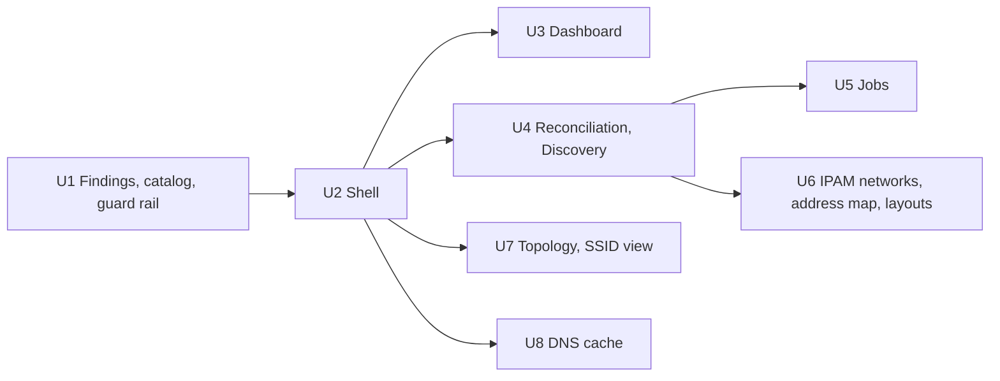

# UI plan: exceptions first, one findings model, readable names

- Status: Accepted on 2026-10-26: the owner accepted the lead's decisions UI-Q1 to UI-Q11 of section 11 the day the design proposal came in. The plan binds and changes only through rule 2.8 of the execution plan. It changes the web UI, a read model and two small APIs; it removes no data and no function.
- Date: 2026-10-26
- Scope: the owner's design proposal of 2026-10-26 ("what I saw" on six views of a moderate home network: dashboard, IPAM networks, topology, reconciliation, jobs, DNS cache), turned into work packages U1 to U8, and the edits it implies for `design/` (README, tokens, mockups), `docs/SECURITY-PROFILES.md` and the status documents. Written against `main` at `fd3a08f4`. Requirement IDs refer to [REQUIREMENTS.md](../REQUIREMENTS.md), toggles (TGL) to [SECURITY-PROFILES.md](../SECURITY-PROFILES.md). Addresses in this plan are documentation addresses (RFC 5737, RFC 3849, RFC 7042) and the names are placeholders.

The proposal found that nothing in the UI is missing; the weight is wrong. Healthy and broken things get the same weight, the same sentence is printed 23 times, codes stand where words should, and numbers come without a window or a scale. This plan keeps the bones (dense 28 px grids, Ctrl+K, jobs with preview and undo, the 12-item rail, the status bar) and adds three things on top: one findings model that every surface reads, exceptions first in every view, and a small set of shared components. The plan has the form of [ha-plan.md](ha-plan.md): scope, the shared design, work packages with acceptance, the owner's decisions, the documents touched, risks.

Contents:

1. [Scope and principles](#1-scope-and-principles)
2. [The findings model](#2-the-findings-model)
3. [The shell](#3-the-shell)
4. [Components](#4-components)
5. [Views](#5-views)
6. [Profiles](#6-profiles)
7. [Work packages](#7-work-packages)
8. [Order, parallelism and merging](#8-order-parallelism-and-merging)
9. [What each page answers in five seconds](#9-what-each-page-answers-in-five-seconds)
10. [Budget](#10-budget)
11. [Owner decisions](#11-owner-decisions)
12. [Requirement rows and documents touched](#12-requirement-rows-and-documents-touched)
13. [Risks](#13-risks)

## 1. Scope and principles

### 1.1 What was seen

The same seven problems repeat across the six views. Each is about weight and wording, none is a missing feature.

| Problem | Evidence | Why it hurts |
|---|---|---|
| Everything has equal weight | Dashboard: 24 cards of one size; Host CPU, Host memory, Commit p99, Encrypted connections and Fullest pool are empty | The one conflict is a grey line under a purple 6; the eye has nowhere to land |
| Color points at healthy things | Reconciliation: every "Intent wins" row has a full green column, the one real conflict has none | Inverts the guide's own rule 6: the calm state is the loudest |
| Repetition instead of aggregation | 23 times "Intent wins: the host is managed..."; 200 times "Done" with the same starter; "Insecure" on every DNS cache row; "Active" on every prefix | Reading cost grows with the network, not with the problems |
| Codes as UI text | Job titles `ipam.job.edit`; recent changes `ipam.reconcile.run`; HTTPS records shown as JSON | Fine for the author, opaque for a second administrator or an auditor |
| Numbers without context | "154 of 1.8e19"; "1,037 min"; sparklines with no scale or window | A number nobody can judge is noise |
| Duplicated panes | IPAM: the tree and the table list the same 21 prefixes | Half the screen tells nothing new |
| Inconsistent density | IPAM 28 px rows, Jobs about 32 px, reconciliation about 75 px | The same data costs a different number of screens per view |

Two data points say the findings logic needs guard rails as much as the UI does. The only conflict on the sample network is on `192.0.2.0`, the network address of `192.0.2.0/24`, between two MACs of the documentation range `00:00:5e:00:53:xx`; a network address is never a device's address (UI-Q11). And the number of open proposals read 6 on the dashboard and 5 elsewhere (section 2.5).

### 1.2 The ten principles

Five of the six principles in `design/README.md` stay (one sharpened), and five are added. The README carries the final text.

1. **Exceptions first, everything reachable.** The umbrella. Every view has three layers in this order: what needs a person, a summary in counts, the full detail. Healthy state is never hidden, only collapsed.
2. **Speed and density first.** Kept, made uniform: 28 px rows in every list, reconciliation included. A cell that needs more lines expands on demand in the side panel; it never makes every row tall.
3. **Anything in three clicks or one keystroke.** Kept. A convenience, not a goal in itself.
4. **Keyboard first, mouse equal.** Kept.
5. **Nothing happens silently.** Kept.
6. **Color is for exceptions.** Sharpened. Agreeing, managed and done states never get a colored fill or wash. Green appears only as a small glyph beside a word. A colored fill means a person should look.
7. **Aggregate before you repeat.** New. When most rows share a value, say it once, in a group row, a column header or a count chip. Only the rows that differ carry a badge.
8. **Words before codes.** New. Every job kind, event and record type has a sentence-case label. The code stays available, in the data font and secondary.
9. **Explain once, on demand.** New. A view's explanation lives behind an info button beside its title, not in a paragraph above the data. An explanation repeated per row moves to the group header.
10. **Empty is a state, not a card.** New. A metric with no source is not drawn; it is listed in one "Hidden" line. A feature that is not set up shows one sentence and one action.

Numbers keep the SI rule and gain two: durations read as people say them (17 h 17 min), and every chart names its window and its scale.

### 1.3 What does not change

The data model, the API of every existing route (new routes are additive), the keyboard map, the jobs engine, the security profiles' toggles (one row is added, section 6), the embedded font, the mark, the icon sprite and the budget rule of section 10. No library, font or icon set from outside is added. The order of the 12 rail items equals the proposal's order already (`ui/src/shell/areas.ts`); only the separators, the badges and the status bar counts are new.

### 1.4 Requirements this plan serves

| Requirement | What the plan delivers | Phase |
|---|---|---|
| IPAM-21 Unified reconciliation view | The evidence view per network, the findings list as the one entry point (UI-Q2), groups and the 28 px row | 3 |
| IPAM-23 IP conflict detection | The guard rail against network and broadcast addresses (UI-Q11) | 3 |
| IPAM-15 Proposals, never intent | Discovery as the findings list for every kind; the ghost lifecycle with Decommission as its action (UI-Q8) | 1 |
| IPAM-20 Topology map | The root rule, the SSID view, inferred links, "Not placed" (U7) | 1 |
| OPS-20 Built-in dashboard | Five blocks in reading order, the Hidden line, profile sets (U3) | 1 |
| API-08 UI: keyboard-driven grids, live updates, WCAG | One density, text on colored fills at 4.5:1, the saved layout (U6) | 1 |
| API-21 Language packs | The label catalog in the XLIFF units of `en` and `sv` (UI-Q5) | 1 |
| IAM-02 Request and approval workflows | The TGL row for a second person's approval (UI-Q9); the workflow itself is Slice 13 and Phase 5 | 5 |

### 1.5 Starting point in the code

Checked on 2026-10-26.

- The rail (`ui/src/shell/areas.ts`) has the 12 items in the proposal's order. The status bar (`ui/src/shell/StatusBar.tsx`) shows connection, last event, running and waiting jobs and the version.
- Grid state: widths in `localStorage` per user and list (`ui/src/grid/widths.ts`), order and hidden columns per browser (`ui/src/grid/prefs.ts`), sort not stored. No per-user preference API exists on the server.
- The open-proposal count is computed twice, by the dashboard tile (`ui/src/dashboard/OperationsTiles.tsx`) and by `ProposalsView.tsx`: the same query, two live subscriptions. No code cause for a different count was found; a missed live event is the plausible one (section 2.5).
- Job titles fall back to the raw kind: `jobTitle` in `ui/src/jobs/words.ts` is `tDynamic(key) ?? key`, and only seven `jobs.title.*` keys exist. Audit actions print the code (`ui/src/dashboard/Dashboard.tsx`, `ui/src/audit/columns.tsx`).
- Reconcile (`ui/src/ipam/reconcile/`) has five sections with a blurb each, auto-height rows, the rule sentence per row in the Winner cell and no side panel. Discovery has `ProposalPanel.tsx`.
- Findings sources today: proposals (`ipam.proposals`, 8 kinds, severity info, warning or critical), utilization alarms (`ipam.alarms`, with a level), reconcile rows (derived on read, no severity), jobs waiting for a person (`jobs.by_state`, no severity) and health rows (`StatusWarning`, severity by code).

## 2. The findings model

### 2.1 What a finding is

A finding is anything Tenko noticed that a person may need to decide on. Today the same idea lives in five places under different names. One model gives each of them a kind, a severity, a subject, the evidence and the suggested action.

```
Finding {
  id            stable: hash of (kind, subject key); the same condition keeps its id
  kind          one of the codes of section 2.2
  severity      act | review | info
  area          ipam | dns | dhcp | discovery | topology | jobs | audit | connectors | nodes | cluster | settings
  subject       { type: address | host | prefix | record | job | ssid | node | connector | setting, id, label }
  scope         tenant, VRF, prefix (for filters and counts per network)
  evidence      a short list of facts: source, value, last seen
  actions       the default action first, then the others, each naming the route it calls
  first_seen, last_seen
}
```

**The index is a derived read model.** It is computed from the sources of section 2.4 and stored nowhere (UI-Q1): no new stored object type, nothing to migrate, nothing that can disagree with its sources after a restore. The reconciler is the only writer of the facts the findings are derived from; the job engine is the only writer for jobs that wait. Surfaces only read.

### 2.2 Kinds, severities, glyphs and default actions

| Kind | Severity | Glyph and color | Default action |
|---|---|---|---|
| Conflict (two devices on one address) | Act now | Octagon, `--conflict` | Resolve: pick the winner |
| Job waits for a person | Act now | Dashed ring, `--accent` | Open the job's manual step |
| Utilization over the alarm | Act now | Triangle, `--status-warning` | Open the prefix |
| Unknown device | Review | Dashed plus, `--proposal` | Adopt or ignore |
| Orphaned record | Review | Dashed plus, `--proposal` | Adopt or delete |
| PTR mismatch | Review | Exclamation, `--discrepancy` | Fix PTR or forward |
| Intent and observation differ | Review | Exclamation, `--discrepancy` | Open the host |
| Ghost address, intent wins | Info, then Review (UI-Q8) | Ring, `--ink-3` | None while Info; Decommission once Review |

Components ask for a severity, not for a domain color: `--severity-act`, `--severity-review` and `--severity-info` in `design/tokens.css` point at the colors above. The glyph keeps its domain color; the severity decides where the finding is drawn and counted.

Health findings join the same index so that the rail, the status bar and the dashboard have one source:

| Kind | Severity | Default action |
|---|---|---|
| Low disk or store size over its limit | Act now | Open Nodes |
| A connector or node is unhealthy (`StatusWarning`, severity by its code) | Act now or Review by code | Open the connector or node |
| A setting is weaker than the profile allows (section 6) | Review; Act now under Hardened | Open the setting |
| Topology root sources disagree (UI-Q10) | Review | "Use this", remembered |
| An IoT-classed device on a non-IoT WLAN; an address outside the SSID's VLAN prefix (U7) | Review | Move, or "Keep on this WLAN" |

### 2.3 Three rules that keep the model honest

1. **Only act-now findings color the dashboard, the rail and the status bar.** Review findings are counted in muted ink; they are listed where they live.
2. **Info findings are listed where they live but never counted as problems.** The status bar shows them as a plain count link without color and outside the totals.
3. **Network and broadcast addresses are never the subject of a conflict** (UI-Q11). The guard rail sits in the reconciler's conflict rule, not in the UI, so a count can never differ from the list. The first prefix address of an IPv4 network of /30 or larger is the network address and the last is the broadcast address; /31 (RFC 3021) and /32 have neither; IPv6 has no broadcast and the subnet-router anycast address is not a conflict subject either.

### 2.4 Sources and how they map

| Source | Today | Becomes |
|---|---|---|
| Proposals (`ipam.proposals`, 8 kinds) | Severity info, warning, critical | Unknown device, orphaned record, intent and observation differ, and the other proposal kinds, each mapped to a kind of section 2.2 by a table in code with a test that every proposal kind has a row |
| Utilization alarms (`ipam.alarms`) | A level | Utilization over the alarm; a level above normal (warning or critical) is Act now, and the level stays in the evidence |
| Reconcile rows (derived on read) | No severity | Conflict, PTR mismatch, ghost; the rule id stays in the evidence |
| Jobs waiting for a person (`jobs.by_state`) | No severity | Job waits for a person; the manual step is the action |
| Health rows (`StatusWarning`) | Severity by code | The health findings above; the code and its parameters stay in the evidence |

### 2.5 One topic, one count

The index has one live topic, `findings`, on the event stream (API-05). An event carries the index revision, a monotonic counter of the derivation; the UI detects a gap or a reconnect and refetches `GET /api/v1/findings/counts` before it draws a count. Every surface (dashboard strip, rail badge, status bar, Discovery, Reconcile) reads the counts from one client store fed by that topic, so two subscriptions on one query cannot exist. The proposal's "6 on the dashboard, 5 elsewhere" has no cause in the code that computes the count twice identically; the plausible one is a live event missed by one of two subscriptions. The single store plus the revision gap check removes it; a UI test asserts that the dashboard, the rail and the list show one number after an out-of-order event.

### 2.6 The API

- `GET /api/v1/findings` lists findings with `severity`, `kind`, `area`, `subject_type`, `prefix` and `q` filters and the usual paging (API-04 conventions).
- `GET /api/v1/findings/counts` returns the revision and the counts per severity, per area and per area and severity. This is what the rail, the status bar and the dashboard read.
- Every finding names its default action as a route and a verb; the UI does not infer actions from kinds.
- Reading needs the permission that reads the underlying objects; a person who may not read a prefix does not see its findings and is not counted (the counts are computed per principal, from the same filter as the list).

## 3. The shell

The shell keeps its parts and gains one job: telling you where the findings are, from any page.

**Rail, 12 items in three groups.** The order stays; a hairline separates the groups so that 12 items scan as three short lists.

| Group | Items | Badge |
|---|---|---|
| Operate | Dashboard, IPAM, DNS, DHCP, Discovery, Topology | The count of findings for that area, colored by the worst severity (IPAM: a red 1 for the conflict) |
| Work | Jobs, Audit | Jobs: the count of jobs waiting for you |
| System | Connectors, Nodes, Cluster | A dot when a connector or node is unhealthy |
| (bottom) | Settings | A dot when a setting is weaker than the profile allows |

**Top bar.** Mark, command field, node status, profile, theme, help and account all stay. The node chip becomes cluster-aware ("Leader · 1 node"; "Follower · 3 nodes, 1 behind") and opens a short cluster card. The profile chip opens what the profile changes (section 6).

**Page header, one pattern for every view.** Title (18 px) with an info button for the explanation, one subtitle line of facts (counts, scope, freshness), primary actions on the right, sub-navigation tabs under it. The DNS cache's four-line paragraph and the reconciliation section blurbs move behind the info button.

**Filter bar, one pattern for every list.** The Jobs filter bar is already right: query field, exception chips with counts, density, columns. Reconciliation, the DNS cache, IPAM addresses and Audit use the same bar, with the chips that list's findings need.

**Status bar.** Live, last event, running and waiting jobs and the version stay. Open findings show as one count per severity, and each count is a link to the filtered findings list.

## 4. Components

Built from what the pages already use; three are new and small. None needs a library, a font or an icon set.

| Component | Built from | Cost |
|---|---|---|
| Data grid (every list) | The existing virtualized grid | Reuse; adds group rows, majority-in-header and the saved layout per user (U6) |
| Finding (row, chip, strip) | Notice and grid cell | New, small: one glyph, one word, one action |
| Metric block | CSS and existing text styles | New, small |
| Empty state, "All clear", the Hidden line, attention strip | Notice | Reuse as variants |
| Group row | Grid | Reuse the range group row of the IPAM grid |
| Info button | Dialog or popover | Reuse |
| Conflict evidence and choices | Side panel | Reuse (`ProposalPanel.tsx`) instead of a row that expands in place |
| Column chooser | Dialog or popover | Reuse |
| Network detail, host detail | Object page with tabs | Reuse |
| Address map | One CSS grid, no chart library | New |

**Finding.** The row, the chip and the strip all draw the glyph of the kind, one word and the default action. The chip carries a count; the strip is the dashboard's needs-attention strip.

**Metric block.** Label (12 px, `--ink-3`), value (24 px, SI), unit, one line of context. A sparkline only when it has a window, and then with its scale. A metric whose source is missing is not drawn; it joins the view's single "Hidden" line with the reason.

**Panel.** Hairline border, 8 px radius, title 14/600, a status as glyph plus word, one link on the right. No panel is ever empty: it holds data, an empty state, or it is not drawn.

**Tables.** 28 px rows in every list. Group rows with counts ("Intent wins · 23", "Today · 4 jobs") collapse runs of similar rows. A badge appears only where a row differs from its column's majority; the majority is said once in the column header ("State · all insecure"). Identifiers render in ink, not in the accent; a link shows itself on hover and focus. Every column in every table can be resized by dragging its header edge (double-click fits it to its content), reordered by dragging, and shown or hidden from the column chooser. The layout of each table (columns, order, widths and sort) is saved per user on the server (UI-Q4), so it follows the person across sessions, browsers and devices; "Reset columns" in the chooser returns to the default. A narrow window never drops a chosen column: the table scrolls sideways with the first column pinned.

**Empty state.** One sentence of what is missing, one action to fix it, on a `--surface-2` fill. Not dashed, because dashed means "not yet intent" (proposals); chrome that exists only in a mockup carries a "Mockup" label instead.

**Address map.** One cell per address, colored only where a finding sits, with free runs visible at a glance. The last octet is shown in each cell in the cell's `-on` token: text on a colored fill uses the paired token and reaches 4.5:1, because the digits are 11 px; on free cells the digits are `--ink-3`. Drawn for prefixes of up to 1,024 addresses (a /22 and smaller); a larger prefix shows a block map with one cell per /24 (UI-Q3). The address grid of today follows below.

**Color on fills.** Text on a colored fill (map cells, badges, counters) never defaults to white or black: it is a dark shade of the fill's own hue on light fills and a light shade on dark fills, at least 4.5:1 against the fill (3:1 only at 24 px and up). Each fill token that can carry text has a paired `-on` token that is checked once (`--conflict-on`, `--mode-static-on` and so on in `design/tokens.css`), so no component picks a text color by eye. `--ok-wash` and `--job-done-wash` are for chips only; no row or column is filled with them.

**Accent.** Identifiers in grids (prefixes, addresses) render in `--ink`. The accent is for selection, focus, the primary action, running work and link hover.

### 4.1 Labels for codes (the label catalog)

A label maps every job kind and audit event to a sentence-case template with its object; the code stays one column or line below it, in the data font. The catalog lives in the i18n files (UI-Q5): keys in `ui/i18n/en.d/*.xlf` and `ui/i18n/sv.d/*.xlf`, with `tDynamic(key) ?? code` as the hook, so a code without a label still shows the code and nothing breaks. There is no separate catalog format, no second lookup, no server-side label.

| Code | Example label |
|---|---|
| `ipam.job.edit` | Edit host controller-1 (3 objects) |
| `dhcp.job.edit` | Edit DHCP scope 192.0.2.0/24 |
| `scan.job.run` | Scan host-192-0-2-11 |
| `ipam.reconcile.run` | Reconcile IPAM |
| `ipam.observation.ingest` | Ingest observations (UniFi) |
| `connect.secret.inject` | Pass credentials to a connector |

Template rules: the label is a verb phrase in sentence case, with no trailing period; the object comes from the job's or event's parameters (name, address, count) through ICU-style placeholders, never by string concatenation in code; a count of objects reads "(3 objects)" through a plural unit; a name that can be long is truncated by the cell, not by the template; a label never contains a secret, a token or a credential value; the code is never part of the label. Record data gets the same treatment: an HTTPS or SVCB record reads `alpn=h2,h3 ipv4hint=192.0.2.10`, not JSON keys.

## 5. Views

Each view says what changes and what stays where; nothing that is listed today disappears.

### 5.1 Dashboard

From 24 equal cards to five blocks in reading order: a needs-attention strip (act-now findings, or one "All clear" line), a health row of six metric blocks, service panels for DNS and DHCP, the fullest prefixes per tenant and VRF beside recent changes, and one "Hidden" line.

- Active alarms and Waiting for a person fold into the attention strip; when empty they are one line, not two empty cards.
- Controller metrics (commit p99, replication lag, node buffers, event-stream clients) move to Cluster and come back on the dashboard when there is more than one node.
- Host CPU and memory appear when they are read; until then they are named in the Hidden line with the reason.
- DHCP shows an empty state ("No scope has a pool yet" and Create a scope) instead of eight zero metrics; the metrics take over once a pool exists.
- Free disk and store size sit in the page subtitle; low disk becomes an act-now finding.
- Recent changes groups repeats (×2) and has a "System activity" switch, so an administrator can see only what people changed. Entries read through the label catalog.

### 5.2 IPAM networks

The tree finds the level, the table scans the networks. The tree shows supernets and top-level networks, always, with a child count; children are collapsible and never unfolded automatically (UI-Q7), so with 150 subnets it stays short. The right pane shows what is selected: a supernet's networks as a sortable, filterable table, or one network's detail.

- Header: prefix, description, VLAN, site, tenant and VRF, one utilization meter with the alarm line.
- The address map of the prefix (section 4), with the address grid of today below it.
- DHCP scopes and wireless networks (SSIDs) inside the prefix, and its recent changes.
- With a supernet selected, the pane shows its children as today's table, sorted by utilization, with "Active" said once in the header instead of on every row. Description, role, VLAN and utilization stay as columns by default, because they are what people look prefixes up by. "No VLAN" and "No description" are filter chips.

### 5.3 Discovery and Reconciliation

Discovery becomes the findings list for every kind; the IPAM Reconcile tab becomes the per-network evidence view (UI-Q2). One entry point answers "what needs my decision?"; the evidence view answers "what is wrong in this network?".

- Sections become groups in one 28 px table, ordered by severity: Conflicts, then Review (unknown devices, orphaned records, PTR mismatches, intent and observation differ), then Info (ghost addresses where intent wins). The one conflict leads; the 23 ghost addresses are one collapsed group.
- The sentence that repeats on every row today ("Intent wins: the host is managed, so what intent says stands") is said once, on the group row.
- The green Wins column goes; the winning source is a small check glyph in its column.
- Selecting a finding opens the side panel (the existing `ProposalPanel`, extended) with the evidence (both MACs, OS guess, inventory id, last seen) and the choices as buttons.
- Each finding row carries its action button; the filter bar has one chip per kind with its count.

### 5.4 Jobs

Default filter Active and Needs you; finished jobs are grouped by day and collapsed ("Yesterday · n done").

- Titles come from the label catalog; Kind keeps the code.
- Started by is hidden when every job has the same starter, and comes back as soon as there are two people.
- Current step shows only for running and waiting jobs; Done rows show the duration instead.
- With nothing active or waiting, the default view is one calm line and a link to the day groups.

### 5.5 Topology

First look: which SSID carries which VLAN, and how many clients sit on each. Infrastructure first, endpoints as counts per SSID and port, uncertain links marked.

- **The root** is the gateway or router, read from the connector or the default route; today an access point can sit on top and a server is drawn as the uplink of a switch. The sources are ranked (UI-Q10): the controller's gateway when the controller manages the gateway, else the node's default route. When they disagree the topology raises a Review finding, "Topology root: sources disagree", with the action "Use this"; the choice is remembered, the same pattern as the name authority ([reconciliation.md](../reconciliation.md) section 4.11).
- The default filter shows routers, switches, access points and hypervisors; endpoints collapse into counts on their port or SSID.
- Links inferred from MAC tables, not from LLDP or the controller, draw dashed with a question mark.
- Hashed names (`host-00005e005301`) get vendor and address as a second line; unplaced devices gather in a labeled "Not placed" group, which also surfaces duplicates.
- **The SSID view.** SSID, then VLAN, then clients; the access point and the band are attributes of the client, not levels of the tree. Two reconciler rules read it: "IoT-classed device on a non-IoT WLAN" and "address not in the SSID's VLAN prefix". Each raises a Review finding whose actions are to move the client or "Keep on this WLAN"; that exception is remembered per host and per SSID. A per-SSID policy, track or ignore, decides whether an SSID is read by the rules at all (a guest SSID can be ignored). Clients are read from the controller only (CONN-05); the rules never write to it (CONN-08, CONN-09).

### 5.6 DNS cache

Already a strong view; three fixes. HTTPS and SVCB data render as SvcParams, not JSON. When every row shares a state (Insecure), it is said once in the column header and the badges go; Stale stays a per-row badge because it varies. The four-line explanation moves behind the info button next to the title.

## 6. Profiles

Profiles change defaults and guard rails, never the layout: every profile has the same menus, views and places for things, so documentation, screenshots and support stay the same.

| | Lab | Home | Standard | Hardened |
|---|---|---|---|---|
| Banner | Hatched, cannot be dismissed | None | None | None |
| Default density | Compact | Compact | Compact | Compact |
| Dashboard | Home set + controller metrics | Attention, health, DNS, DHCP, prefixes, changes | Home set + connectors, jobs, cluster when more than one node | Standard set + security events and audit summary |
| Changes | Small edits inline with undo, the rest as a job with preview | Small edits inline with undo, the rest as a job with preview | Small edits inline with undo, the rest as a job with preview | Small edits inline with undo, the rest as a job with preview, and a second person's approval (new, TGL-38) |
| Recent changes | All activity | All activity | People only by default | People only, with who approved |
| Topology | Editable | Editable | Editable | Read-only by default |
| Act-now findings | Conflicts, alarms | Conflicts, alarms | + jobs waiting for a person | + any setting weaker than the profile |

Every default can be changed per user except the guard rails (approval, the Lab banner, read-only topology in Hardened), which only an administrator can lift and which then show as a weakened-setting finding.

- **TGL-38** is the second person's approval under Hardened: on by default in Hardened, off elsewhere (`docs/SECURITY-PROFILES.md`). It is built in Slice 13 with the directory identity, because a second person needs a second identity (UI-Q9). Until then a Hardened change is a job with preview and no approval step.
- **Read-only topology in Hardened** is the UI face of TGL-20 (UniFi write access is off in Hardened); U7 checks that the map offers no write action while TGL-20 is off and adds no toggle of its own.
- **"Every change as a job with preview"** in Standard and Hardened stood in the proposal's text and was struck by the owner on 2026-10-26: every change already runs as an audited job, and a preview is required where it adds something (moves, L2 changes), so every profile keeps the small inline edit with undo of `design/README.md` (interaction rules). It is not planned; it may become a feature if someone asks for it.
- **Dashboard sets and recent-changes defaults** are per-user preference defaults chosen by the profile, not security toggles.
- **Weakened settings** are findings (kind "A setting is weaker than the profile allows", section 2.2), Review in Home and Standard, Act now in Hardened. In Lab the banner already says so and the finding is not raised. The Settings rail dot is the count of these findings.

## 7. Work packages

Sizes are builder-days. A package owns the files it lists; contract requests come to the lead.

### U1 Findings index, label catalog, guard rail (8 builder-days)

- **Depends on:** nothing. Backend, API and data files only; no component.
- **Requirements:** IPAM-21, IPAM-23, IPAM-15, API-05, API-21.
- **Owns:** `crates/tenko-ipam/src/findings/` (the model, the derivation from the sources of section 2.4, the kind table with its test that every proposal kind, alarm level and health code maps to a kind); `crates/tenko-api` route `findings` and its DTOs, the `findings` topic with the index revision (section 2.5), the per-principal counts; the guard rail in the conflict rule of `crates/tenko-ipam/src/reconcile/` (UI-Q11) with property tests over /24, /30, /31, /32 and IPv6; the ghost age setting (default 30 days) and the Info-to-Review rule (UI-Q8); the label catalog's keys and strings in `ui/i18n/en.d` and `ui/i18n/sv.d` for every job kind and audit action, the parameters the labels need on the job and audit DTOs, and a check that fails when a code in the job kind and audit action registries has no key in `en` or `sv`; the `tDynamic(key) ?? code` hook kept as is; `docs/reconciliation.md` and `docs/api` text; CHANGELOG.
- **Acceptance:** `GET /findings/counts` equals the sum of its sources in a test with concurrent writes; the revision lets a client that missed an event detect the gap; the 192.0.2.0 case yields no conflict and a conflict between two hosts on `192.0.2.10` still does; a ghost older than the setting turns Review with Decommission as its action (ties to the host lifecycle of `2d14afc9`); the label check passes; OpenAPI regenerated; the UI type generation and the i18n check pass.
- **Size:** 8.

### U2 Shell (5 builder-days)

- **Depends on:** U1.
- **Requirements:** API-08, OPS-20.
- **Owns:** `ui/src/shell/` (rail groups, separators and badges; status bar counts per severity linking to the filtered list; the cluster-aware node chip and its card; the profile chip's panel), the page header component with the info button and the subtitle line, the filter bar pattern, the one client store for the `findings` topic, the Finding chip and strip; `design/mockups/shell-and-ipam.html` updated; Playwright for the badges.
- **Acceptance:** the rail shows three groups and the badge of each area from the counts; the status bar counts equal the list; the dashboard, the rail and the status bar show one number after an out-of-order event (section 2.5); first load within the budget of section 10; keyboard chords unchanged.
- **Size:** 5.
- **Status:** Built, awaiting gate (branch `ui-shell`). It holds: the rail in three groups with hairlines and Settings at the bottom, a badge per Operate area and Jobs from `GET /findings/counts` (act and review, in the fill of the worst severity with its `-on` text, hidden at zero, labelled with the count and the area), a dot on Connectors and Nodes for a finding to act on and on Settings while a setting is weaker than Home (the session's banner, not under Lab; the findings index maps no row for it) or a settings finding is to act on; the status bar's counts per severity, act and review linking to `/discovery?severity=act|review` (the inbox takes the finding severity as a URL filter; info is plain text until U4, because `severity=info` is already the proposal severity there); one client store for the counts (`ui/src/shell/findings.ts`, a reload on every event of the topic, on a reconnect and a reset, an older answer never replacing a newer one); the cluster-aware node chip with its card and the profile chip with what the profile sets; `PageHeader` (title, info button with a popover, subtitle of facts, actions, tabs) on Jobs, Audit, Discovery, Reconciliation and the DNS cache; `FilterBar` as one component (an optional query field, a submit mode, chips with counts) on Jobs, Reconciliation, the DNS cache, IPAM addresses and Audit; the Finding chip; the severity and two `-on` tokens in the product's tokens; the mock's counts and the shell mockup. The badges, the status item and their words load after the first page (first load 76.9 KB gzip).

### U3 Dashboard (5 builder-days)

- **Depends on:** U1, U2.
- **Requirements:** OPS-20, OPS-05.
- **Owns:** `ui/src/dashboard/` (the five blocks, the Metric block, the empty state, "All clear", the Hidden line, the profile sets of section 6, recent changes with grouping and the System activity switch); `design/mockups/dashboard.html` replaced by the dashboard of the owner's canvas with documentation addresses and placeholder names (UI-Q6).
- **Acceptance:** with a moderate network the page shows at most the five blocks and no empty card; a metric without a source appears only in the Hidden line with its reason; a conflict is the first thing on the page; recent changes read through the catalog and no raw code appears in the default view; UI tests and Playwright.
- **Size:** 5.

### U4 Reconciliation and Discovery (8 builder-days)

- **Depends on:** U1, U2.
- **Requirements:** IPAM-21, IPAM-15, IPAM-23.
- **Owns:** `ui/src/discovery/` (the findings list for every kind with one action per row), `ui/src/ipam/reconcile/` (the per-network evidence view, groups in one 28 px table, the side panel with the evidence, the check glyph instead of the Wins column), the group row in `ui/src/grid/` and the "majority in the header" rule; the reconciliation mockup with documentation addresses (UI-Q6).
- **Acceptance:** the 23 identical rows become one group with the sentence once; the conflict leads and its panel shows both MACs; every row is 28 px; no green fill or wash in the view; the count in the Discovery header equals the rail badge and the status bar; the existing proposal approval and rejection flows pass their tests unchanged.
- **Size:** 8.

### U5 Jobs (4 builder-days)

- **Depends on:** U1, U4 (the group row).
- **Requirements:** IPAM-17, API-09.
- **Owns:** `ui/src/jobs/` (default filter Active and Needs you, day groups, titles from the catalog, Started by hidden for one starter, current step only while running or waiting, duration on Done rows); the jobs mockup.
- **Acceptance:** 200 finished jobs by one person read as day groups with no repeated starter; a title never prints a raw code when the catalog has the key; the waiting count equals the rail badge; the row height is 28 px.
- **Size:** 4.

### U6 IPAM networks, address map and saved layouts (10 builder-days)

- **Depends on:** U1, U2, U4 (group rows).
- **Requirements:** IPAM-02, IPAM-10, API-08.
- **Owns:** `ui/src/ipam/` tree and detail pane (UI-Q7), the Address map component (UI-Q3), the supernet table; the per-user preferences API and the move of every table's layout behind it (UI-Q4): a replicated per-user table in `crates/tenko-store` and `crates/tenko-api`, `GET /api/v1/auth/preferences` (beside `/auth/session`, the person's own routes), `PUT` and `DELETE /api/v1/auth/preferences/{key}` with the key `table:<id>`; the value is a small versioned document (columns shown, order, widths, sort) validated against the table's known column ids, 16 KiB at most per key and a bounded number of keys per user, own data only, written with a debounce; `ui/src/grid/prefs.ts` and `widths.ts` keep their interface and change their store, import the browser's old values once, and fall back to the browser when the API is unreachable; the IPAM networks mockup.
- **Acceptance:** with 150 subnets the tree stays short and nothing unfolds by itself; a /24 draws 256 cells and a /22 draws 1,024; a /16 draws 256 block cells, one per /24; every digit on a cell reaches 4.5:1 in both themes (a test over the `-on` tokens); a column layout set in one browser appears in another after sign-in and "Reset columns" returns the default; one person cannot read or write another's preferences; the API is covered by route tests, the OpenAPI document is regenerated, and the privilege boundary holds (nothing runs outside the `tenko` account).
- **Size:** 10.

### U7 Topology and the SSID view (10 builder-days)

- **Depends on:** U1, U2.
- **Requirements:** IPAM-20, CONN-05, CONN-08.
- **Owns:** `ui/src/topology/` and `crates/tenko-ipam/src/topology/`: root detection from the ranked sources and the disagreement finding with "Use this" (UI-Q10) and its setting and audit record; the infrastructure-first default filter and endpoint counts; dashed inferred links; the "Not placed" group; the SSID view (SSID, VLAN, clients; access point and band as attributes); the two reconciler rules "IoT-classed device on a non-IoT WLAN" and "address not in the SSID's VLAN prefix" with the "Keep on this WLAN" exception per host and per SSID and the per-SSID track or ignore policy; `docs/topology.md` and `docs/reconciliation.md`.
- **Acceptance:** the root is the gateway when the controller manages it and the default route's next hop otherwise; a disagreement raises one finding and "Use this" is remembered across a restart; an inferred link is dashed with a question mark; an IoT-classed device on a non-IoT WLAN raises a finding that "Keep on this WLAN" removes for that host only; an ignored SSID raises none; Hardened shows no write action on the map while TGL-20 is off.
- **Size:** 10.

### U8 DNS cache (2 builder-days)

- **Depends on:** U2.
- **Requirements:** DNS-23.
- **Owns:** `ui/src/dns/` cache view: SvcParams rendering of HTTPS and SVCB data (alpn, ipv4hint, ipv6hint, port, ech and unknown keys as `keyNNNNN=` per RFC 9460), the state said once in the header, the info button.
- **Acceptance:** an HTTPS record reads `alpn=h2,h3 ipv4hint=192.0.2.10`; with every row Insecure the badges are gone and the header says so; a Stale row keeps its badge.
- **Size:** 2.

Total: 52 builder-days.

## 8. Order, parallelism and merging



U1 comes first, because every view change after it only displays what it produces. U3, U4, U7 and U8 can run in parallel after U2 when their files are disjoint; the one shared file is the grid (`ui/src/grid/`), owned by U4 for group rows and by U6 for the layout store, so U6 starts after U4 merges. U5 waits for U4's group row. The lead orders the queue; one owner per file. Each package keeps the first load within the budget (section 10), updates its mockup with documentation addresses, and regenerates `docs/api/openapi.json`, the UI types and the i18n files at the gate. Slice 13 (identity) and this plan touch `ui/src/shell/` and the settings pages; the lead orders them so that one builder holds the shell at a time.

## 9. What each page answers in five seconds

| Page | First thing you look for | What carries it |
|---|---|---|
| Dashboard | Is anything wrong, and what? | The needs-attention strip, or one "All clear" line |
| IPAM networks, supernet | Which network is filling up or missing data? | A table sorted or filtered by utilization, with "No VLAN" and "No description" chips |
| IPAM networks, one network | What is free, and what sits where? | The utilization block and the address map with octets |
| Reconciliation | What needs my decision? | The act-now group on top, its evidence open |
| Discovery | Which proposals, and what do I do with each? | One row per finding with its action button |
| Jobs | Is anything running or waiting for me? | The default filter Active and Needs you, or one calm line |
| Topology | Which SSID carries which VLAN, and its clients? | Access point labels with SSIDs, VLAN edge groups, client counts |
| DNS cache | What does this name resolve to, and is it fresh? | The tree plus the table, TTL left and Stale per row |

## 10. Budget

The first load is 75.8 KB gzip with a ceiling of +1 KB per merge. The plan stays inside it on purpose: icons come from the existing 16-unit sprite, JetBrains Mono is already embedded, charts are hand-drawn SVG, the address map is CSS. The largest new weight is the findings client code and the label strings; the catalog's strings load with the Jobs and Audit chunks, not with the first page. A package that would exceed the ceiling splits its code into a lazy chunk before it merges; none may raise the ceiling.

## 11. Owner decisions

The lead put eleven decisions to the owner, who accepted them on 2026-10-26. Where options stand against each other, the order of `CONTRIBUTING.md` decides (security, performance, usability, features) and each entry says where the chosen option stands. The four open questions of the proposal are UI-Q8 to UI-Q10 and the proposal count (answered under UI-Q1).

**UI-Q1. Where does the findings index live?**
- Options: (a) a derived read model over the existing sources with one live topic; (b) a stored `findings` table written by the reconciler; (c) each surface keeps its own query.
- Trade-offs: (a) cannot disagree with its sources, needs no migration or restore step and costs a derivation per read (cached by revision). (b) adds a stored object type that restores and cluster merges must keep consistent. (c) is today, and the reason the proposal count differed.
- **Decided (2026-10-26): (a). The index is a derived read model with one live topic; every surface reads it; no new stored object type.** This also answers the proposal count: no code cause for 6 against 5 was found, a missed live event is the plausible one, and one store with a revision removes it.

**UI-Q2. How many entry points for decisions?**
- Options: (a) Discovery is the findings list for every kind and the IPAM Reconcile tab is the per-network evidence view; (b) keep Discovery for proposals and Reconcile for the rest; (c) merge both into one page.
- Trade-offs: (a) gives one place to answer "what needs my decision?" and keeps the evidence next to the network (usability, features). (b) is today. (c) loses the per-network scope.
- **Decided (2026-10-26): (a), one entry point.**

**UI-Q3. How is the address map drawn?**
- Options: (a) up to 1,024 cells (a /22 and smaller), a block map with one cell per /24 above that; (b) always one cell per address; (c) always blocks.
- Trade-offs: (a) keeps the DOM small and the map readable (performance). (b) draws 65,536 cells for a /16. (c) loses the free runs.
- **Decided (2026-10-26): (a).**

**UI-Q4. Where is a table's layout saved?**
- Options: (a) per user on the server, through a small preferences table and endpoint; (b) in the browser as today; (c) per installation.
- Trade-offs: (a) follows the person across devices and costs a small authenticated route with a size cap (security: own data only, bounded, validated against known column ids). (b) is the status quo, per browser. (c) overrides personal choices.
- **Decided (2026-10-26): (a), not localStorage.**

**UI-Q5. Where does the label catalog live?**
- Options: (a) in the i18n files (`en` and `sv`) with `tDynamic(key) ?? code` as the hook; (b) a separate catalog served by the API; (c) labels computed on the server.
- Trade-offs: (a) reuses the language-pack path (API-21), costs nothing at runtime and lets a missing key degrade to the code. (b) and (c) add a format, a route and a second place for text.
- **Decided (2026-10-26): (a), no separate catalog.**

**UI-Q6. What do the mockups in the repository contain?**
- **Decided (2026-10-26): documentation addresses and placeholder names only.** The owner's canvas mockups are redrawn that way when they enter `design/mockups/` (U3 to U6).

**UI-Q7. How does the IPAM tree unfold?**
- **Decided (2026-10-26): supernets and top-level networks are always shown; children are collapsible and never unfolded automatically.**

**UI-Q8. Is a ghost address Info forever, or Review after a time?**
- Options: (a) Info, never counted; (b) Review at once; (c) Info until a configurable age, then Review.
- Trade-offs: (a) hides a stale claim forever; (b) is the wall the proposal complains about; (c) keeps the calm state calm and surfaces the claim that has outlived its use.
- **Decided (2026-10-26): (c). Info until a configurable age (default 30 days), then Review with Decommission as the action,** tied to the host lifecycle of `2d14afc9`.

**UI-Q9. Is a second person's approval under Hardened wanted?**
- Options: (a) yes, a TGL row, on in Hardened; (b) a job with preview is enough.
- Trade-offs: (a) is the stronger control and needs a second identity, which Slice 13 delivers (security). (b) is what exists.
- **Decided (2026-10-26): (a). A TGL row in `docs/SECURITY-PROFILES.md` (TGL-38, Hardened on by default), built in Slice 13 with the directory identity; until then a job with preview.**

**UI-Q10. Which source names the topology root when sources disagree?**
- **Decided (2026-10-26): a ranked list of sources: the controller's gateway when the controller manages the gateway, else the node's default route. A disagreement is a Review finding with "Use this", which is remembered, the same pattern as the name authority of `a1bdf27a`.**

**UI-Q11. Can a network or broadcast address be the subject of a conflict?**
- **Decided (2026-10-26): never.** The guard rail sits in the reconciler (U1).

## 12. Requirement rows and documents touched

No new requirement IDs; one new toggle.

| Row or file | Change |
|---|---|
| `design/README.md` | The six principles become the ten; decisions 17 to 20; the shell section (groups, badges, status bar counts); dashed borders resolved; the accent rule; the paired `-on` tokens; the component inventory; the number rules; the label catalog section |
| `design/tokens.css` | The severity roles and the `-on` tokens; no existing value changes |
| `design/mockups/` | The dashboard, reconciliation, jobs and IPAM networks mockups with documentation addresses (U3 to U6); `shell-and-ipam.html` with the rail groups (U2); the topology mockup gains the SSID view (U7) |
| `docs/SECURITY-PROFILES.md` | TGL-38 (second person's approval) and a note on the weakened-setting finding |
| `docs/ROADMAP.md` | One row pointing at this plan |
| `docs/plans/phase-3-status.md` | A sentence in "Plan and decisions"; the packages get a status table when the first one starts |
| `docs/reconciliation.md`, `docs/topology.md`, `docs/api` | U1 and U7: the guard rail, the findings API, the root rule, the WLAN rules |
| `CHANGELOG.md` | Nothing for this plan (it is a plan, not a product change); each package writes its own entry under `## [Unreleased]` with requirement IDs |

## 13. Risks

| # | Risk | Proposed resolution |
|---|---|---|
| UI-R1 | The derived index is slow on a large network, so a count costs a full derivation per read | The index is cached by its revision and recomputed on the sources' change events; the counts route reads the cache; U1 measures it on the 150-subnet fixture and on a 10,000-address one |
| UI-R2 | A kind or severity mapping drifts when a new proposal kind or health code is added | The test of U1 that every source value has a row fails the build; the label check does the same for job kinds and audit actions |
| UI-R3 | The per-principal counts leak the existence of objects the person may not read | Counts use the filter of the list; a test with a scoped role asserts equality of the count and the visible list |
| UI-R4 | The preferences API becomes a place to store large or unvalidated data | A key pattern, a size cap, a cap on the number of keys, validation against the known column ids, own data only; unknown keys are refused |
| UI-R5 | Group rows and the saved layout both touch the grid, which every list uses | U4 owns group rows, U6 owns the store, in that order; the grid's existing tests run unchanged in both |
| UI-R6 | The `-on` tokens are chosen once and a later theme change breaks 4.5:1 | A test computes the ratio of every `-on` token against its fill in both themes; it fails the build |
| UI-R7 | Hiding what is healthy hides a problem that has no finding | Nothing is removed: groups collapse, the Hidden line names every omitted metric with its reason, and the full detail is one click away; U3 and U4 acceptance check reachability of every old column |
| UI-R8 | The WLAN rules misclassify a device and flood Review | The "Keep on this WLAN" exception per host and per SSID, the per-SSID ignore policy, and the classification read from the host's class and the network's role only; U7 runs the rules against the sample network first |
| UI-R9 | The profile table promised behaviour that has no toggle (every change as a job with preview, section 6) | Closed on 2026-10-26: struck by the owner; every profile keeps the inline edit with undo |
